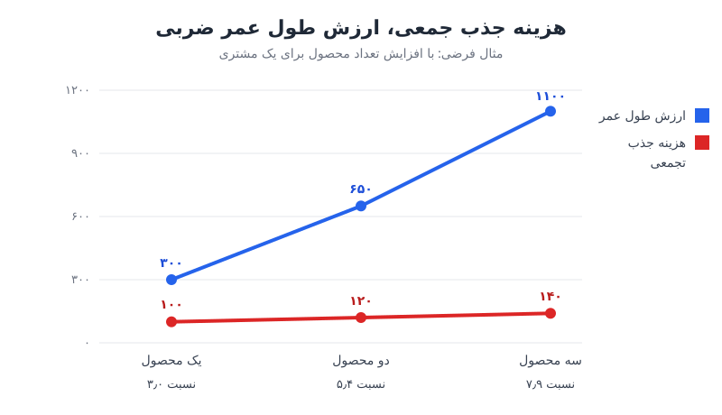

نسبت LTV به CAC، یعنی ارزش طول عمر مشتری در برابر هزینه‌ی جذب او، در شرکتی که چند خط کسب‌وکار دارد معنای تازه‌ای پیدا می‌کند. اگر مشتری را یک بار جذب کنید و بعد چند محصول به او بفروشید، هزینه‌ی جذب تقریباً جمعی و خطی می‌ماند اما ارزش مشتری ضربی رشد می‌کند. این نوشته منطق این الگو و پیش‌نیازهایش را مرور می‌کند.

نمونه‌ی واقعی خوبی برای این بحث، شرکت Fanatics است؛ کسب‌وکاری در حوزه‌ی ورزش با سه خط جدا: فروش پوشاک و کالای هواداری، کالای کلکسیونی مثل کارت‌های ورزشی، و شرط‌بندی ورزشی. این شرکت برخلاف شرکت‌های نرم‌افزاری موجودی واقعی، تولید و هزینه‌ی ارسال دارد و همین آن را برای دیدن ارتباط شاخص‌های عملیاتی با عدد نهایی مناسب می‌کند.

## جریان نقد آزاد مقصد است، نه نقشه‌ی راه

وقتی از شاخص‌ها در بیرون شرکت حرف می‌زنیم، بیشتر وقت صرف **شاخص‌های خروجی** می‌شود: درآمد، EBITDA و جریان نقد آزاد (FCF). این‌ها مهم‌اند و از دید مدیر مالی، جریان نقد آزاد از همه مهم‌تر است، چون نقد دروغ نمی‌گوید. چرا این عدد از سود قابل‌اتکاتر است در [جریان نقدی آزاد در برابر سود خالص](/posts/2022/05/02/free-cash-flow-vs-net-income/) آمده است.

مشکل این است که وقتی این عددها در صورت سود و زیان ظاهر می‌شوند، تصمیم‌هایی که آن‌ها را ساخته ماه‌ها یا سال‌ها پیش گرفته شده‌اند. پس مدیر مالی باید «صد چیزی را که پیش از نقد می‌آید» پایش کند. این شاخص‌های پیشرو را می‌توان در دو گروه دید:

| گروه | شاخص | چه چیزی را نشان می‌دهد |
|---|---|---|
| تجاری | تعداد کاربران | اندازه‌ی پایگاه مشتری و داده |
| تجاری | تعداد کاربران جدید | ظرفیت رشد؛ چون سهم کیف پول هر مشتری سقف دارد |
| تجاری | تعداد تراکنش | پیش‌نشانگر درآمد آینده |
| تجاری | میانگین ارزش سفارش | حرکت مشتری به سمت کالای گران‌تر |
| عملیاتی | زمان تا رسیدن سفارش به در خانه | کیفیت تجربه و احتمال خرید دوباره |
| عملیاتی | نرخ سفارش بی‌نقص | سفارشی که به هیچ تماس پشتیبانی نیاز ندارد؛ اثر مستقیم بر بهای تمام‌شده |
| عملیاتی | زمان و کیفیت پاسخ پشتیبانی | بازگشت مشتری پس از یک تجربه‌ی بد |

شاخص‌های عملیاتی معمولاً کمتر در گزارش مالی دیده می‌شوند، اما جهت حرکت درآمد و سپس جریان نقد را زودتر نشان می‌دهند. برای چیدن این شاخص‌ها در یک گزارش منظم، [ریتم گزارش‌دهی KPI و شاخص‌های پیشرو و پسرو](/posts/2024/05/13/kpi-reporting-cadence-leading-lagging/) را ببینید.

### تخفیف به‌عنوان یک شاخص

شاخص دیگری که ارزش پایش جدی دارد **میزان تخفیف** است. راه کاهش آن حذف کامل پیشنهادها نیست؛ شخصی‌سازی تخفیف و جابه‌جا کردن ترکیب کالا به سمت محصولات باکیفیت‌تر است. فروختن یک هودی گران و خوش‌دوخت به مشتری‌ای که واقعاً آن را می‌خواهد، بهتر از عادت دادن کل پایگاه مشتری به منتظر ماندن برای ایمیل «۲۰ درصد تخفیف» است. تخفیف عمومی حاشیه را می‌خورد و انتظار مشتری را هم خراب می‌کند.

## هزینه‌ی جذب جمعی، ارزش طول عمر ضربی

نسبت LTV به CAC یک شاخص مرکب است و نمی‌توان آن را با یک اهرم تغییر داد. در کسب‌وکار چندمحصولی، مهم‌ترین اهرم **حضور مشتری در بیش از یک خط کسب‌وکار** است. در نمونه‌ی Fanatics، مشتری‌ای که با چند واحد کسب‌وکار تعامل دارد حدود ۴.۷ برابر مشتری تک‌محصولی ارزش دارد؛ بیشتر برمی‌گردد، بهتر حفظ می‌شود و فعال‌تر است. همین الگو را در شرکت‌های نرم‌افزاری که چند محصول را به یک مشتری می‌فروشند هم می‌توان دید.

ایده‌ی اصلی این است:

- **هزینه‌ی جذب جمعی است:** مشتری یک بار جذب می‌شود؛ معرفی محصول دوم به او هزینه‌ی کمی اضافه می‌کند.
- **ارزش طول عمر ضربی است:** هر محصول اضافه هم درآمد مستقیم دارد و هم ماندگاری مشتری در بقیه‌ی محصولات را بالا می‌برد.

### مثال عددی

فرض کنید هزینه‌ی جذب هر مشتری ۱۰۰ واحد و ارزش طول عمر مشتری تک‌محصولی ۳۰۰ واحد است؛ نسبت LTV به CAC برابر ۳ می‌شود. حالا فرض کنید فروش محصول دوم به همین مشتری ۲۰ واحد هزینه‌ی بازاریابی دارد و به‌خاطر حفظ بهتر، ارزش طول عمر کل او را به ۶۵۰ می‌رساند. محصول سوم با ۲۰ واحد دیگر، ارزش را به ۱۱۰۰ می‌رساند.

| تعداد محصول | CAC تجمعی | LTV | نسبت LTV به CAC |
|---|---|---|---|
| ۱ | ۱۰۰ | ۳۰۰ | ۳.۰ |
| ۲ | ۱۲۰ | ۶۵۰ | ۵.۴ |
| ۳ | ۱۴۰ | ۱۱۰۰ | ۷.۹ |

هزینه ۴۰ درصد بالا رفته، اما ارزش نزدیک به چهار برابر شده است. این همان «هزینه‌ی جمعی، ارزش ضربی» است. البته اعداد فرضی‌اند و در عمل باید با داده‌ی گروهی (Cohort) واقعی سنجیده شوند.

## پیش‌نیاز پنهان: نمای یکپارچه‌ی مشتری

هیچ‌کدام از این‌ها بدون دانستن اینکه مشتری واقعاً کیست ممکن نیست. در یک کسب‌وکار چندکاناله، بسیاری از خریداران وارد حساب کاربری نمی‌شوند، از طریق سایت شرکای فروش خرید می‌کنند یا در فروشگاه حضوری فقط کارت می‌کشند. پیش از هر شخصی‌سازی یا فروش متقابل، باید این سوابق پراکنده را در چند کسب‌وکار و چند سطح تراکنش به یک نفر وصل کرد.

این کار شامل حذف رکوردهای تکراری، پاک‌سازی داده و ساختن **نمای واحد مشتری** است و هزینه‌ی زیادی دارد. نکته‌ی مالی مهم اینجاست: این سرمایه‌گذاری در صورت سود و زیان فقط در ستون هزینه دیده می‌شود. برای ناظر بیرونی فقط هزینه بالا رفته است، در حالی که این **شرط لازم** برای سنجیدن و بهبود نسبت LTV به CAC است. بدون این نما، اصلاً نمی‌دانید مشتری چند محصولی دارید یا نه.

### از پیشنهاد محصول بعدی تا فهم دلیل خرید

موتورهای پیشنهاد سنتی فقط می‌پرسند محتمل‌ترین کالای بعدی بر اساس سابقه‌ی سفارش‌ها چیست. کسی که جعبه‌ی بسته‌بندی می‌خرد شاید پیشنهاد دزدگیر دود ببیند، بی‌آنکه سیستم بداند او در حال اسباب‌کشی است. با داده‌ی یکپارچه و هوش مصنوعی می‌توان یک قدم جلوتر رفت و حدس زد **چرا** کسی خرید می‌کند؛ مثلاً اینکه خانواده‌ای چهارنفره بلیت یک مسابقه‌ی مهم خریده و احتمالاً برای همه لباس تیم و وسایل جانبی لازم دارد. پیشنهاد احتمالاتی دقیق‌تر یعنی نرخ تبدیل بالاتر و ارزش طول عمر بیشتر، بدون افزایش هزینه‌ی جذب.

## افزودن محصول تازه روی زیرساخت موجود

پرسش بعدی این است که مشتری از کدام در وارد می‌شود و آیا ترتیب مهم است. در نمونه‌ی Fanatics از هر دری می‌توان وارد شد، اما کسب‌وکار فروش کالا بزرگ‌ترین دروازه به سمت کالای کلکسیونی و شرط‌بندی است. شناختن این دروازه به شما می‌گوید بودجه‌ی جذب را کجا خرج کنید.

گام بعدی منطقی، افزودن محصول چهارم است؛ در این نمونه یک کارت اعتباری. جذابیت آن برای مدیر مالی به خود محصول نیست، به اقتصاد واحد است. حالا هزینه‌ی جذب بین چهار محصول سرشکن می‌شود، در حالی که:

- هزینه‌ی جذب همچنان جمعی است؛
- زیرساخت داده از قبل ساخته شده؛
- نمای واحد مشتری وجود دارد؛
- موتور فروش متقابل در حال کار است؛
- فقط یک سطح تازه برای اجرای همان موتور اضافه شده است.

پیش از تصمیم به افزودن محصول، خوب است سودآوری بخش‌های فعلی مشتریان را هم بسنجید؛ روش آن در [تحلیل سودآوری مشتریان](/posts/2024/12/19/customer-profitability-segment-analysis/) آمده است.

## پرسش‌های متداول

### نسبت LTV به CAC در کسب‌وکار چندمحصولی را چطور محاسبه کنیم؟
CAC را در سطح مشتری (نه محصول) و تجمعی بسنجید و LTV را مجموع حاشیه‌ی سود همه‌ی محصولات در طول عمر مشتری بگیرید. محاسبه‌ی جداگانه برای هر محصول، اثر فروش متقابل را پنهان می‌کند.

### چرا هزینه‌ی داده‌ی مشتری را سرمایه‌گذاری بدانیم وقتی در حسابداری هزینه است؟
چون منفعت آن در دوره‌های بعد و از مسیر حفظ بهتر و فروش متقابل می‌آید. در تحلیل مدیریتی آن را به افزایش LTV گروه‌های مشتری ربط دهید تا بازده آن دیده شود.

### کدام شاخص پیشرو برای کسب‌وکار دارای موجودی کالا مهم‌تر است؟
نرخ سفارش بی‌نقص و زمان تحویل، چون هم بر بهای تمام‌شده و هزینه‌ی پشتیبانی اثر دارند و هم بر احتمال خرید دوباره.

### آیا افزودن هر محصول تازه نسبت LTV به CAC را بهتر می‌کند؟
فقط اگر روی همان پایگاه مشتری و زیرساخت موجود سوار شود. محصولی که مشتری تازه و کانال جذب جدا لازم دارد، در عمل یک کسب‌وکار جدید با CAC مستقل است.

## جمع‌بندی

در شرکت چندمحصولی، جریان نقد آزاد مقصد نهایی است، اما مسیر آن از شاخص‌های پیشرو تجاری و عملیاتی می‌گذرد. اهرم اصلی نسبت LTV به CAC، فروش متقابل است: هزینه‌ی جذب جمعی می‌ماند و ارزش مشتری ضربی رشد می‌کند. شرط این الگو، سرمایه‌گذاری در نمای یکپارچه‌ی مشتری است که امروز فقط هزینه به نظر می‌رسد. نیمی از کار انتخاب شاخص درست است و نیم دیگر، جرئت سرمایه‌گذاری در داده‌ای که آن شاخص را ممکن می‌کند.
