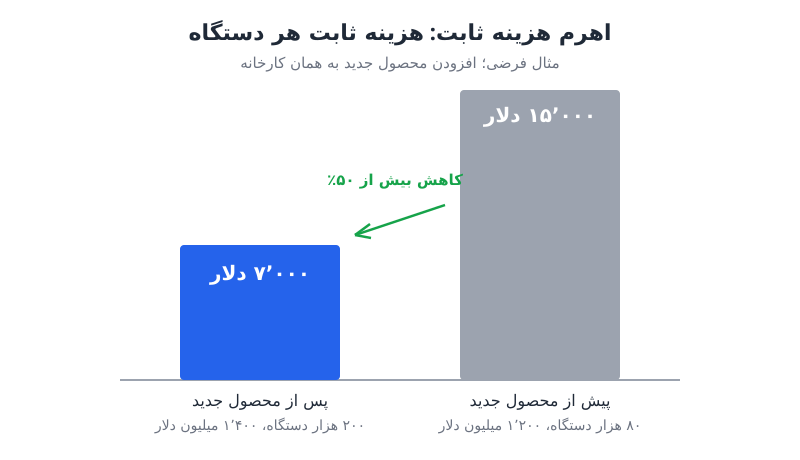

**برنامه‌ریزی ظرفیت** یکی از پرریسک‌ترین تصمیم‌های مدیر مالی است: اگر کم بسازید رشد خفه می‌شود و اگر زیاد بسازید نقدی را می‌سوزانید که سال‌ها طول می‌کشد برگردد. تجربه‌ی ریویان، خودروساز برقی آمریکایی، سه درس روشن دارد که فراتر از صنعت خودرو، برای هر کسب‌وکاری کاربرد دارد.

## از دارایی موجود بیشترین بهره را بگیرید

ریویان قرار بود خودروی جدید و ارزان‌ترش، R2 (شاسی‌بلندی با قیمت حدود ۴۵ هزار دلار)، را در یک کارخانه‌ی کاملاً جدید در ایالت جورجیا تولید کند. اما تصمیم گرفت تولید R2 را **ابتدا** در کارخانه‌ی موجودش در ایلینوی آغاز کند.

نتیجه، صرفه‌جویی حدود ۲٫۲۵ میلیارد دلاری در مخارج سرمایه‌ای کوتاه‌مدت بود. کارخانه‌ی جورجیا با ظرفیت ۴۰۰ هزار دستگاه همچنان ساخته می‌شود، اما فقط وقتی ظرفیت فعلی به سقف برسد. پیش از آن، ریویان فضای کارخانه‌ی ایلینوی را حدود ۱٫۱ میلیون فوت مربع گسترش داد تا ظرفیت سالانه‌ی کل را برای سه محصولش (R1، R2 و ون تجاری) به حدود ۲۱۵ هزار دستگاه برساند.

این همان اصلی است که در هر صنعتی صدق می‌کند: **برای آنچه شاید لازم شود هزینه نکنید؛ برای آنچه امروز واقعاً استفاده می‌کنید برنامه بریزید.** پیش از تأیید یک خط محصول جدید، بازار جغرافیایی تازه یا مدل فروش جدید، بپرسید آیا واقعاً همه‌ی ظرفیت ساختار فعلی را استفاده کرده‌اید؟ برای تفکیک منطق مخارج سرمایه‌ای، [دو نوع مخارج سرمایه‌ای: نگهداری یا رشد](/posts/2024/08/01/two-types-of-capex/) را ببینید.

راه‌های افزایش ظرفیت بدون ساخت جدید:

- خودکارسازی و افزایش رباتیک در خطوط فعلی؛
- بهینه‌سازی سرعت خط تولید و حذف گلوگاه‌ها؛
- استفاده از شیفت‌های بیشتر یا چیدمان بهتر فضای موجود.

## ریسک برنامه‌ریزی اشتباه: کم‌ساختن یا زیادساختن؟

پاسخ مدیر مالی ریویان ظریف ولی متمایل به یک سو بود: نقطه‌ی شروع همیشه این باشد که چطور از آنچه ساخته‌اید بیشتر بیرون بکشید. این به معنای «همیشه کم بساز» نیست؛ یعنی پیش از تعهد سرمایه‌ی سنگین برای ظرفیت جدید، راه‌های خلاقانه را امتحان کنید.

### پرتگاه‌های کارایی

در خودروسازی، برای یک خط تولید خودروی انبوه، **محدوده‌ی بهینه** معمولاً ۲۰۰ تا ۳۰۰ هزار دستگاه است:

| حجم تولید سالانه‌ی یک خط | وضعیت |
|---|---|
| کمتر از ۱۵۰ هزار | بخش بزرگی از ارزش سرمایه‌گذاری از دست می‌رود |
| ۲۰۰ تا ۳۰۰ هزار | محدوده‌ی بهینه |
| خیلی بیشتر از ۳۰۰ هزار | بازده نزولی |

این محدوده جهت‌دهنده است، نه پیش‌بینی دقیق. پس باید شرط ظرفیت را با باور محکم به اندازه‌ی بازار بپذیرید و بدانید اشتباه در هر دو جهت دردناک است.

در کسب‌وکارهای نرم‌افزاری، معادل این پرتگاه‌ها زیرساخت سرور، برنامه‌ی نیروی انسانی و ظرفیت تیم فروش است. کم‌سرمایه‌گذاری رشد را خفه می‌کند و بیش‌سرمایه‌گذاری نقدی را می‌سوزاند که ممکن است شما را مجبور کند در موقعیت ضعیف سرمایه جذب کنید. محدوده‌ی شما ممکن است نسبت پوشش سهمیه‌ی فروش، درصد بهره‌برداری از زیرساخت یا تعداد زیردستان هر مدیر باشد. آن را بشناسید.

### برنامه‌ی نیرو بر پایه‌ی نقشه‌ی محصول و توان مالی

ریویان برنامه‌ی نیروی انسانی را بر پایه‌ی یک «واحد اتمی»، مثلاً تعداد کارشناس فروش در شرکت‌های نرم‌افزاری، نمی‌چیند. نقطه‌ی شروعش **نقشه‌ی راه محصول** است و از آن به عقب برمی‌گردد. بعد یک قید بزرگ اضافه می‌کند: اول ببین چقدر توان پرداخت داری. با همین قید درباره‌ی زمان‌بندی، ترتیب پروژه‌ها و استفاده از نیروی قراردادی برای پوشش جهش‌های موقت تصمیم می‌گیرد. این کار تنش سالمی بین جاه‌طلبی و سرمایه ایجاد می‌کند. برای سنجش درخواست‌های استخدام، [پیش‌بینی نیروی انسانی](/posts/2023/09/30/challenge-headcount-forecast-requests/) را بخوانید.

## اهرم هزینه ثابت: چرا محصول جدید سودآوری را جلو می‌اندازد

شهود اولیه می‌گوید افزودن محصول جدید سودآوری را عقب می‌اندازد: زنجیره‌ی تأمین تازه، دوره‌ی راه‌اندازی و ناکارایی‌های اولیه. اما ریویان برعکسش را نشان می‌دهد. R2 فقط اقتصاد واحد مستقل خودش را ندارد؛ چون در همان کارخانه ساخته می‌شود، **اهرم هزینه ثابت** بیشتری برای R1 و ون تجاری هم ایجاد می‌کند. هزینه‌های ثابت سنگین (ساختمان، تجهیزات، استهلاک) روی تعداد بسیار بیشتری دستگاه پخش می‌شود و هزینه‌ی هر واحد محصولات قبلی هم پایین می‌آید.

### یک مثال عددی ساده

فرض کنید هزینه‌ی ثابت سالانه‌ی یک کارخانه ۱٬۲۰۰ میلیون دلار است و پیش از محصول جدید، ۸۰ هزار دستگاه در سال تولید می‌کند. با افزودن محصول جدید در همان کارخانه، تولید به ۲۰۰ هزار دستگاه می‌رسد و فرض کنید هزینه‌ی ثابت فقط به ۱٬۴۰۰ میلیون دلار افزایش یابد.

| وضعیت | هزینه ثابت (میلیون دلار) | تعداد دستگاه | هزینه ثابت هر دستگاه (دلار) |
|---|---|---|---|
| پیش از محصول جدید | ۱٬۲۰۰ | ۸۰ هزار | ۱۵٬۰۰۰ |
| پس از محصول جدید | ۱٬۴۰۰ | ۲۰۰ هزار | ۷٬۰۰۰ |

هزینه‌ی ثابت کل فقط حدود ۱۷ درصد بالا رفته، اما سهم هر دستگاه بیش از نصف کم شده است. محصولات قدیمی بدون هیچ تغییری در خودشان سودآورتر شده‌اند.

### مزیت راه‌اندازی در کارخانه‌ی فعال

R2 در کارخانه‌ای راه‌اندازی می‌شود که در حال کار و در مقیاس است: نیروی کار آموزش‌دیده، تأمین‌کنندگان مستقر و دانش سازمانی ساخت خودرو از قبل وجود دارد. پس سریع‌تر از یک کارخانه‌ی جدید به ظرفیت می‌رسد. معادلش در شرکت نرم‌افزاری، راه‌اندازی محصول جدیدی است که تیم فروش خریدارش را می‌شناسد و تیم موفقیت مشتری رابطه را از قبل دارد. اگر زیرساخت داده، امنیت، صورت‌حساب و پشتیبانی را ساخته‌اید، هزینه‌ی نهایی محصول جدید پایین‌تر است و هزینه‌ی ترکیبی کل سبد کاهش می‌یابد.

شاهد این اثر: هزینه‌ی عملیاتی نقدی ریویان در ۲۰۲۴ تقریباً برابر ۲۰۲۲ بود، در حالی که درآمدش در همین دوره حدود سه برابر شد.

## چک‌لیست برنامه‌ریزی ظرفیت برای مدیر مالی

- **اول دارایی موجود:** تا ظرفیت فعلی را به حداکثر نرسانده‌اید، چیز جدید نسازید.
- **پرتگاه‌های کارایی را بشناسید:** محدوده‌ی بهینه‌ی هر سرمایه‌گذاری را تعریف کنید و اندازه‌ی بازار را در کنارش بسنجید.
- **از اهرم هزینه ثابت غافل نشوید:** محصول، مشتری یا کاربرد جدید روی زیرساخت موجود منحنی هزینه را خم می‌کند. پیش از هر تعهد ثابت جدید، [آزمون‌های هزینه ثابت](/posts/2024/09/24/fixed-costs-best-month-downside-tests/) را هم اجرا کنید.
- **نقشه‌ی محصول را با توان مالی محدود کنید:** از نقشه‌ی راه شروع کنید و قید توان پرداخت را روی آن بگذارید.

در کسب‌وکارهای فیزیکی نمی‌توان محصول ۹۰ درصد آماده را عرضه کرد؛ همه‌ی قطعات باید سر جایشان باشند. همین است که برنامه‌ریزی ظرفیت را در این صنایع حساس‌تر می‌کند.

## پرسش‌های متداول

### اهرم هزینه ثابت چیست؟

یعنی پخش شدن هزینه‌های ثابت روی حجم بیشتری از تولید یا فروش. هرچه حجم بالاتر برود، سهم هزینه‌ی ثابت هر واحد کمتر و حاشیه‌ی سود بیشتر می‌شود.

### چه زمانی ساخت ظرفیت جدید منطقی است؟

وقتی ظرفیت فعلی با خودکارسازی و بهینه‌سازی به سقف رسیده و شواهد بازار نشان می‌دهد تقاضا در محدوده‌ی بهینه‌ی ظرفیت جدید قرار می‌گیرد.

### آیا افزودن محصول جدید همیشه سودآوری را بهتر می‌کند؟

نه. اگر محصول جدید زیرساخت مشترک را استفاده نکند یا تقاضای کافی نداشته باشد، فقط هزینه‌ی ثابت تازه می‌سازد. اثر مثبت وقتی است که روی پایه‌ی مشترک موجود سوار شود.

### این درس‌ها برای شرکت‌های نرم‌افزاری چه معنایی دارد؟

ظرفیت آن‌ها سرور، نیروی انسانی و تیم فروش است. همان منطق صدق می‌کند: اول بهره‌برداری کامل از ظرفیت موجود، بعد گسترش در محدوده‌ی بهینه.

## جمع‌بندی

برنامه‌ریزی ظرفیت با پرسش «چقدر بیشتر بسازیم؟» شروع نمی‌شود، با «چقدر بیشتر از آنچه داریم می‌توانیم بیرون بکشیم؟» شروع می‌شود. محدوده‌ی بهینه را بشناسید، نیرو را بر پایه‌ی نقشه‌ی محصول و توان مالی بچینید و از اهرم هزینه ثابت برای پایین آوردن هزینه‌ی هر واحد استفاده کنید.
