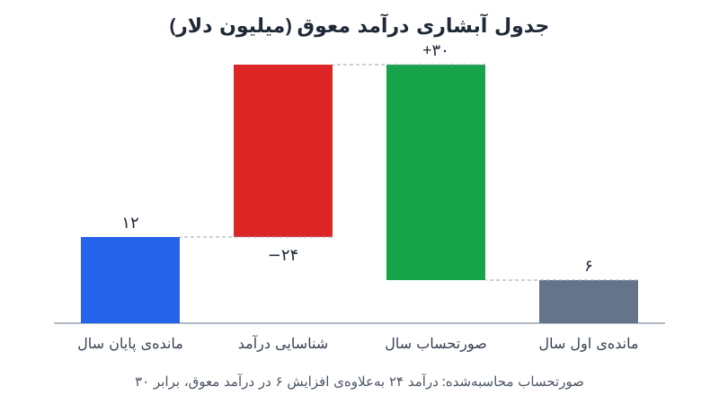

**درآمد معوق** (پیش‌دریافت درآمد) در ترازنامه زیر بدهی‌ها می‌نشیند، اما مدیران مالی از بزرگ‌شدنش ذوق می‌کنند. برای حسابدار، این مبلغ تعهدی است که باید ادا شود؛ برای مدیر مالی و سرمایه‌گذار، شاهدی بر فروش آینده. در این نوشته می‌بینیم هر گروه از این عدد چه برداشتی دارد و واحد حسابداری چطور می‌تواند آن را به ابزار تصمیم‌گیری تبدیل کند.

## زنجیره‌ی تبدیل عدد حسابداری به عدد تصمیم

واحد مالی و حسابداری را می‌شود یک نوار نقاله دید. واحد حسابداری و کنترلر هر قلم ریز، یعنی رسید، صورتحساب و اقلام تعهدی، را می‌گیرد و در پایان ماه به صورت‌های مالی تبدیل می‌کند. تیم FP&A این صورت‌ها را با برنامه مقایسه می‌کند تا ببیند بیشتر یا کمتر از انتظار فروخته و خرج کرده‌ایم. در مرحله‌ی آخر، مدیر مالی، سرمایه‌گذار و خریدار احتمالی همین اعداد را به زبان خودشان برمی‌گردانند: درآمد به ARR، تمدید قرارداد به نرخ نگهداشت خالص و هزینه‌ی حقوق به پایه‌ی پیش‌بینی استخدام. (برای مرور نرخ نگهداشت، [GRR و NRR در SaaS](/posts/2023/05/09/grr-vs-nrr-saas-retention/) را ببینید.)

حسابداری و مالی یک زبان دارند، ولی با دو لهجه. درآمد معوق نمونه‌ی خوبی است: یک عدد واحد که سه گروه سه برداشت متفاوت از آن دارند.

## درآمد معوق و RPO؛ تعریف‌ها و ترتیب بزرگی

**درآمد معوق** پولی است که شرکت پیش از تحویل کالا یا خدمت دریافت کرده یا صورتحسابش را صادر کرده است. با ارائه‌ی خدمت، این مبلغ ماه‌به‌ماه از ترازنامه به صورت سود و زیان منتقل می‌شود و به درآمد شناسایی‌شده تبدیل می‌شود. (منطق این انتقال را در [شناخت درآمد در صورت سود و زیان](/posts/2023/12/13/revenue-recognition-income-statement/) توضیح داده‌ایم.)

**تعهدات عملکردی باقی‌مانده (RPO)** یک قدم جلوتر می‌رود: علاوه بر درآمد معوق، درآمد قراردادی‌ای را هم شامل می‌شود که هنوز صورتحسابش صادر نشده است. یعنی هر ریال RPO برای تبدیل‌شدن به درآمد باید اول از درآمد معوق عبور کند.

در یک شرکت SaaS معمولاً این ترتیب برقرار است:

**RPO > ARR > درآمد معوق**

### هر عدد را از کجا بیاوریم؟

- **درآمد معوق** را مستقیم از بخش بدهی‌های ترازنامه می‌خوانید و هر ماه با ایفای تعهدات به‌روز می‌شود.
- **درآمد صورتحساب‌نشده** سخت‌تر است و باید از سطح قرارداد، معمولاً از سامانه‌ی مدیریت ارتباط با مشتری، بیاید: ارزش کل قرارداد (TCV) منهای دوره‌هایی که سپری شده است.

قراردادهای چندساله با دوره‌ی پلکانی این تفاوت را پررنگ می‌کنند. قراردادی با ۱۰۰ هزار دلار در سال اول، ۲۰۰ هزار در سال دوم و ۳۰۰ هزار در سال سوم، روز امضا ۶۰۰ هزار دلار RPO می‌سازد، در حالی که درآمد معوقش فقط به اندازه‌ی صورتحساب‌های صادرشده است.

## چرا مدیر مالی از درآمد معوق استقبال می‌کند؟

از نگاه عملیاتی، درآمد معوقی که پیشاپیش صورتحساب و وصول شده، **ارزان‌ترین پول در دسترس** است. این همان سرمایه در گردش منفی است؛ نوعی تأمین مالی بدون بهره که مشتری فراهم می‌کند. به همین دلیل مدیر مالی شرکتی که هنوز زیان‌ده است این عدد را با دقت دنبال می‌کند: نقدی که بابت خدمت تحویل‌نشده آمده، اجازه می‌دهد زودتر از منحنی بلوغ فروش استخدام کند و فروشنده‌ی بیشتری بیاورد تا قرارداد بیشتری ببندد. به بیان دیگر، درآمد معوق یکی از محرک‌های اصلی نقشه‌ی استخدام است.

دلیل دوم روایت ارزش‌گذاری است. در شرکت‌های فناوری، ارزش‌گذاری معمولاً با ضریبی از درآمد دوازده ماه آینده بیان می‌شود. هرچه شرکت سریع‌تر رشد کند و قرارداد بیشتری برای آینده بسته باشد، سرمایه‌گذار حاضر است دورتر را هم به حساب شرکت بگذارد. شاهد این آینده دقیقاً در درآمد معوق و RPO دیده می‌شود.

## سرمایه‌گذار و صورتحساب محاسبه‌شده

سرمایه‌گذار روی تداوم فعالیت شرکت شرط می‌بندد. برای او بدهیِ ثبت‌شده در دفاتر فقط رویدادی در تقویم است که دیر یا زود به درآمد تبدیل می‌شود. ریسک از نگاه حسابدار و ریسک از نگاه سرمایه‌گذار دو چیز متفاوت‌اند.

سرمایه‌گذار با یک فرمول ساده کار می‌کند:

**صورتحساب محاسبه‌شده = درآمد + تغییر درآمد معوق**

سپس رشد صورتحساب را با رشد درآمد مقایسه می‌کند. اگر صورتحساب سریع‌تر رشد کند، کسب‌وکار در حال شتاب‌گرفتن است و صورت سود و زیان هنوز این را نشان نمی‌دهد. اگر درآمد معوق کوچک شود، احتمالاً کندی فروش یا ریزش مشتری در راه است.

سه نکته‌ای که سرمایه‌گذار بررسی می‌کند:

| نشانه | چه می‌گوید |
|---|---|
| نرخ تغییر درآمد معوق | سرعت رشد کسب‌وکار آینده |
| فصلی‌بودن | جهش فصل آخر سال معمولاً یعنی تمدیدها در پایان سال متمرکزند، نه تغییر ماهیت کسب‌وکار |
| نسبت جاری به بلندمدت | سهم قراردادهای چندساله؛ درآمد معوق بلندمدت بیشتر یعنی مشتریانی که طبق قرارداد نمی‌توانند بروند |

نتیجه اینکه درآمد معوق، با وجود جایگاهش در ستون بدهی، از نگاه سرمایه‌گذار به یک «دارایی» شبیه‌تر است.

## نگاه خریدار؛ درآمد معوق به‌عنوان شبه‌بدهی

خریدار در معامله‌ی ادغام و تملیک نگاه سخت‌گیرانه‌تری دارد. استدلالش این است که فروشنده نقد قرارداد را پیش‌تر دریافت کرده و شرکت معمولاً بر مبنای «بدون نقد و بدون بدهی» خریده می‌شود. پس خریدار باید خدمت را ارائه کند بی‌آنکه پولش را بگیرد. در نتیجه تلاش می‌کند درآمد معوق را مثل بدهی ببیند و هزینه‌ی ارائه‌ی خدمت را از قیمت کم کند.

فرض کنید حاشیه‌ی سود ناخالص شرکت ۸۰ درصد و درآمد معوق در روز معامله ۱۲ میلیون دلار است. هزینه‌ی ارائه‌ی خدمت حدود ۲۰ درصد است، پس خریدار ممکن است ۱۲ × ۲۰٪ = ۲.۴ میلیون دلار از قیمت خرید کم کند. همان عددی که سرمایه‌گذار بابتش پاداش می‌دهد، خریدار بابتش جریمه می‌کند.

## مثال عددی: جدول آبشاری درآمد معوق

اعداد یک سال فرضی:

| قلم | مبلغ (میلیون دلار) |
|---|---|
| مانده‌ی ابتدای سال | ۶ |
| صورتحساب طی سال (جدید و تمدید) | ۳۰ |
| شناسایی به‌عنوان درآمد | (۲۴) |
| مانده‌ی پایان سال | ۱۲ |

همین چهار عدد سه روایت می‌سازد:

- **روایت صورت سود و زیان:** درآمد ۲۴ میلیون، در برابر ۱۶ میلیون سال قبل؛ رشد ۵۰ درصد.
- **روایت سرمایه‌گذار:** صورتحساب محاسبه‌شده = ۲۴ + ۶ = ۳۰ میلیون. اگر صورتحساب سال قبل ۱۸ میلیون بوده، رشد صورتحساب حدود ۶۷ درصد است، یعنی بیشتر از رشد درآمد؛ کسب‌وکار در حال شتاب‌گرفتن است.
- **روایت مدیر مالی:** اگر برنامه‌ی درآمد سال بعد ۴۰ میلیون باشد، مانده‌ی ۱۲ میلیونی یعنی حدود ۳۰ درصد سال بعد پیش از شروع سال قرارداد و صورتحساب شده است.

### سه کار عملی برای واحد حسابداری

1. **جدول آبشاری** درآمد معوق (مانده‌ی اول، صورتحساب، شناسایی، مانده‌ی پایان) را به‌صورت یک صفحه‌ی ثابت بسازید و در جلسه‌ی بازبینی پیش‌بینی ارائه کنید.
2. **صورتحساب محاسبه‌شده** را در گزارش ماهانه کنار درآمد بگذارید. هر دو ورودی را دارید و اولین کسی بودن که آن را نشان می‌دهد، جایگاهتان را تغییر می‌دهد.
3. به مدیر مالی بگویید **چند درصد برنامه‌ی سال بعد** در مانده‌ی پایان سال نشسته است. جمله‌ی «سال را با ۳۰ درصد پیش‌فروش شروع می‌کنیم» شما را وارد گفت‌وگوی برنامه‌ریزی می‌کند.

## پرسش‌های متداول

### آیا درآمد معوق همیشه نشانه‌ی خوبی است؟
نه. رشدش وقتی خوب است که از قراردادهای واقعی و پایدار بیاید. کاهش آن ممکن است نشانه‌ی کندی فروش یا ریزش باشد و جهش فصلی هم نباید با رشد واقعی اشتباه گرفته شود.

### تفاوت RPO و درآمد معوق چیست؟
درآمد معوق فقط مبالغ صورتحساب‌شده و هنوز شناسایی‌نشده است؛ RPO این مبلغ به‌علاوه‌ی درآمد قراردادیِ هنوز صورتحساب‌نشده است.

### صورتحساب محاسبه‌شده چه کاربردی دارد؟
نشان می‌دهد شرکت در دوره چقدر فروش صورتحساب‌شده داشته است. مقایسه‌ی رشد آن با رشد درآمد، شتاب یا کندی کسب‌وکار را زودتر از صورت سود و زیان نشان می‌دهد.

### چرا خریدار از قیمت شرکت کم می‌کند؟
چون نقد قرارداد پیش‌تر به فروشنده رسیده و خریدار باید هزینه‌ی ارائه‌ی خدمت را بپردازد؛ معمولاً به اندازه‌ی مانده ضرب در سهم بهای تمام‌شده.

## جمع‌بندی

درآمد معوق یک عدد است با سه تفسیر: برای حسابدار تعهد، برای مدیر مالی تأمین مالی بدون بهره و پشتوانه‌ی روایت رشد، برای سرمایه‌گذار شاهد شتاب کسب‌وکار و برای خریدار شبه‌بدهی. واحد حسابداری که جدول آبشاری، صورتحساب محاسبه‌شده و سهم پیش‌فروش سال بعد را خودش گزارش کند، از تهیه‌کننده‌ی عدد به شریک تصمیم‌گیری تبدیل می‌شود.
