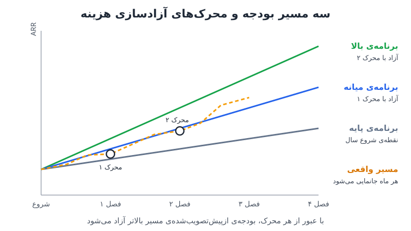

**بودجه‌ی سالانه** در شرکتی که سالی ۲۰ درصد رشد می‌کند ابزار قابل‌اتکایی است؛ اما وقتی رشد سه‌رقمی می‌شود، معمولاً پیش از پایان فصل اول کهنه شده است. راه‌حل، دقیق‌تر حدس‌زدن یک عدد نیست. باید چند برنامه‌ی موازی ساخت که هر کدام هزینه‌های خودش را دارد و با رسیدن کسب‌وکار به آستانه‌های مشخص، بودجه‌ی مسیر بالاتر خودکار آزاد شود.

## چرا بودجه‌ی تک‌عددی در رشد سریع از کار می‌افتد؟

روال رایج FP&A این است: یک برنامه بساز، هر ماه به‌روزش کن و نسخه‌ی تازه را ارائه بده. در شرکتی با رشد معتدل این روش جواب می‌دهد؛ فصل بعد شبیه همین فصل است، انحراف‌ها قابل‌توضیح‌اند و ماه گذشته حدس خوبی برای ماه آینده است.

در رشد سه‌رقمی هیچ‌کدام از این‌ها صادق نیست. فروش ناگهان ۴۰ درصد بالاتر از برنامه می‌آید، دفتر جدیدی تصویب می‌شود یا کانالی که کسی به آن باور نداشت ناگهان جواب می‌دهد. مدل برای بار صدم نسخه‌ی تازه می‌خورد و تیم مالی عملاً به گزارشگر هواشناسی بدی تبدیل می‌شود: می‌گوید باران می‌بارد، که همه می‌دانند؛ ولی نمی‌گوید فردا می‌شود تیم را به دریا فرستاد یا نه. این همان تفسیر گذشته است با کمی جابه‌جایی ماه‌های آینده، نه پیش‌بینی. (تفاوت بودجه‌ی ثابت و پیش‌بینی متحرک را در [بودجه ثابت، پیش‌بینی متحرک](/posts/2023/11/25/budget-stays-forecast-moves/) دیده‌ایم.)

### رشد سریع خط صاف نیست

مشکل عمیق‌تر این است که رشد سریع آن‌طور که مدل فرض می‌کند حرکت نمی‌کند. نه خط مستقیم است و نه حتی منحنی تمیز چوب هاکی. بیشتر شبیه پاروزدن در قایق است: جهشی به جلو، دو هفته درجا زدن که ثبت‌نام‌ها تخت می‌شوند و همه نگران می‌شوند، و دوباره جهشی بزرگ بی‌دلیل روشن. یک سال بعد که خطوط را صاف کنید، می‌بینید تمام مدت سریع رشد کرده‌اید، اما هرگز روی خطی که پیش‌بینی کرده بودید.

## سه برنامه‌ی موازی به‌جای یک عدد

بسیاری از تحلیلگران FP&A در شرکت‌های پرشتاب در ذهنشان سه مسیر را هم‌زمان دنبال می‌کنند: مسیری که رشد داغ می‌ماند، مسیری که رشد آرام می‌شود و به روند خطی برمی‌گردد، و مسیر میانه‌ای که «نه خیلی داغ، نه خیلی سرد» است. معمولاً همان مسیر میانه ارائه می‌شود، در حالی که خودشان کمترین اطمینان را به آن دارند.

یک نمونه‌ی واقعی، شرکت زیرساخت توسعه‌ی وب **Vercel** است که طبق گزارش‌های رسانه‌ای، درآمد تکرارشونده‌ی سالانه‌اش از حدود ۱۰۰ میلیون دلار در ابتدای ۲۰۲۴ به نرخ سالانه‌ی حدود ۳۴۰ میلیون دلار در اوایل ۲۰۲۶ رسیده است. مدیر مالی این شرکت همین سه مسیر را به‌جای تصور، رسماً ساخته است: سه مدل جداگانه که هر کدام منحنی رشد و تخصیص منابع خودش را دارد.

تشبیه او منحنی رشد کودک است. پزشک نمی‌تواند بگوید کودک دقیقاً چقدر قد خواهد کشید، اما می‌تواند نشان دهد روی کدام منحنی و در کدام صدک است. نکته‌ی کلیدی اینجاست: **در ابتدای سال یکی از برنامه‌ها «انتخاب» نمی‌شود.** همه مسیرها را می‌بینند و منتظر می‌مانند تا کسب‌وکار نشان دهد روی کدام ریل حرکت می‌کند.

### کار ماهانه‌ی FP&A چطور عوض می‌شود؟

به‌جای بازسازی پیش‌بینی، کار ماهانه **جانمایی دوباره** است: تشخیص اینکه روی کدام ریل هستیم و اعلام آن به بقیه‌ی سازمان. این شفافیت باید به هیئت‌مدیره هم برسد؛ گفتن اینکه «پیش‌بینی ۱۲ ماهه‌ی این کسب‌وکار بسیار دشوار است» و نشان‌دادن اینکه منابع هنگام جابه‌جایی بین مسیرها چگونه جابه‌جا می‌شوند، از دفاع تا پای جان از یک عدد ثابت آسان‌تر است. (روش ساخت سناریو در مدل را در [برنامه‌ریزی سناریو در مدل مالی](/posts/2022/04/18/scenario-planning-financial-model/) ببینید.)

## بودجه به‌عنوان محرک، نه هدف

در این رویکرد، بودجه کمتر عددی است که باید به آن رسید و بیشتر **مجموعه‌ای از تصمیم‌های هزینه‌ای است که از قبل گرفته شده‌اند** و منتظر اجازه‌ی اجرا هستند. هر برنامه هزینه‌های خودش را دارد و برنامه‌ی بالایی چیزهایی را تأمین می‌کند که برنامه‌ی پایه ندارد. هزینه‌ی مسیر بلندپروازانه را در ماه اول سال به‌خاطر حس خوب خرج نمی‌کنید؛ وقتی خرجش می‌کنید که کسب‌وکار واقعاً به آن ریل رسیده و محرک را فعال کرده است.

پیامدهای مهم:

- **بدون جلسه‌ی تصویب دوباره:** با فعال‌شدن محرک، کسی تخصیص منابع را از نو بحث نمی‌کند و ارائه‌ی جدید نمی‌سازد. سازمان از قبل انتظار دارد استخدام و هزینه انجام شود.
- **خرج‌نکردن هم خطاست:** اگر به مسیر درآمد بالاتر رسیده‌اید ولی بازاریابی تقاضا را تأمین نمی‌کنید، برنامه‌ای را که تازه واجدش شده‌اید گرسنه نگه داشته‌اید.
- **وضعیت بینابینی طبیعی است:** معمولاً دقیقاً روی یک ریل نیستید. «کمی بالاتر از برنامه‌ی میانه‌ایم، اما هنوز به برنامه‌ی بالایی نرسیده‌ایم» یعنی بخشی از طرح‌های آن مسیر هنوز کامل تأمین نمی‌شوند.

### هر هزینه با «آنچه باید باور کنیم»

آزادشدن هزینه چک سفید نیست. مثلاً اگر شرکت به‌جای چند همایش بزرگ داخلی، رویدادهای منطقه‌ای کوچک‌تر در کشورهای مختلف برگزار کند، باید مدلی داشته باشد که بگوید: این مبلغ را خرج می‌کنیم، انتظار این میزان تولید فرصت فروش را داریم و سپس دوباره ارزیابی می‌کنیم.

## مثال عددی: محرک‌های آزادسازی بودجه

فرض کنید شرکتی ARR فعلی ۱۰۰ میلیارد تومانی دارد و سه برنامه برای پایان سال ساخته است:

| برنامه | ARR پایان سال | بودجه‌ی هزینه‌ی سالانه | محرک ورود |
|---|---|---|---|
| پایه | ۱۸۰ | ۱۲۰ | پیش‌فرض شروع سال |
| میانه | ۲۵۰ | ۱۴۵ | ARR پایان فصل اول بالای ۱۲۰ |
| بالا | ۳۴۰ | ۱۷۵ | ARR پایان فصل دوم بالای ۱۷۰ |

اعداد به میلیارد تومان است. فاصله‌ی هزینه‌ی میانه تا بالا حدود ۲۰ درصد است. اگر ARR پایان فصل اول ۱۲۸ باشد، ۲۵ میلیارد هزینه‌ی اضافه‌ی برنامه‌ی میانه، مثلاً استخدام فروشنده و رویدادهای منطقه‌ای، بدون جلسه‌ی جدید آزاد می‌شود. اگر پایان فصل دوم ۱۶۰ باشد، شرکت بالاتر از میانه ولی زیر محرک بالایی است؛ پس فقط بخشی از طرح‌های مسیر بالا، مثلاً جذب نیروی استخدام، زودتر شروع می‌شود.

لازم نیست در ابتدای سال درست حدس بزنید کدام مسیر محقق می‌شود؛ کافی است بدانید روی هر مسیر چه خواهید کرد. این ایده با [طرح اقدام تدافعی و تهاجمی](/posts/2024/07/10/offensive-defensive-action-plans-triggers/) هم‌خانواده است، با این تفاوت که اینجا محرک‌ها کل بودجه‌ی سالانه را بین چند مسیر رشد جابه‌جا می‌کنند.

## زیرساخت را جلوتر از قطار بسازید

یک هشدار مهم: حرکت سریع و خرج‌کردن بر اساس محرک‌ها نباید بهانه‌ی کنار گذاشتن کارهای پایه‌ای شود. جمله‌ی آشنای «فعلاً دستی انجامش می‌دهیم؛ اگر بزرگ شد، مشکل خوبی است» در رشد سریع خطرناک است.

فرض کنید محاسبه‌ی پورسانت فروش در یک برگه‌ی اکسل انجام می‌شود و یک نفر در یک بعدازظهر حساب ۳۰ فروشنده را می‌بندد. شرکت به مسیر بالاتر می‌رسد، تعداد فروشنده‌ها به چند صد نفر می‌رسد و نیمی از آن‌ها طرح پورسانت سفارشی دارند. همان برگه به بمب ساعتی تبدیل می‌شود: اصلاحیه‌ی بزرگ، به‌هم‌ریختن پیش‌بینی فصلی و نارضایتی فروشندگانی که قرارداد آورده‌اند.

نکته‌ی متناقض این است که هرچه بهتر عمل کنید، کار سخت‌تر می‌شود؛ چون ریل بیشتری باید پیش از رسیدن قطار کشیده شود:

- بدون ظرفیت جذب نیرو، نمی‌توانید برنامه‌ی استخدام را در لحظه آزاد کنید.
- بدون کسی در تدارکات برای مذاکره، نمی‌توانید هزینه‌ی نرم‌افزار مسیر بالا را خرج کنید.
- بدون سامانه‌ی پورسانت و صورتحساب مقیاس‌پذیر، رشد فروش به آشفتگی عملیاتی تبدیل می‌شود.

## پرسش‌های متداول

### بودجه‌ی سه‌مسیره با سناریوسازی معمولی چه فرقی دارد؟
در سناریوسازی معمولی یک سناریو انتخاب و بقیه کنار گذاشته می‌شوند. اینجا هر سه مسیر فعال می‌مانند، هزینه‌های هر کدام از قبل تصویب شده و محرک‌ها تعیین می‌کنند کدام اجرا شود.

### محرک‌ها را بر چه شاخصی بگذاریم؟
شاخصی که زودتر از سود و زیان حرکت می‌کند و تیم به آن اعتماد دارد، مثل ARR، فرصت‌های فروش ایجادشده یا قراردادهای امضاشده در پایان هر فصل.

### آیا این روش برای شرکت با رشد معتدل هم لازم است؟
معمولاً نه. وقتی رشد پیش‌بینی‌پذیر است، یک بودجه همراه با پیش‌بینی غلتان کافی است. ارزش این روش در رشد سه‌رقمی و نوسان شدید است.

### با هیئت‌مدیره چطور درباره‌ی این روش صحبت کنیم؟
صادقانه بگویید پیش‌بینی ۱۲ ماهه دشوار است، هر سه مسیر و محرک‌ها را نشان دهید و هر ماه گزارش کنید روی کدام مسیر هستید و منابع چگونه جابه‌جا شده‌اند.

## جمع‌بندی

در رشد سریع، بودجه‌ی تک‌عددی به گزارش هواشناسی دیرهنگام تبدیل می‌شود. جایگزین بهتر، سه برنامه‌ی موازی با هزینه‌های ازپیش‌تصویب‌شده است که با عبور از محرک‌های مشخص آزاد می‌شوند. کار FP&A از بازسازی مدل به تشخیص مسیر و اعلام آن تغییر می‌کند، و شرط موفقیت این است که زیرساخت عملیاتی همیشه جلوتر از رشد ساخته شود.
