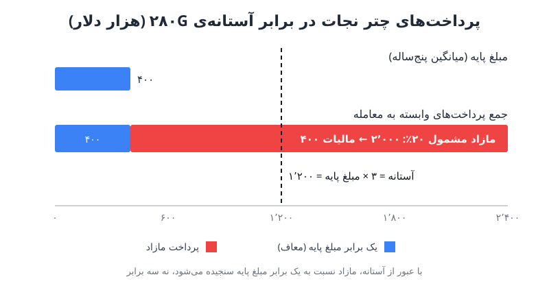

مالیات ۲۸۰G یکی از سازوکارهای کم‌دیده‌ی قانون مالیات آمریکاست که درست در روزهای پایانی فروش یا ادغام شرکت سر برمی‌آورد. هر مدیر مالی که در شرکتی با سرمایه‌گذار خطرپذیر یا خصوصی کار می‌کند و پاداش بستن معامله یا شتاب واگذاری سهام دارد، باید این قاعده، راه‌های مدیریت آن و هزینه‌ی پنهانش در حریم خصوصی را بشناسد.

## مالیات ۲۸۰G چیست و از کجا آمد؟

بخش ۲۸۰G قانون درآمد داخلی آمریکا به پرداخت‌هایی می‌پردازد که به **تغییر کنترل** شرکت وابسته‌اند؛ یعنی فروش، ادغام یا تغییر مالکیت اصلی. اگر این پرداخت‌ها به «فرد مشمول» (به‌طور کلی مدیران ارشد، سهام‌داران عمده و پرحقوق‌ترین کارکنان) از آستانه‌ای مشخص بگذرند، دو اتفاق می‌افتد:

- گیرنده علاوه بر مالیات بر درآمد عادی، **۲۰ درصد مالیات غیرمستقیم** (excise) روی بخش مازاد می‌پردازد.
- شرکت حق کسر بخش مازاد را از درآمد مشمول مالیات خود از دست می‌دهد.

این قاعده محصول موج تصاحب‌های دهه‌ی ۱۹۸۰ است؛ زمانی که بسته‌های «چتر نجات طلایی» چندده‌میلیون‌دلاری برای مدیرانی که شرکت را به فروش می‌رساندند خشم عمومی برانگیخت و قانون‌گذار تصمیم گرفت برای پرداخت‌های بزرگ وابسته به تغییر کنترل جریمه‌ی مالیاتی بگذارد.

## پرداخت چتر نجات؛ اسم بزرگ، تعریف گسترده

واژه‌ی «چتر نجات» ذهن را به مبالغ عظیم می‌برد، اما از نظر قانون **هر پرداخت یا مزیتی که به تغییر کنترل وابسته باشد** پرداخت چتر نجات است، چه ۲۵ هزار دلار باشد چه ۲۵ میلیون. نمونه‌های رایج:

- پاداش بستن معامله؛
- پاداش ماندگاری که در زمان بستن معامله قطعی می‌شود؛
- ارزش شتاب‌گرفتن واگذاری سهام یا اختیار خرید سهام (با قواعد محاسباتی خاص خود)؛
- افزایش مزایای پایان خدمت در صورت اخراج پس از معامله؛
- خود پرداخت جبران مالیات (gross-up) که آن هم پرداخت چتر نجات حساب می‌شود.

### آستانه‌ی سه‌برابری

معیار سنجش، عددی مطلق نیست بلکه **«مبلغ پایه»** است: میانگین سالانه‌ی حقوق مشمول مالیات فرد در پنج سال پیش از سال تغییر کنترل (یا دوره‌ی کوتاه‌تر خدمت، سالانه‌شده). اگر مجموع پرداخت‌های چتر نجات **به سه برابر مبلغ پایه برسد یا از آن بگذرد**، فرد مشمول قاعده است.

نکته‌ای که اغلب اشتباه فهمیده می‌شود: پس از عبور از آستانه، «پرداخت مازاد» نه نسبت به سه برابر، بلکه نسبت به **یک برابر مبلغ پایه** محاسبه می‌شود. یعنی عبور یک دلاری از خط، ناگهان بخش بسیار بزرگی از پرداخت را مشمول مالیات می‌کند.

این قاعده برای مدیر مالی تازه‌وارد خطرناک‌تر است. کسی که هجده ماه پیش با حقوق پایه‌ی متوسط آمده و حالا پاداش معامله و شتاب واگذاری دارد، میانگین پنج‌ساله‌ی پایینی دارد و به‌راحتی از آستانه می‌گذرد.

## مثال عددی مالیات ۲۸۰G

فرض کنید وضعیت یک مدیر مالی این است:

| قلم | مبلغ (دلار) |
|---|---|
| میانگین حقوق پنج سال اخیر (مبلغ پایه) | ۴۰۰٬۰۰۰ |
| آستانه (سه برابر مبلغ پایه) | ۱٬۲۰۰٬۰۰۰ |
| پاداش بستن معامله | ۷۵۰٬۰۰۰ |
| ارزش شتاب واگذاری سهام | ۱٬۴۰۰٬۰۰۰ |
| پاداش ماندگاری در زمان بستن | ۲۵۰٬۰۰۰ |
| **جمع پرداخت‌های چتر نجات** | **۲٬۴۰۰٬۰۰۰** |

چون ۲٫۴ میلیون از آستانه‌ی ۱٫۲ میلیون بیشتر است، پرداخت مازاد برابر است با ۲٫۴ میلیون منهای یک برابر مبلغ پایه، یعنی **۲ میلیون دلار**. مالیات ۲۰ درصدی روی آن **۴۰۰ هزار دلار** می‌شود که فرد علاوه بر مالیات عادی بر کل ۲٫۴ میلیون می‌پردازد. شرکت هم کسر ۲ میلیون دلار را از دست می‌دهد.

## سه راه پیش روی شرکت

وقتی فردی از آستانه عبور می‌کند، معمولاً سه گزینه روی میز است.

### ۱. کاهش پرداخت

بسته را آن‌قدر کم کنید که درست زیر سه برابر مبلغ پایه بماند. در مثال ما یعنی حدود ۱٫۲ میلیون دلار کمتر دریافتی. گاهی قراردادها بند «بهترین خالص» دارند: هر کدام از کاهش یا پرداخت کامل با مالیات که خالص بیشتری به فرد بدهد، اعمال می‌شود.

### ۲. جبران مالیات (Gross-up)

شرکت مبلغی اضافه می‌پردازد تا فرد پس از همه‌ی مالیات‌ها همان خالصی را بگیرد که بدون ۲۸۰G می‌گرفت. مشکل این است که این مبلغ خودش هم پرداخت چتر نجات است و مالیات عادی و ۲۰ درصدی دارد، پس محاسبه بازگشتی است. فرض کنید نرخ نهایی مالیات بر درآمد فرد ۴۰ درصد باشد؛ جبران لازم تقریباً از رابطه‌ی ۴۰۰٬۰۰۰ ÷ (۱ − ۰٫۴ − ۰٫۲) به دست می‌آید، یعنی حدود **یک میلیون دلار** هزینه‌ی اضافه، به‌علاوه‌ی از دست رفتن کسر مالیاتی همین مبلغ. به همین دلیل این گزینه در شرکت‌های خصوصی کم‌طرفدار است.

### ۳. رأی پاک‌سازی سهام‌داران

در شرکت‌های خصوصی (سهامی که در بازار عمومی معامله نمی‌شود) اگر بیش از **۷۵ درصد** سهام‌داران غیرذی‌نفع (یعنی سهام‌دارانی غیر از خود افراد مشمول) پرداخت را تأیید کنند، مالیات ۲۰ درصدی و محرومیت از کسر مالیاتی هر دو از بین می‌روند. شرط مهم این است که فرد پیش از رأی از بخش مازاد صرف‌نظر کند تا دریافت آن واقعاً به نتیجه‌ی رأی بستگی داشته باشد. این راه از نظر مالیاتی تقریباً رایگان است و پرکاربردترین مسیر شرکت‌های خصوصی است.

| گزینه | هزینه برای فرد | هزینه برای شرکت | افشای اطلاعات |
|---|---|---|---|
| کاهش پرداخت | حدود ۱٫۲ میلیون کمتر | ندارد | محدود |
| جبران مالیات | تقریباً صفر | حدود ۱ میلیون + کسر از دست‌رفته | محدود |
| رأی پاک‌سازی | ریسک ردشدن | تقریباً صفر | گسترده |

## هزینه‌ی پنهان رأی پاک‌سازی: حریم خصوصی

برای رأی‌گیری باید **همه‌ی اطلاعات مهم** در اختیار سهام‌دارانی قرار گیرد که حق رأی دارند: نام افراد و مبلغ پرداخت هر کدام. افراد مشمول از رأی‌دادن کنار گذاشته می‌شوند، اما سند افشا به بقیه‌ی فهرست سهام‌داران می‌رسد؛ از سرمایه‌گذاران تا کارمندی که سال‌ها پیش چند اختیار خرید را اعمال کرده و یک سهم عادی دارد.

پیامدها می‌تواند فراتر از پچ‌پچ در محیط کار باشد. تصور کنید شرکتی با قیمت پایین فروخته شود، سهام عادی کارکنان عملاً بی‌ارزش شود و هم‌زمان سند افشا نشان دهد مدیرعامل و مدیر مالی هر کدام چند میلیون دلار بابت بستن معامله و ماندن می‌گیرند. چنین پرداخت‌هایی ممکن است کاملاً قانونی و متعارف باشد، اما «متعارف بودن» در برابر برداشت کارکنان سپر خوبی نیست.

## چک‌لیست مدیر مالی پیش از فروش شرکت

- **زود بپرسید:** وقتی فروش جدی شد (بانک سرمایه‌گذاری پیشنهاد داده یا هیئت‌مدیره از زمان خروج حرف می‌زند)، از مشاور حقوقی معامله بخواهید تحلیل ۲۸۰G را همان موقع انجام دهد، نه هفته‌ی پیش از بستن.
- **دو سند را با هم بخوانید:** قرارداد استخدام و طرح سهام کارکنان هر دو بر نحوه‌ی رفتار با پرداخت‌های چتر نجات اثر دارند.
- **فهرست افراد مشمول و مبالغ را مدل کنید:** مبلغ پایه، آستانه و پرداخت مازاد هر نفر را در یک جدول ساده داشته باشید.
- **برای افشا برنامه‌ی ارتباطی داشته باشید:** اگر رأی پاک‌سازی انتخاب شد، پیش‌بینی کنید چه کسانی سند را می‌بینند و چه پرسش‌هایی پیش می‌آید.

این کارها مکمل [آمادگی مدیر مالی برای فروش شرکت](/posts/2023/03/08/cfo-prepare-company-acquisition-checklist/) و آشنایی با [مفاهیم ادغام و تملک برای FP&A](/posts/2023/04/01/seven-ma-concepts-for-fpa/) است. در معاملات با [سرمایه‌گذار خصوصی](/posts/2024/02/27/private-equity-funding-explained/) که تیم مدیریت معمولاً بسته‌های تشویقی سنگین دارد، اهمیت آن بیشتر هم می‌شود.

## پرسش‌های متداول

### آیا ۲۸۰G فقط برای شرکت‌های آمریکایی مهم است؟
این قاعده بخشی از قانون مالیات آمریکاست و برای مدیران مشمول مالیات آمریکا و شرکت‌هایی با ساختار آمریکایی اهمیت دارد، اما درس آن، یعنی سنجش زودهنگام پیامد مالیاتی و افشای پاداش‌های وابسته به معامله، همه‌جا کاربرد دارد.

### آیا پاداش کوچک هم پرداخت چتر نجات است؟
بله. اندازه مهم نیست؛ هر پرداخت وابسته به تغییر کنترل در محاسبه وارد می‌شود و فقط مجموع آن با آستانه مقایسه می‌شود.

### چرا مدیر تازه‌وارد بیشتر در معرض است؟
چون مبلغ پایه میانگین حقوق سال‌های گذشته است و برای کسی که تازه آمده پایین است، در حالی که پاداش‌های معامله و شتاب واگذاری بزرگ‌اند.

### اگر رأی پاک‌سازی رد شود چه می‌شود؟
فرد بخش مازادی را که از آن صرف‌نظر کرده دریافت نمی‌کند و در عمل به وضعیت «کاهش پرداخت» برمی‌گردد.

## جمع‌بندی

مالیات ۲۸۰G پرداخت‌های وابسته به فروش شرکت را، وقتی از سه برابر میانگین حقوق پنج‌ساله بگذرند، با ۲۰ درصد مالیات اضافه و حذف کسر مالیاتی جریمه می‌کند. کاهش پرداخت، جبران مالیات و رأی پاک‌سازی سه راه اصلی‌اند که هر کدام هزینه‌ی متفاوتی دارند؛ ارزان‌ترین آن‌ها، رأی پاک‌سازی، هزینه‌اش را در شفافیت پاداش‌ها می‌پردازد. بهترین زمان برای پرداختن به این موضوع، لحظه‌ای است که فروش واقعی به نظر می‌رسد.
