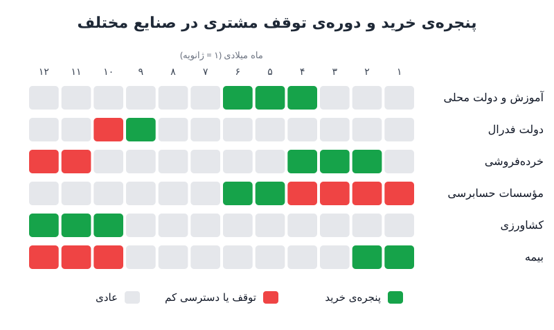

فصلی بودن خرید مشتری موضوعی است که معمولاً به تیم فروش سپرده می‌شود، اما مستقیماً روی پیش‌بینی درآمد، نقدینگی و هدف‌گذاری اثر دارد. هر صنعت تقویم بودجه، سال مالی و دوره‌های شلوغی خاص خودش را دارد. تیم مالی که این ویژگی‌ها را بشناسد، هم پیش‌بینی دقیق‌تری می‌سازد و هم منابع فروش را به سمت پول هدایت می‌کند.

## چرا شناخت تقویم خرید مشتری کار تیم مالی است؟

تیم فروش بیشترین گفت‌وگو را با مشتری دارد و معمولاً اولین کسی است که به الگوهای عجیب برمی‌خورد: بودجه‌ای که ناگهان آزاد می‌شود، یا مشتری‌ای که سه ماه غیب می‌شود. اما تبدیل این مشاهده‌ها به الگو و استفاده از آن در برنامه‌ریزی، کار مالی است. دو دلیل اصلی:

- **پیش‌بینی دقیق‌تر:** وقتی بدانید مشتری کی می‌خرد، توزیع قراردادها در ماه‌ها و فصل‌ها واقع‌بینانه‌تر می‌شود.
- **تخصیص بهتر منابع:** فروشندگان پرهزینه‌ترین منبع رشدند و باید در زمان درست به سمت درست هدایت شوند.

این بحث با [منحنی فصلی بودن درآمد](/posts/2023/02/18/seasonality-curve-revenue-forecast/) فرق دارد. آن‌جا الگوی تاریخی درآمد خودتان را می‌سازید؛ این‌جا می‌پرسید چرا آن الگو وجود دارد و ریشه‌اش در تقویم مشتری کجاست. این شناخت به‌ویژه وقتی مهم است که وارد بخش تازه‌ای از بازار می‌شوید و هنوز تاریخچه‌ای ندارید.

## فصلی بودن خرید در صنایع مختلف

نمونه‌های زیر از بازار آمریکا است، اما منطق‌شان همه‌جا صدق می‌کند: مشتری وقتی می‌خرد که هم بودجه دارد و هم فرصت اجرا.

### آموزش و دولت‌های محلی

- خرید در فصل دوم میلادی فعال می‌شود، چون تابستان بهترین زمان برای راه‌اندازی سامانه بدون مختل کردن کلاس‌هاست.
- سال مالی بسیاری از نهادهای آموزشی و دولتی ۳۰ ژوئن تمام می‌شود و بودجه‌ی باقی‌مانده باید پیش از آن خرج شود.
- میل به خرید و پنجره‌ی اجرا در همان چند هفته روی هم می‌افتند؛ از دست دادن ژوئن می‌تواند یعنی از دست دادن کل سال.

### دولت فدرال

- سال مالی ۳۰ سپتامبر تمام می‌شود و هفته‌های آخر سپتامبر پر از عجله برای تعهد بودجه‌ی باقی‌مانده است.
- اگر سال تازه با مصوبه‌ی موقت بودجه شروع شود، نهادها معمولاً در سطح بودجه‌ی سال قبل می‌مانند و برای شروع طرح‌های جدید محدودیت دارند. یعنی از جهش سپتامبر به توقف اکتبر.

### مؤسسات حسابرسی و حسابداری

- سال مالی چهار مؤسسه‌ی بزرگ یکسان نیست: دو مؤسسه ۳۰ ژوئن، یکی در ماه مه و یکی ۳۰ سپتامبر سال را می‌بندند.
- مهم‌تر از آن، فصل مالیات و حسابرسی است. از ژانویه تا آوریل این مشتریان مشغول مشتریان خودشان‌اند و عملاً در دسترس نیستند.
- گاهی بهترین پنجره‌ی فروش را سال مالی مشتریِ مشتری تعیین می‌کند.

### خرده‌فروشی

- بسیاری از خرده‌فروشان تقویم ۵۲/۵۳ هفته‌ای دارند و سال مالی را اواخر ژانویه یا اوایل فوریه می‌بندند تا فصل تعطیلات و مرجوعی‌های بعدش در یک سال بیفتد.
- اواخر زمستان و بهار، با تازه شدن بودجه، پنجره‌ی خرید و اجراست.
- از پاییز «توقف تغییرات فنی» شروع می‌شود؛ هیچ‌کس نمی‌خواهد نرم‌افزار تازه در شلوغ‌ترین روزهای فروش صندوق را از کار بیندازد.

### کشاورزی، سلامت و بیمه

- **کشاورزی:** پول وقتی می‌رسد که محصول فروخته شود. پس از برداشت، پنجره‌ی خرید تجهیزات باز می‌شود و قواعد استهلاک تسریعی، خرید پیش از پایان سال را از نظر مالیاتی جذاب‌تر می‌کند.
- **سلامت:** بیمارستان‌ها بودجه‌ی سرمایه‌ای سالانه دارند و پایان سال فشار «یا خرج کن یا از دست بده» دیده می‌شود، اما اجرا باید با عملیات بالینی هماهنگ شود و اواخر سال که اعمال جراحی انتخابی بیشتر است، کندتر پیش می‌رود.
- **بیمه:** بخش بزرگی از تمدیدها حول اول ژانویه است، پس فصل چهارم مشتری غرق تمدید است. بودجه هست، وقت نیست.

### آموزش عالی

دانشگاه‌ها هم معمولاً ۳۰ ژوئن سال مالی را می‌بندند، اما تقویم عملیاتی‌شان را دانشجویان تعیین می‌کنند. اگر سامانه‌ای که به عملیات دانشگاه وصل است جایگزین شود، تابستان بهترین زمان اجراست؛ پس تصمیم خرید باید ماه‌ها زودتر گرفته شود.

در ایران هم همین منطق را می‌بینید: سال مالی بیشتر دستگاه‌های دولتی و بسیاری از شرکت‌ها پایان اسفند تمام می‌شود و شتاب خرید در ماه‌های پایانی سال و رکود نسبی نوروز، الگویی آشناست.

## خرج‌کرد پایان سال؛ فرصت امسال، ریسک تمدید سال بعد

بودجه‌ی برخی واحدها، به‌ویژه بازاریابی، به سال بعد منتقل نمی‌شود. همین باعث می‌شود در فصل‌های پایانی سال پول «باید» خرج شود. دو نکته برای مالی:

1. مشتریانی که چرخه‌ی فروش طولانی دارند، ممکن است برای پر کردن قیف فروش فصل اول سال بعد، از فصل سوم و چهارم خرج کنند.
2. خرید پایان سال اغلب برای «ویتامین» است نه «مسکن»؛ یعنی چیز ضروری نیست. امسال درآمدش را بگیرید، اما در پیش‌بینی [نرخ نگهداشت خالص درآمد (NRR)](/posts/2023/05/09/grr-vs-nrr-saas-retention/) برای این گروه کمی محافظه‌کار باشید.

فرض کنید ۲۰۰ هزار دلار از قراردادهای فصل چهارم از بودجه‌ی پایان سال آمده و نرخ تمدید معمول شما ۹۰ درصد است. اگر برای این بخش نرخ ۷۰ درصد در نظر بگیرید، درآمد تمدیدی سال بعد به‌جای ۱۸۰ هزار، ۱۴۰ هزار دلار پیش‌بینی می‌شود؛ ۴۰ هزار دلار اختلافی که بهتر است از الان در مدل باشد، نه در گزارش انحراف.

## ویژگی‌هایی که به تقویم ربطی ندارند

برخی موانع خرید فصلی نیستند، اما زمان‌بندی قرارداد را به همان اندازه تغییر می‌دهند:

| ویژگی | اثر بر قرارداد | پیامد برای پیش‌بینی |
|---|---|---|
| سقف امضا | بالای یک مبلغ، قرارداد به واحد خرید، مدیر مالی یا مناقصه می‌رود | قراردادهای بزرگ را با تأخیر بیشتر مدل کنید |
| فهرست تأمین‌کنندگان مجاز | بدون حضور در قراردادهای چارچوبی، خرید ممکن نیست | هزینه و زمان ورود به فهرست را از قبل بودجه کنید |
| سرمایه‌ای در برابر جاری | گاهی بودجه‌ی پروژه‌ی سرمایه‌ای آزاد است و بودجه‌ی جاری قفل | ساختار قرارداد (پیاده‌سازی به‌جای اشتراک) را بررسی کنید |
| تقویم هیئت‌مدیره | مبالغ بالای سقف تا جلسه‌ی رسمی بعدی صبر می‌کنند | تاریخ قرارداد را به تاریخ جلسه گره بزنید |

برای کسب‌وکاری که خودش فصلی است، کنترل نقدینگی در ماه‌های کم‌فروش هم مهم است؛ در این باره [ریسک کسب‌وکار فصلی](/posts/2024/04/21/seasonal-business-risk-management/) را ببینید.

## پرسش‌های متداول

### این اطلاعات را از کجا جمع کنیم؟

از یادداشت‌های تیم فروش، تاریخ بسته شدن قراردادهای گذشته به تفکیک صنعت، و سال مالی اعلام‌شده‌ی مشتریان در گزارش‌های رسمی‌شان.

### اگر تاریخچه‌ی فروش در یک صنعت نداریم چه کنیم؟

از تقویم بودجه و دوره‌های شلوغی آن صنعت یک منحنی فرضی بسازید و با هر فصل داده‌ی واقعی اصلاحش کنید.

### آیا فصلی بودن خرید روی نقدینگی هم اثر دارد؟

بله. اگر قراردادها در یک فصل متمرکز باشند، وصول مطالبات هم متمرکز می‌شود و ماه‌های دیگر به ذخیره‌ی نقد بیشتری نیاز دارند.

## جمع‌بندی

فصلی بودن خرید مشتری از سال مالی، چرخه‌ی بودجه و دوره‌های شلوغی خود او می‌آید. تیم مالی با ساختن نقشه‌ی پنجره‌های خرید و توقف هر صنعت، توجه به خرج‌کرد پایان سال و ریسک تمدیدش، و در نظر گرفتن سقف امضا و تقویم هیئت‌مدیره، پیش‌بینی واقع‌بینانه‌تری می‌سازد و فروش را در زمان درست به سمت پول هدایت می‌کند.
