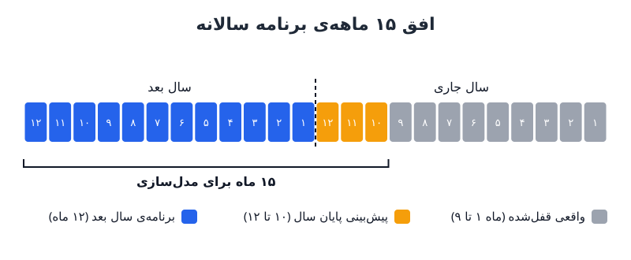

برنامه سالانه پیش از آن‌که حتی یک عدد در مدل نوشته شود، به پنج داده‌ی ورودی وابسته است. هر چه پایین‌دست می‌سازید، از بودجه‌ی استخدام تا هدف درآمد، روی همین پنج ستون ایستاده است. اگر یکی لق باشد، کل بودجه کج می‌شود. در این نوشته می‌بینیم هر ورودی چیست، چطور آماده‌اش کنیم و کجا معمولاً خراب می‌شود.

## پنج ورودی برنامه سالانه در یک نگاه

پیش از مدل‌سازی این پنج مورد را جمع کنید:

1. فهرست کارکنان فعلی؛
2. فهرست موقعیت‌های باز؛
3. صورت سود و زیان تا پایان ماه نهم سال (سپتامبر در سال مالی میلادی)؛
4. سابقه‌ی تحقق سهمیه‌ی فروشندگان؛
5. هزینه‌های دوازده ماه گذشته.

بهتر است کار را از آخرین پیش‌بینی‌ای شروع کنید که همین حالا بر اساسش تصمیم می‌گیرید. در این صورت برنامه سالانه به‌جای صفحه‌ای سفید، یک بازپیش‌بینی جزئی‌تر برای **۱۵ ماه آینده** می‌شود: سه ماه باقی‌مانده‌ی سال جاری به‌علاوه‌ی دوازده ماه سال بعد.

### چرا ماه نهم خط پایه است؟

باید جایی خط بکشید. اعداد واقعی تا پایان ماه نهم قفل می‌شوند، برنامه در پاییز ساخته می‌شود و در جلسه‌ی هیئت‌مدیره‌ی فصل سوم، حدود دو ماه پیش از پایان سال، با یک عدد مشخص به تصویب می‌رسد. این زمان‌بندی در اصل امتیازی بود به دشواری جمع‌آوری و پاک‌سازی داده‌ها. امروز اگر داده‌های کارکنان، هزینه و فروش تمیز و خودکار به مدل برسند، این پنج ورودی می‌توانند هر ماه تازه شوند؛ لنگر برنامه همان ماه نهم می‌ماند، اما شکاف سه ماه آخر را به‌جای یک پیش‌بینی کهنه، هفته‌به‌هفته می‌بندید.

## ورودی اول و دوم: کارکنان فعلی و موقعیت‌های باز

### فهرست کارکنان فعلی

خروجی سامانه‌ی منابع انسانی که همه‌ی کارکنان تمام‌وقت و پیمانکاران را با واحد، حقوق پایه و پاداش قابل دریافت نشان می‌دهد. این «خط پایه‌ی افراد حاضر» شماست. روش تبدیل این فهرست به جدول هزینه را در [برنامه‌ی کارکنان از روی فهرست پرسنل](/posts/2023/06/24/headcount-schedule-from-employee-census/) قدم‌به‌قدم توضیح داده‌ایم.

### فهرست موقعیت‌های باز

این فهرست را دو دسته کنید:

- موقعیت‌هایی که فعلاً در حال جذب‌اند؛
- موقعیت‌هایی که در بودجه‌ی امسال تصویب شده‌اند ولی هنوز کاری رویشان شروع نشده است.

این‌جا باید کمی پیش‌بینی احتمالی کنید: هر موقعیت با چه احتمالی تا پایان سال پر می‌شود و اگر پر نشود، آیا جایی در خط پایه‌ی سال بعد می‌گیرد؟ دسته‌ی اول احتمال بالاتری دارد، چون دسته‌ی دوم احتمالاً تا باز شدن و پر شدن به سال بعد کشیده می‌شود.

### دام نیروی «گیرافتاده»

بودجه‌ها معمولاً جایی از ریل خارج می‌شوند که موقعیت باز در برزخ گیر کند:

- از خط پایه حذف شده، اما پیش از پایان سال پر می‌شود؛ پس فردی واقعی حقوق می‌گیرد که در برنامه دیده نشده است.
- تا پایان سال پر نمی‌شود، اما مدیر واحد فرض می‌کند به بودجه‌ی سال بعد منتقل شده است؛ پس وقتی سقف را دریافت می‌کند، یک نفر کم دارد.

در هر دو حالت در نهایت یک نیروی اضافه از هیچ ساخته می‌شود. راه‌حل این است که سقف بودجه‌ی هر واحد را به‌صورت **«حداکثر کل مجاز»** اعلام کنید، نه «تعداد نیروی اضافه». با عدد افزایشی تقریباً همیشه ضرر می‌کنید. برای سنجیدن درخواست‌ها هم [این راهنمای ارزیابی درخواست استخدام](/posts/2023/09/30/challenge-headcount-forecast-requests/) را ببینید.

### مثال عددی

فرض کنید واحد فروش ۴۰ نفر دارد، ۴ موقعیت در حال جذب و ۲ موقعیت مصوب ولی شروع‌نشده. احتمال پر شدن تا پایان سال را برای دسته‌ی اول ۷۵ درصد و برای دسته‌ی دوم ۲۵ درصد بگیرید. پیش‌بینی پایان سال: ۴۰ + (۴ × ۰٫۷۵) + (۲ × ۰٫۲۵) = ۴۳٫۵ نفر. اگر برنامه‌ی سال بعد ۴۸ نفر را مجاز بداند، سقف را «۴۸ نفر کل» اعلام کنید، نه «۵ نفر اضافه». حالا اگر به‌جای ۴۳٫۵ نفر، ۴۵ نفر وارد سال جدید شوند، واحد خودش می‌داند فقط ۳ جای خالی دارد.

## ورودی سوم: سود و زیان پایه پیش از پایان سال

بودجه‌ی سال بعد را پیش از قطعی‌شدن نتایج امسال می‌سازید. اگر فروش شما در پایان سال انباشته باشد، این عدم قطعیت جدی است؛ شرکتی را تصور کنید که ۳۵ درصد فروش جدیدش در فصل آخر، ۲۰ درصد در ماه آخر و ۱۰ درصد در هفته‌ی آخر سال اتفاق می‌افتد.

برخی شرکت‌ها برای فرار از این ابهام، تصویب بودجه را به اواخر زمستان موکول می‌کنند. این انتخاب برای شرکتی در رشد سریع اشتباه است: دقتی که با صبر به دست می‌آید، در برابر شتابی که از دست می‌رود ناچیز است. راه بهتر تصویب برنامه بر پایه‌ی ماه نهم و به‌روزرسانی مداوم سه ماه پایانی است. این همان نگاهی است که در [هفت توهم برنامه‌ریزی سالانه](/posts/2024/09/08/annual-planning-seven-delusions/) هم بر آن تأکید شد: برنامه سند زنده است، نه پیش‌گویی.

## ورودی چهارم: سابقه‌ی تحقق سهمیه‌ی فروش

مرور کنید سال گذشته هدف هر فروشنده چه بود، تک‌تک آن‌ها و میانه‌ی تیم چقدر به آن نزدیک شدند، و بعد درباره‌ی بالا یا پایین رفتن سهمیه‌ها تصمیم بگیرید. چند عدد فرضی برای درک نسبت درآمد هدف به سهمیه:

| بخش بازار | درآمد هدف سالانه (ثابت/متغیر) | سهمیه‌ی سالانه | نسبت سهمیه به درآمد هدف |
|---|---|---|---|
| کسب‌وکار کوچک | ۱۵۰ هزار دلار (۷۵/۷۵) | ۷۵۰ هزار دلار | ۵ برابر |
| بازار میانی | ۲۰۰ هزار دلار | ۱ میلیون دلار | ۵ برابر |
| سازمان‌های بزرگ | ۳۰۰ هزار دلار (۱۵۰/۱۵۰) | ۱٫۵ میلیون دلار | ۵ برابر |

تقسیم دوباره‌ی قلمروها و عرضه‌ی محصول جدید هر دو بر این تصمیم اثر می‌گذارند. اگر قلمرو فروشنده‌ای کوچک می‌شود، باید چیز بیشتری برای فروش به همان حساب‌های کمتر داشته باشد، وگرنه بی‌انصافی کرده‌اید.

## ورودی پنجم: هزینه‌های ۱۲ ماه گذشته

به یک دوره‌ی کامل دوازده‌ماهه نیاز دارید، نه فقط نُه ماه از ابتدای سال؛ یعنی دوازده ماه منتهی به ماه نهم. هزینه‌ها را بر اساس دسته با سه نگاه متفاوت بسنجید:

- **نرخ ماهانه‌ی پایانی سالانه‌شده:** مناسب حقوق و دستمزد، چون آخرین وضعیت را نشان می‌دهد.
- **میانگین ماهانه‌ی سه ماه اخیر:** مناسب نرم‌افزار، به‌خصوص اگر قیمتش مصرفی است.
- **میانگین ماهانه‌ی دوازده ماه اخیر:** مناسب سفر و رویداد، تا فصلی‌بودن را در بر بگیرد.

### چرا ترک خدمت در فهرست نیست؟

ریزش کارکنان عمداً جزو این پنج ورودی نیست. هر فاصله‌ای میان رفتن و آمدن افراد، بادی موافق برای برنامه است؛ هدیه‌ای که بهتر است در طول سال پیدایش کنید، نه آن‌که از ابتدا در عدد بپزید. بودجه‌ریزی با فرض ریزش، سقف هزینه را به‌طور مصنوعی پایین می‌آورد و خطر کسری را بالا می‌برد.

## پرسش‌های متداول

### چرا افق برنامه ۱۵ ماه است و نه ۱۲ ماه؟

چون سه ماه پایانی سال جاری هنوز قطعی نیست و مستقیم بر نقطه‌ی شروع سال بعد اثر می‌گذارد. دیدن این سه ماه کنار دوازده ماه بعد، از غافلگیری در ابتدای سال جلوگیری می‌کند.

### اگر سال مالی شرکت شمسی باشد چه؟

منطق یکسان است: خط پایه را حدود سه ماه پیش از پایان سال مالی ببندید، یعنی پایان آذر برای سال منتهی به اسفند، و افق پانزده‌ماهه را از آن‌جا بچینید.

### احتمال پر شدن موقعیت‌های باز را از کجا بیاوریم؟

از سابقه‌ی جذب خودتان: میانگین زمان از بازشدن تا پرشدن موقعیت در هر واحد. هر چه تا پایان سال کمتر از آن زمان مانده باشد، احتمال پایین‌تر است.

### کدام نگاه هزینه‌ای برای اجاره مناسب است؟

برای هزینه‌های قراردادی ثابت مثل اجاره، معمولاً مبلغ قرارداد آینده از هر میانگین تاریخی دقیق‌تر است.

## جمع‌بندی

کیفیت برنامه سالانه به کیفیت پنج ورودی آن بستگی دارد: کارکنان فعلی، موقعیت‌های باز، سود و زیان پایه، سابقه‌ی سهمیه‌ی فروش و هزینه‌های دوازده ماه اخیر. این داده‌ها را پیش از مدل‌سازی محکم کنید، سقف نیروی انسانی را به‌صورت حداکثر کل اعلام کنید، و اگر داده‌ها خودکار به مدل می‌رسند، آن‌ها را به‌جای یک بار در سال، هر ماه تازه کنید.
