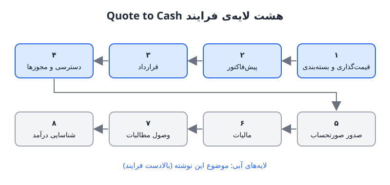

فرایند Quote to Cash یا «از پیش‌فاکتور تا وصول وجه» به زبان ساده یعنی تبدیل برگه‌ی قیمت شرکت به پول نقد در حساب بانکی. با این‌که نامش از پیش‌فاکتور شروع می‌شود، در واقع خیلی زودتر آغاز می‌شود و بعد از وصول هم تمام نمی‌شود. در این نوشته ساختار کلی این فرایند و چهار لایه‌ی نخست آن را بررسی می‌کنیم.

## Quote to Cash دقیقاً مال کیست؟

این فرایند از فروش، محصول، مالی، حسابداری و حقوقی عبور می‌کند. هر واحد بخشی از آن را از آنِ خود می‌داند، اما هیچ‌کدام نمی‌خواهد مالک کل آن باشد. نتیجه معمولاً این است که شکاف‌ها بین واحدها می‌افتد و تیم مالی در انتهای کار، هنگام صدور صورتحساب یا تطبیق وجوه، آن‌ها را کشف می‌کند.

برای دیدن کل تصویر، می‌توان فرایند را در هشت لایه دید:

1. قیمت‌گذاری و بسته‌بندی
2. پیش‌فاکتور
3. قرارداد
4. تأمین دسترسی و مجوزها
5. صدور صورتحساب
6. مالیات
7. وصول مطالبات
8. شناسایی درآمد

صدور صورتحساب امروز سریع‌ترین تغییر را دارد، چون قیمت‌گذاری مصرفی، مدل‌های تعهدی، قیمت‌گذاری مبتنی بر نتیجه و اندازه‌گیری مصرف همه به آن فشار می‌آورند. لایه‌های پایانی و اثر آن‌ها بر چرخه‌ی نقد را در [سفارش تا وصول وجه در محصولات هوش مصنوعی](/posts/2025/02/01/order-to-cash-ai-cogs-cash-cycle/) دیده‌ایم؛ این‌جا تمرکز روی چهار لایه‌ی بالادستی است که بیشتر خطاهای بعدی از همان‌جا متولد می‌شوند.

## لایه‌ی اول: قیمت‌گذاری و بسته‌بندی

پیش از آن‌که فروشنده پیش‌فاکتوری بسازد، محصول باید قیمت و بسته داشته باشد. در گذشته شرکت‌ها شاید سالی یک بار قیمت‌ها را به‌روز می‌کردند. امروز با سرعت نوآوری، هزینه‌های متغیر هوش مصنوعی و تغییر سریع رفتار کاربر، قیمت باید بارها با اقتصاد واحد هم‌سو شود.

دو مدل رایج امروز:

- **ترکیبی اشتراکی و مصرفی:** مبلغ ثابت ماهانه با سهمیه‌ی مشخص مصرف، و پرداخت متغیر برای مصرف بیشتر.
- **اعتبار با شارژ خودکار:** مشتری بسته‌ای اعتبار می‌خرد و وقتی تمام شد، خودکار شارژ می‌شود.

در فروش سازمانی پرسش کلیدی بسته‌بندی این است که اعتبار در چه سطحی تجمیع شود: فرد، تیم یا کل سازمان مشتری؟ این تصمیم ساده به نظر می‌رسد، اما روی مجوزها، صورتحساب و گزارش مصرف اثر مستقیم دارد.

با رشد شرکت، قیمت‌گذاری به **مالک و فرایند** نیاز دارد. اگر هر فروشنده هر طور خواست تخفیف بدهد، نتیجه تخفیف‌های ناهماهنگ و انبوه کدهای کالا (SKU) است و در انتها تیم مالی نمی‌تواند صورتحساب درستی بسازد. برای ساختن این نظم، [دسک معامله](/posts/2025/01/26/deal-desk-saas-pricing-guardrails/) یکی از ابزارهای مؤثر است.

## لایه‌ی دوم: پیش‌فاکتور

پیش‌فاکتور باید همه‌ی اقلام قابل صورتحساب را که فروشنده با مشتری توافق کرده خلاصه کند. امروز به‌ندرت فقط یک مبلغ ثابت در کار است؛ معمولاً هزینه‌ی راه‌اندازی، هزینه‌ی مصرف، هزینه‌ی مازاد و موارد دیگر کنار هم می‌آیند و زمان صورتحساب هر کدام متفاوت است.

هر قلم پیش‌فاکتور زنجیره‌ای از پیامد دارد:

- برای دانستن مبلغ پرداختی، باید صورتحساب ساخته شود؛
- برای صورتحساب، مالیات باید لحاظ شود؛
- مالیات به این بستگی دارد که چه فروخته‌ایم، کجا و کی؛
- باید روش دریافت وجه به‌همراه مالیات تعیین شود: انتقال بانکی، کارت یا روش دیگر؛
- و باید قاعده‌ی استرداد و محاسبه‌ی تناسبی (پرو‌ریتا) برای مشتری ناراضی روشن باشد.

همه‌ی این داده‌ها باید به تیم مالی برسد تا در انتها وجوه را بشمارد و تطبیق دهد. در فروش سازمانی پیچیدگی بیشتر است: معاملات چندمحصولی با تخفیف ویژه، توافق‌نامه‌ی سطح خدمت (SLA) با استرداد در صورت قطعی، بند «مطلوب‌ترین مشتری» که بهترین قیمت را تضمین می‌کند، یا سقف افزایش قیمت. هر کدام بار عملیاتی سنگینی بر سامانه‌ی صورتحساب و افرادی که باید اجرایش کنند می‌گذارد.

## لایه‌ی سوم: قرارداد

هسته‌ی هر قرارداد از نگاه صورتحساب چهار پرسش است:

| پرسش | نمونه |
|---|---|
| چه چیزی را صورتحساب می‌کنیم؟ | اشتراک، مصرف، خدمات راه‌اندازی |
| کی صورتحساب می‌کنیم؟ | پیش‌پرداخت سالانه، ماهانه پس از مصرف |
| به چه کسی؟ | شرکت مادر، واحد تابعه، نشانی صورتحساب |
| تحت چه قواعدی؟ | تخفیف پلکانی، سقف قیمت، استرداد SLA |

سه پرسش اول معمولاً روشن‌اند؛ دشواری اصلی در پرسش چهارم است. تیم‌های مالی بارها کشف می‌کنند آنچه فروخته شده در عمل قابل صورتحساب نیست.

### آزمون صورتحساب پیش از امضا

یک عادت ساده بسیاری از این مشکلات را پیشگیری می‌کند: **پیش از ارسال قرارداد برای امضا، صورتحساب ماه بعد آن را آزمایشی بسازید.** معمولاً در همین لحظه معلوم می‌شود که چیزی قابل وصول نیست. اگر نتوانید صورتحساب بسازید، نمی‌توانید پول بگیرید، و درآمد تکراری‌ای که شمرده‌اید فقط روی کاغذ است.

فرض کنید قراردادی ۱۲۰ هزار دلاری با پرداخت سالانه و ۲۰ درصد تخفیف برای تعهد سه‌ساله، به‌علاوه‌ی هزینه‌ی مصرف مازاد بر سهمیه بسته شده است. هنگام ساخت صورتحساب آزمایشی می‌فهمید سهمیه‌ی مصرف ماهانه تعریف شده اما مازاد فصلی صورتحساب می‌شود، و قرارداد نگفته مصرف کم یک ماه مازاد ماه دیگر را جبران می‌کند یا نه. این ابهام اگر پس از امضا کشف شود، به مذاکره‌ی دوباره، اختلاف و تأخیر در وصول می‌انجامد.

## لایه‌ی چهارم: تأمین دسترسی و مجوزها

پس از خرید، مشتری باید به چیزی دسترسی پیدا کند و کسی باید تصمیم بگیرد چه کسی چقدر از اعتبار را خرج کند. در گذشته دسترسی به نرم‌افزار همه یا هیچ بود: یا وارد بودید یا نبودید. امروز مجوزها بسیار ریزتر شده‌اند:

- **محدودیت مدل یا قابلیت:** این واحد به فلان مدل دسترسی ندارد و دسترسی باید در هر لحظه قابل قطع باشد.
- **سقف مصرف:** فقط تا پنج بار اجازه‌ی فلان کار را دارید و بعد مسدود می‌شوید. این که چند سال پیش نادر بود، حالا رایج است.

یک مثال گویا: برخی اپلیکیشن‌های مدیریت مالی شخصی در طرح پایه اجازه‌ی اتصال دستیار هوش مصنوعی را می‌دهند، اما تعداد عملیات نوشتن را به چند بار محدود می‌کنند. کاربر می‌تواند چند تراکنش را دسته‌بندی کند و بعد به دیوار می‌خورد. این طراحی هوشمندانه است: کاربر ارزش را حس می‌کند و برای طرح بالاتر پول می‌دهد، و هم‌زمان جلوی مصرف نامحدود و پرهزینه گرفته می‌شود.

پس مجوزها دو کارکرد دارند: **دفاعی**، یعنی جلوگیری از نشت درآمد وقتی مشتری بیش از آنچه پرداخته استفاده می‌کند؛ و **تهاجمی**، یعنی سازوکاری برای فروش ارتقا. اشتباه در این لایه بسیار گران تمام می‌شود.

## پرسش‌های متداول

### تفاوت Quote to Cash و Order to Cash چیست؟

Order to Cash معمولاً از ثبت سفارش تا وصول وجه را پوشش می‌دهد، اما Quote to Cash زودتر شروع می‌شود و قیمت‌گذاری، پیش‌فاکتور و قرارداد را هم در بر می‌گیرد.

### مالکیت این فرایند با کدام واحد باشد؟

یک مالک واحد برای کل زنجیره کمتر دیده می‌شود، اما هر لایه باید مالک روشن داشته باشد و تیم مالی در طراحی قیمت و قرارداد از ابتدا حضور داشته باشد، نه فقط در انتها.

### نشت درآمد بیشتر از کدام لایه می‌آید؟

از قراردادهایی که قابل صورتحساب نیستند و از مجوزهایی که درست تنظیم نشده‌اند؛ هر دو باعث می‌شوند ارزش تحویل‌شده به پول تبدیل نشود.

### کوچک‌ترین گام عملی برای شروع چیست؟

آزمون صورتحساب پیش از امضا. هزینه‌ی کمی دارد و بیشتر ابهام‌های قرارداد را پیش از آن‌که به اختلاف تبدیل شوند آشکار می‌کند.

## جمع‌بندی

فرایند Quote to Cash از برگه‌ی قیمت شروع می‌شود و هر تصمیم در لایه‌های بالادستی، روی صورتحساب، مالیات، وصول و شناسایی درآمد اثر می‌گذارد. برای قیمت‌گذاری مالک و فرایند تعیین کنید، اقلام پیش‌فاکتور را با پیامدهای مالیاتی و پرداختی‌اش ببینید، پیش از امضای قرارداد صورتحساب آزمایشی بسازید و مجوزها را هم ابزار جلوگیری از نشت درآمد بدانید و هم موتور فروش ارتقا.
