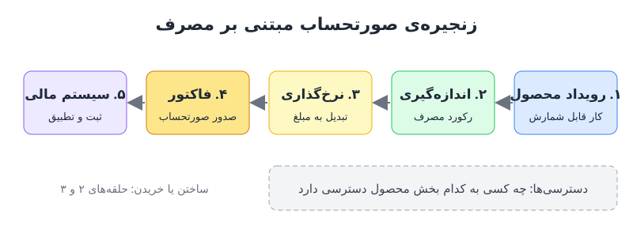

صورتحساب مبتنی بر مصرف دیگر یک کار ساده‌ی پشتیبانی در گوشه‌ی سیستم حسابداری نیست. وقتی واحد ارزش از «هر کاربر» به «هر درخواست»، «هر اعتبار» یا «هر توکن» تغییر می‌کند، صدور فاکتور به مسئله‌ای هم‌زمان در حوزه‌ی محصول، داده و مالی تبدیل می‌شود. این نوشته زنجیره‌ی کامل را از رویداد محصول تا ثبت در دفاتر توضیح می‌دهد.

## چرا واحد ارزش تغییر کرده است

ده سال پیش مدل رؤیایی نرم‌افزار ساده بود: ماهی ۱۰۰ دلار به ازای هر کاربر. تعداد کاربر نماینده‌ی خوبی برای ارزش دریافتی بود، چون کار را انسان انجام می‌داد.

امروز این فرض شکسته است. فرض کنید دو مشتری هر کدام ماهی ۲۰ دلار برای یک ابزار هوش مصنوعی می‌پردازند. اولی در ماه پنج درخواست ساده می‌فرستد. دومی صدها هزار درخواست اجرا می‌کند و عملاً کار یک تیم بزرگ را خودکار کرده است. قیمت یکسان است، اما هم ارزش دریافتی و هم هزینه‌ی خدمت‌رسانی به این دو مشتری کاملاً متفاوت است. از نگاه اقتصاد واحد، این مدل پایدار نیست.

نتیجه این است که بیشتر شرکت‌ها امروز ترکیبی از چند جزء دارند: صندلی (کاربر)، مصرف، اعتبار، اضافه‌مصرف، هزینه‌ی پلتفرم و مصرف هوش مصنوعی. برای درک بهتر این تحول، [پیش‌بینی درآمد مبتنی بر مصرف](/posts/2025/01/18/consumption-based-revenue-forecast/) را هم ببینید.

## سیر تحول صورتحساب در نرم‌افزار

| دوره | مدل فروش | ماهیت صورتحساب |
|---|---|---|
| مجوز دائمی | یک‌بار پرداخت | یک فاکتور، تمام |
| اشتراک | پرداخت دوره‌ای | زمان‌بندی فاکتور، دوره‌ی آزمایشی، پیش‌پرداخت |
| مصرفی | پرداخت به اندازه‌ی استفاده | اندازه‌گیری لحظه‌ای، قیمت پلکانی، تعهد حداقل |

در هر سه مدل، درآمد حاصل‌ضرب قیمت (P) در مقدار (Q) است. تفاوت در این است که در مدل مصرفی، رسیدن به P و Q بسیار پیچیده است. اشتراک بیشتر یک مسئله‌ی صدور فاکتور بود؛ مصرف، یک مسئله‌ی داده و قیمت‌گذاری لحظه‌ای است.

## اندازه‌گیری مصرف: چه چیزی را بشماریم؟

در ظاهر، اندازه‌گیری ساده به نظر می‌رسد؛ تاکسی‌متر هم همین کار را می‌کند. اما در عمل سه پرسش دشوار وجود دارد:

- **واحد شمارش چیست؟** تعداد فراخوانی API، حجم داده، یک معیار جایگزین، یا توکن؟
- **در چه سطحی؟** کاربر، پروژه، حساب مشتری یا کل سازمان؟
- **حجم داده چقدر است؟** هر انتخاب، میلیون‌ها رکورد خام تولید می‌کند که باید جذب و نگهداری شود.

در محصولات هوش مصنوعی، واحدی که جا افتاده توکن است. اما توکن بیشتر شبیه یک ارز رفتار می‌کند تا یک واحد کار: ارزش آن به زمینه بستگی دارد. برای نمونه، توکن خروجی گران‌تر از توکن ورودی است، چون خواندن درخواست یک‌جا و موازی انجام می‌شود اما تولید پاسخ، توکن‌به‌توکن.

از سمت خریدار، یکسان شدن واحد شمارش یک مزیت دارد: می‌توان فروشندگان مختلف را کنار هم مقایسه کرد و درباره‌ی تفاوت قیمت‌ها مذاکره کرد؛ همان اتفاقی که در رایانش ابری با واحدهایی مثل «هسته‌ی مجازی در دقیقه» افتاد.

## منطق قیمت‌گذاری: قیمت دیروز، قیمت امروز نیست

حتی وقتی اندازه‌گیری حل شود، منطق قیمت‌گذاری مصرفی پیچیده است. در اشتراک، قرارداد می‌گوید سال اول ۲۰ و سال دوم ۵۰ دلار. اما یک قرارداد مصرفی معمولاً چنین است:

- ۱۰۰ اعتبار رایگان در بسته وجود دارد؛
- ۱,۰۰۰ اعتبار بعدی هر کدام ۳ دلار؛
- برای ۱,۰۰۰ اعتبار بعد از آن تخفیف داده می‌شود، به شرط تعهد خرید ۵,۰۰۰ اعتبار؛
- اگر مصرف از سقف اعتباری عبور کند، دسترسی قطع می‌شود.

فرض کنید مشتری در یک ماه ۱,۶۰۰ اعتبار مصرف کرده است. ۱۰۰ اعتبار اول رایگان است و ۱,۰۰۰ اعتبار بعدی ۳,۰۰۰ دلار می‌شود. برای ۵۰۰ اعتبار باقی‌مانده، سیستم باید بداند آیا مشتری تعهد ۵,۰۰۰ اعتباری را امضا کرده یا نه، و نرخ کدام پله را اعمال کند. این تصمیم باید برای هزاران مشتری، به‌صورت خودکار و بدون خطا گرفته شود. ریسک‌های این تعهدها برای مشتری را در [قرارداد مبتنی بر مصرف و ریسک تعهد خرید](/posts/2024/11/19/usage-based-contract-commitment-risk/) بررسی کرده‌ایم.

چالش دیگر، **مصرف دیرهنگام** است. اگر خط لوله‌ی اندازه‌گیری مصرف را با تأخیر گزارش کند، مالی باید تصمیم بگیرد این مصرف در کدام دوره ثبت شود. این یک مسئله‌ی تطبیق واقعی است.

## زنجیره‌ی صورتحساب مبتنی بر مصرف

برای راه‌اندازی صورتحساب مصرفی نمی‌توان بی‌گدار به آب زد. زنجیره‌ی کامل پنج حلقه دارد:

1. **رویداد محصول:** هر کاری که می‌خواهید بابتش پول بگیرید، باید در محصول به‌صورت یک رویداد قابل شناسایی، برچسب‌خورده و قابل ردیابی تولید شود. یعنی مدل درآمدی باید از روز اول طراحی محصول در ذهن باشد.
2. **اندازه‌گیری:** رویدادهای خام به رکوردهای مصرف تبدیل می‌شوند.
3. **نرخ‌گذاری:** رکوردهای مصرف بر اساس قرارداد هر مشتری به مبلغ ریالی یا دلاری تبدیل می‌شوند.
4. **صدور فاکتور:** مبالغ نرخ‌گذاری‌شده به فاکتور تبدیل می‌شوند.
5. **ثبت در سیستم مالی:** فاکتورها به دفاتر می‌رسند تا ثابت شود چه مصرفی فروخته شد، چه بخشی قابل صورتحساب بود و چه مبلغی درآمد است، و هیچ مصرفی در مسیر گم نشده است.

در کنار این زنجیره، **دسترسی‌ها** هم باید مدیریت شود: چه کسی به محصول دسترسی دارد و به چه بخش‌هایی. تولید رویداد قطعاً کار خود شرکت است، اما برای اندازه‌گیری و نرخ‌گذاری می‌توان بین ساختن و خریدن انتخاب کرد.

## آیا صورتحساب از سیستم ERP جدا می‌شود؟

صورتحساب سال‌ها یکی از ماژول‌های سیستم یکپارچه‌ی منابع سازمان (ERP) بود. امروز بیشتر شبیه بخشی از محصول است. سیستم ERP جایگزین نمی‌شود، اما در حال تفکیک است، چون یک سیستم دسته‌ای است و برخی کارکردهای مرتبط با کسب درآمد باید لحظه‌ای باشند.

| کارکرد | جایگاه محتمل |
|---|---|
| دفتر کل و بستن حساب‌ها | همچنان در ERP |
| شناسایی درآمد | تا حد زیادی بیرون رفته |
| خودکارسازی مطالبات | در حال خروج |
| صورتحساب | لایه‌ی عملیاتی کنار ERP |

قاعده‌ی کلی این است: کارکردهایی که باید با سرعت محصول حرکت کنند، به سیستم صورتحساب منتقل می‌شوند و ERP سیستم ثبت نهایی باقی می‌ماند. پیامد نقدی این زنجیره را در [سفارش تا وصول وجه در محصولات هوش مصنوعی](/posts/2025/02/01/order-to-cash-ai-cogs-cash-cycle/) بخوانید.

## پرسش‌های متداول

### تفاوت اندازه‌گیری و نرخ‌گذاری چیست؟
اندازه‌گیری رویدادهای خام را به رکورد مصرف تبدیل می‌کند؛ نرخ‌گذاری آن رکوردها را بر اساس قرارداد هر مشتری به مبلغ پولی تبدیل می‌کند.

### چرا مدل درآمدی باید از ابتدای طراحی محصول مشخص باشد؟
چون اگر محصول رویدادهای لازم را تولید نکند، چیزی برای شمارش و فاکتور وجود ندارد و افزودن آن بعداً پرهزینه است.

### مصرف دیرهنگام را چطور مدیریت کنیم؟
پیش از راه‌اندازی، سیاست مکتوب داشته باشید که مصرف گزارش‌شده با تأخیر در کدام دوره فاکتور و ثبت شود.

### آیا شرکت‌های کوچک هم به سیستم جداگانه‌ی صورتحساب نیاز دارند؟
اگر فقط اشتراک ساده دارید، معمولاً نه. با ورود مصرف، اعتبار و قیمت پلکانی، صفحه‌گسترده و ماژول ساده‌ی ERP سریع به محدودیت می‌رسد.

## جمع‌بندی

صورتحساب مبتنی بر مصرف از جایی پیچیده شد که واحد ارزش از انسان به مصرف تغییر کرد. برای اجرای درست آن باید زنجیره‌ی رویداد، اندازه‌گیری، نرخ‌گذاری، فاکتور و ثبت مالی را از ابتدا طراحی کرد، تکلیف مصرف دیرهنگام را از پیش روشن کرد و تصمیم گرفت کدام حلقه‌ها داخلی ساخته شوند و کدام خریداری. صورتحساب دیگر فقط کار واحد مالی نیست؛ لایه‌ای عملیاتی میان محصول و دفاتر است.
