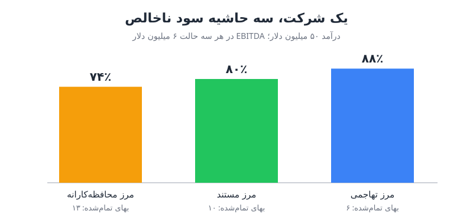

طبقه‌بندی بهای تمام‌شده‌ی خدمات یا کالای فروش‌رفته فقط یک محاسبه‌ی حسابداری نیست؛ تصمیمی است که مستقیماً روایت شرکت را نزد سرمایه‌گذار و خریدار شکل می‌دهد. حاشیه سود ناخالص روی کاغذ ساده است، اما جایی که مرز بهای تمام‌شده را می‌کشید، می‌تواند شما را در گروه شرکت‌های نرم‌افزاری پرحاشیه یا در گروه کسب‌وکارهای خدماتی کم‌حاشیه قرار دهد.

## حاشیه سود ناخالص: محاسبه یا قضاوت؟

تعریف کتابی ساده است: درآمد منهای بهای تمام‌شده. اما وقتی با صورت‌حساب میزبانی ابری، سهمیه‌ی بزرگ توکن هوش مصنوعی، هزینه‌ی پشتیبانی مشتری یا حقوق رو‌به‌رشد مهندسان مستقر نزد مشتری روبه‌رو می‌شوید، در واقع درباره‌ی ارزش‌گذاری تصمیم می‌گیرید.

استانداردهای حسابداری برای این مرز آزادی عمل می‌دهند. یک منطقه‌ی خاکستری میان «هزینه‌ی تحویل محصول» و «هزینه‌ی اداره‌ی شرکت» وجود دارد و تشخیص آن با مدیر حسابداری و کنترلر است. این مرز امروز حساس‌تر از همیشه است، چون هزینه‌های هوش مصنوعی میان دو چیز مبهم شده‌اند: هزینه‌ی ارائه‌ی محصول هوشمند به مشتری، و هزینه‌ی اداره‌ی خود شرکت با ابزارهای هوشمند. برای مرور انواع حاشیه، [حاشیه سود ناخالص، عملیاتی و خالص](/posts/2024/01/14/profit-margins-gross-operating-net/) را ببینید.

## چرا مدیر مالی، سرمایه‌گذار و خریدار به این مرز حساس‌اند

### مدیر مالی

حاشیه سود ناخالص نشان می‌دهد چند ریال برای اداره و رشد شرکت باقی می‌ماند و در نتیجه تعیین می‌کند چقدر می‌توان برای رشد هزینه کرد. منطق رایج این است که هزینه‌های عملیاتی به رشد آینده کمک می‌کنند و بهای تمام‌شده خدمت به فروش‌های گذشته است.

- حاشیه‌ی بالا یعنی می‌توانید دوره‌ی بازگشت هزینه‌ی جذب مشتری (CAC Payback) طولانی‌تری را تحمل کنید.
- حاشیه‌ی پایین یعنی باید هزینه‌ها را سریع‌تر بازگردانید.

مدیر مالی همچنین به ثبات تعریف اهمیت می‌دهد. هیچ چیز بدتر از این نیست که سرمایه‌گذار بپرسد آیا روش محاسبه از دوره‌ای به دوره‌ی دیگر عوض شده است.

### سرمایه‌گذار

برای سرمایه‌گذار درصد حاشیه نشانه‌ی مقیاس‌پذیری است و شرکت را در یک دسته قرار می‌دهد که هر کدام بازه‌ی ضریب ارزش‌گذاری خود را دارد:

| نوع کسب‌وکار | حاشیه سود ناخالص معمول |
|---|---|
| نرم‌افزار خالص (پیش از هوش مصنوعی) | بالای ۸۰ درصد |
| زیرساخت و مدل‌های مصرفی | از ۵۰ درصد تا حدود ۷۵ درصد |
| شرکت‌های خدماتی یا پیاده‌سازی‌محور | پایین‌تر، متناسب با سهم خدمات |

نکته‌ی جالب این است که امروز حاشیه‌ی «بیش از حد بالا» هم می‌تواند علامت منفی باشد، چون ممکن است نشان دهد هوش مصنوعی واقعی در محصول وجود ندارد. روند هم به اندازه‌ی سطح مهم است: حاشیه‌ی رو‌به‌کاهش بدترین روایت است، حتی اگر از سطح بالا شروع شده باشد. بهای تمام‌شده روی [ارزش طول عمر مشتری و نسبت LTV به CAC](/posts/2025/02/09/ltv-cac-multi-product-cross-sell/) هم اثر می‌گذارد و تعدیل‌نکردن این شاخص‌ها با حاشیه سود ناخالص خطای رایجی است.

### خریدار

تیم بررسی کیفیت سود (QofE) خریدار، حاشیه را از سطح تراکنش از نو می‌سازد و پشتیبانی، موفقیت مشتری، زیرساخت و هر هزینه‌ی دیگری را که بتواند به بهای تمام‌شده اضافه می‌کند تا کاهش قیمت را توجیه کند. هم‌زمان برای هم‌افزایی‌ها تعدیل می‌کند؛ مثلاً ممکن است قرارداد ابری ارزان‌تری داشته باشد. سرمایه‌گذار می‌پرسد «این حاشیه چه می‌تواند بشود»؛ خریدار می‌پرسد «اول چه اضافه کنم و بعد چه حذف کنم».

## هزینه‌های قطعی و هزینه‌های خاکستری

| دسته | اقلام |
|---|---|
| تقریباً قطعی در بهای تمام‌شده | میزبانی و زیرساخت ابری، داده و فیدهایی که در محصول بسته‌بندی می‌شوند، پشتیبانی مشتری (افراد و نرم‌افزار)، خدمات حرفه‌ای راه‌اندازی |
| خاکستری | توکن و عامل‌های هوش مصنوعی، موفقیت مشتری (اگر سهمیه‌ی فروش دارد)، مصرف دوره‌ی آزمایشی رایگان، توسعه و آموزش مدل، پردازش و نگهداری داده |

## مثال عددی: یک شرکت، سه حاشیه

فرض کنید شرکتی با ۵۰ میلیون دلار درآمد تکراری سالانه این هزینه‌ها را دارد (ارقام به میلیون دلار):

| قلم هزینه | مبلغ |
|---|---|
| میزبانی ابری محصول | ۶ |
| پشتیبانی مشتری | ۲.۵ |
| توکن هوش مصنوعی مصرفی در محصول | ۳.۵ |
| مهندسان راهکار (راه‌اندازی و تحویل) | ۱ |
| فروش و بازاریابی | ۱۶ |
| تحقیق و توسعه | ۱۰ |
| عمومی و اداری | ۵ |

مجموع هزینه‌ها ۴۴ و سود عملیاتی پیش از استهلاک (EBITDA) ۶ میلیون دلار است. اختلاف بر سر ۷ میلیون دلار پشتیبانی، توکن و مهندسان راهکار است.

- **مرز تهاجمی:** فقط میزبانی در بهای تمام‌شده؛ بهای تمام‌شده ۶، سود ناخالص ۴۴، حاشیه **۸۸ درصد**.
- **مرز محافظه‌کارانه:** همه‌ی هزینه‌های خدمت به مشتری؛ بهای تمام‌شده ۱۳، سود ناخالص ۳۷، حاشیه **۷۴ درصد**.

چهارده واحد درصد اختلاف، با همان مبلغ هزینه و همان EBITDA.

### مرز مستند و قابل دفاع

حالا هر قلم خاکستری را با شواهد واقعی تفکیک کنیم:

| تعدیل | منطق | انتقال از بهای تمام‌شده |
|---|---|---|
| ۱۰٪ میزبانی | محیط توسعه، آزمایش و تست بار؛ به تحقیق و توسعه | ۰.۶ |
| ۳۰٪ توکن | مصرف داخلی کارکنان برای خودکارسازی کارها؛ به عمومی و اداری | حدود ۱ |
| ۲۵٪ توکن | مصرف دوره‌ی آزمایشی رایگان، که هزینه‌ی جذب است؛ به فروش و بازاریابی | ۰.۸۷۵ |
| ۵۰٪ مهندسان راهکار | سهمیه‌ی فروش دارند؛ به فروش | ۰.۵ |

در مجموع حدود ۳ میلیون دلار جابه‌جا می‌شود: بهای تمام‌شده ۱۰، سود ناخالص ۴۰ و حاشیه **۸۰ درصد**. شش واحد درصد برگشت، بدون تغییر در قرارداد یا درآمد، و این بار با تعریفی که واقعاً نحوه‌ی کار سازمان را نشان می‌دهد. برای اهمیت این عدد در تحلیل رقابتی، [حاشیه سود ناخالص به‌عنوان نشانه‌ی خندق](/posts/2022/07/01/gross-margin-moat-indicator/) را بخوانید.

## سه اقدام عملی برای کنترلر

1. **تعریف بهای تمام‌شده را در یک صفحه بنویسید.** هر جزء را جداگانه تعریف کنید و تأیید کل تیم مالی را بگیرید تا همه بدانند هر هزینه کجا می‌نشیند.
2. **مصرف توکن را از همین حالا برچسب بزنید.** بازسازی تفکیکی که از ابتدا ثبت نشده، بعداً تقریباً ناممکن است.
3. **حاشیه‌ی نرم‌افزار و خدمات را جدا گزارش کنید.** اگر درآمد خدمات یا پیاده‌سازی دارید، دو حاشیه‌ی جدا نشان دهید تا هسته‌ی نرم‌افزاری کسب‌وکار جریمه نشود.

## پرسش‌های متداول

### آیا جابه‌جایی هزینه میان بهای تمام‌شده و هزینه‌های عملیاتی سود را تغییر می‌دهد؟
خیر. سود عملیاتی و EBITDA ثابت می‌ماند؛ فقط ترکیب حاشیه سود ناخالص و هزینه‌های عملیاتی و در نتیجه روایت شرکت عوض می‌شود.

### هزینه‌ی توکن هوش مصنوعی باید در بهای تمام‌شده باشد؟
بخشی که مستقیماً به مشتری خدمت می‌دهد بله. مصرف داخلی کارکنان و مصرف دوره‌ی آزمایشی را می‌توان با شواهد مستند به هزینه‌های عملیاتی برد.

### اگر تعریف را تغییر دهیم چه کنیم؟
دوره‌های گذشته را با تعریف جدید بازارائه کنید و تغییر را شفاف توضیح دهید تا روند قابل مقایسه بماند.

## جمع‌بندی

حاشیه سود ناخالص یک مرز است، نه فقط یک فرمول. همان شرکت با همان هزینه‌ها می‌تواند حاشیه‌ای بین ۷۴ تا ۸۸ درصد گزارش کند. هدف، بالاترین عدد ممکن نیست؛ عددی است که هم بالا باشد و هم از نظر منطقی قابل دفاع، با تعریف مکتوب، برچسب‌گذاری دقیق هزینه‌ها و ثبات از دوره‌ای به دوره‌ی دیگر.
