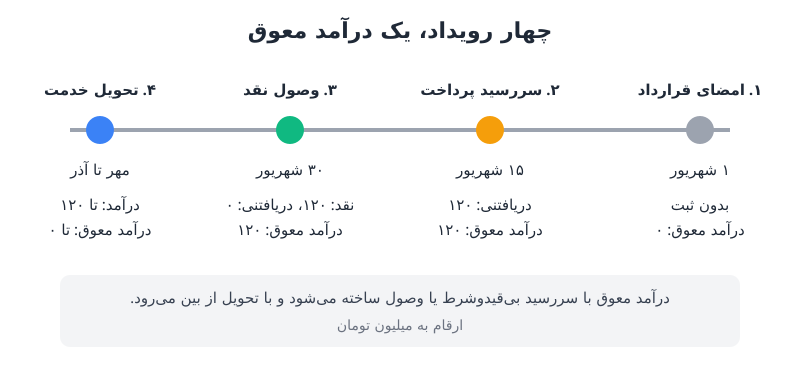

**درآمد معوق** یکی از اقلامی است که حتی کارشناسان باتجربه‌ی مالی هم درباره‌اش اشتباه می‌کنند. خیلی‌ها فکر می‌کنند با امضای قرارداد یا ارسال صورتحساب، درآمد معوق ساخته می‌شود و هر ریالش هم در حساب بانکی نشسته است. هیچ‌کدام لزوماً درست نیست. این نوشته نشان می‌دهد درآمد معوق دقیقاً در کدام لحظه متولد می‌شود.

در [نوشته‌ی قبلی درباره‌ی درآمد معوق و RPO](/posts/2025/02/15/deferred-revenue-rpo-calculated-billings/) دیدیم چرا مدیر مالی و سرمایه‌گذار به این عدد اهمیت می‌دهند. این بار سراغ پرسشی پایه‌ای‌تر می‌رویم: کدام رویداد این بدهی را می‌سازد و چه دارایی‌ای روبه‌رویش در ترازنامه می‌نشیند؟

## تعریف دقیق درآمد معوق در حسابداری تعهدی

در حسابداری تعهدی، درآمد وقتی شناسایی می‌شود که «کسب» شده باشد، یعنی کالا یا خدمت تحویل شده باشد. این لحظه ممکن است قبل یا بعد از رسیدن پول باشد.

تعریف دقیق‌تر این است: درآمد معوق زمانی ایجاد می‌شود که **پول دریافت شده باشد** یا **تعهد پرداخت مشتری بی‌قیدوشرط و سررسیدشده باشد**، اما شرکت هنوز کالا یا خدمت را تحویل نداده باشد.

بخش دوم این جمله، یعنی «تعهد پرداخت بی‌قیدوشرط»، منشأ بیشتر سردرگمی‌هاست. مشتری می‌تواند پیش از شروع خدمت، بدون هیچ شرطی به شما بدهکار شود؛ مثلاً وقتی لایسنس نرم‌افزارش فعال می‌شود یا تاریخ پرداخت قراردادی‌اش فرامی‌رسد. در این حالت درآمد معوق ایجاد شده، **حتی اگر هنوز ریالی وصول نکرده باشید**.

## چهار رویداد جدا: امضا، صورتحساب، وصول و تحویل

در گفت‌وگوهای روزمره «قرارداد بستیم»، «فاکتور زدیم»، «سررسید شد» و «پول آمد» را به‌جای هم به کار می‌بریم. اما این‌ها چهار رویداد مستقل‌اند و هر کدام چیز متفاوتی می‌گوید:

| رویداد | پرسشی که پاسخ می‌دهد |
|---|---|
| قرارداد | مشتری متعهد به خرید چه چیزی و با چه شرایطی شده است؟ |
| صورتحساب و سررسید | چه مبلغی را صورتحساب کرده‌ایم و پرداختش کی لازم‌الاجراست؟ |
| وصول نقد | واقعاً چقدر پول دریافت کرده‌ایم؟ |
| تحویل و شناخت درآمد | با تحویل کالا یا خدمت، چه مقدار درآمد کسب کرده‌ایم؟ |

درآمد معوق در محل تلاقی این چهار رویداد قرار دارد: پرداخت انجام شده یا بی‌قیدوشرط سررسید شده، اما درآمد هنوز کسب نشده است.

### صدور صورتحساب به‌تنهایی کافی نیست

نکته‌ی کلیدی این است که **ارسال صورتحساب زودهنگام، خودبه‌خود درآمد معوق نمی‌سازد**. اگر صورتحساب را پیش از آنکه قرارداد حق بی‌قیدوشرط دریافت به شما بدهد بفرستید، هنوز چیزی برای ثبت ندارید. برعکس، ممکن است صورتحساب را دیر فرستاده باشید و درآمد معوق از قبل وجود داشته باشد؛ چون قرارداد، تاریخ سررسید را تعیین کرده است، نه ایمیل شما.

## مثال عددی: قرارداد ۱۲۰ میلیونی تبلیغات

فرض کنید یک رسانه‌ی آنلاین قراردادی ۱۲۰ میلیون تومانی برای ۱۲ جایگاه تبلیغاتی در فصل پاییز (مهر تا آذر) می‌بندد؛ هر جایگاه ۱۰ میلیون تومان. قرارداد اول شهریور امضا می‌شود و کل مبلغ، بی‌قیدوشرط، ۱۵ شهریور سررسید می‌شود.

### ۱. امضای قرارداد (۱ شهریور)

یک قرارداد امضاشده‌ی ۱۲۰ میلیونی داریم؛ تیم فروش آن را در فهرست قراردادهای بسته‌شده ثبت می‌کند. اما نه تبلیغی پخش شده، نه پولی آمده و نه تاریخ پرداخت رسیده است. پس **هیچ ثبت حسابداری‌ای در کار نیست** و درآمد معوق صفر است.

### ۲. سررسید پرداخت (۱۵ شهریور)

حالا مشتری بی‌قیدوشرط ۱۲۰ میلیون بدهکار است و رسانه هم ۱۲ جایگاه به او بدهکار است. ثبت می‌کنیم:

- **حساب دریافتنی: ۱۲۰ میلیون** (آنچه مشتری به ما بدهکار است)
- **درآمد معوق: ۱۲۰ میلیون** (خدمتی که به مشتری بدهکاریم)

موجودی نقد تغییری نکرده و درآمدی هم شناسایی نشده است. اگر واحد مالی صورتحساب را پنج روز دیرتر بفرستد، ثبت به عقب نمی‌رود؛ صورتحساب فقط به تعهدی که از قبل وجود داشته می‌رسد. یک استثنا مهم است: اگر قرارداد ارائه‌ی صورتحساب معتبر را شرط اساسی حق دریافت کرده باشد، تحلیل فرق می‌کند. پس شرایط پرداخت قرارداد را با دقت بخوانید.

### ۳. وصول نقد (۳۰ شهریور)

مشتری پول را می‌پردازد. نقد ۱۲۰ میلیون بالا می‌رود و حساب دریافتنی صفر می‌شود. درآمد معوق همچنان ۱۲۰ میلیون است، چون هنوز تبلیغی پخش نشده است.

اگر مشتری دیر بپردازد، تا وقتی مبلغ قابل‌مطالبه و قابل‌وصول است، حساب دریافتنی باز می‌ماند. درآمد معوق مستقل از وصول، با تحویل خدمت کم می‌شود.

### ۴. تحویل خدمت (مهر تا آذر)

با پخش هر جایگاه، ۱۰ میلیون درآمد شناسایی و همین مقدار از درآمد معوق کم می‌شود. نکته‌ی ظریف اینجاست که درآمد از **تحویل** پیروی می‌کند، نه از تقویم. اگر شش جایگاه در مهر و دو جایگاه در آبان پخش شود، درآمد این دو ماه ۶۰ و ۲۰ میلیون است، نه ۴۰ میلیون یکنواخت در هر ماه. (اصول این انتقال را در [شناخت درآمد در صورت سود و زیان](/posts/2023/12/13/revenue-recognition-income-statement/) ببینید.)

| تاریخ | نقد | حساب دریافتنی | درآمد معوق | درآمد شناسایی‌شده (تجمعی) |
|---|---|---|---|---|
| ۱ شهریور | ۰ | ۰ | ۰ | ۰ |
| ۱۵ شهریور | ۰ | ۱۲۰ | ۱۲۰ | ۰ |
| ۳۰ شهریور | ۱۲۰ | ۰ | ۱۲۰ | ۰ |
| پایان مهر (۶ جایگاه) | ۱۲۰ | ۰ | ۶۰ | ۶۰ |
| پایان آبان (۲ جایگاه) | ۱۲۰ | ۰ | ۴۰ | ۸۰ |
| پایان آذر (۴ جایگاه) | ۱۲۰ | ۰ | ۰ | ۱۲۰ |

ارقام به میلیون تومان است.

## درآمد معوق همیشه یعنی پول در بانک؟

پاسخ کوتاه: نه. در ۱۵ شهریور، ۱۲۰ میلیون درآمد معوق داشتیم و صفر ریال نقد. در ۳۰ شهریور همان درآمد معوق را داشتیم و کل نقد را. هر دو وضعیت در ترازنامه یک رقم درآمد معوق نشان می‌دهند، اما فقط یکی حقوق کارکنان را پرداخت می‌کند.

پس هر وقت کسی گفت «۱۰ میلیارد درآمد معوق داریم»، بهترین پرسش بعدی این است: **چقدرش وصول شده است؟** برای پاسخ باید درآمد معوق را کنار حساب دریافتنی دید. اگر بخش بزرگی از درآمد معوق در برابر دریافتنی‌های معوق نشسته باشد، آن «وام بدون بهره‌ای» که از پیش‌پرداخت مشتری انتظار داریم، هنوز به دست نیامده است. این همان نقطه‌ای است که [مدیریت سرمایه در گردش](/posts/2023/06/10/profitable-company-cash-shortage-causes/) اهمیت پیدا می‌کند.

### سه درس عملی برای تیم مالی

1. **شرایط پرداخت را بخوانید.** تاریخ سررسید و شرط‌های صورتحساب در قرارداد، زمان ثبت را تعیین می‌کند، نه زمان ارسال ایمیل.
2. **صورتحساب را به‌موقع بفرستید.** تأخیر در صدور صورتحساب ثبت حسابداری را عقب نمی‌اندازد، اما وصول نقد را عقب می‌اندازد.
3. **درآمد معوق را با دریافتنی‌ها تطبیق دهید.** گزارشی که نشان دهد چه بخشی از درآمد معوق وصول شده، تصویر واقعی‌تری از نقدینگی می‌دهد.

## پرسش‌های متداول

### آیا امضای قرارداد درآمد معوق ایجاد می‌کند؟

نه. امضا فقط یک تعهد فروش است. تا وقتی پولی دریافت نشده یا پرداخت بی‌قیدوشرط سررسید نشده، ثبتی برای درآمد معوق انجام نمی‌شود.

### اگر صورتحساب دیر صادر شود، درآمد معوق هم دیرتر ثبت می‌شود؟

معمولاً نه. اگر قرارداد تاریخ سررسید را مشخص کرده باشد، تعهد از همان تاریخ وجود دارد. فقط اگر صدور صورتحساب معتبر شرط اساسی حق دریافت باشد، نتیجه فرق می‌کند.

### طرف مقابل درآمد معوق در ترازنامه چیست؟

بسته به وضعیت، یا نقد است (اگر مشتری پرداخته) یا حساب دریافتنی (اگر پرداخت سررسید شده اما وصول نشده). بدهی یکی است و دارایی روبه‌رویش فرق می‌کند.

### درآمد معوق با چه سرعتی کم می‌شود؟

با سرعت تحویل کالا یا خدمت، نه با گذر یکنواخت زمان و نه با سرعت وصول.

## جمع‌بندی

درآمد معوق نه با امضا ساخته می‌شود و نه با فرستادن صورتحساب؛ با دریافت پول یا سررسید بی‌قیدوشرط پرداخت ساخته می‌شود و با تحویل خدمت از بین می‌رود. قرارداد، صورتحساب، وصول و تحویل چهار ساعت جداگانه‌اند که هر کدام به وقت خودشان کار می‌کنند. تحلیلگر مالی خوب این چهار ساعت را از هم جدا می‌کند، کنار درآمد معوق حساب دریافتنی را هم می‌بیند و همیشه می‌پرسد: چه مقدار از این عدد واقعاً نقد شده است؟
