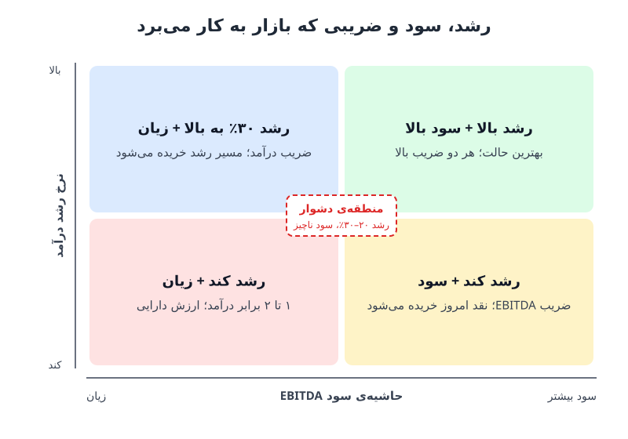

ضریب درآمد یا ضریب EBITDA؛ انتخاب میان این دو فقط یک بحث فنی نیست و می‌تواند ارزش یک شرکت را چند برابر کند. خریدار یا سرمایه‌گذار با نگاه به سرعت رشد و حاشیه‌ی سود تصمیم می‌گیرد آینده را بخرد یا سود امروز را. در این نوشته منطق این انتخاب، آستانه‌ی رشد و دام «سود اندک» را مرور می‌کنیم.

## ضریب درآمد از کجا آمد؟

شوخی قدیمی دنیای استارتاپ‌ها این است که «وقتی سود نداری، با ضریب درآمد معامله می‌شوی». بخشی از این شوخی ریاضی ساده است: وقتی EBITDA منفی است، ضریب EBITDA معنایی ندارد. اما منطق اصلی چیز دیگری است. سرمایه‌گذار باور دارد رشد درآمد آن‌قدر سریع است که ساختار هزینه‌ی امروز در چند سال آینده بی‌اهمیت می‌شود. با بزرگ‌شدن مقیاس، هزینه‌ها با همان سرعت درآمد بالا نمی‌روند و اهرم عملیاتی خودش را نشان می‌دهد. به بیان دیگر، درآمد مثل موجی است که هزینه‌ها را زیر خود می‌گیرد.

### یک مثال عددی از «پیشی‌گرفتن درآمد از هزینه»

فرض کنید شرکتی ۱۰۰ میلیون دلار درآمد و ۱۵۰ میلیون دلار هزینه دارد؛ یعنی ۵۰ میلیون دلار زیان.

| سناریو | رشد سالانه‌ی درآمد | رشد سالانه‌ی هزینه | زمان رسیدن به سربه‌سر |
|---|---|---|---|
| رشد تند | ۵۰٪ | ۲۰٪ | حدود ۲ سال |
| رشد کند | ۱۵٪ | ۱۰٪ | حدود ۹ سال |

در سناریوی اول، سال دوم درآمد به ۲۲۵ و هزینه به ۲۱۶ میلیون می‌رسد و شرکت سودده می‌شود. در سناریوی دوم، شکاف هزینه و درآمد فقط حدود ۴٫۵ درصد در سال کم می‌شود و رسیدن به سربه‌سر نزدیک یک دهه طول می‌کشد. برای همین در شرکت پررشد، زیان امروز تقریباً اهمیتی ندارد، اما در شرکت کم‌رشد، همان زیان کل داستان است.

## آستانه‌ی ۳۰ درصد رشد؛ جایی که چارچوب ارزش‌گذاری عوض می‌شود

یک قاعده‌ی سرانگشتی رایج میان سرمایه‌گذاران این است که برای گرفتن ضریب‌های درآمد بالا باید دست‌کم ۳۰ درصد در سال رشد کنید. دلیلش زمان دوبرابرشدن است:

- رشد ۳۰ درصدی درآمد را در حدود ۲٫۶ سال دو برابر می‌کند؛ عملاً کمتر از سه سال.
- رشد ۱۵ درصدی برای دوبرابرشدن نزدیک ۵ سال زمان می‌خواهد.

در شرکتی که در سه سال دو برابر می‌شود، ساختار حاشیه‌ی سود در مقیاس دو برابر کاملاً متفاوت خواهد بود و جریان نقد امروز در برابر آن ناچیز است. پس مسیر رشد ارزش‌گذاری می‌شود و درآمد تکرارشونده‌ی سالانه (ARR) تمیزترین نماینده‌ی این مسیر است.

نکته‌ی ظریف اینجاست که با کندشدن رشد، ضریب درآمد به‌تدریج کوچک نمی‌شود؛ جایگزین می‌شود. وقتی رشد از حدود ۳۰ درصد پایین‌تر می‌رود، سرمایه‌گذار دیگر به حاشیه‌ی سود فرضی آینده اعتبار نمی‌دهد و می‌پرسد شرکت همین امروز چقدر نقد تولید می‌کند. بنیان‌گذارانی که هنوز به ضریب دوران رشد ۴۰ درصدی دل بسته‌اند، این تغییر چارچوب را دیر می‌فهمند.

بدترین جایگاه از این نگاه، رشد ۲۰ تا ۳۰ درصدی همراه با زیان است: برای سرمایه‌گذار رشد بیش از حد کند و برای سرمایه‌گذار جریان نقد بیش از حد زیان‌ده. برای آشنایی با منطق ارزش‌گذاری در هر مرحله، [چرخه‌ی رشد کسب‌وکار و روش‌های ارزش‌گذاری](/posts/2022/08/08/business-growth-cycle-valuation-methods/) را ببینید.

## دام سود اندک؛ وقتی ۳ درصد EBITDA به ضررتان است

شوخی دوم دنیای فناوری این است که «وقتی سود داری، با ضریب EBITDA معامله می‌شوی». این حرف در محدوده‌ای باریک درست است، به‌ویژه در شرکت‌های نرم‌افزاری پررشد که با سرمایه‌ی خطرپذیر بزرگ شده‌اند. در این شرکت‌ها رشد ARR و درصد سود ناخالص معمولاً بیش از حاشیه‌ی سود فعلی ارزش را تعیین می‌کند. البته اگر یک شرکت توزیع یا خدمات نگهداری را می‌فروشید، خریدار تقریباً حتماً سراغ EBITDA می‌رود، چون دقیقاً همان کسب‌وکار نقدساز را می‌خرد.

موضوع وقتی جالب می‌شود که خریدار «راهبردی» باشد؛ یعنی شرکتی که می‌خواهد کسب‌وکار شما را در عملیات خود ادغام کند. او احتمالاً بخش بزرگی از هزینه‌های عملیاتی شما را نگه نمی‌دارد: تیم مالی، منابع انسانی و حتی بخشی از فروش و بازاریابی. آنچه واقعاً می‌خواهد پایگاه مشتری، درآمد تکرارشونده و امکان فروش محصولات بیشتر به همان مشتریان است. پس EBITDA فعلی شما تصویر خوبی از ارزش کسب‌وکار زیر مالکیت او نیست.

حالا فرض کنید شرکت شما تازه به EBITDA مثبت رسیده، اما با حاشیه‌ی ۳ درصد. شما باور دارید در مقیاس بزرگ‌تر این کسب‌وکار به ۳۰ درصد حاشیه می‌رسد، ولی اکنون یک عدد واقعی و ضعیف به خریدار داده‌اید که روی آن لنگر بیندازد. نتیجه، دو داستان متوسط در کنار هم است: از خریدار می‌خواهید برای توان سودآوری آینده پول بدهد، در حالی که عدد امروز با آن آینده فاصله‌ی زیادی دارد. فروشنده در حالت ایده‌آل یا EBITDA منفی با روایتی مستند از ساختار حاشیه‌ی نهایی دارد، یا سود بسیار زیاد. منطقه‌ی میانی سخت‌ترین مذاکره را می‌سازد.

## نه رشد، نه سود؛ ضریب‌های ۱ تا ۲ برابر درآمد

اگر شرکتی نه رشد سریع دارد و نه سودآور است، معمولاً ضریب‌های ۱ یا ۲ برابر درآمد در خبرها دیده می‌شود. اما این ضریب‌ها بیشتر محاسبه‌ای پس از بسته‌شدن معامله‌اند تا مبنای قیمت‌گذاری. در معامله‌ی شرکتی که روزی پررشد بوده، حالا کند شده، هنوز نقد می‌سوزاند و با ارزش‌گذاری‌هایی سرمایه جذب کرده که دیگر قابل دفاع نیستند، خریدار درباره‌ی ۱٫۸ یا ۲٫۱ برابر بحث نمی‌کند. او می‌سنجد دارایی واقعاً برایش چقدر می‌ارزد، چقدر نقد باید به آن تزریق کند و چه بدهی‌هایی را به ارث می‌برد. در طرف دیگر هم سهامداران بیشتر نگران این‌اند که پس از پرداخت حق تقدم سهام ممتاز چیزی برای سهام عادی باقی می‌ماند یا نه.

## بهترین ترکیب: رشد یا سود؟ مقایسه با قانون ۴۰

در بلندمدت، ارزش هر کسب‌وکار برابر ارزش فعلی جریان‌های نقد آزاد آینده است و هدف، رسیدن به حاشیه‌ی سود ۲۵ درصد یا بیشتر است. در آن سطح، رشد ۱۵ درصدی کافی است تا شرکت از «قانون ۴۰» (جمع نرخ رشد درآمد و حاشیه‌ی EBITDA) عبور کند. اما در میان‌مدت، به‌ویژه وقتی معامله یا جذب سرمایه نزدیک است، منطقی‌تر است رشد را تا حد معقول بالا ببرید و هم‌زمان سود ناخالص را سالم نگه دارید. رشدی که هر دلار درآمدش ۹۵ سنت هزینه‌ی تحویل دارد، کسی را تحت تأثیر قرار نمی‌دهد.

دو شرکت نرم‌افزاری را با کیفیت درآمد، نرخ نگهداشت مشتری، سود ناخالص و بازار مشابه در نظر بگیرید:

| شاخص | شرکت الف | شرکت ب |
|---|---|---|
| رشد درآمد | ۳۳٪ | ۲۳٪ |
| حاشیه‌ی سود | منفی ۵٪ | ۶٪ |
| امتیاز قانون ۴۰ | ۲۸ | ۲۹ |
| زمان دوبرابرشدن درآمد | حدود ۲٫۴ سال | حدود ۳٫۳ سال |

شرکت ب امتیاز قانون ۴۰ اندکی بهتری دارد، اما برای معامله، شرکت الف جذاب‌تر است. ده واحد رشد اضافه یعنی مسیر سریع‌تر به مقیاس و کسب‌وکاری بزرگ‌تر برای برداشت سود در آینده. این ده واحد، به شرط پایدار بودن رشد و سالم ماندن اقتصاد واحد، می‌تواند بسیار بیشتر از یازده واحد سودآوری امروز ارزش داشته باشد. پس پیش از معامله، فدا کردن رشد معنادار فقط برای رسیدن به EBITDA مثبت ناچیز، احتمالاً سود و زیان امسال را زیباتر و کل کسب‌وکار را برای پرپول‌ترین خریداران کم‌جاذبه‌تر می‌کند. برای مقایسه‌ی ضریب‌های مختلف، [ضریب‌های P/S، P/E و P/FCF](/posts/2022/08/14/valuation-multiples-ps-pe-pfcf/) و [روش‌های ارزش‌گذاری از ضریب EBITDA تا ارزش دفتری](/posts/2023/02/08/business-valuation-methods-ebitda-multiple/) هم مفیدند.

## پرسش‌های متداول

### ضریب درآمد معمولاً بر چه مبنایی حساب می‌شود؟
رایج‌ترین شکل، ارزش بنگاه (ارزش بازار سهام به‌اضافه‌ی بدهی منهای نقد) تقسیم بر درآمد دوازده ماه آینده است تا شرکت‌ها با سال مالی و فصلی‌بودن متفاوت قابل مقایسه شوند.

### آیا آستانه‌ی ۳۰ درصد برای همه‌ی صنایع صدق می‌کند؟
نه. این قاعده بیشتر برای شرکت‌های نرم‌افزاری و پررشد است. در صنایع سنتی مثل توزیع یا خدمات، EBITDA از ابتدا مبنای اصلی است.

### اگر شرکت تازه سودده شده، بهتر است سود را پنهان کند؟
نه؛ هدف شفافیت است، نه پنهان‌کاری. اما پیش از معامله نباید رشد معنادار را فقط برای رسیدن به سود اندک قربانی کرد و باید روایتی مستند از حاشیه‌ی سود هدف داشت.

### چرا سود ناخالص در این بحث این‌قدر مهم است؟
چون نشان می‌دهد رشد درآمد واقعاً به سودآوری آینده تبدیل می‌شود یا نه. رشد با سود ناخالص پایین اعتبار ضریب درآمد را از بین می‌برد.

## جمع‌بندی

ضریب درآمد پاداش مسیر رشد است و ضریب EBITDA معیار نقدی که امروز تولید می‌شود. با رشد بالای ۳۰ درصد، زیان امروز در برابر آینده کم‌اهمیت است؛ زیر آن، چارچوب ارزش‌گذاری به سود و جریان نقد تغییر می‌کند. منطقه‌ی خطرناک، رشد متوسط با زیان یا سود ناچیز است. پیش از هر معامله، رشد پایدار با سود ناخالص سالم را بر بهبود ظاهری سود کوتاه‌مدت مقدم بدانید.
