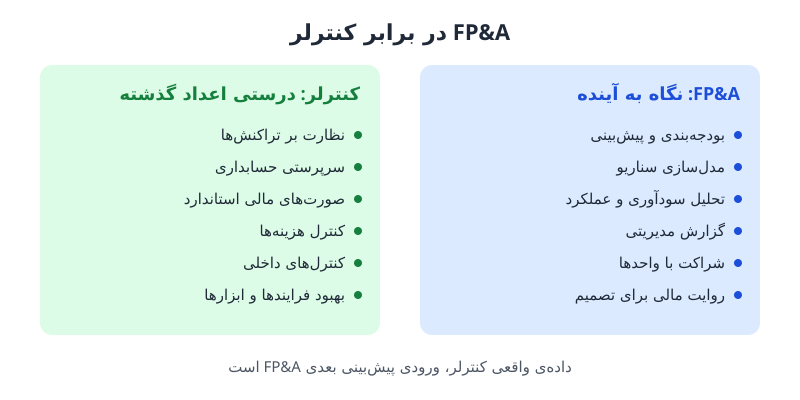

بسیاری از کسانی که وارد حرفه‌ی مالی می‌شوند، میان دو عنوان شغلی سردرگم‌اند: **FP&A یا کنترلر**؟ هر دو با اعداد شرکت کار می‌کنند، اما یکی بیشتر رو به آینده است و دیگری نگهبان درستی اعداد گذشته. در این نوشته تفاوت این دو نقش، فعالیت‌های اصلی هرکدام و نحوه‌ی همکاری‌شان را با یک مثال عملی مرور می‌کنیم.

## FP&A چیست و چه می‌کند؟

برنامه‌ریزی و تحلیل مالی (FP&A) جایی است که مالی و استراتژی به هم می‌رسند. تحلیلگر FP&A فقط عدد تولید نمی‌کند؛ او باید عددها را به تصمیم تبدیل کند و برای این کار هم با واحدهای دیگر شریک شود و هم داستان پشت اعداد را روایت کند. فعالیت‌های اصلی این نقش:

- **بودجه‌بندی و پیش‌بینی:** ترسیم نقشه‌ی مالی سازمان، یعنی برآورد درآمد و هزینه‌ها برای دوره‌های آینده.
- **تحلیل مالی:** بررسی عمیق عملکرد و سودآوری برای پیدا کردن نقاط قابل بهبود.
- **مدل‌سازی سناریو:** ساختن چند تصویر مختلف از آینده و آماده‌کردن واکنش برای هر کدام.
- **گزارشگری مدیریتی:** رساندن اطلاعات مالی خلاصه و قابل اقدام به مدیران ارشد.
- **ترکیب داده‌ی مالی و غیرمالی:** کنار هم گذاشتن شاخص‌های مالی و عملیاتی (مثل تعداد مشتری، ظرفیت تولید یا نرخ ریزش) برای دیدن تصویر کامل.
- **شراکت تجاری:** همکاری با فروش، بازاریابی، عملیات و منابع انسانی تا اهداف مالی و عملیاتی هم‌راستا شوند.
- **روایت مالی:** تبدیل داده‌های پیچیده به داستانی روشن که تصمیم‌گیری را آسان‌تر کند.

اگر می‌خواهید بدانید FP&A خودش چه زیرشاخه‌هایی دارد، نوشته‌ی [پنج نوع نقش در FP&A](/posts/2023/11/11/five-types-of-fpa-roles/) را ببینید.

## کنترلر چیست و چه مسئولیتی دارد؟

کنترلر کسی است که مطمئن می‌شود هر عدد در جای درست خودش نشسته است. در کشورهای انگلیسی‌زبان، کنترلر فقط یک حسابدار ارشد نیست؛ او نگهبان یکپارچگی اطلاعات مالی است و تضمین می‌کند هر تراکنش به‌درستی ثبت و گزارش شود. فعالیت‌های اصلی او:

- **مالی تراکنشی:** نظارت بر تراکنش‌های روزانه، از فروش تا خرید.
- **سرپرستی حسابداری:** اطمینان از اینکه همه‌ی کارهای حسابداری، از دفاتر تا ترازنامه، دقیق و به‌موقع انجام شود.
- **گزارشگری مالی استاندارد:** تهیه‌ی منظم صورت‌های مالی که سلامت مالی شرکت را نشان می‌دهد.
- **کنترل بهای تمام‌شده و هزینه‌ها:** پایش هزینه‌ها برای حفظ سودآوری.
- **کنترل‌های داخلی:** طراحی و نگه‌داری فرایندهایی که جلوی خطا یا تقلب مالی را می‌گیرد.
- **فرایندها و ابزارها:** ساده‌سازی فرایندهای مالی و استفاده از ابزارهای جدید برای دقت و سرعت بیشتر.

جایگاه کنترلر در کنار مدیر مالی و حسابداران در نوشته‌ی [نقش‌های واحد حسابداری](/posts/2024/06/08/accounting-department-roles-cfo-controller/) توضیح داده شده است.

## تفاوت FP&A و کنترلر در یک نگاه

| معیار | FP&A | کنترلر |
|---|---|---|
| جهت زمانی | آینده | گذشته و حال |
| پرسش اصلی | چه خواهد شد و چه کنیم؟ | چه شد و آیا درست ثبت شد؟ |
| خروجی اصلی | بودجه، پیش‌بینی، سناریو، گزارش مدیریتی | صورت‌های مالی، تطبیق‌ها، کنترل‌های داخلی |
| مخاطب اصلی | مدیرعامل و مدیران واحدها | مدیر مالی، حسابرس، نهادهای بیرونی |
| مهارت برجسته | مدل‌سازی، تحلیل، ارتباط و روایت | دقت، دانش استانداردها، طراحی فرایند |
| معیار موفقیت | کیفیت تصمیم‌ها | درستی و به‌موقع‌بودن اعداد |

این دو نقش رقیب هم نیستند. FP&A برای تحلیل آینده به داده‌ی واقعی و قابل اتکا نیاز دارد و این داده را کنترلر فراهم می‌کند. برعکس، کنترلر از تحلیل‌های FP&A می‌فهمد کدام ارقام برای مدیریت اهمیت بیشتری دارند و کجا باید دقت را بالا ببرد. پیوند عمیق‌تر این دو کارکرد در نوشته‌ی [حسابداری مالی و کنترلینگ مالی](/posts/2023/12/11/financial-accounting-vs-controlling/) آمده است.

## مثال عملی: عرضه‌ی یک محصول جدید

فرض کنید یک شرکت نوپای فناوری می‌خواهد محصول تازه‌ای به بازار بیاورد. ببینیم هر نقش چه می‌کند.

### پیش از عرضه: نوبت FP&A

تحلیلگر FP&A یک مدل درآمد برای محصول جدید می‌سازد و روندهای بازار، رقبا و فروش احتمالی را در آن لحاظ می‌کند. سپس سناریو می‌چیند:

- اگر محصول پرفروش شود چه اتفاقی می‌افتد؟
- اگر فروش کمتر از انتظار باشد چه؟

فرض کنید در سناریوی پایه فروش سال اول ۲۰ میلیارد تومان با حاشیه‌ی سود ناخالص ۴۰ درصد برآورد شود، در سناریوی خوش‌بینانه ۳۰ میلیارد و در سناریوی بدبینانه ۱۲ میلیارد. اگر هزینه‌ی بازاریابی ثابت ۶ میلیارد باشد، سود ناخالص منهای بازاریابی در سه سناریو به ترتیب ۲، ۶ و منفی ۱.۲ میلیارد می‌شود. همین اعداد نشان می‌دهد شرکت باید پیش از عرضه برای حالت بدبینانه برنامه‌ی کاهش هزینه داشته باشد.

بعد از این تحلیل، FP&A با تیم‌های فروش و بازاریابی بودجه و برنامه‌ها را هماهنگ می‌کند و نتیجه را به شکلی گیرا به مدیران ارشد ارائه می‌دهد تا تصمیم آگاهانه بگیرند.

### پس از عرضه: نوبت کنترلر

وقتی محصول عرضه شد، کنترلر وارد میدان می‌شود. او مطمئن می‌شود هر فروش، هر برگشتی و هر هزینه‌ی مرتبط درست ثبت شود، درآمد و بهای تمام‌شده‌ی محصول را طبق استانداردها حسابداری کند و در پایان دوره صورت‌های مالی را تهیه کند تا عملکرد واقعی محصول دیده شود. اگر مغایرت یا بی‌نظمی مالی پیدا شود، او مسئول اصلاح آن و رعایت الزامات است.

نکته‌ی مهم اینجاست: عدد واقعی که کنترلر گزارش می‌کند، ورودی دور بعدی پیش‌بینی FP&A است. چرخه همین‌طور ادامه پیدا می‌کند.

## هشدار درباره‌ی معنای «کنترلر» در اروپا

عنوان شغلی همیشه معنای یکسانی ندارد. در کشورهایی مثل آلمان و فرانسه، «کنترلر» اغلب به کسی گفته می‌شود که عمدتاً کار FP&A انجام می‌دهد: بودجه، پیش‌بینی و تحلیل انحراف. بخشی از این تفاوت از نرم‌افزار SAP می‌آید که مالی را به دو ماژول تقسیم کرده است: FI برای حسابداری مالی و CO برای کنترلینگ. هر کس با ماژول CO کار کند، در فرهنگ کاری اروپایی «کنترلر» نامیده می‌شود، در حالی که همین کار در شرکتی آمریکایی احتمالاً FP&A نام دارد.

نتیجه‌ی عملی برای جویندگان کار ساده است: **به عنوان شغلی اکتفا نکنید و شرح وظایف را با دقت بخوانید.** ببینید بیشتر وقت این نقش صرف ثبت و تطبیق و گزارشگری استاندارد می‌شود یا صرف بودجه و سناریو و شراکت با واحدها.

## کدام مسیر برای شما مناسب‌تر است؟

- اگر از ساختن مدل، سناریوچینی، ارائه و گفت‌وگو با مدیران غیرمالی لذت می‌برید، FP&A احتمالاً مناسب شماست.
- اگر دقت، نظم، شناخت عمیق استانداردها و طراحی فرایندهای کنترلی را دوست دارید، مسیر کنترلری جذاب‌تر است.
- تجربه در یکی، برای دیگری هم ارزشمند است: کنترلری که تحلیل آینده را بلد باشد، و تحلیلگر FP&A که ثبت حسابداری را بفهمد، هر دو نیروی کمیاب‌تری هستند.

## پرسش‌های متداول

### آیا کنترلر همان حسابدار است؟
نه دقیقاً. کنترلر معمولاً بر کل واحد حسابداری نظارت دارد و مسئول درستی گزارشگری، کنترل‌های داخلی و فرایندهاست؛ حسابداران زیرمجموعه‌ی او کار ثبت را انجام می‌دهند.

### آیا می‌توان از کنترلری به FP&A رفت؟
بله و این مسیر رایجی است. دانش حسابداری پایه‌ی محکمی است؛ کافی است مهارت مدل‌سازی، پیش‌بینی و ارتباط با واحدهای غیرمالی را تقویت کنید.

### در شرکت کوچک هر دو نقش را یک نفر انجام می‌دهد؟
اغلب بله. در این حالت بهتر است زمان جداگانه‌ای برای بستن دقیق حساب‌ها و زمان جداگانه‌ای برای تحلیل و برنامه‌ریزی کنار بگذارید.

### چرا آگهی‌های شغلی «کنترلر» این‌قدر متفاوت‌اند؟
چون در برخی کشورها، به‌ویژه آلمان و فرانسه، کنترلر به نقشی نزدیک به FP&A گفته می‌شود. شرح وظایف را بخوانید، نه فقط عنوان را.

## جمع‌بندی

FP&A آینده‌ی مالی شرکت را با تحلیل، سناریو و شراکت با واحدها هدایت می‌کند و کنترلر تضمین می‌کند اعداد گذشته دقیق، کامل و قابل اتکا باشند. یکی برنامه می‌چیند و دیگری نشان می‌دهد در واقعیت چه شد. این دو در یک چرخه‌ی پیوسته به هم وابسته‌اند و برای انتخاب میان آن‌ها، علاقه‌ی خودتان و شرح وظایف واقعی هر آگهی را معیار قرار دهید.
