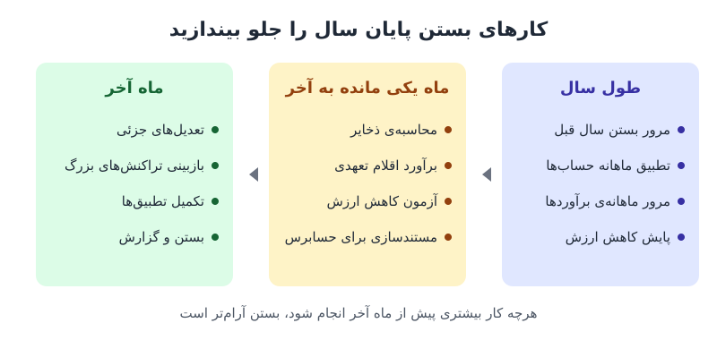

**بستن حساب‌های پایان سال** سنگین‌ترین دوره‌ی کاری تیم مالی است: حجم کار بالاست، حسابرس منتظر است و مدیران عدد نهایی سال را می‌خواهند. راز یک بستن آرام این است که بیشتر کار را پیش از ماه آخر انجام دهید. در این راهنما پنج بخش آماده‌سازی را مرور می‌کنیم؛ از درس گرفتن از سال گذشته تا محاسبه‌ی ذخایر و آزمون کاهش ارزش یک ماه زودتر.

## بخش اول: بازبینی دقیق بستن سال گذشته

بهترین منبع برای بهتر کردن امسال، اشتباهات و گلوگاه‌های پارسال است.

### ۱. مستندات را یک‌جا جمع کنید

دفاتر، ترازنامه، صورت سود و زیان، گزارش حسابرسی، سوابق تراکنش‌ها، اسناد پشتیبان و اظهارنامه‌های مالیاتی سال قبل را در یک پوشه‌ی مشترک و یک فایل فهرست (مثلاً یک صفحه‌گسترده با برچسب و دسته‌بندی) جمع کنید تا مرتب‌سازی، جست‌وجو و مقایسه آسان باشد. یک «پرونده‌ی بستن» دیجیتال برای هر سال مالی، مرورهای بعدی را بسیار سریع‌تر می‌کند. قواعد مشترکی هم برای نام‌گذاری و دسترسی تعیین کنید تا چند نفر هم‌زمان بتوانند بررسی کنند.

### ۲. تحلیل ساختاریافته انجام دهید

اسناد بستن سال قبل را از نظر درستی و کامل‌بودن بررسی کنید و به **اصلاحات لحظه‌ی آخر** و دلیل آن‌ها توجه ویژه داشته باشید. بازخورد حسابرسان، اعضای تیم و سایر ذی‌نفعان را هم جمع کنید. برای دسته‌بندی یافته‌ها می‌توانید از تحلیل SWOT استفاده کنید: نقاط قوت فرایند، ضعف‌ها، فرصت‌های بهبود و ریسک‌ها. یک ماتریس تصویری از این تحلیل، انتقال نتیجه به تیم را ساده‌تر می‌کند.

یک یافته‌ی رایج در این بازبینی این است که محاسبه‌ی ذخایر یا کاهش ارزش بی‌دلیل به ماه آخر موکول شده، در حالی که می‌شد آن را در بستن ماه قبل انجام داد.

### ۳. درس‌ها را به کار تبدیل کنید

یافته‌ها را به اقدام‌های مشخص تبدیل و بر اساس اثر و امکان‌پذیری اولویت‌بندی کنید. برای هر اقدام یک مسئول و یک مهلت تعیین و پیشرفت را در جلسه‌های تیمی پیش از پایان سال پیگیری کنید. یک جلسه‌ی «درس‌آموخته‌ها» بعد از هر بستن، فرهنگ بهبود مستمر را جا می‌اندازد. اصول بهبود تدریجی این فرایند در [بهبود بستن ماهانه حساب‌ها](/posts/2023/07/12/improve-month-end-close-process/) هم آمده است.

## بخش دوم: به‌روزرسانی و راستی‌آزمایی سوابق مالی

### بازبینی تراکنش‌ها

همه‌ی ثبت‌های سال را مرور کنید، اما تمرکز اصلی روی **تراکنش‌های بزرگ، غیرعادی یا پیچیده** باشد. هر ثبت باید سند پشتیبان (فاکتور، رسید، قرارداد) داشته باشد. وقتی حجم زیاد است، از نمونه‌گیری استفاده کنید یا تراکنش‌های پرریسک را در اولویت بگذارید. نرم‌افزار حسابداری را طوری تنظیم کنید که ثبت‌های خارج از محدوده‌ی تعیین‌شده (مثلاً مبالغ غیرمعمول) را خودکار علامت بزند. تمرکز بر ثبت‌هایی که از الگوی عادی فاصله دارند، اغلب خطاهای مهمی را آشکار می‌کند؛ مثلاً ذخیره‌ای که هیچ مستند توجیهی ندارد.

### اصلاحات جامع

اقلام تعهدی، پیش‌پرداخت‌ها، استهلاک و ذخیره‌ی مطالبات مشکوک‌الوصول را شناسایی و ثبت کنید و برآوردهای ابتدای سال را با ارقام واقعی تعدیل کنید. یک **تقویم حسابداری** با همه‌ی تاریخ‌ها و مهلت‌های کلیدی بسازید تا هیچ اصلاحی جا نماند. بهتر است برآوردها را هر ماه مرور کنید؛ این کار بار پایان سال را پخش می‌کند و گزارش‌های ماهانه را هم دقیق‌تر می‌کند. مراحل عمومی ثبت اسناد تعدیلی در [بستن ماهانه دفاتر؛ ۷ گام چرخه حسابداری](/posts/2024/06/10/monthly-close-accounting-cycle-steps/) توضیح داده شده است.

## بخش سوم: تطبیق حساب‌ها را جلو بیندازید

تطبیق حساب‌ها کار زیادی می‌برد؛ اگر نمی‌خواهید در پایان سال غافلگیر شوید، زودتر شروع کنید.

- **تطبیق بانکی:** هر تراکنش دفاتر را با صورت‌حساب بانک تطبیق دهید و مغایرت‌ها را ریشه‌یابی کنید. یک شناسه‌ی مشترک میان سیستم حسابداری و صورت‌حساب بانک پیدا کنید (مثل شماره‌ی مرجع) تا بخش عمده‌ی تطبیق خودکار شود. برای حساب‌های پیچیده، تطبیق را بر اساس نوع تراکنش یا بازه‌ی زمانی بخش‌بندی کنید.
- **سایر حساب‌های کلیدی:** مطالبات، بدهی‌های تجاری و حقوق و دستمزد را هم تطبیق دهید و مطمئن شوید همه‌ی فاکتورها و پرداخت‌های معوق ثبت شده‌اند. گزارش سنی مطالبات و پرداختنی‌ها اقلام قدیمی را زود نشان می‌دهد؛ درباره‌ی آن در [گزارش سن مطالبات](/posts/2024/11/09/ar-aging-report-cash-guide/) بیشتر بخوانید.

تطبیق ماهانه در طول سال، بار پایان سال را به حداقل می‌رساند.

## بخش چهارم: محاسبه‌ی ذخایر و اقلام تعهدی یک ماه زودتر

توصیه‌ی اصلی این راهنما این است: **ذخایر و اقلام تعهدی را در بستن ماه یکی مانده به آخر محاسبه کنید.** این کار وقت آزاد می‌کند و غافلگیری‌ها را (که تقریباً همیشه پیش می‌آید) زودتر آشکار می‌کند.

### شناسایی

همه‌ی قراردادها، ریسک‌ها، توافق‌ها و تعهدات باز را برای یافتن ذخایر احتمالی مرور کنید و روند هزینه‌ها را برای برآورد اقلام تعهدی پایان سال تحلیل کنید. این مرور باید با مشارکت واحدهای دیگر انجام شود تا هیچ تعهدی از قلم نیفتد. یک **فهرست موضوعات ذخیره** از ذخایر سال‌های قبل و شناخت کسب‌وکار بسازید. مرور ذخایر در ماه یکی مانده به آخر همراه با مدیران، باعث می‌شود همه از وضعیت ذخایر و تصویر احتمالی پایان سال آگاه باشند.

### محاسبه و مستندسازی

استانداردهای حسابداری مربوط را رعایت کنید و برای هر ذخیره و قلم تعهدی **مستند پشتیبان کامل** داشته باشید؛ منتظر درخواست حسابرس نمانید. روش محاسبه را سال به سال ثابت نگه دارید تا مقایسه‌پذیر باشد. مستندات را طوری بنویسید که یک فرد بیرونی بدون توضیح شفاهی آن را بفهمد و آن را با همه‌ی افراد درگیر به اشتراک بگذارید.

## بخش پنجم: آزمون کاهش ارزش دارایی‌ها

مانند ذخایر، ارزیابی کاهش ارزش هم اگر یک ماه زودتر انجام شود، برآورد پایان سال را بسیار دقیق‌تر می‌کند.

1. **شناسایی:** فهرست کامل دارایی‌های مشهود و نامشهود را تهیه کنید و دارایی‌هایی را که به‌خاطر تغییر بازار، آسیب فیزیکی یا منسوخ‌شدن در خطرند، مشخص کنید. با رویکرد مبتنی بر ریسک و قاعده‌ی ۸۰/۲۰، دارایی‌هایی را اولویت دهید که در کاربرد، ارزش بازار یا عملکرد اقتصادی‌شان تغییر جدی رخ داده است. یک فهرست ساده‌ی پایش در طول سال کافی است.
2. **انجام آزمون:** مبلغ بازیافتنی را محاسبه کنید؛ یعنی بیشترِ «ارزش منصفانه منهای مخارج فروش» و «ارزش اقتصادی». ساده‌ترین پرسش این است: امروز این دارایی را به چه قیمتی می‌توانم بفروشم؟ اگر مبلغ دفتری از مبلغ بازیافتنی بیشتر باشد، زیان کاهش ارزش باید شناسایی شود. برای دارایی‌های پیچیده ممکن است به ارزیاب بیرونی، مدل DCF یا مقایسه با قیمت‌های بازار نیاز داشته باشید. از مدل ساده شروع کنید و از یک نفر دیگر بخواهید آن را بازبینی و تأیید کند.
3. **ثبت:** زیان کاهش ارزش را در همان بستن ماه یکی مانده به آخر ثبت کنید و در سیستم هشدارهایی بگذارید تا دارایی‌های مشابه با رویکرد یکسان بررسی شوند.

### مثال عددی

فرض کنید ماشین‌آلاتی با مبلغ دفتری ۸۰۰ میلیون تومان دارید. به‌خاطر ورود فناوری جدید، قیمت فروش آن پس از کسر هزینه‌ی فروش ۵۵۰ میلیون است و ارزش فعلی جریان‌های نقدی آینده‌اش ۶۲۰ میلیون. مبلغ بازیافتنی بیشترِ این دو، یعنی ۶۲۰ میلیون است و زیان کاهش ارزش ۸۰۰ منهای ۶۲۰، برابر ۱۸۰ میلیون تومان می‌شود. اگر این را یک ماه زودتر بدانید، پیش‌بینی سود پایان سال را به‌موقع اصلاح می‌کنید و مدیران غافلگیر نمی‌شوند.

## پرسش‌های متداول

### چرا ذخایر را یک ماه زودتر محاسبه کنیم؟
چون فشار کاری ماه آخر کم می‌شود، خطاهای عجولانه کاهش می‌یابد و مدیریت زودتر تصویر واقعی سود پایان سال را می‌بیند. در ماه آخر فقط تعدیل جزئی لازم است.

### بستن پایان سال با بستن فصلی چه فرقی دارد؟
بستن سالانه علاوه بر کارهای عادی، شامل آزمون کاهش ارزش، مرور کامل ذخایر، آماده‌سازی برای حسابرسی و الزامات مالیاتی است. برای ریتم فصلی، [چک‌لیست بستن حساب پایان فصل](/posts/2024/10/18/quarter-end-close-checklist/) را ببینید.

### اگر حجم تراکنش‌ها زیاد باشد، همه را باید بررسی کرد؟
نه. با نمونه‌گیری و تمرکز بر تراکنش‌های بزرگ، غیرعادی و پرریسک، بیشترین خطاها با کمترین زمان پیدا می‌شود.

### مبلغ بازیافتنی دقیقاً چیست؟
بیشترِ دو عدد: ارزش منصفانه منهای مخارج فروش، و ارزش فعلی جریان‌های نقدی که دارایی در ادامه‌ی استفاده ایجاد می‌کند.

## جمع‌بندی

بستن آرام پایان سال از ماه‌ها قبل ساخته می‌شود. از بستن سال گذشته درس بگیرید، تراکنش‌های بزرگ و غیرعادی را زود بازبینی کنید، تطبیق حساب‌ها را ماهانه انجام دهید و مهم‌تر از همه، ذخایر و کاهش ارزش دارایی‌ها را یک ماه زودتر محاسبه و ثبت کنید. نتیجه، اعداد دقیق‌تر، حسابرسی روان‌تر و پیش‌بینی قابل اتکاتر برای مدیران است.
