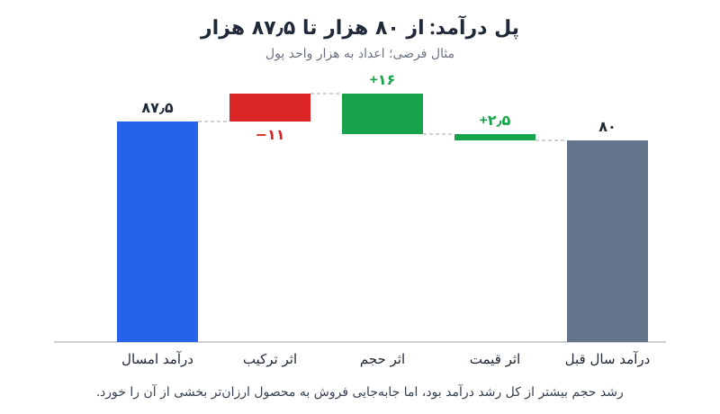

تحلیل قیمت، حجم و ترکیب (PVM) روشی است برای اینکه بفهمید چرا درآمد یا حاشیه سود نسبت به دوره‌ی قبل یا بودجه تغییر کرده است. به‌جای جمله‌ی کلی «فروش ده درصد بالا رفت»، این تحلیل نشان می‌دهد چه سهمی از تغییر از قیمت، چه سهمی از تعداد و چه سهمی از جابه‌جایی سبد محصولات آمده است.

## تحلیل PVM چیست و چرا گزارش انحراف را دقیق‌تر می‌کند؟

در بیشتر جلسه‌های بررسی فروش، اولین پرسش مدیران این است: «چرا عدد این ماه با ماه قبل یا با بودجه فرق دارد؟» پاسخ‌هایی مثل «بازار ضعیف بود» یا «فروش خوب پیش رفت» نه قابل‌سنجش‌اند و نه به اقدام مشخصی می‌رسند.

تحلیل PVM تغییر کل را به سه جزء جمع‌پذیر می‌شکند. جمع این سه جزء دقیقاً برابر با کل تغییر است؛ پس هیچ بخشی از انحراف بی‌توضیح نمی‌ماند. همین ویژگی آن را به یکی از کاربردی‌ترین ابزارهای واحد FP&A تبدیل کرده است، هرچند در کلاس‌های دانشگاهی کمتر به آن پرداخته می‌شود.

این تحلیل فقط برای درآمد نیست. می‌توان آن را روی حاشیه سود ناخالص، بهای تمام‌شده و حتی هزینه‌ی حقوق و دستمزد (با تفکیک نرخ دستمزد، تعداد نفرات و ترکیب سطوح شغلی) هم اجرا کرد.

## سه جزء اصلی: اثر قیمت، اثر حجم و اثر ترکیب

### اثر قیمت

اثر قیمت نشان می‌دهد اگر تعداد و ترکیب فروش ثابت می‌ماند، تغییر قیمت فروش چه اثری بر درآمد داشت. این جزء پاسخ می‌دهد که آیا سیاست قیمت‌گذاری واقعاً سودآوری را بالا برده یا تخفیف‌ها آن را فرسوده‌اند.

### اثر حجم

اثر حجم به تغییر تعداد کل واحدهای فروخته‌شده مربوط است. اگر با همان قیمت‌ها و همان ترکیب، تعداد بیشتری بفروشید، درآمد بالا می‌رود. این جزء بازتاب تقاضای بازار و کارایی تلاش‌های فروش است.

### اثر ترکیب

اثر ترکیب از تغییر سهم هر محصول در کل فروش می‌آید. حتی اگر تعداد کل و قیمت‌ها ثابت بمانند، وقتی سهم محصولات گران‌تر یا پرحاشیه‌تر بیشتر شود، درآمد یا سود بالا می‌رود؛ و برعکس. این جزء اغلب پنهان‌ترین و آموزنده‌ترین بخش تحلیل است.

| جزء | پرسشی که پاسخ می‌دهد | فرمول ساده |
|---|---|---|
| اثر قیمت | قیمت‌گذاری چقدر اثر داشت؟ | (قیمت جدید − قیمت قبلی) × تعداد جدید هر محصول |
| اثر حجم | فروش بیشتر یا کمتر چقدر اثر داشت؟ | (تعداد کل جدید − تعداد کل قبلی) × میانگین قیمت قبلی |
| اثر ترکیب | جابه‌جایی سبد محصول چقدر اثر داشت؟ | (تعداد جدید − تعداد جدید با ترکیب قبلی) × قیمت قبلی هر محصول |

## مثال عددی تحلیل PVM گام‌به‌گام

فرض کنید شرکتی دو محصول دارد: یک محصول ممتاز و یک محصول اقتصادی. قیمت‌ها به واحد پول فرضی است.

| محصول | قیمت سال قبل | تعداد سال قبل | قیمت امسال | تعداد امسال |
|---|---|---|---|---|
| ممتاز | ۱۰۰ | ۶۰۰ | ۱۰۵ | ۵۰۰ |
| اقتصادی | ۵۰ | ۴۰۰ | ۵۰ | ۷۰۰ |

درآمد سال قبل ۸۰٬۰۰۰ (۶۰٬۰۰۰ + ۲۰٬۰۰۰) و درآمد امسال ۸۷٬۵۰۰ (۵۲٬۵۰۰ + ۳۵٬۰۰۰) است؛ یعنی ۷٬۵۰۰ رشد. حالا این رشد را می‌شکنیم:

1. **اثر قیمت:** فقط قیمت محصول ممتاز ۵ واحد بالا رفته است. ۵ × ۵۰۰ = **۲٬۵۰۰+**.
2. **اثر حجم:** تعداد کل از ۱٬۰۰۰ به ۱٬۲۰۰ رسیده است. میانگین قیمت سال قبل ۸۰ بوده (۸۰٬۰۰۰ تقسیم بر ۱٬۰۰۰). پس ۲۰۰ × ۸۰ = **۱۶٬۰۰۰+**.
3. **اثر ترکیب:** سال قبل ۶۰ درصد فروش ممتاز و ۴۰ درصد اقتصادی بود. اگر ۱٬۲۰۰ واحد امسال با همان ترکیب فروخته می‌شد، ۷۲۰ واحد ممتاز و ۴۸۰ واحد اقتصادی داشتیم. اثر ممتاز: (۵۰۰ − ۷۲۰) × ۱۰۰ = ۲۲٬۰۰۰−. اثر اقتصادی: (۷۰۰ − ۴۸۰) × ۵۰ = ۱۱٬۰۰۰+. جمع: **۱۱٬۰۰۰−**.

جمع سه اثر: ۲٬۵۰۰ + ۱۶٬۰۰۰ − ۱۱٬۰۰۰ = ۷٬۵۰۰؛ دقیقاً برابر با کل رشد درآمد.

برداشت مدیریتی این مثال چیزی است که عدد کل پنهان می‌کرد: رشد حجم بسیار قوی بوده، اما مشتریان به سمت محصول ارزان‌تر رفته‌اند و این جابه‌جایی بخش بزرگی از رشد را خنثی کرده است. شاید افزایش قیمت محصول ممتاز باعث فرار بخشی از مشتریانش شده باشد. این دقیقاً همان پرسشی است که باید در جلسه‌ی بعدی با تیم فروش مطرح شود.

توجه کنید که روش‌های مختلفی برای محاسبه‌ی PVM وجود دارد (مثلاً ترتیب محاسبه‌ی اثرها یا اینکه اثر قیمت با تعداد جدید سنجیده شود یا قدیم). نکته‌ی مهم این است که یک روش را انتخاب و در همه‌ی دوره‌ها ثابت نگه دارید تا گزارش‌ها قابل مقایسه باشند.

## کاربردهای تحلیل PVM در تصمیم‌های مالی

- **بررسی‌های دوره‌ای فروش:** وقتی فروش پایین آمده، PVM روشن می‌کند که مشکل از کاهش تعداد است، از افت قیمت، یا از فروش سهم بیشتری از محصولات ارزان‌تر. هرکدام راه‌حل متفاوتی دارد.
- **تصمیم‌های محصول:** محصولات پیشرو و عقب‌مانده را مشخص می‌کند و نشان می‌دهد کدام محصول ترکیب فروش را به سمت سودآوری بیشتر یا کمتر می‌برد.
- **قیمت‌گذاری:** اثر واقعی افزایش یا کاهش قیمت بر درآمد و سود را جدا از نوسان حجم نشان می‌دهد.
- **تحلیل حاشیه سود:** اگر به‌جای قیمت فروش از حاشیه‌ی هر واحد استفاده کنید، خواهید فهمید انحراف حاشیه از کجا آمده است. گاهی درآمد بالا می‌رود ولی به دلیل ترکیب نامطلوب، حاشیه سود کل افت می‌کند.
- **مقایسه با بودجه:** به‌جای سال قبل، بودجه را مبنا بگذارید تا انحراف از برنامه را به اجزای قابل‌پیگیری بشکنید.

برای آشنایی با چارچوب کلی مقایسه‌ی عملکرد با برنامه، [راهنمای تحلیل بودجه در برابر عملکرد](/posts/2022/04/14/budget-vs-actual-variance-analysis/) را ببینید. اگر به دنبال اهرم‌های عملی بهبود سود هستید، [چهار اهرم افزایش سودآوری کسب‌وکار](/posts/2024/05/11/increase-business-profitability-levers/) مکمل خوبی برای نتایج PVM است.

## نکته‌های اجرایی برای تحلیل PVM منظم

**منتظر بحران نمانید.** بسیاری از تیم‌ها فقط وقتی فروش افت می‌کند سراغ این تحلیل می‌روند. اگر هر ماه یا هر فصل آن را اجرا کنید، تغییرات ترکیب و فرسایش قیمت را زودتر می‌بینید و فرصت اصلاح دارید.

**سطح جزئیات را درست انتخاب کنید.** تحلیل در سطح تک‌تک کالاها ممکن است شلوغ و پرنوسان شود. معمولاً گروه محصول، کانال فروش یا منطقه سطح مناسب‌تری برای گزارش مدیریتی است.

**داده‌ی تمیز آماده کنید.** برای هر محصول به قیمت و تعداد هر دو دوره نیاز دارید. محصولات جدید یا حذف‌شده را جداگانه نشان دهید تا اثر ترکیب را مخدوش نکنند.

**نتیجه را با نمودار پل نشان دهید.** نمودار آبشاری بهترین قالب برای ارائه‌ی PVM است؛ مخاطب در یک نگاه می‌بیند از عدد مبنا با چه اجزایی به عدد فعلی رسیده‌اید. برای سرعت بخشیدن به چرخه‌ی تحلیل، [نکته‌های تحلیل انحراف سریع‌تر](/posts/2023/06/08/speed-up-variance-analysis/) هم کاربردی است.

## پرسش‌های متداول

### تفاوت اثر حجم و اثر ترکیب چیست؟

اثر حجم فقط به تغییر تعداد کل فروش نگاه می‌کند و فرض می‌کند سهم محصولات ثابت مانده است. اثر ترکیب برعکس، تعداد کل را ثابت می‌گیرد و فقط اثر جابه‌جایی سهم محصولات را می‌سنجد.

### آیا جمع سه اثر همیشه با کل تغییر برابر است؟

اگر فرمول‌ها را سازگار انتخاب کنید، بله. در غیر این صورت یک «اثر متقابل» باقی می‌ماند که باید آن را صریحاً به یکی از اجزا نسبت دهید یا جداگانه گزارش کنید.

### برای شرکتی با یک محصول هم PVM معنا دارد؟

با یک محصول، اثر ترکیب صفر است و تحلیل به دو جزء قیمت و حجم ساده می‌شود. اما اگر همان محصول را در کانال‌ها یا مناطق با قیمت متفاوت می‌فروشید، می‌توانید ترکیب را در سطح کانال بسنجید.

### PVM را روی هزینه‌ها هم می‌شود اجرا کرد؟

بله. مثلاً برای هزینه‌ی حقوق، نرخ دستمزد نقش قیمت، تعداد نفرات نقش حجم و ترکیب سطوح شغلی نقش ترکیب را دارد.

## جمع‌بندی

تحلیل PVM عدد کلی تغییر درآمد یا حاشیه سود را به سه پاسخ مشخص تبدیل می‌کند: قیمت چه کرد، حجم چه کرد و ترکیب چه کرد. همین تفکیک، گفت‌وگو با مدیران را از حدس و توضیح کلی به تصمیم‌های قابل‌اجرا درباره‌ی قیمت‌گذاری، تمرکز فروش و سبد محصول می‌برد. یک روش ثابت انتخاب کنید، آن را به‌طور منظم اجرا کنید و نتیجه را با نمودار پل ارائه دهید.
