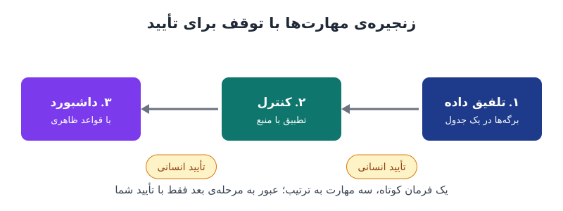

بیشتر تیم‌های مالی هر ماه چند روز را صرف تمیزکردن فایل‌های اکسل می‌کنند. **مهارت هوش مصنوعی در اکسل** راهی است که یک کار تکراری را یک بار به دستیار هوش مصنوعی یاد بدهید، دستورش را ذخیره کنید و از آن به بعد با یک فرمان کوتاه اجرایش کنید؛ همراه با کنترل، داشبورد و تأیید انسانی در هر مرحله.

## مسئله: کار تکراری که به بهترین تحلیلگر وابسته است

صورت‌حساب کارت‌های اعتباری سازمانی را در نظر بگیرید. بانک یک فایل می‌فرستد با سی برگه، یکی برای هر دارنده‌ی کارت، و ستون‌هایی که فقط به کار خود بانک می‌آید. کسی باید برگه‌ها را یکی کند، ستون‌های اضافه را حذف کند، جمع‌ها را کنترل کند و نتیجه را برای مدیر قابل‌ارائه کند. همین یک فایل معمولاً یک بعدازظهر کامل وقت می‌گیرد.

مشکل بزرگ‌تر این است که این کار معمولاً به دست بهترین تحلیلگر تیم انجام می‌شود. روزی که او نیست، نفر بعدی فایل را باز می‌کند و همه‌چیز از صفر شروع می‌شود. دانش فرایند در ذهن یک نفر مانده و جایی ثبت نشده است.

## مهارت هوش مصنوعی چیست و چه فرقی با پرامپت دارد؟

مهارت (Skill) مجموعه‌ای از دستورالعمل‌ها برای انجام یک کار مشخص است که به‌صورت یک فایل متنی کوچک ذخیره می‌شود. در عمل یک پرامپت بلند و دقیق است که یک بار نوشته می‌شود. در ابزارهایی مثل Copilot در اکسل، این فایل در پوشه‌ی مشخصی از فضای ابری قرار می‌گیرد و با تایپ @ و نام مهارت فراخوانده می‌شود.

دو ویژگی مهارت را از پرامپت معمولی بهتر می‌کند:

- **دیگر لازم نیست دوباره تایپش کنید.** دستور همیشه یکسان اجرا می‌شود و نتیجه به حافظه‌ی افراد وابسته نیست.
- **قابل اشتراک است.** چون فایل است، می‌توانید آن را به همکاران بدهید یا در ابزارهای دیگر هم استفاده کنید. دانش فرایند از ذهن یک نفر به یک سند تبدیل می‌شود.

فایل مهارت معمولاً با قالب Markdown نوشته می‌شود؛ متن ساده‌ای با علامت‌هایی برای عنوان و فهرست که خواندنش برای مدل زبانی آسان‌تر است.

## روش زنجیره‌ی مهارت در شش گام

### ۱. یک بار کار را نشان بدهید

مهارت را از اول ننویسید؛ توصیف کامل یک کار اکسلی بدون امتحان‌کردنش سخت است. اول کار را یک بار با زبان ساده از دستیار بخواهید و نتیجه را کنترل کنید. برای فایل کارت می‌شود چنین خواست: همه‌ی برگه‌ها را در یک برگه جمع کن، فقط تاریخ، شرح، مبلغ و برگشتی‌ها را نگه دار، برای هر سطر شرکت و دارنده‌ی کارت را مشخص کن، تراکنش‌ها را برای هر دارنده بر اساس تاریخ مرتب کن و به‌جای عدد ثابت از فرمول استفاده کن. حاصل باید یک برگه‌ی تمیز باشد، بدون سطر خالی و ستون زائد. در همان گفت‌وگو بمانید تا دستیار کل جریان کار را در نظر داشته باشد.

### ۲. مهارت را بنویسید

اگر نتیجه درست بود، در همان گفت‌وگو بخواهید از این جریان کار یک فایل مهارت با نامی مثل data-cleaning بنویسد و «همه‌ی جزئیات را به‌صورت دستورالعمل ثبت کند». همین جمله‌ی آخر است که دستیار را وادار به دقت می‌کند. متن را به فایل Markdown تبدیل و ذخیره کنید.

### ۳. مهارت را در جای درست بگذارید

در بخش مدیریت مهارت‌های ابزار، پوشه‌ی مهارت‌ها را بسازید، برای هر مهارت یک زیرپوشه هم‌نام با آن ایجاد کنید و فایل را با نام SKILL.md در آن قرار دهید. اگر نام پوشه یا فایل اشتباه باشد، مهارت شناخته نمی‌شود.

### ۴. یک مهارت مستقل برای کنترل بسازید

خروجی هوش مصنوعی را صددرصد نمی‌شود پذیرفت؛ حجم داده زیاد است و مدل هم مثل انسان اشتباه می‌کند. پس یک برگه‌ی کنترل لازم است: داده‌ی تلفیق‌شده با فرمول در برابر برگه‌های منبع تطبیق داده شود، قالب‌ها درست باشد، فایل‌های اصلی دست نخورند و هر خطا قبل از پایان اصلاح و دوباره بررسی شود. این کنترل را هم به یک مهارت جداگانه تبدیل کنید. استفاده از فرمول به‌جای عدد ثابت این‌جا حیاتی است؛ با کلیک روی هر خانه می‌شود رد عدد را تا منبع دنبال کرد. اصول کلی این نوع کنترل را در [حاکمیت هوش مصنوعی در مالی](/posts/2024/08/27/ai-finance-governance-controls/) مرور کرده‌ایم.

### ۵. ظاهر گزارش را استاندارد کنید

جدول تمیز و کنترل‌شده هنوز برای جلسه‌ی مدیریت مناسب نیست. یک مهارت کوچک برای قواعد ظاهری بنویسید: پس‌زمینه‌ی ساده با رنگ تأکیدی برای روندها، کارت‌های شاخص افقی در بالای صفحه با نشانگر روند، سبز برای انحراف مطلوب و قرمز برای نامطلوب، برجسته‌کردن انحراف فقط وقتی از ۵ درصد بیشتر است، جداکننده‌ی هزارگان، مبالغ بدون اعشار و درصدها با یک رقم اعشار، و یک توضیح کوتاه زیر هر نمودار. نقش خود و رنگ‌های سازمان را جایگزین کنید.

وقتی این مهارت وجود دارد، درخواست داشبورد بسیار کوتاه می‌شود: «از برگه‌ی تلفیق‌شده یک داشبورد تحلیلی در برگه‌ی جدید بساز و از فرمول استفاده کن.» دستیار قواعد ظاهری را خودش از مهارت برمی‌دارد. سپس خود فرایند ساخت داشبورد را هم به مهارتی با نامی مثل cost-dashboard تبدیل کنید.

### ۶. مهارت‌ها را زنجیر کنید

حالا یک مهارت بالادستی بنویسید که بقیه را به ترتیب فراخواند: اول تلفیق، بعد کنترل، بعد داشبورد. خط آخر این مهارت باید این باشد: «بعد از هر مرحله توقف کن و منتظر تأیید من بمان.» این توقف عمدی است؛ می‌خواهید ببینید خطا در کدام مرحله ظاهر می‌شود و همان‌جا دخالت کنید. هوش مصنوعی کار را آماده می‌کند و تصمیم عبور به مرحله‌ی بعد با انسان است.

## یک مثال عددی برای سنجش بازده

فرض کنید تحلیلگری با هزینه‌ی کامل ساعتی ۴۰ دلار هر ماه ۴ ساعت روی فایل کارت و ۸ ساعت روی دو فایل تکراری دیگر وقت می‌گذارد. ساخت و آزمودن مهارت‌ها برای هر سه فایل حدود ۱۰ ساعت کار یک‌باره است و اجرای ماهانه با بازبینی هر فایل حدود نیم ساعت.

| شرح | پیش از مهارت | پس از مهارت |
|---|---|---|
| ساعت ماهانه | ۱۲ | ۱٫۵ |
| هزینه‌ی ماهانه (دلار) | ۴۸۰ | ۶۰ |
| هزینه‌ی ساخت یک‌باره (دلار) | ۰ | ۴۰۰ |

صرفه‌جویی ماهانه ۴۲۰ دلار است و هزینه‌ی ساخت در کمتر از یک ماه برمی‌گردد. اما این عدد فقط وقتی معنا دارد که ساعت آزادشده واقعاً جایی خرج شود. ساعتی که صرفه‌جویی شود ولی به کار باارزش‌تری نرسد، فایده‌ای ندارد. پس پیش از شروع مشخص کنید وقت آزادشده صرف چه تحلیلی می‌شود یا کدام کار برون‌سپاری‌شده حذف می‌شود. برای انتخاب کارهای مناسب خودکارسازی، [ممیزی زمان کاری](/posts/2023/08/27/time-audit-eliminate-automate-delegate/) نقطه‌ی شروع خوبی است.

## کدام کارهای مالی برای مهارت مناسب‌اند؟

بهترین گزینه‌ها کارهایی هستند که هر ماه با همان منطق تکرار می‌شوند و نتیجه‌شان قابل کنترل است:

- تلفیق صورت‌حساب‌های بانکی و کارت سازمانی
- آماده‌سازی جدول پیش‌پرداخت‌ها از روی قراردادها
- تهیه‌ی گزارش انحراف بودجه با قالب ثابت
- مرتب‌سازی خروجی نرم‌افزار حسابداری برای [بستن ماهانه حساب‌ها](/posts/2023/07/12/improve-month-end-close-process/)

کارهایی که قضاوت حرفه‌ای می‌خواهند، مثل برآورد ذخیره یا تفسیر انحراف‌ها، باید در دست انسان بمانند؛ مهارت فقط داده را آماده می‌کند.

## پرسش‌های متداول

### آیا مهارت فقط در اکسل کاربرد دارد؟

نه. مهارت یک فایل متنی است و می‌شود آن را در دستیارهای گفت‌وگو و ابزارهای دیگر هم به کار برد. ابزارهای بیشتری هم پشتیبانی از آن را اضافه می‌کنند.

### چرا همه‌ی کار را در یک مهارت بزرگ نمی‌نویسیم؟

مهارت‌های کوچک را راحت‌تر می‌شود آزمود، اصلاح کرد و دوباره به کار برد. زنجیره با توقف بین مراحل نشان می‌دهد خطا دقیقاً کجا رخ داده است.

### چرا تأکید بر فرمول به‌جای عدد ثابت است؟

عدد ثابت ردی از منبعش ندارد. با فرمول، هر خانه را می‌شود تا داده‌ی اصلی دنبال کرد و کنترل آسان‌تر می‌شود.

### آیا با وجود برگه‌ی کنترل، بازبینی انسانی لازم است؟

بله. برگه‌ی کنترل خطاهای محاسباتی را پیدا می‌کند، اما تأیید نهایی و تصمیم درباره‌ی استثناها با مسئول مالی است.

## جمع‌بندی

مهارت هوش مصنوعی در اکسل یک کار تکراری را به یک سند قابل اجرا و قابل اشتراک تبدیل می‌کند. کار را یک بار نشان بدهید، از آن مهارت بسازید، کنترل و قالب گزارش را هم جداگانه مهارت کنید و در پایان همه را با توقف برای تأیید انسانی زنجیر کنید. بازده واقعی وقتی به دست می‌آید که از پیش تعیین کنید ساعت‌های آزادشده صرف چه کاری می‌شود.
