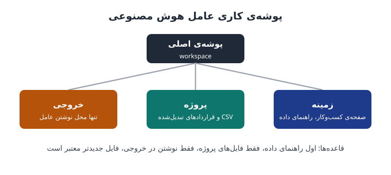

ابزارهای هوش مصنوعی حالا فقط به پرسش پاسخ نمی‌دهند؛ به هدف کار می‌کنند، خودشان مراحل را می‌چینند و تا پایان کار ادامه می‌دهند. اما **عامل هوش مصنوعی در مالی** بدون شناخت شرکت، داده‌ها و قواعد شما، سریع و با اطمینان اشتباه می‌کند. این نوشته چهار پایه‌ای را مرور می‌کند که پیش از سپردن کار به عامل باید آماده باشد.

## چرا عامل‌ها حالا واقعاً «عامل» شده‌اند؟

تا مدتی پیش، بیشتر ابزارهایی که خود را عامل می‌نامیدند در واقع گردش کار بودند: فرایندی گام‌به‌گام که در یک یا چند مرحله‌اش هوش مصنوعی به کار رفته بود. تغییر اصلی این است که ابزارها حالا «کامپیوتر خودشان» را دارند. هنگام کار، یک ماشین مجازی در فضای ابری باز می‌شود و دستیار در آن با صفحه‌گسترده، ارائه و زبان برنامه‌نویسی کار می‌کند، بدون اینکه صفحه‌کلید و ماوس شما را اشغال کند.

پیش‌تر یک دستور می‌دادید و یک خروجی می‌گرفتید. حالا اگر به فایل‌ها و برنامه‌هایتان دسترسی بدهید، عامل بدون توضیح هر مرحله کار را پیش می‌برد. همین‌جا خطر پیدا می‌شود: اگر اطلاعات کلیدی نداشته باشد یا هدف را حدس بزند چه؟

## فرمول عملکرد: هوش ضرب در زمینه

یک فرمول ساده این وضعیت را خوب توضیح می‌دهد: **عملکرد = هوش × زمینه**.

- **هوش** توان مدل است. شرکت‌های سازنده آن را تعیین می‌کنند و شما فقط بین مدل‌ها انتخاب می‌کنید. مدل‌های گران‌تر را برای برنامه‌ریزی کارهای پیچیده نگه دارید، مدل‌های میانی را برای بیشتر کارها و مدل‌های سبک را برای بازیابی ساده‌ی اطلاعات.
- **زمینه** چیزی است که عامل درباره‌ی شرکت، داده‌ها و قواعد شما می‌داند. این بخش کاملاً در اختیار شماست.

فرض کنید به عامل بگویید «گزارش فروش فصل سوم را آماده کن». بدون زمینه باید حدس بزند: کدام فایل‌ها؟ فروش یعنی چه؟ فصل سوم در سال مالی شما کدام سه ماه است؟ وقتی ضرب در صفر باشد، هوش بیشتر کمکی نمی‌کند.

## پایه‌ی اول: یک صفحه درباره‌ی کسب‌وکار

یک فایل متنی ساده بسازید و چهار چیز را بنویسید: کجا کار می‌کنید، چه محصولی می‌فروشید، در کدام کشورها و در چه صنعتی. مثلاً: «شرکت نرم‌افزاری ۱۲۰ نفره هستیم، اشتراک سالانه می‌فروشیم و بیشتر مشتریان در آلمان و فرانسه‌اند.» این کار یک بار انجام می‌شود و در همه‌ی ابزارها و پروژه‌ها قابل استفاده است. عامل بدون این صفحه مثل کارمندی است که نمی‌داند شرکتش چه کار می‌کند.

## پایه‌ی دوم: داده‌ی ساختاریافته و تمیز

داده‌ی ساختاریافته یعنی عدد در سطر و ستون؛ از نرم‌افزار حسابداری یا ERP، از یک جدول اکسل یا پایگاه داده. آن را به اکسل یا CSV خروجی بگیرید یا ابزار را مستقیم به منبع وصل کنید. اگر وصل می‌کنید، دامنه را محدود کنید؛ مثلاً در دستورالعمل پروژه بنویسید «از اتصال ERP فقط برای داده‌ی مشتری استفاده کن.» ظرفیت حافظه‌ی مدل محدود است.

گزارش‌های زیبای انسانی با خانه‌های ادغام‌شده زمینه‌ی خوبی نیستند. این قواعد را رعایت کنید:

- هر تراکنش در یک سطر و هر مفهوم در یک ستون
- قالب یکسان برای تاریخ، عدد و ارز
- بدون جمع جزء، بدون خانه‌ی ادغام‌شده و بدون دو مقدار در یک خانه
- تاریخ در نام فایل، مثل sales_2026-09-30.csv، تا در تعارض دو فایل، جدیدتر مشخص باشد

| تاریخ | مشتری | محصول | مبلغ | ارز |
|---|---|---|---|---|
| 2026-09-14 | الف | طرح A | 1,200 | EUR |
| 2026-09-15 | ب | طرح B | 3,400 | EUR |

اگر سطری مثل «جمع فصل سوم» وسط داده باشد، عامل آن را یک فروش دیگر حساب می‌کند. همین منطق در [ساده‌سازی سرفصل حساب‌ها](/posts/2024/10/12/simplify-chart-of-accounts/) هم صدق می‌کند: ساختار تمیز، خطای کمتر.

## پایه‌ی سوم: اسناد سبک‌شده

داده‌ی غیرساختاریافته یعنی متن‌هایی که در سطر و ستون نیستند: ایمیل، قرارداد، صورت‌جلسه و PDF. مدل‌ها متن را بر حسب «توکن» می‌شمارند و هر چه توکن بیشتر، سقف مصرف زودتر پر می‌شود. یک صفحه‌ی PDF به‌خاطر ساختار، تصویر و اطلاعات پنهان می‌تواند ۱٬۵۰۰ تا ۳٬۰۰۰ توکن مصرف کند، در حالی که همان متن در قالب Markdown حدود ۲۰۰ توکن است.

فرض کنید عامل باید ۴۰ قرارداد ده‌صفحه‌ای را بخواند. با میانگین ۲٬۰۰۰ توکن در هر صفحه، این یعنی ۸۰۰ هزار توکن؛ پس از تبدیل به Markdown حدود ۸۰ هزار توکن، یعنی یک‌دهم. فایل‌ها را یک بار تبدیل کنید: با خود دستیار، با یک مبدل رایگان یا با ذخیره‌ی متن از یک ویرایشگر. یک قاعده‌ی مهم: خلاصه هرگز جای منبع را نمی‌گیرد؛ قرارداد اصلی را هم در پوشه نگه دارید.

## پایه‌ی چهارم: راهنمای داده

راهنمای داده یادداشت کوتاهی است که فایل‌ها را برای عامل توضیح می‌دهد، مثل راهنمای یک نقشه. چهار بخش دارد:

1. هر فایل چیست (مثلاً یک سطر برای هر فروش، از ERP)
2. هر ستون چه معنایی دارد (مبلغ پیش از مالیات، به ارز ستون ارز)
3. چه چیزی را هرگز نباید جمع زد (ستون فصل را با سه ماهش جمع نزن؛ خودش جمع آن‌هاست)
4. تعریف‌های خود شما (درآمد خالص یعنی فروش منهای برگشتی و تخفیف)

بند سوم اهمیت زیادی دارد؛ در برگه‌ای با ستون‌های ژانویه، فوریه، مارس و جمع فصل، عامل ممکن است هر چهار ستون را جمع بزند. پیش از هر تحلیل بنویسید: «بگو این داده را چطور فهمیده‌ای؛ هنوز تحلیل نکن.» اگر برداشت غلط بود، اصلاحش کنید و بعد کار را بخواهید. مالکیت و تعریف یکسان داده در [داده‌ی قابل‌اتکا برای گزارش مالی](/posts/2023/10/10/reliable-data-financial-reporting/) هم بحث شده است.

## سازمان‌دهی پوشه‌ی کاری و قواعد عامل

یک پوشه‌ی اصلی بسازید با سه زیرپوشه: «زمینه» برای صفحه‌ی کسب‌وکار و راهنمای داده، «پروژه» برای فایل‌های همین کار، و «خروجی» به‌عنوان تنها جایی که عامل در آن می‌نویسد. قبل از شروع از همه‌چیز نسخه‌ی پشتیبان بگیرید؛ عاملی که به پوشه دسترسی دارد می‌تواند فایل‌ها را ویرایش یا حذف کند. سپس چهار قاعده بدهید:

1. اول راهنمای داده را بخوان.
2. فقط از فایل‌های پوشه‌ی پروژه استفاده کن.
3. فقط در پوشه‌ی خروجی بنویس.
4. اگر دو فایل با هم نمی‌خوانند، جدیدتر معتبر است.

وقتی تعداد فایل‌ها به صدها می‌رسد، عامل نمی‌تواند همه را بخواند. راه‌حل، ساخت یک جست‌وجوگر داخلی است: فایل‌ها به قطعه‌های کوچک تقسیم می‌شوند، روی هر قطعه برچسبی مثل «شرکت الف، گزارش فصل سوم، صفحه‌ی ۴» می‌خورد، قطعه‌ها در یک فهرست قابل جست‌وجو ذخیره می‌شوند و عامل فقط بهترین قطعه‌ها را می‌خواند. این روش را RAG می‌نامند و برچسب‌ها همان لایه‌ای است که معنای هر عدد را روشن می‌کند. برای اینکه بدانید کدام فرایندها اصلاً به عامل نیاز دارند، [کاربردهای عامل هوش مصنوعی در مالی](/posts/2024/12/01/ai-agents-finance-use-cases/) را ببینید.

## پرسش‌های متداول

### آیا مدل قوی‌تر جای زمینه‌ی خوب را می‌گیرد؟

نه. طبق فرمول هوش ضرب در زمینه، اگر زمینه ناقص باشد، حتی بهترین مدل هم بر پایه‌ی حدس کار می‌کند و خطایش را با اطمینان ارائه می‌دهد.

### چرا PDF را به Markdown تبدیل کنیم؟

چون همان متن با توکن بسیار کمتری خوانده می‌شود؛ هزینه و مصرف پایین می‌آید و عامل فضای بیشتری برای خود تحلیل دارد.

### راهنمای داده چقدر باید مفصل باشد؟

کوتاه و دقیق. چند خط برای هر فایل کافی است، به شرط اینکه معنای ستون‌ها، جمع‌های ممنوع و تعریف‌های اختصاصی شرکت را پوشش دهد.

### چرا عامل فقط باید در پوشه‌ی خروجی بنویسد؟

برای حفظ داده‌ی اصلی. اگر عامل اشتباه کند، منبع دست‌نخورده می‌ماند و خطا فقط در خروجی است که بازبینی می‌شود.

## جمع‌بندی

خودمختاری بدون زمینه به نتیجه‌ی ضعیف، عدد نادرست و هزینه‌ی بیشتر می‌رسد. پیش از سپردن کار به عامل هوش مصنوعی در مالی، یک صفحه درباره‌ی کسب‌وکار بنویسید، داده‌ی ساختاریافته را تمیز کنید، اسناد را سبک کنید و راهنمای داده بسازید. سپس عامل را با چهار قاعده‌ی روشن به پوشه‌ای مرتب بفرستید.
