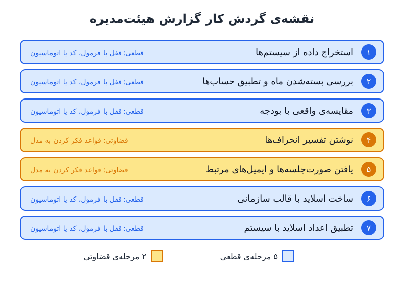

بیشتر **گردش کارهای هوش مصنوعی در گزارش مالی** روز اول خراب نمی‌شوند؛ ماه دوم خراب می‌شوند. یک کد دفتر کل تازه اضافه می‌شود، ساختار فایل عوض می‌شود و مدل همچنان با اطمینان کامل جواب غلط می‌دهد. راه‌حل، نوشتن یک دستور بلندتر نیست؛ شکستن کار به قطعه‌های کوچک و ساختن هر قطعه به روش درست خودش است.

## مسئله‌ی «یک مهارت غول‌آسا»

فرض کنید تحلیلگری برای بررسی ماهانه‌ی مدل کمیسیون فروش، یک دستورالعمل جامع برای دستیار هوش مصنوعی نوشته است: فایلی با ۶۰۰ ردیف و ۵۴ ستون که هر ماه پردازش می‌شود و دستورالعملش به حدود ۲۰ صفحه رسیده است. ماه اول همه‌چیز عالی کار می‌کند. ماه دوم دو کد حساب جدید در داده ظاهر می‌شود و کل خروجی به هم می‌ریزد؛ بدتر از آن، مدل هیچ هشداری نمی‌دهد.

مشکل از خود مدل نیست، از طراحی است. یک دستورالعمل بیست‌صفحه‌ای هم ساختنش سخت است، هم اشکال‌یابی‌اش و هم اعتماد به آن. وقتی چیزی خراب می‌شود نمی‌دانید کدام بخش مقصر است. توصیه‌ی اصلی ساده است: به‌جای یک مهارت بزرگ، چند مهارت کوچک بسازید و بعد آن‌ها را در یک پروژه یا بسته‌ی واحد به هم وصل کنید.

## دو نوع کار: قطعی و قضاوتی

ریشه‌ی ماجرا در تفاوت دو نوع کار است:

- **کار قطعی (Deterministic):** با ورودی یکسان، همیشه خروجی یکسان می‌دهد؛ مثل یک فرمول اکسل. محاسبه‌ی یک KPI فقط یک جواب درست دارد.
- **کار احتمالاتی یا قضاوتی (Probabilistic):** مدل زبانی ذاتاً احتمالاتی است؛ یک پرسش را دو بار بپرسید، ممکن است دو جواب متفاوت بگیرید. نوشتن تفسیر انحراف از بودجه یک جواب واحد ندارد.

هر گزارش هیئت‌مدیره هر دو نوع کار را در خود دارد. وقتی کل گزارش را یک‌جا به مدل می‌سپارید، از ابزاری احتمالاتی برای کارهایی استفاده می‌کنید که باید کاملاً قطعی باشند. همین‌جاست که خطا وارد می‌شود. پیش‌تر در بحث [حاکمیت هوش مصنوعی در مالی](/posts/2024/08/27/ai-finance-governance-controls/) هم دیدیم که منطق محاسبه باید قطعی و قابل‌ردیابی باشد.

## ساخت گردش کار هوش مصنوعی برای گزارش هیئت‌مدیره در چهار گام

### گام ۱: اول زمینه را آماده کنید

پیش از ساختن هر چیزی، یک پوشه‌ی مرجع بسازید که چهار جزء دارد: یک صفحه توضیح درباره‌ی کسب‌وکار، داده‌های ساخت‌یافته، داده‌های بدون ساختار و یک راهنمای داده. برای گزارش هیئت‌مدیره یعنی ارقام واقعی و بودجه به‌صورت جدول‌های تمیز، صورت‌جلسه‌ی ماه قبل به‌صورت فایل متنی، و راهنمایی که صریحاً بگوید کدام فایل «واقعی» است و کدام «بودجه».

### گام ۲: گردش کار را نقشه‌برداری کنید

کل کار را بنویسید، هر مرحله در یک خط. بعد کنار هر مرحله علامت بزنید: آیا جواب باید هر بار یکسان باشد، یا قضاوت لازم دارد؟ یک گردش کار نمونه برای گزارش ماهانه‌ی هیئت‌مدیره:

| مرحله | نوع کار |
|---|---|
| استخراج داده از سیستم حسابداری و فایل‌های اداری | قطعی |
| اطمینان از بسته‌شدن ماه یا تطبیق حساب‌ها | قطعی |
| مقایسه‌ی ارقام واقعی با بودجه یا هدف | قطعی |
| نوشتن تفسیر انحراف‌ها | قضاوتی |
| یافتن ایمیل‌ها و صورت‌جلسه‌های مرتبط | قضاوتی |
| ساخت اسلایدها با رنگ و قلم سازمان | قطعی |
| تطبیق اعداد اسلایدها با سیستم گزارشگری | قطعی |

پنج مرحله از هفت مرحله باید هر بار جواب یکسان بدهند و فقط دو مرحله به قضاوت مدل نیاز دارند. این نسبت در بیشتر کارهای مالی تکرار می‌شود.

### گام ۳: برای هر نوع کار، مهارت مناسب بسازید

**برای مراحل قطعی، جواب را قفل کنید.** سه راهکار عملی:

1. **جابه‌جایی داده را به ابزار اتوماسیون بسپارید.** انتقال گزارش‌ها از نرم‌افزار حسابداری به یک پوشه‌ی ابری با هوش مصنوعی شدنی است، اما چرا اعتبار و توکن را صرف کاری قطعی کنید؟ ابزارهای اتوماسیون گردش کار (مثل Zapier، Make، n8n یا Power Automate) تضمین می‌کنند مراحل هر بار یکسان اجرا شوند.
2. **فرمول یا کد را یک بار با کمک هوش مصنوعی بسازید و بارها استفاده کنید.** برای کاری مثل تطبیق تخفیف‌های حجمی (Rebate) که پر از محاسبه‌ی قاعده‌محور است، بهتر است مدل یک اسکریپت پایتون بنویسد که داخل مهارت قرار بگیرد. لازم نیست پایتون بلد باشید؛ کافی است خروجی را کنترل کنید. اصل کلی: نگذارید مدل هر ماه روش محاسبه را از نو اختراع کند. یک بار بسازید، آزمون کنید، بعد هر ماه از همان استفاده کنید.
3. **برای کارهای عمدتاً قاعده‌مند با چند استثنا، مدل را وادار به پرسیدن کنید.** فرض کنید قواعد طبقه‌بندی تراکنش‌های بانکی فقط در ذهن یک نفر است. با دادن صورت‌حساب‌های قدیمی و صفحه‌گسترده‌های طبقه‌بندی‌شده به مدل، حدود ۶۰ تا ۷۰ درصد قواعد استخراج و به فرمول تبدیل می‌شود. ۳۰ تا ۴۰ درصد باقی‌مانده علامت‌گذاری می‌شود و مدل موظف است پیش از پرکردن هر خلأ از شما بپرسد. این همان چیزی است که مشکل کد حساب جدید را حل می‌کرد: کد تازه به‌جای حدس‌زدن، برای بررسی به شما ارجاع می‌شود.

**برای مراحل قضاوتی، به مدل بگویید چطور فکر کند.** قواعد تحلیل را بدهید، نه جواب را. مثلاً مهارت تحلیل می‌گوید: «از خط اول درآمد شروع کن، بعد محرک‌های فروش را پیدا کن». برای ساختار تحلیل انحراف می‌توانید از [ریشه‌یابی انحراف و مقایسه‌گر مناسب](/posts/2023/10/08/accountability-kpi-comparator-root-cause/) الهام بگیرید.

یک تقسیم‌بندی نمونه برای گزارش هیئت‌مدیره:

- **مهارت اصلی** که همه‌چیز را به هم وصل می‌کند و با یک فرمان اجرا می‌شود.
- **مهارت تحلیل** مخصوص همان شرکت.
- **مهارت قالب‌بندی** برای رنگ و قلم سازمانی؛ یکی از ساده‌ترین مهارت‌ها برای ساختن.
- **عامل کنترل اسلاید** که اعداد ارائه را با سیستم گزارشگری تطبیق می‌دهد.
- **عامل جست‌وجوی صورت‌جلسه** که ایمیل‌ها را برای موارد مرتبط با جلسه‌ی آن ماه می‌گردد.

### گام ۴: مهارت‌ها را در یک بسته جمع کنید و بیازمایید

حالا مهارت‌ها را در یک بسته (پلاگین یا پروژه) کنار هم بگذارید. نقشه‌ی گام ۲ را به دستیار بدهید، مشخص کنید کدام مراحل قطعی و کدام قضاوتی‌اند و ابزارهایی را که باید به آن‌ها وصل شود (مثلاً نرم‌افزار حسابداری یا ایمیل) نام ببرید. پس از ساخت، مهارت‌ها و اتصال‌های داخل بسته را بخوانید تا بدانید دقیقاً چه چیزی ساخته شده است. اگر از دستیار دیگری استفاده می‌کنید، معادل‌هایی مثل دستیار سفارشی با دستورالعمل و فایل‌های خودش هم وجود دارد.

## آزمون روی ماهی که بسته شده

مهم‌ترین قدم، آزمون است. بسته را روی ماهی اجرا کنید که قبلاً بسته و گزارش شده است و خروجی را با گزارشی که واقعاً ارسال کرده‌اید مقایسه کنید. قاعده این است: کاری را خودکار کنید که می‌دانید «خوب» در آن چه شکلی است.

فرض کنید گزارش ماه گذشته درآمد را ۴٬۲۵۰ میلیون تومان و انحراف از بودجه را منفی ۳٫۵ درصد نشان داده است. اگر بسته درآمد را ۴٬۲۵۰ اما انحراف را منفی ۴ درصد گزارش کند، می‌دانید ایراد در مرحله‌ی مقایسه یا داده‌ی بودجه است، نه در استخراج درآمد. ساختار ماژولار دقیقاً همین امکان را می‌دهد: خطا را به یک قطعه‌ی مشخص نسبت می‌دهید و همان را اصلاح می‌کنید. در یک دستور غول‌آسا چنین تشخیصی تقریباً ناممکن است.

مسیر کار مالی به سمتی می‌رود که بخش بیشتری از کارهای ماهانه با یک عامل هوشمند در حلقه انجام شود و نقش ما مدیریت این عامل‌ها باشد. اما فقط عاملی را می‌توان خوب مدیریت کرد که از قطعه‌های درست ساخته شده باشد. برای اینکه بدانید کجا اصلاً به هوش مصنوعی نیاز ندارید، نوشته‌ی [چه زمانی هوش مصنوعی در مالی لازم نیست](/posts/2024/11/29/when-not-to-use-ai-finance/) را ببینید.

## پرسش‌های متداول

### چرا نباید کل گزارش را در یک دستور بلند به هوش مصنوعی داد؟
چون کارهای قطعی و قضاوتی با هم مخلوط می‌شوند، خطاها پنهان می‌مانند و هنگام تغییر داده نمی‌دانید کدام بخش خراب شده است.

### برای محاسبات تکراری از مدل استفاده کنیم یا فرمول؟
فرمول، اسکریپت یا ابزار اتوماسیون. می‌توانید آن را با کمک مدل بسازید، ولی پس از آزمون باید همان را هر ماه بدون تغییر اجرا کنید.

### با کدهای حساب یا دسته‌های تازه چه کنیم؟
قاعده‌ای بگذارید که هر مورد ناشناخته علامت‌گذاری شود و مدل پیش از تصمیم از شما بپرسد، نه اینکه حدس بزند.

### بسته‌ی جدید را چطور اعتبارسنجی کنیم؟
روی یک ماه بسته‌شده اجرا کنید و خروجی را عدد به عدد با گزارش واقعی ارسال‌شده مقایسه کنید.

## جمع‌بندی

یک مهارت غول‌آسا سخت ساخته می‌شود و سخت به آن اعتماد می‌شود. کار را بر اساس نوعش تقسیم کنید: پاسخ‌هایی را که باید ثابت بمانند با فرمول، کد یا ابزار اتوماسیون قفل کنید، قضاوت را با قواعد روشن به مدل بسپارید، استثناها را به سمت انسان هدایت کنید و همه را در یک بسته‌ی واحد جمع کنید. بعد روی ماهی که جوابش را می‌دانید آزمون بگیرید و تنها پس از آن سراغ گردش کارهای بزرگ‌تر بروید.
