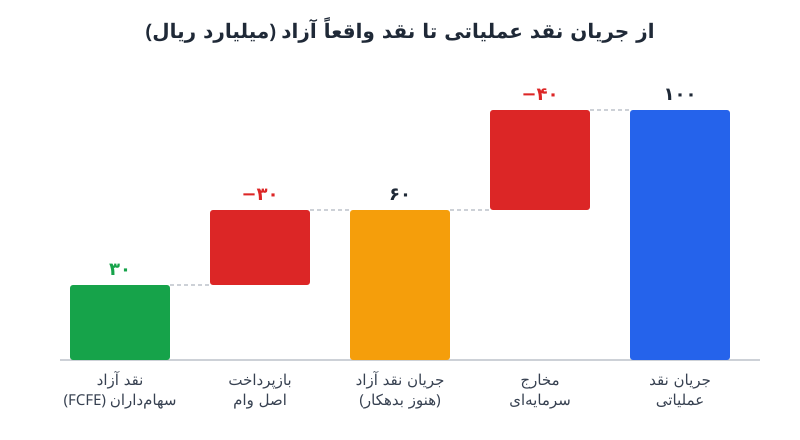

انواع جریان نقد را اغلب با هم اشتباه می‌گیرند: جریان نقد عملیاتی، سرمایه‌گذاری، تأمین مالی، جریان نقد آزاد شرکت (FCFF) و جریان نقد آزاد سهام‌داران (FCFE). هر کدام به پرسش متفاوتی پاسخ می‌دهد. این نوشته نشان می‌دهد هر عدد چطور ساخته می‌شود، کجا به کار می‌آید و چرا «جریان نقد آزاد» با وجود نامش هنوز آزاد نیست.

## سه جریان نقد صورت جریان وجوه نقد

سه نوع نخست مستقیماً روی صورت جریان وجوه نقد دیده می‌شوند و پایه‌ی همه‌ی محاسبه‌های بعدی‌اند.

### ۱. جریان نقد عملیاتی

نقدی است که فعالیت اصلی کسب‌وکار تولید می‌کند. از سود خالص شروع می‌کنیم، اقلام غیرنقدی مثل استهلاک را برمی‌گردانیم و تغییرات سرمایه در گردش (مطالبات، موجودی، پرداختنی‌ها) را اعمال می‌کنیم. این عدد نشان می‌دهد:

- آیا شرکت از محل عملیات خودش تعهداتش را می‌پردازد؟
- آیا نقد کافی برای ادامه‌ی کار روزمره دارد؟
- روند تولید نقد در طول زمان بهتر شده یا بدتر؟

### ۲. جریان نقد سرمایه‌گذاری

خالص خرید و فروش دارایی‌های بلندمدت مثل ساختمان، ماشین‌آلات و تجهیزات است. خرید دارایی منفی و فروش آن مثبت ثبت می‌شود. از این عدد برای ارزیابی تصمیم‌های سرمایه‌گذاری مدیریت و توان شرکت در کسب بازده از آن‌ها استفاده می‌شود.

### ۳. جریان نقد تأمین مالی

خالص پول دریافتی و پرداختی از محل بدهی و سرمایه است: وام گرفتن و بازپرداخت اصل آن، افزایش سرمایه، خرید سهام خزانه و پرداخت سود سهام. این بخش توان شرکت در جذب سرمایه و ساختار ریسک تأمین مالی آن را نشان می‌دهد.

## جریان نقد آزاد شرکت (FCFF)؛ نقد متعلق به همه‌ی تأمین‌کنندگان سرمایه

FCFF یا جریان نقد بدون اهرم، نقدی است که پس از پرداخت هزینه‌های عملیاتی، سرمایه‌گذاری در سرمایه در گردش و مخارج سرمایه‌ای لازم برای حفظ دارایی‌ها باقی می‌ماند، **پیش از** هر پرداختی به طلبکاران.

فرمول رایج:

> FCFF = جریان نقد عملیاتی + هزینه‌ی بهره × (۱ − نرخ مالیات) − مخارج سرمایه‌ای

بهره‌ی پس از مالیات را برمی‌گردانیم چون در جریان نقد عملیاتی کسر شده، ولی FCFF باید مستقل از نحوه‌ی تأمین مالی باشد. این عدد مال مجموع سهام‌داران و وام‌دهندگان است و به همین دلیل در [مدل جریان نقد تنزیل‌شده](/posts/2022/08/24/discounted-cash-flow-dcf-step-by-step/) با میانگین موزون هزینه‌ی سرمایه (WACC) تنزیل می‌شود تا ارزش کل شرکت به دست آید.

## چرا «جریان نقد آزاد» آزاد نیست؟

در گفت‌وگوهای روزمره، جریان نقد آزاد (FCF) معمولاً با این تعریف ساده به کار می‌رود:

> FCF = جریان نقد عملیاتی − مخارج سرمایه‌ای

نام «آزاد» از اینجا آمده که فرض می‌شود این پول برای خرج‌کردن به اختیار مدیریت یا توزیع میان سهام‌داران در دسترس است. اما یک نکته‌ی مهم جا مانده: جریان نقد عملیاتی فقط **بهره** را پرداخته، نه **اصل** وام را. پس شرکت هنوز همه‌ی تعهداتش به طلبکاران را ادا نکرده و تا وقتی قسط‌ها پرداخت نشده، این پول واقعاً آزاد نیست.

### مزایای FCF

- محاسبه‌اش ساده است و از صورت جریان نقد مستقیم درمی‌آید.
- هم وام‌دهنده و هم وام‌گیرنده آن را می‌فهمند.
- هم مخارج سرمایه‌ای را در نظر می‌گیرد و هم نقدی را که رشد فروش یا افت کارایی سرمایه در گردش می‌بلعد.

### محدودیت‌های FCF

- فرض می‌کند همه‌ی مخارج سرمایه‌ای ضروری است، در حالی که بخشی از آن نگهداری و بخشی رشد است.
- در سال خرید دارایی، مخارج سرمایه‌ای را بزرگ و در سال‌های بعد کوچک نشان می‌دهد.
- به‌تنهایی نمی‌گوید شرکت توان بازپرداخت بدهی‌اش را دارد یا نه.
- تعریف استانداردی ندارد؛ پیش از هر مذاکره تعریف بانک یا سرمایه‌گذار را بپرسید.

### FCF را می‌توان دستکاری کرد

ساده‌ترین راه بالا بردن FCF این است که شرکت در دارایی ثابت کم‌سرمایه‌گذاری کند. در کوتاه‌مدت عدد زیبا می‌شود و سهام‌داران خوشحال‌اند، اما در بلندمدت هم نقد کمتر می‌ماند و هم دارایی‌های فرسوده بهره‌وری را پایین می‌آورند.

## جریان نقد آزاد سهام‌داران (FCFE)؛ تنها نقد واقعاً آزاد

FCFE یا جریان نقد اهرمی، همه‌ی آنچه FCF حساب می‌کند به‌علاوه‌ی **همه‌ی پرداخت‌های بدهی**، چه اصل و چه بهره، را در نظر می‌گیرد:

> FCFE = جریان نقد عملیاتی − مخارج سرمایه‌ای ± خالص تغییر بدهی

اگر شرکت وام جدید بگیرد، FCFE بالا می‌رود و اگر اصل وام را بازپرداخت کند، پایین می‌آید. نتیجه نقدی است که پس از تسویه با همه‌ی طلبکاران باقی می‌ماند و واقعاً می‌تواند صرف سود سهام، بازخرید سهام، بازپرداخت زودتر بدهی یا خرید شرکت‌های دیگر شود. در ارزش‌گذاری، FCFE با نرخ بازده مورد انتظار سهام‌داران تنزیل می‌شود و مستقیماً ارزش حقوق صاحبان سهام را می‌دهد.

## مثال عددی: از جریان نقد عملیاتی تا FCFE

فرض کنید شرکتی در یک سال این اعداد را دارد (میلیارد ریال):

| قلم | مبلغ |
|---|---|
| جریان نقد عملیاتی | ۱۰۰ |
| هزینه‌ی بهره | ۱۰ |
| نرخ مالیات | ۲۵٪ |
| مخارج سرمایه‌ای | ۴۰ |
| بازپرداخت اصل وام | ۳۰ |
| وام جدید | ۰ |

- **FCF ساده:** ۱۰۰ − ۴۰ = ۶۰
- **FCFF:** ۱۰۰ + ۱۰ × (۱ − ۰٫۲۵) − ۴۰ = ۶۷٫۵
- **FCFE:** ۱۰۰ − ۴۰ − ۳۰ = ۳۰

مدیری که فقط عدد ۶۰ را ببیند ممکن است فکر کند می‌تواند ۵۰ میلیارد سود سهام بدهد. اما پس از قسط وام، تنها ۳۰ میلیارد واقعاً آزاد است و توزیع ۵۰ میلیارد یعنی برداشت از ذخیره‌ی نقد یا گرفتن وام تازه. برای اینکه بازپرداخت‌ها به‌درستی در مدل دیده شوند، [جدول بدهی و جاروی نقد](/posts/2023/04/29/debt-schedule-cash-sweep-model/) ابزار مناسبی است.

## کدام جریان نقد را برای چه کاری به کار ببریم؟

| نوع جریان نقد | پرسش اصلی | کاربرد رایج |
|---|---|---|
| عملیاتی | عملیات اصلی نقد می‌سازد؟ | سلامت مالی و روند |
| سرمایه‌گذاری | مدیریت کجا سرمایه‌گذاری می‌کند؟ | ارزیابی تصمیم‌های سرمایه‌ای |
| تأمین مالی | پول از کجا آمده و به کجا رفته؟ | ریسک ساختار سرمایه |
| FCFF | کل کسب‌وکار چقدر می‌ارزد؟ | DCF با WACC، ارزش شرکت |
| FCFE | چقدر برای سهام‌داران مانده؟ | سود سهام، بازخرید، ارزش سهام |

اگر هنوز درباره‌ی فاصله‌ی سود حسابداری و نقد تردید دارید، مطلب [جریان نقدی آزاد و سود خالص](/posts/2022/05/02/free-cash-flow-vs-net-income/) نقطه‌ی شروع خوبی است.

## پرسش‌های متداول

### تفاوت اصلی FCFF و FCFE چیست؟

FCFF پیش از پرداخت به طلبکاران محاسبه می‌شود و مال همه‌ی تأمین‌کنندگان سرمایه است؛ FCFE پس از پرداخت بهره و اصل بدهی محاسبه می‌شود و فقط مال سهام‌داران است.

### آیا FCFE همیشه از FCFF کمتر است؟

معمولاً بله، چون بهره و بازپرداخت‌ها کسر می‌شوند. اما در سالی که شرکت وام جدید بزرگی بگیرد، FCFE ممکن است موقتاً از FCFF بیشتر شود.

### چرا تعریف FCF در قراردادهای وام مهم است؟

چون تعریف استانداردی ندارد و هر بانک ممکن است اقلام متفاوتی را در آن بگنجاند. محاسبه با تعریف اشتباه می‌تواند به نقض شرایط قرارداد منجر شود.

### کم‌کردن مخارج سرمایه‌ای چه اشکالی دارد؟

FCF امسال را بالا می‌برد ولی ظرفیت تولید نقد سال‌های آینده را می‌خورد. بهتر است مخارج نگهداری را جدا کنید و دست‌کم هم‌اندازه‌ی استهلاک نگه دارید.

## جمع‌بندی

پنج نوع جریان نقد پنج پرسش متفاوت را پاسخ می‌دهند. سه جریان صورت مالی تصویر عملیات، سرمایه‌گذاری و تأمین مالی را می‌دهند؛ FCFF ارزش کل کسب‌وکار را می‌سنجد و FCFE نشان می‌دهد پس از تسویه با همه‌ی طلبکاران چه چیزی برای سهام‌داران می‌ماند. هر وقت عدد «جریان نقد آزاد» را دیدید، بپرسید: آیا اصل بدهی هم پرداخت شده است؟ اگر نه، آن پول هنوز آزاد نیست.
