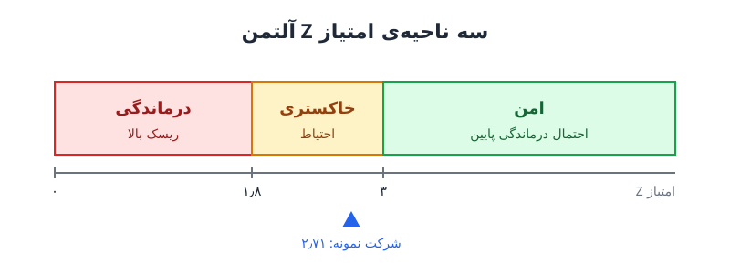

**درماندگی مالی** وضعیتی است که شرکت نمی‌تواند تعهدات نقدی جاری‌اش را انجام دهد؛ یعنی نقد کافی در دست ندارد یا به‌موقع به دستش نمی‌رسد تا حقوق کارکنان، طلب تأمین‌کنندگان و اقساط وام را بپردازد. این نوشته ده نشانه‌ی هشدار و یک ابزار کمّی برای سنجش آن، یعنی امتیاز Z آلتمن، را مرور می‌کند.

## درماندگی مالی با زیان یکی نیست

شرکتی می‌تواند یک سال زیان بدهد و همچنان سالم باشد، و شرکتی دیگر با سود حسابداری به بن‌بست نقدی برسد. درماندگی مالی درباره‌ی **توان پرداخت به‌موقع** است، نه صرفاً سود. اگر این وضعیت ادامه پیدا کند، به نقض تعهدات قراردادی، اقدام حقوقی طلبکاران و در نهایت ورشکستگی می‌رسد.

نکته‌ی مهم: هیچ‌کدام از نشانه‌های زیر به‌تنهایی کافی نیست. اما وقتی چند نشانه با هم ظاهر شوند، احتمال درماندگی جدی است.

## ده نشانه‌ی هشدار درماندگی مالی

### نشانه‌های نقدینگی

1. **تأخیر در پرداخت صورتحساب‌ها.** شرکت نقد کافی برای تعهدات جاری تولید نمی‌کند و ممکن است با پیامدهای حقوقی یا نقض قرارداد روبه‌رو شود.
2. **مانده‌ی نقد پایین یا صفر.** شرکت را مجبور می‌کند برای انجام تعهدات به سراغ بدهی یا تأمین مالی گران برود.
3. **جریان نقد عملیاتی منفی.** عملیات اصلی پول کافی برای پوشش هزینه‌ها نمی‌سازد؛ نشانه‌ی ناکارایی یا رقابت شدید. برای خواندن دقیق‌تر این صورت، نوشته‌ی [علائم هشدار صورت جریان نقد](/posts/2022/08/02/cash-flow-statement-red-flags/) را ببینید.
4. **افزایش بدهی کوتاه‌مدت و حساب‌های پرداختنی.** تکیه بر تأمین مالی کوتاه‌مدت پرهزینه است و در بلندمدت فشار را بیشتر می‌کند.

### نشانه‌های عملکرد

5. **کاهش فروش یا درآمد.** شرکت را به سمت بدهی بیشتر برای پوشش تعهدات می‌برد و وضعیت را بدتر می‌کند.
6. **حاشیه‌ی سود پایین یا منفی.** یا عملیات ناکارآمد است یا رقابت حاشیه را خورده است.

### نشانه‌های ساختار سرمایه

7. **نسبت بدهی به حقوق صاحبان سهام بالا.** هزینه‌ی بهره سود را به‌شدت کاهش می‌دهد.
8. **نسبت بدهی به دارایی بالا.** شرکت اهرم سنگینی دارد و ممکن است نتواند با دارایی‌هایش سود کافی بسازد؛ ریسک نکول بالا می‌رود.

### نشانه‌های بازار

9. **افت قیمت سهام.** سرمایه‌گذاران اعتمادشان را از دست می‌دهند و جذب سرمایه‌ی تازه سخت‌تر می‌شود.
10. **کاهش رتبه‌ی اعتباری.** تأمین مالی با نرخ مناسب دشوار می‌شود و شرکت به سمت گزینه‌های گران‌تر رانده می‌شود.

بسیاری از این نشانه‌ها همان چیزی است که بانک‌ها در قالب تعهدات مالی قرارداد وام پایش می‌کنند؛ نوشته‌ی [کاونانت‌های مالی و نسبت‌های اهرمی](/posts/2023/03/14/financial-covenants-fccr-leverage-ratio/) این ارتباط را توضیح می‌دهد.

## امتیاز Z آلتمن چیست؟

نشانه‌ها کیفی‌اند؛ برای یک عدد واحد، امتیاز Z آلتمن ساخته شده است. این مدل پنج نسبت مالی را با وزن‌های مشخص ترکیب می‌کند تا احتمال ورشکستگی یا درماندگی مالی را در دو سال آینده تخمین بزند:

**Z = ۱٫۲A + ۱٫۴B + ۳٫۳C + ۰٫۶D + ۱٫۰E**

| متغیر | نسبت | چه چیزی را می‌سنجد |
|---|---|---|
| A | سرمایه در گردش ÷ کل دارایی‌ها | نقدینگی |
| B | سود انباشته ÷ کل دارایی‌ها | سودآوری انباشته و عمر شرکت |
| C | سود پیش از بهره و مالیات (EBIT) ÷ کل دارایی‌ها | بهره‌وری عملیاتی دارایی‌ها |
| D | ارزش بازار حقوق صاحبان سهام ÷ ارزش دفتری بدهی‌ها | توان پرداخت و حاشیه‌ی اطمینان بازار |
| E | فروش ÷ کل دارایی‌ها | گردش دارایی‌ها |

بیشترین وزن به C تعلق دارد؛ یعنی توان دارایی‌ها در ساختن سود عملیاتی مهم‌ترین عامل بقاست.

## تفسیر نتیجه: سه ناحیه

- **بالاتر از ۳:** ناحیه‌ی امن؛ احتمال درماندگی در کوتاه‌مدت پایین است.
- **بین ۱٫۸ و ۳:** ناحیه‌ی خاکستری؛ احتیاط و پایش دقیق‌تر لازم است.
- **کمتر از ۱٫۸:** ریسک بالای درماندگی مالی.

## مثال عددی محاسبه‌ی امتیاز Z

فرض کنید شرکتی تولیدی و بورسی این ارقام را دارد (میلیارد تومان): کل دارایی‌ها ۱٬۰۰۰، سرمایه در گردش ۱۵۰، سود انباشته ۲۰۰، EBIT برابر ۱۰۰، ارزش بازار سهام ۶۰۰، کل بدهی‌ها ۵۰۰ و فروش ۱٬۲۰۰.

| متغیر | نسبت | وزن | حاصل |
|---|---|---|---|
| A | ۰٫۱۵ | ۱٫۲ | ۰٫۱۸ |
| B | ۰٫۲۰ | ۱٫۴ | ۰٫۲۸ |
| C | ۰٫۱۰ | ۳٫۳ | ۰٫۳۳ |
| D | ۱٫۲۰ | ۰٫۶ | ۰٫۷۲ |
| E | ۱٫۲۰ | ۱٫۰ | ۱٫۲۰ |
| **Z** | | | **۲٫۷۱** |

امتیاز ۲٫۷۱ در ناحیه‌ی خاکستری است. جالب است ببینیم چه چیزی آن را به ناحیه‌ی امن می‌برد: اگر EBIT از ۱۰۰ به ۱۹۰ برسد، C به ۰٫۱۹ و سهمش به حدود ۰٫۶۳ می‌رسد و Z از ۳ عبور می‌کند. همین نشان می‌دهد بهبود سودآوری عملیاتی اثرگذارترین اهرم است.

## محدودیت‌های امتیاز Z

- **برای همه‌ی شرکت‌ها طراحی نشده.** فرمول اصلی برای شرکت‌های تولیدی بورسی ساخته شد؛ برای شرکت‌های خصوصی، خدماتی یا مالی نسخه‌های تعدیل‌شده با وزن‌های دیگر وجود دارد.
- **به ارزش بازار وابسته است.** متغیر D در شرکت غیربورسی باید با ارزش دفتری جایگزین شود که دقت را تغییر می‌دهد.
- **خطاناپذیر نیست.** آن را کنار سایر شاخص‌های سلامت مالی، به‌ویژه پیش‌بینی جریان نقد کوتاه‌مدت، به کار ببرید.
- **عکس لحظه‌ای است.** روند امتیاز در چند دوره از عدد یک دوره گویاتر است.

## پرسش‌های متداول

### آیا امتیاز Z برای کسب‌وکار کوچک غیربورسی هم کاربرد دارد؟
با احتیاط. باید از نسخه‌ی تعدیل‌شده برای شرکت‌های خصوصی استفاده کنید و آن را فقط یک نشانه در کنار بقیه بدانید.

### اگر امتیاز در ناحیه‌ی خاکستری بود چه کنیم؟
مؤلفه‌ای را که بیشترین ضعف را دارد پیدا کنید. معمولاً سودآوری عملیاتی یا سرمایه در گردش نقطه‌ی شروع اصلاح است.

### مهم‌ترین نشانه‌ی درماندگی مالی کدام است؟
جریان نقد عملیاتی منفی و مداوم، چون نشان می‌دهد عملیات اصلی خودش را تأمین نمی‌کند و شرکت به منابع بیرونی وابسته شده است.

### در صورت بروز چند نشانه، اولین اقدام چیست؟
تصویر دقیقی از نقد و تعهدات چند هفته‌ی آینده بسازید. گام‌های عملی را در [چک‌لیست بحران مالی کسب‌وکار](/posts/2024/09/18/business-financial-crisis-checklist/) آورده‌ایم.

## جمع‌بندی

درماندگی مالی معمولاً ناگهانی نیست؛ پیش از آن نشانه‌هایی در نقدینگی، عملکرد، ساختار سرمایه و بازار ظاهر می‌شود. امتیاز Z آلتمن این تصویر را در یک عدد خلاصه می‌کند: بالای ۳ امن، بین ۱٫۸ و ۳ احتیاط، زیر ۱٫۸ خطر. از آن به‌عنوان زنگ هشدار استفاده کنید، نه حکم قطعی، و همیشه آن را کنار جریان نقد واقعی بخوانید.
