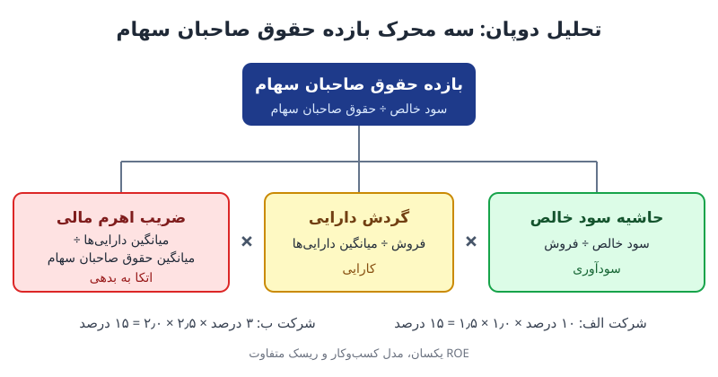

بازده حقوق صاحبان سهام (ROE) نشان می‌دهد شرکت با پول سهام‌داران چقدر سود ساخته است. اما یک عدد تنها نمی‌گوید این بازده از کجا آمده است. تحلیل دوپان ROE را به سه محرک می‌شکند تا روشن شود بازده بالا حاصل سودآوری است، حاصل کارایی در استفاده از دارایی‌ها، یا حاصل اتکای بیشتر به بدهی.

## تحلیل دوپان چیست؟

تحلیل دوپان روشی برای تحلیل سودآوری است که بازده حقوق صاحبان سهام را به حاصل‌ضرب سه نسبت تجزیه می‌کند:

**ROE = حاشیه سود خالص × گردش دارایی × ضریب اهرم مالی**

این سه نسبت به سه پرسش پاسخ می‌دهند:

1. از هر واحد فروش، چه سهمی را به‌عنوان سود نگه می‌دارید؟
2. با دارایی‌هایتان چقدر کارآمد فروش می‌سازید؟
3. چه مقدار از این دارایی‌ها را با پول قرضی تأمین کرده‌اید؟

اگر با خود ROE و نسبت‌های خویشاوندش آشنا نیستید، مطلب [ROIC، ROE و ROA](/posts/2022/10/13/roic-roe-roa-explained/) پیش‌زمینه‌ی خوبی است.

## سه محرک ROE در تحلیل دوپان و فرمول هر کدام

### حاشیه سود خالص

**حاشیه سود خالص = سود خالص ÷ فروش**

سهمی از فروش است که پس از کسر همه‌ی هزینه‌ها، بهره و مالیات برای شرکت می‌ماند. این جزء کیفیت قیمت‌گذاری، کنترل هزینه و ساختار مالیاتی را نشان می‌دهد. برای دیدن لایه‌های مختلف سود، [حاشیه سود ناخالص، عملیاتی و خالص](/posts/2024/01/14/profit-margins-gross-operating-net/) را بخوانید.

### گردش دارایی

**گردش دارایی = فروش ÷ میانگین کل دارایی‌ها**

نشان می‌دهد هر واحد دارایی چند واحد فروش تولید کرده است. خرده‌فروشان و توزیع‌کنندگان معمولاً گردش دارایی بالا و حاشیه‌ی پایین دارند؛ صنایع سرمایه‌بر مثل نیروگاه یا مخابرات برعکس.

### ضریب اهرم مالی

**ضریب اهرم مالی = میانگین کل دارایی‌ها ÷ میانگین حقوق صاحبان سهام**

نشان می‌دهد هر واحد سرمایه‌ی سهام‌داران پشتوانه‌ی چند واحد دارایی است. هرچه این ضریب بزرگ‌تر باشد، سهم بدهی در تأمین مالی بیشتر است. اگر ضریب ۲ باشد، نیمی از دارایی‌ها با بدهی تأمین شده‌اند.

وقتی این سه را در هم ضرب کنید، فروش و دارایی‌ها از صورت و مخرج حذف می‌شوند و همان سود خالص ÷ حقوق صاحبان سهام باقی می‌ماند. پس تجزیه دقیق است و چیزی گم نمی‌شود.

## مثال عددی: دو شرکت با ROE یکسان

فرض کنید دو شرکت هر دو ROE پانزده درصدی گزارش کرده‌اند:

| محرک | شرکت الف | شرکت ب |
|---|---|---|
| حاشیه سود خالص | ۱۰٪ | ۳٪ |
| گردش دارایی | ۱٫۰ | ۲٫۵ |
| ضریب اهرم مالی | ۱٫۵ | ۲٫۰ |
| **ROE** | **۱۵٪** | **۱۵٪** |

شرکت الف با حاشیه‌ی بالا و بدهی کم به این بازده رسیده است؛ مدل کسب‌وکارش احتمالاً بر برند یا فناوری متکی است. شرکت ب با حاشیه‌ی باریک، فروش پرحجم و بدهی بیشتر همان عدد را ساخته است. ریسک این دو یکسان نیست: یک افت کوچک در حاشیه‌ی شرکت ب، به‌خاطر اهرم بالاتر، ضربه‌ی بزرگ‌تری به سهام‌دارانش می‌زند.

### مقایسه‌ی دو سال یک شرکت

حالا فرض کنید ROE یک شرکت از ۱۲ به ۱۵ درصد رسیده است. ظاهر خبر خوب است. اما با تحلیل دوپان می‌بینید حاشیه‌ی سود ثابت مانده (۶٪)، گردش دارایی هم تغییری نکرده (۱٫۲۵)، و ضریب اهرم از ۱٫۶ به ۲٫۰ رسیده است. یعنی همه‌ی بهبود از بدهی بیشتر آمده، نه از عملکرد بهتر. این همان نکته‌ای است که یک عدد ROE به‌تنهایی پنهان می‌کند.

## تحلیل دوپان در عمل؛ چه سؤالی بپرسیم؟

برای هر محرک، پرسش مدیریتی متفاوتی مطرح است:

- **اگر حاشیه‌ی سود ضعیف است:** آیا مشکل از قیمت‌گذاری است، از بهای تمام‌شده، یا از هزینه‌های عملیاتی و مالی؟
- **اگر گردش دارایی پایین است:** آیا موجودی و مطالبات بیش از نیاز انباشته شده؟ آیا ظرفیت بلااستفاده داریم؟
- **اگر اهرم بالاست:** آیا جریان نقد شرکت برای پوشش اقساط و بهره کافی است؟ کاونانت‌های وام در چه وضعی‌اند؟

این تفکیک کمک می‌کند گفت‌وگوی مدیریتی از «ROE پایین است» به «کدام اهرم را باید حرکت دهیم» برسد؛ رویکردی که در [محرک‌های ارزش کسب‌وکار](/posts/2024/03/10/business-value-drivers-guide/) هم دنبال می‌شود.

### نسخه‌ی گسترده‌ی دوپان

در تحلیل‌های دقیق‌تر، حاشیه‌ی سود خالص را هم به سه جزء می‌شکنند: بار مالیاتی (سود خالص ÷ سود پیش از مالیات)، بار بهره (سود پیش از مالیات ÷ سود عملیاتی) و حاشیه‌ی سود عملیاتی (سود عملیاتی ÷ فروش). این نسخه‌ی پنج‌جزئی نشان می‌دهد چه مقدار از سود در مسیر بهره و مالیات از دست می‌رود.

## محدودیت‌های تحلیل دوپان

- **به اعداد حسابداری متکی است.** اقلام غیرمکرر، تجدید ارزیابی دارایی‌ها یا روش‌های متفاوت استهلاک می‌تواند نسبت‌ها را جابه‌جا کند.
- **حقوق صاحبان سهام منفی یا بسیار کوچک** ROE و ضریب اهرم را بی‌معنا یا اغراق‌آمیز می‌کند؛ مثلاً در شرکت‌هایی که سهام خزانه‌ی زیادی خریده‌اند.
- **مقایسه بین صنایع** باید با احتیاط باشد؛ ترکیب طبیعی حاشیه و گردش در هر صنعت متفاوت است.
- **ریسک را مستقیم نمی‌سنجد.** اهرم بالا ROE را بالا می‌برد، اما هزینه‌ی سرمایه و ریسک ورشکستگی را هم افزایش می‌دهد.

## پرسش‌های متداول

### چرا از میانگین دارایی‌ها و حقوق صاحبان سهام استفاده می‌شود؟

چون سود و فروش در طول سال به دست می‌آیند، در حالی که ترازنامه عکسی از یک لحظه است. میانگین ابتدا و انتهای دوره تصویر منصفانه‌تری از منابع به‌کاررفته می‌دهد.

### آیا ROE بالاتر همیشه بهتر است؟

نه. اگر بازده بالا از اهرم زیاد آمده باشد، ریسک شرکت هم بالاتر رفته است. تحلیل دوپان دقیقاً برای تشخیص همین موضوع است.

### تحلیل دوپان برای چه کسانی مفید است؟

برای سرمایه‌گذار در مقایسه‌ی شرکت‌ها، برای مدیر مالی در تشخیص اهرم‌های بهبود عملکرد، و برای اعتباردهنده در سنجش اینکه بازده سهام‌داران چقدر به بدهی وابسته است.

## جمع‌بندی

تحلیل دوپان یک عدد کلی را به داستانی سه‌بخشی تبدیل می‌کند: چقدر از فروش را نگه می‌دارید، چقدر کارآمد از دارایی‌ها فروش می‌سازید، و چقدر به بدهی تکیه کرده‌اید. دو شرکت با ROE یکسان ممکن است مدل کسب‌وکار و ریسک کاملاً متفاوتی داشته باشند، و افزایش ROE یک شرکت ممکن است فقط حاصل بدهی بیشتر باشد. هر بار که ROE را گزارش یا تحلیل می‌کنید، این سه محرک را کنارش بگذارید.
