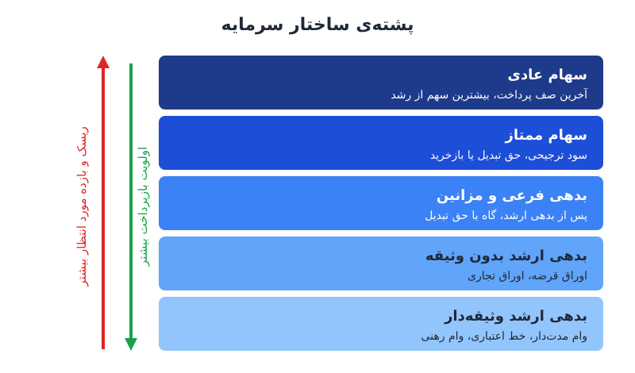

ساختار سرمایه معمولاً با دوگانه‌ی ساده‌ی «بدهی یا سهام» توضیح داده می‌شود. در عمل، بین این دو سر طیف، لایه‌های متعددی از ابزارهای تأمین مالی وجود دارد که هرکدام ترکیبی از ویژگی‌های بدهی و سهام دارند. شناخت این لایه‌ها به مدیر مالی کمک می‌کند برای هر نیاز، ابزاری با هزینه و ریسک مناسب انتخاب کند.

## ساختار سرمایه به‌شکل یک پشته

ساده‌ترین راه فهم ساختار سرمایه، تصور یک پشته‌ی طبقه‌بندی‌شده است. هرچه پایین‌تر بروید، تأمین‌کننده زودتر پولش را پس می‌گیرد و ریسکش کمتر است؛ پس بازده کمتری هم طلب می‌کند. هرچه بالاتر بروید، تأمین‌کننده دیرتر و با ریسک بیشتر پول می‌گیرد و بازده بیشتری می‌خواهد.

در صورت ورشکستگی یا انحلال، پرداخت به همین ترتیب از پایین به بالا انجام می‌شود. سازوکار مشابهی در تقسیم بازده معاملات سرمایه‌گذاری خصوصی هم دیده می‌شود که در [آبشار بازده](/posts/2023/04/23/returns-waterfall-private-equity/) توضیح داده شده است.

## پنج لایه‌ی تأمین مالی از پایین به بالا

### لایه‌ی ۱: بدهی ارشد وثیقه‌دار

کم‌ریسک‌ترین و معمولاً ارزان‌ترین منبع، چون به دارایی مشخصی پشتوانه دارد:

- **وام مدت‌دار:** وام بلندمدت با بازپرداخت اقساطی و اغلب نرخ ثابت.
- **خط اعتباری گردان:** سقفی که شرکت هر وقت لازم داشت برداشت و بازپرداخت می‌کند؛ مناسب نیاز فصلی سرمایه در گردش.
- **وام با پشتوانه‌ی دارایی:** وثیقه‌ی آن حساب‌های دریافتنی یا موجودی کالا است.
- **تأمین مالی تجهیزات:** خود تجهیزات خریداری‌شده وثیقه‌ی وام است.
- **وام رهنی:** با پشتوانه‌ی زمین یا ساختمان.

### لایه‌ی ۲: بدهی ارشد بدون وثیقه

وام‌دهنده به قدرت جریان نقد شرکت تکیه می‌کند، نه به دارایی خاص:

- **وام مدت‌دار و خط اعتباری بدون وثیقه** برای شرکت‌هایی با جریان نقد قوی و پایدار.
- **اوراق قرضه‌ی شرکتی** با نرخ و سررسید مشخص.
- **اوراق تجاری:** اسناد کوتاه‌مدت بدون وثیقه، معمولاً با سررسید حداکثر ۲۷۰ روز.
- **انتشار خصوصی:** اوراق بدهی که مستقیم به سرمایه‌گذاران نهادی فروخته می‌شود و شرایط منعطف‌تری از اوراق عمومی دارد.

### لایه‌ی ۳: بدهی فرعی و ابزارهای میانی

از اینجا ویژگی‌های سهام کم‌کم وارد می‌شود:

- **اوراق جونیور:** در صف پرداخت پس از بدهی ارشد قرار می‌گیرند.
- **بدهی میانی (مزانین):** وام فرعی که اغلب حق اختیار خرید سهام یا حق تبدیل دارد.
- **اوراق پربازده:** منتشرشده توسط شرکت‌هایی با رتبه‌ی اعتباری پایین‌تر و نرخ بهره‌ی بالاتر.
- **وام رتبه‌ی دوم وثیقه:** ادعای ثانویه روی همان وثیقه‌ای که بدهی ارشد دارد.
- **اوراق قرضه‌ی قابل تبدیل:** قابل تبدیل به تعداد مشخصی سهم عادی.

### لایه‌ی ۴: سهام ممتاز

سهام است، اما با حقوق ترجیحی نسبت به سهام عادی:

- **ممتاز انباشتنی:** سود معوق انباشته می‌شود و باید پیش از هر سودی به سهام عادی پرداخت شود.
- **ممتاز غیرانباشتنی:** سود پرداخت‌نشده انباشته نمی‌شود.
- **ممتاز مشارکتی:** علاوه بر سود ثابت، در سود اضافی هم سهیم است.
- **ممتاز قابل تبدیل:** با نسبت معین به سهام عادی تبدیل می‌شود.
- **ممتاز قابل بازخرید:** ناشر می‌تواند پس از تاریخ معین آن را با قیمت از پیش تعیین‌شده بازخرید کند.

### لایه‌ی ۵: سهام عادی و راه‌های جذب آن

بالاترین ریسک، آخرین صف پرداخت و بیشترین سهم از رشد آینده:

- **سهام مؤسسان:** اغلب با حق رأی ویژه و برنامه‌ی واگذاری تدریجی.
- **عرضه‌ی اولیه‌ی عمومی:** اولین فروش سهام به عموم و ایجاد بازار برای آن.
- **عرضه‌ی ثانویه:** فروش سهام بیشتر توسط شرکت یا سهامداران فعلی.
- **حق تقدم:** فروش سهام جدید به سهامداران فعلی به نسبت سهمشان، معمولاً با تخفیف.
- **طرح سهام کارکنان:** اعطای حق خرید سهام به کارکنان به‌عنوان بخشی از جبران خدمت.
- **تأمین مالی جمعی:** جمع‌آوری مبالغ کوچک از تعداد زیادی سرمایه‌گذار.
- **یادداشت‌های قابل تبدیل و قراردادهای SAFE:** ابزار رایج شرکت‌های نوپا که در دور بعدی جذب سرمایه به سهام تبدیل می‌شوند و نیاز به تعیین ارزش‌گذاری فوری را حذف می‌کنند. درباره‌ی اینکه SAFE بدهی است یا سهام اتفاق‌نظر وجود ندارد و برخی حسابرسان آن را در بدهی طبقه‌بندی می‌کنند.

## مثال عددی: هزینه‌ی ترکیبی یک پشته‌ی ساده

فرض کنید شرکتی ۱۰۰ میلیارد تومان سرمایه این‌طور تأمین کرده و بازده مورد انتظار هر لایه (پیش از اثر مالیات) چنین است:

| لایه | مبلغ | سهم | بازده مورد انتظار |
|---|---|---|---|
| بدهی ارشد وثیقه‌دار | ۴۰ | ۴۰٪ | ۱۸٪ |
| بدهی مزانین | ۱۵ | ۱۵٪ | ۲۶٪ |
| سهام ممتاز | ۱۰ | ۱۰٪ | ۳۰٪ |
| سهام عادی | ۳۵ | ۳۵٪ | ۳۸٪ |

میانگین موزون = ۰٫۴۰×۱۸ + ۰٫۱۵×۲۶ + ۰٫۱۰×۳۰ + ۰٫۳۵×۳۸ = ۷٫۲ + ۳٫۹ + ۳ + ۱۳٫۳ = **۲۷٫۴ درصد**

اگر شرکت ۱۰ میلیارد از سهام عادی را با بدهی ارشد جایگزین کند، هزینه‌ی ترکیبی پایین می‌آید، اما بار اقساط و ریسک نقض تعهدات وام هم بالا می‌رود. همین‌جا است که باید ظرفیت بازپرداخت را با معیاری مثل [نسبت پوشش بدهی (DSCR)](/posts/2024/01/16/dscr-lender-borrowing-capacity/) سنجید. ضمناً بهره‌ی بدهی معمولاً هزینه‌ی قابل‌قبول مالیاتی است و هزینه‌ی واقعی آن را کمتر می‌کند؛ سود سهام چنین مزیتی ندارد.

## چطور لایه‌ی مناسب را انتخاب کنیم

- **نیاز کوتاه‌مدت و فصلی:** خط اعتباری گردان یا وام با پشتوانه‌ی دریافتنی.
- **خرید دارایی بادوام:** تأمین مالی تجهیزات یا وام رهنی؛ سررسید وام را با عمر دارایی هماهنگ کنید.
- **رشد سریع با جریان نقد ناپایدار:** سهام یا ابزارهای قابل تبدیل، چون اقساط ثابت ندارند.
- **خرید شرکت یا جهش بزرگ:** ترکیبی از بدهی ارشد و مزانین تا سهم مالکیت مالکان فعلی کمتر رقیق شود.
- **حفظ کنترل:** بدهی یا سهام ممتاز بدون حق رأی، به‌جای سهام عادی جدید.

پرسش پایه همیشه یکی است: آیا جریان نقد آینده توان پرداخت تعهد ثابت را دارد؟ چارچوب تصمیم وام را در [بدهی خوب یا بد](/posts/2024/07/28/debt-good-or-bad-formula/) ببینید.

## پرسش‌های متداول

### چرا سهام از بدهی گران‌تر است در حالی که بهره ندارد؟

چون سهامدار آخرین نفر در صف دریافت است و ریسک بیشتری می‌پذیرد؛ پس بازده بالاتری انتظار دارد. این بازده به‌صورت رقیق‌شدن مالکیت و سهم از سود آینده پرداخت می‌شود.

### بدهی مزانین برای چه شرکتی مناسب است؟

برای شرکتی با جریان نقد نسبتاً پایدار که ظرفیت بدهی ارشدش پر شده و نمی‌خواهد سهام زیادی واگذار کند؛ مثلاً در معاملات خرید شرکت.

### ابزار ترکیبی در صورت‌های مالی کجا ثبت می‌شود؟

بستگی به شرایط قرارداد و استاندارد حسابداری دارد. برخی ابزارها مثل اوراق قابل تبدیل ممکن است به جزء بدهی و جزء حقوق مالکانه تفکیک شوند.

## جمع‌بندی

تأمین مالی طیفی پنج‌لایه است: بدهی ارشد وثیقه‌دار، بدهی ارشد بدون وثیقه، بدهی فرعی و میانی، سهام ممتاز و سهام عادی. با حرکت به بالای پشته، ریسک و هزینه بیشتر و انعطاف بازپرداخت بیشتر می‌شود. انتخاب درست یعنی تطبیق هر لایه با نوع نیاز، عمر دارایی، ثبات جریان نقد و میزان کنترلی که مالکان می‌خواهند حفظ کنند.
