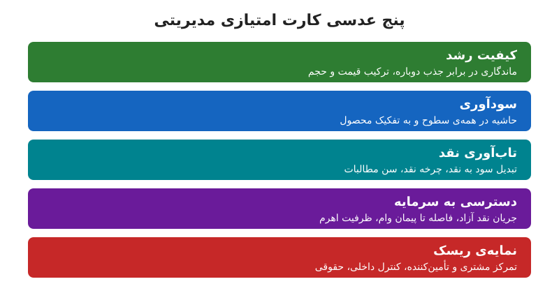

بیشتر گزارش‌های KPI شبیه گشت‌وگذار در موزه‌اند: نمایشگاه‌های فراوان و تفسیر اندک. اما کارت امتیازی مدیریتی خوب باید نگهبان سرمایه و ظرفیت شرکت باشد. در این نوشته سه تغییر نگاه و چارچوب پنج‌عدسی را می‌بینیم که شاخص‌ها را به نقد و ظرفیت گره می‌زند.

## از شمارش اعداد تا خلق ارزش

اگر کارت امتیازی شما نتواند به این پرسش پاسخ دهد که «آیا پیوسته از هزینه‌ی سرمایه‌مان بهتر عمل می‌کنیم و ظرفیت سرمایه‌گذاری مجدد چقدر است؟»، هنوز کارت امتیازی مدیریتی نیست.

به‌جای ردیابی صرفِ «درآمد»، ترکیب آن را ببینید: به تفکیک بخش، کانال و محصول، و اثرش بر روند حاشیه سود. شاخص‌های تجاری را به اقتصاد واحد وصل کنید تا به حاشیه مشارکت و در نهایت جریان نقد آزاد برسند. وقتی داشبورد، علاوه بر NPV و IRR و ROIC، ورودی و خروجی نقد آینده را هم نشان دهد، تصمیم تأمین مالی از نظر شخصی به محاسبه تبدیل می‌شود.

برای انتخاب شاخص‌ها [هفت گام انتخاب KPI](/posts/2024/04/17/choose-right-kpis-seven-steps/) را ببینید.

## از چشم‌انداز سالانه تا دید غلتان

مدیران استراتژیک منتظر کالبدشکافی پایان فصل نمی‌مانند. آن‌ها ریتم تصمیم‌محورِ غلتان دارند که واقعیت عملیاتی هفتگی را به نقد، اهرم و نقدینگی آینده وصل می‌کند.

سامانه‌ی KPI شما باید این‌ها را پیش‌بینی کند:

- ۱۳ تا ۱۶ هفته‌ی آینده‌ی چرخه‌ی تبدیل وجه نقد (مطالبات، موجودی، حساب‌های پرداختنی)
- افق سه تا پنج ساله برای تصویر راهبردی

قاعده‌ی ساده: اگر شاخص‌های هشداردهنده دو دوره‌ی پیاپی منحرف شدند، مرور سرمایه را فعال کنید، نه یک ارائه‌ی دیگر. وقتی سرمایه پیش از انباشته شدن ریسک جابه‌جا شود، هیئت‌مدیره کنترل می‌بیند، نه توضیح. نمونه‌ی ساده‌ی این رویکرد [پیش‌بینی نقد ۱۳ هفته‌ای](/posts/2024/07/24/13-week-cash-flow-forecast-habit/) است.

## از شاخص‌های بخشی تا حاکمیت پنج‌عدسی

داشبوردهای پراکنده ریسک را دفن می‌کنند. دید خود را در پنج عدسی جمع کنید و برای هر کدام دو تا چهار KPI بگذارید که همگی به نقد و ظرفیت ختم شوند.

### ۱. کیفیت رشد

رشد خوب با رشد گران فرق دارد. این عدسی نشان می‌دهد:

- ماندگاری مشتری در برابر جذب دوباره‌ی مشتری
- ترکیب قیمت و حجم

### ۲. سودآوری

حاشیه‌ها را در همه‌ی سطوح ببینید: به تفکیک محصول، بخش و خط کسب‌وکار. حاشیه‌ی کل ممکن است زیان یک محصول را پنهان کند.

### ۳. تاب‌آوری جریان نقد

- نرخ تبدیل سود عملیاتی به جریان نقد عملیاتی
- چرخه تبدیل وجه نقد به تفکیک اجزا
- تحلیل سنی مطالبات و بدهی‌های تجاری

### ۴. دسترسی به سرمایه

- جریان نقد آزاد پس از تعهدهای اجباری
- فاصله با پیمان‌های مالی وام (covenant headroom)
- ظرفیت استفاده‌نشده‌ی تسهیلات
- ظرفیت اهرمی

### ۵. نمایه‌ی ریسک

- تمرکز مشتری و تأمین‌کننده
- ضعف توان مدیریتی
- نقص کنترل داخلی
- تهدیدهای حقوقی

وقتی این پنج عدسی را بسازید، تیم کم‌کم کسب‌وکار را همان‌گونه اداره می‌کند که وام‌دهندگان و سرمایه‌گذاران آن را ارزیابی می‌کنند.

## مثال عددی

فرض کنید شرکتی ۲۰٪ رشد درآمد دارد، ولی عدسی‌ها می‌گویند:

| عدسی | یافته |
|---|---|
| کیفیت رشد | ماندگاری مشتری از ۹۰٪ به ۸۰٪ رسیده |
| سودآوری | حاشیه‌ی محصول جدید ۵٪ است |
| نقد | چرخه‌ی نقد ۴۵ روز بلندتر شده |
| سرمایه | ۱۰٪ فاصله تا نقض پیمان وام |
| ریسک | ۵۰٪ فروش به یک مشتری |

درآمد خوب به نظر می‌رسد، اما کارت امتیازی پنج‌عدسی نشان می‌دهد این رشد نقدینگی و ظرفیت تأمین مالی را می‌خورد. بدون این نگاه، هشدار خیلی دیر می‌رسد. برای ارتباط نقدینگی و سود، [سرمایه در گردش و نقدینگی](/posts/2024/04/03/working-capital-vs-cash-liquidity-ratios/) را هم بخوانید.

## چگونه چارچوب را در عمل راه بیندازیم؟

اجرای این چارچوب با یک جلسه‌ی کوتاه شروع می‌شود، نه یک پروژه‌ی بزرگ نرم‌افزاری:

1. برای هر عدسی فقط دو شاخص اول را انتخاب کنید که داده‌اش همین حالا در دسترس است.
2. برای هر شاخص یک آستانه‌ی هشدار تعریف کنید، مثلاً «تبدیل سود به نقد کمتر از ۷۰٪».
3. صاحب هر شاخص را مشخص کنید تا انحراف بی‌پاسخ نماند.
4. ماهانه، و برای نقد هفتگی، مرور کنید و نتیجه را به تصمیم تأمین یا توقف سرمایه وصل کنید.

## آیا رهبری از واقعیت جلوتر است؟

هیئت‌مدیره‌ها گزارش KPI را برای سرگرمی نمی‌خوانند؛ برای یک پرسش می‌خوانند: «آیا مدیریت از واقعیت جلوتر است؟» شاخص‌های ظاهری می‌گویند بله، تا زمانی که نقد خلافش را ثابت کند.

وقتی سامانه ریسک را پنهان کند، اعتبار فرسوده می‌شود، تأییدها کند می‌شود و ضریب ارزش‌گذاری فشرده می‌شود. برعکس، KPIهای تصمیم‌محور نشان‌دهنده‌ی کنترل‌اند، اعتماد وام‌دهنده را بالا می‌برند و در لحظه‌ی نیاز آزادی عمل می‌دهند.

## پرسش‌های متداول

### کارت امتیازی مدیریتی چند شاخص داشته باشد؟
هر عدسی دو تا چهار شاخص؛ یعنی حداکثر حدود بیست شاخص برای کل شرکت.

### فرق این چارچوب با داشبورد معمول چیست؟
در داشبورد معمول شاخص‌ها بخشی‌اند؛ اینجا همه به نقد و ظرفیت سرمایه ختم می‌شوند.

### چه زمانی مرور سرمایه را فعال کنیم؟
وقتی شاخص هشداردهنده دو دوره‌ی پیاپی منحرف شود.

### آیا شرکت کوچک هم به پنج عدسی نیاز دارد؟
بله، ولی با تعداد شاخص کمتر؛ حتی یک شاخص برای هر عدسی کافی است.

## جمع‌بندی

KPI زمانی ارزش دارد که تصمیم سرمایه را تغییر دهد. با سه تغییر نگاه (از اسکورکارت به خلق ارزش، از دید سالانه به دید غلتان، از شاخص بخشی به پنج عدسی)، کارت امتیازی شما به ابزار حاکمیت مالی تبدیل می‌شود که هم برای مدیران و هم برای وام‌دهندگان قابل‌اعتماد است.
