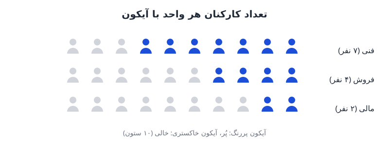

هزینه‌ی کارکنان معمولاً بزرگ‌ترین بخش پیش‌بینی هزینه‌هاست. اما وقتی عددها آماده شد، چطور آن‌ها را برای مدیران جذاب و فوری‌خوان نشان دهیم؟ یک راه ساده، **داشبورد نیروی انسانی در اکسل** است که تعداد کارکنان هر واحد را با ردیفی از آیکون نشان می‌دهد. در این نوشته گام‌به‌گام می‌سازیمش.

## چرا جدول عددی برای ارائه کافی نیست؟

جدول کارکنان هر واحد دقیق است، ولی خواندنش زمان می‌برد. مدیر عامل در جلسه‌ای که ده موضوع روی میز دارد، حوصله‌ی مقایسه‌ی ستون‌های عدد را ندارد. اگر کنار هر واحد ردیفی از آیکون آدم‌ها ببیند، در یک نگاه می‌فهمد کدام واحد بزرگ‌تر است و کجا جای خالی وجود دارد.

مزیت‌های این شیوه:

- مقایسه‌ی واحدها بدون خواندن عدد ممکن می‌شود.
- با رنگ‌های سازمان هماهنگ می‌شود و گزارش حرفه‌ای‌تر به نظر می‌رسد.
- اگر به پیش‌بینی نیروی انسانی وصل شود، با تغییر فرض‌ها خودش به‌روز می‌شود.

این رویکرد یک نمونه از اصولی است که در [اصول طراحی داشبورد مالی در اکسل](/posts/2026/11/13/financial-dashboard-design-principles/) هم آمده است: نمایش باید ساده و برای مخاطب مشخص طراحی شود.

## ایده‌ی اصلی: تصویر به‌عنوان مقدار سلول

در نسخه‌های جدید مایکروسافت ۳۶۵ می‌توان تصویر را «داخل سلول» قرار داد، نه روی سلول. در این حالت تصویر مثل یک مقدار عمل می‌کند و می‌توانید در سلول دیگر بعد از علامت مساوی به آن اشاره کنید. یعنی اگر آیکون پررنگ در سلول `K1` باشد، فرمول `=K1` در هر سلول دیگر همان آیکون را نمایش می‌دهد.

همین ویژگی است که امکان ساخت نمودار آیکونی با فرمول را می‌دهد؛ چون فرمول `IF` می‌تواند به‌جای عدد یا متن، یکی از دو تصویر را برگرداند.

## گام اول: آیکون‌ها را آماده کنید

دو آیکون لازم دارید:

1. یک آیکون **پررنگ** (مثلاً شکل یک آدم) برای «پُر».
2. همان آیکون به رنگ **خاکستری روشن** برای «خالی».

از هر مجموعه‌ی آیکون رایگان یا ارزان می‌توانید استفاده کنید. نکته‌ی مهم، هماهنگی رنگ پررنگ با رنگ سازمان است. خروجی را ترجیحاً با پس‌زمینه‌ی شفاف ذخیره کنید تا روی سلول‌های رنگی هم تمیز دیده شود.

## گام دوم: آیکون‌ها را در سلول قرار دهید

از نوار Insert مسیر Pictures و سپس Place in Cell و From This Device را انتخاب کنید. هر آیکون را در سلولی جدا بگذارید، مثلاً پررنگ در `K1` و خاکستری در `L1`. این دو سلول مرجع شما هستند؛ می‌توانید آن‌ها را در ناحیه‌ای کنار صفحه یا در برگه‌ی تنظیمات پنهان کنید.

اندازه‌ی سلول‌ها را هم یکسان و مربعی کنید تا آیکون‌ها کشیده نشوند.

## گام سوم: جدول و فرمول

جدول را این‌طور بسازید:

| واحد | تعداد کارکنان | هزینه (اختیاری) | ۱ | ۲ | ۳ | ... | ۱۰ |
|---|---|---|---|---|---|---|---|
| فروش | ۴ | | | | | | |
| مالی | ۲ | | | | | | |
| فنی | ۷ | | | | | | |

ستون‌های شماره‌دار از ۱ تا ۱۰ را در سطر عنوان بنویسید. ستون «هزینه» هم اختیاری است و اگر بخواهید هزینه‌ی هر واحد را کنار تصویر ببینید، اضافه‌اش کنید.

حالا در اولین سلول آیکون (فرض کنید `D5`) این فرمول را بنویسید و به همه‌ی سلول‌های جدول بکشید:

```
=IF($B5>=D$4, $K$1, $L$1)
```

منطق فرمول ساده است: اگر تعداد کارکنان واحد بزرگ‌تر یا مساوی شماره‌ی ستون باشد، آیکون پررنگ نمایش داده می‌شود؛ وگرنه آیکون خاکستری.

### مثال عددی

فرض کنید واحد فنی ۷ نفر دارد. در ستون‌های ۱ تا ۷ شرط برقرار است و هفت آیکون پررنگ می‌بینید؛ در ستون‌های ۸ تا ۱۰ شرط برقرار نیست و سه آیکون خاکستری نمایش داده می‌شود. واحد مالی با ۲ نفر، دو آیکون پررنگ و هشت آیکون خاکستری دارد. مقایسه‌ی دو ردیف بدون خواندن هیچ عددی ممکن است.



## دو نکته برای کاربرد واقعی

**حد بالای ستون‌ها.** اگر واحدی بیش از ده نفر دارد، یا تعداد ستون‌ها را بیشتر کنید یا هر آیکون را معرف چند نفر بگیرید (مثلاً هر آیکون برابر پنج نفر) و در فرمول از تقسیم استفاده کنید. فقط حتماً یک راهنما کنار نمودار بنویسید.

**اتصال به مدل.** ارزش اصلی زمانی است که ستون «تعداد کارکنان» دستی نباشد و از برنامه‌ی کارکنان خوانده شود. برای ساخت آن می‌توانید به [برنامه‌ی کارکنان در مدل مالی](/posts/2023/02/20/headcount-schedule-financial-model/) و روش [پیش‌بینی هزینه‌ی نیروی انسانی با تقسیم روزانه حقوق](/posts/2026/11/01/headcount-forecast-daily-proration/) مراجعه کنید. با این اتصال، هر بار که استخدام جدیدی وارد پیش‌بینی شود، آیکون‌ها خودشان تغییر می‌کنند.

## محدودیت‌ها

- قابلیت قرار دادن تصویر در سلول در همه‌ی نسخه‌های اکسل نیست؛ پیش از ارسال فایل مطمئن شوید گیرنده هم نسخه‌ی سازگار دارد.
- آیکون‌ها برای مقایسه‌ی سریع‌اند و جای تحلیل دقیق هزینه را نمی‌گیرند؛ عدد دقیق را کنار تصویر نگه دارید.
- تعداد زیاد آیکون در یک صفحه فایل را سنگین می‌کند؛ از تصویر کم‌حجم استفاده کنید.

## پرسش‌های متداول

### آیا این روش در گوگل‌شیت هم کار می‌کند؟

گوگل‌شیت تابع `IMAGE` دارد که با آدرس تصویر کار می‌کند و می‌توان آن را داخل `IF` گذاشت. ساختار فرمول همان است، فقط تصویر را باید از آدرس بگیرید.

### اگر اکسل من گزینه‌ی Place in Cell را ندارد چه کنم؟

می‌توانید به‌جای تصویر از شکل‌های یونیکد مثل ● و ○ داخل فرمول `IF` استفاده کنید. شکل نهایی ساده‌تر است، اما همان کار را انجام می‌دهد و در همه‌ی نسخه‌ها باز می‌شود.

### تعداد کارکنان کسری باشد چه می‌شود؟

اگر کارکنان نیمه‌وقت دارید، عدد کسری می‌شود و آیکون کامل مرز را رد نمی‌کند. بهتر است برای نمایش، عدد را گرد کنید یا عدد دقیق را در ستون کناری بنویسید.

## جمع‌بندی

برای ساخت داشبورد نیروی انسانی با آیکون، دو تصویر را در سلول بگذارید، ستون‌های شماره‌دار بسازید و با یک فرمول `IF` پررنگ یا خاکستری بودن هر آیکون را تعیین کنید. نتیجه گزارشی است که در چند ثانیه خوانده می‌شود. اگر به برنامه‌ی کارکنان وصلش کنید، همیشه به‌روز می‌ماند و برای ارائه به مدیران آماده است.
