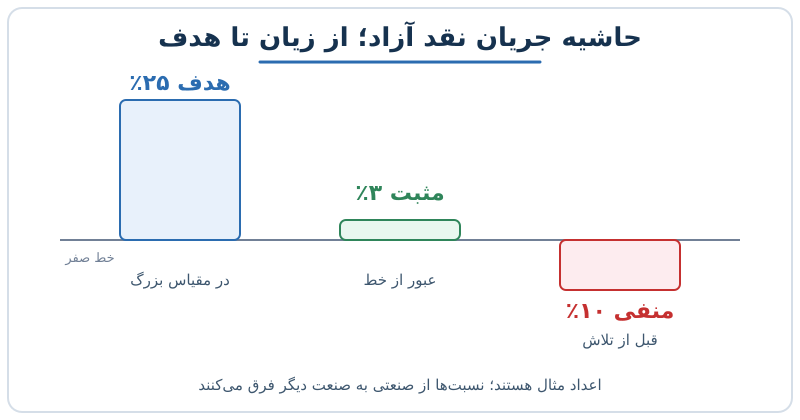

بعضی شرکت‌های رشدی سال‌هاست می‌گویند «۱۸ ماه دیگر سودآور می‌شویم»؛ سال بعد هم همان جمله تکرار می‌شود. این نوشته درباره‌ی یک اصل ساده اما کمتر رعایت‌شده است: وقتی به مرز سربه‌سر نزدیک شدید، سودآوری سریع باید اولویت بقیه‌ی هدف‌ها شود. می‌بینیم چرا چنین رفتاری روی اعتماد سرمایه‌گذار و ارزش‌گذاری شرکت اثر می‌گذارد و چطور می‌شود آن را با عدد سنجید.

## مشکل «همیشه ۱۸ ماه مانده»

وقتی هدف سودآوری مدام عقب می‌رود، سرمایه‌گذار نتیجه می‌گیرد که مدیریت یا نمی‌خواهد یا نمی‌تواند هزینه را مهار کند. رشد درآمد هرچقدر جذاب باشد، بازار روی شرکتی که کنترل سرنوشت مالی خودش را ندارد نوعی تخفیف می‌گذارد. چنین شرکتی برای ادامه‌ی کار به بازار سرمایه یا دور بعدی تأمین مالی وابسته است و شرایط بازار در دست او نیست.

نکته‌ی عملی این است: «نزدیک بودن» را باید تعریف کرد. مثلاً می‌توانید قاعده بگذارید که وقتی حاشیه‌ی جریان نقد آزاد از منفی ۵ درصد بهتر شد، هر پیشنهاد هزینه‌ی جدید باید به‌صراحت بگوید چقدر ما را از مرز سربه‌سر دور می‌کند.

## چرا عبور از خط صفر ارزش دارد؟

عبور از مرز سربه‌سر چند اثر هم‌زمان دارد:

- **کاهش ریسک روایت:** دیگر لازم نیست سرمایه‌گذار به آینده‌ای باور کند که هنوز اتفاق نیفتاده است.
- **استقلال مالی:** شرکت می‌تواند بدون فشار منتظر شرایط مناسب بازار بماند.
- **نشانه‌ی جدیت مدیریت:** ثابت می‌کند هزینه‌ها را می‌توان کنترل کرد.
- **تغییر معیار سنجش:** وقتی شرکت سودده شود، نرخ رشد سالانه‌اش برای سهامدار تقریباً شبیه بازده سالانه‌ی سرمایه‌اش تعبیر می‌شود. این یک تقریب ساده است و فرض می‌کند ضریب ارزش‌گذاری ثابت بماند، اما جهت فکر را نشان می‌دهد.

اگر با مفهوم بازده سرمایه‌گذار آشنا نیستید، مقاله‌ی [ارزش‌گذاری به روش DCF قدم‌به‌قدم](/posts/2022/08/24/discounted-cash-flow-dcf-step-by-step/) پایه‌ی لازم را می‌دهد.

## منطق ارزش‌گذاری: جریان نقد آینده، تنزیل‌شده

ارزش هر شرکت در نهایت برابر است با جریان‌های نقد آینده که به امروز تنزیل می‌شوند. اگر شرکتی هنوز جریان نقد مثبت ندارد، تحلیلگر باید وضعیتی را در آینده فرض کند که شرکت به آن می‌رسد. این فرض هرچه دورتر و نامطمئن‌تر باشد، نرخ تنزیل مؤثر بالاتر و ارزش امروز کمتر می‌شود.

باور کردن این جمله ساده‌تر است: «در مقیاس بزرگ حاشیه‌ی جریان نقد آزاد ما به ۲۵ درصد می‌رسد»، وقتی همین امروز ۲ تا ۳ درصد مثبت داشته باشید، تا وقتی که ۱۰ درصد زیر صفر باشید. در حالت اول یک مسیر ثابت‌شده را ادامه می‌دهید؛ در حالت دوم هنوز باید ثابت کنید مسیر وجود دارد. برای یادآوری تفاوت سود حسابداری و نقد واقعی، [سود خالص؛ معیار گمراه‌کننده و جایگزین آن](/posts/2022/09/11/net-income-misleading-metric-fcf/) را ببینید.

## یک مثال عددی ساده

شرکتی با درآمد ۱۰۰ میلیارد تومان را فرض کنید.

| وضعیت | حاشیه‌ی جریان نقد آزاد | جریان نقد سالانه |
|---|---|---|
| قبل از تلاش | منفی ۱۰٪ | منفی ۱۰ میلیارد |
| پس از تلاش | مثبت ۳٪ | مثبت ۳ میلیارد |
| هدف در مقیاس بزرگ | مثبت ۲۵٪ | مثبت ۲۵ میلیارد (به‌ازای همین درآمد) |

تفاوت میان دو حالت اول ۱۳ واحد درصد، یعنی ۱۳ میلیارد تومان در سال است. این مبلغ احتمالاً از چند محل می‌آید: توقف استخدام‌های کم‌بازده، کاهش هزینه‌ی جذب مشتری در کانال‌های ناکارا، حذف محصولات کم‌اثر و افزایش قیمت‌ها. شرکت حتی با رشد کندتر، تصویر متفاوتی از خودش می‌سازد: شرکتی که پول می‌سازد، نه شرکتی که فقط می‌سوزاند.

عدد ۲۵ درصد در اینجا صرفاً هدف مثال است و برای هر صنعت و مدل کسب‌وکار فرق دارد.

## چطور سرعت بگیریم؟

یک چارچوب چهارمرحله‌ای کمک می‌کند:

1. **فاصله را اندازه بگیرید:** دقیقاً مشخص کنید تا جریان نقد صفر چند واحد درصد مانده است.
2. **هزینه‌ها را به سه دسته بشکنید:** ضروری، قابل بهینه‌سازی، قابل حذف.
3. **تأثیر هر اقدام را با عدد بنویسید** و بر اساس سرعت اثر اولویت‌بندی کنید.
4. **پیشرفت را هر ماه گزارش کنید** تا همه‌ی تیم‌ها مسیر را ببینند.

برای ساختن پایه‌ی عددی، مفهوم [نقطه‌ی سربه‌سر](/posts/2024/02/11/break-even-point-analysis-guide/) و حاشیه‌ی ایمنی ابزار مناسبی است.

## هشدار: همه‌چیز را قربانی نکنید

«شتاب به سمت سودآوری» به معنای قطع سرمایه‌گذاری در رشد نیست. اگر کانال فروش اصلی شما کار می‌کند و بازگشت سرمایه‌اش روشن است، قطع آن اشتباه است. هدف حذف هزینه‌های ناکارا است، نه هزینه‌های مولد. پس از رسیدن به سودآوری هم می‌توانید دوباره سرمایه‌گذاری را بالا ببرید، اما این بار از موضع قدرت.

## پرسش‌های متداول

### سودآوری یعنی سود حسابداری یا جریان نقد؟

برای ارزش‌گذاری، جریان نقد آزاد معیار مطمئن‌تری است، چون به پول واقعی برمی‌گردد. اما شرکت‌ها اغلب هر دو را دنبال می‌کنند.

### آیا بازار همیشه به شرکت سودده پاداش می‌دهد؟

خیر. اگر رشد درآمد کاملاً متوقف شود، ممکن است بازار ارزش را کاهش دهد. توازن رشد و سودآوری مهم است.

### مرز «نزدیک بودن» چقدر است؟

عدد جهانی وجود ندارد. هر شرکت باید بر اساس ذخیره‌ی نقدی، سرعت سوختن پول و شرایط بازار خودش تعریف کند.

### اگر هنوز دور از سربه‌سر هستیم چه کنیم؟

ابتدا روی اقتصاد واحد کار کنید: حاشیه‌ی ناخالص و هزینه‌ی جذب مشتری. تا آن‌ها اصلاح نشوند، کاهش هزینه‌ی عمومی نتیجه‌ی پایدار نمی‌دهد.

## جمع‌بندی

سودآوری سریع نزدیک مرز سربه‌سر یعنی تبدیل یک وعده به یک واقعیت. این کار ریسک روایت را کم می‌کند، استقلال مالی می‌دهد و به ارزش‌گذاری کمک می‌کند. فاصله تا صفر را اندازه بگیرید، هزینه‌های ناکارا را حذف کنید، رشد مولد را نگه دارید و پیشرفت را شفاف گزارش کنید. وقتی از خط عبور کردید، بازی تغییر می‌کند.
