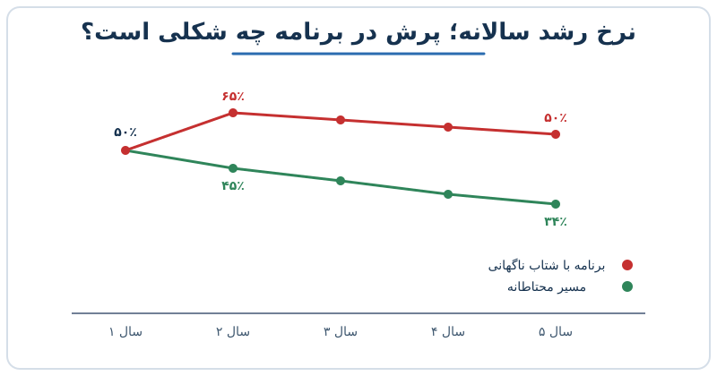

فرض کنید در حال نوشتن برنامه‌ی رشد پنج‌ساله‌ی شرکتی هستید. جدول آماده است، درآمد هر سال بالاتر از سال قبل است و همه‌چیز زیباست؛ اما یک ستون را نگاه نکرده‌اید: نرخ رشد سالانه. در یک برنامه‌ی رشد پنج‌ساله، رشدی که هر سال سریع‌تر از سال قبل شود، معمولاً اولین چیزی است که سرمایه‌گذار به آن شک می‌کند. در این نوشته می‌بینیم چرا و چه آزمونی لازم است.

## هزینه در اختیار شماست، رشد کمتر

یک تمایز ظریف اما مهم وجود دارد: تیم مالی بر رشد درآمد اثر می‌گذارد، اما بر هزینه کنترل دارد. قیمت، تخصیص بودجه‌ی بازاریابی و تصمیم استخدام را می‌توان تغییر داد؛ ولی اینکه مشتری‌ها چقدر بخرند، به بازار، رقبا و محصول بستگی دارد.

به همین دلیل، وقتی شرکت باید توازن میان رشد و سودآوری را تنظیم کند، همه‌ی اهرم‌ها وزن برابر ندارند. مهار هزینه فوری‌تر و قابل پیش‌بینی‌تر است. برای مرور شاخصی که رشد و سودآوری را کنار هم می‌گذارد، [تحلیل قانون ۴۰ در یک شرکت SaaS](/posts/2027/04/06/figma-s1-saas-rule-of-40-valuation/) را ببینید.

## سخت‌ترین کار: دوباره شتاب دادن

وقتی شرکت بزرگ‌تر می‌شود، نرخ رشدش معمولاً کم می‌شود. دلیلش ساده است: پایه‌ی بزرگ‌تر یعنی برای همان درصد رشد، درآمد اضافی بیشتری لازم است. اینکه رشد بعد از کند شدن دوباره بالا برود، پدیده‌ای کمیاب است. اگر مجموعه‌ای از شرکت‌های هم‌گروه را بررسی کنید، احتمالاً تعداد کمی در سال بعد نسبت به سال قبل سریع‌تر رشد کرده‌اند. معیار «دوام رشد» همین را اندازه می‌گیرد؛ در [امتیاز دوام رشد درآمد در SaaS](/posts/2027/10/27/growth-endurance-score-saas/) فرمول و برداشت درست از آن آمده است.

از اینجا یک نتیجه‌ی عملی می‌گیریم: برنامه‌ای که فرضش «شتاب دوباره» است، باید دلیل روشنی برای آن داشته باشد.

## آزمون سلامت نرخ‌های رشد

بعد از اتمام مدل، یک آزمون سریع انجام دهید: نرخ رشد هر سال را در یک ردیف بنویسید و تغییر آن را نسبت به سال قبل ببینید.

| سال | برنامه‌ی خوش‌بینانه | مسیر محتاطانه |
|---|---|---|
| سال ۱ | ۵۰٪ | ۵۰٪ |
| سال ۲ | ۶۵٪ | ۴۵٪ |
| سال ۳ | ۶۰٪ | ۴۱٪ |
| سال ۴ | ۵۵٪ | ۳۷٪ |
| سال ۵ | ۵۰٪ | ۳۴٪ |

اعداد مثال فرضی هستند. در ستون اول، پرش از ۵۰ به ۶۵ درصد در سال دوم زنگ خطر است. پرسش‌هایی که باید پاسخ داشته باشید:

- چه محصول یا بازار تازه‌ای این پرش را توضیح می‌دهد؟
- ظرفیت فروش و تیم برای آن از کجا می‌آید؟
- اگر فرض غلط درآمد، رشد را نیاورد، چه می‌شود؟

شرکتی با درآمد سالانه حدود ده میلیون دلار که محصول جدیدی هم در یک‌سال آینده عرضه نمی‌کند، با چنین جهشی روبه‌رو می‌شود که توجیهش دشوار است. همین نتیجه برای هر مقیاس دیگری هم صادق است: هر جهش باید دلیل داشته باشد.

## وقتی ساختار هزینه روی رشد شتابان بنا شود

همه‌چیز به هم متصل است. اگر هزینه‌ها را بر پایه‌ی رشد شتابان ببندید و رشد محقق نشود، مجبور می‌شوید ناگهانی و شدید هزینه را کم کنید تا تعادل برگردد. این یعنی اخراج، توقف پروژه و اعتماد از دست‌رفته.

راه بهتر این است که بودجه را مرحله‌ای باز کنید: هزینه‌ی جدید فقط وقتی فعال شود که درآمد به نقطه‌ی مشخصی برسد. این روش در [بودجه‌ی سه‌مسیره در رشد سریع](/posts/2025/02/17/multi-plan-budget-hypergrowth-triggers/) توضیح داده شده است.

مثال ساده: شرکتی با درآمد ۱۰ واحد، هزینه‌ها را برای درآمد ۱۶ واحد در سال بعد استخدام و ثابت می‌کند، اما فقط به ۱۴ واحد می‌رسد. حالا ۲ واحد درآمد کم است و هزینه‌ی ثابت‌شده همچنان بالاست. اگر حاشیه‌ی شرکت از قبل باریک بوده، همین شکاف یعنی زیان و ناچار شدن به کاهش سریع هزینه. اگر هزینه را به رشد واقعی گره می‌زدید، این فشار پیش نمی‌آمد.

## گام‌های عملی

1. سناریوی پایه را بر پایه‌ی نرخ رشد کاهنده یا ثابت بنویسید.
2. سناریوی شتاب را جداگانه و با محرک مشخص بسازید.
3. هزینه‌های ثابت را به سناریوی پایه گره بزنید.
4. حاشیه‌ی جریان نقد را در هر سه سناریو بسنجید.

## پرسش‌های متداول

### آیا هرگز نباید شتاب رشد در برنامه بیاید؟

می‌شود، اما فقط با دلیل مشخص مثل محصول تازه، بازار جدید یا خرید شرکت و با شواهد اولیه.

### چرا سرمایه‌گذار به نرخ رشد سال‌به‌سال حساس است؟

چون تجربه‌ی بازار نشان می‌دهد رشد معمولاً با بزرگ‌تر شدن کند می‌شود. فرضی که خلاف آن باشد، ریسک برنامه را بالا می‌برد.

### کاهش هزینه همیشه راه‌حل است؟

نه. هزینه‌ی مولد را نباید حذف کرد. هدف، هم‌خوان کردن ساختار هزینه با رشدی است که واقعاً قابل‌دست‌یابی است.

### چقدر باید برنامه را محتاطانه نوشت؟

برنامه‌ی پایه باید قابل دفاع باشد و سناریوهای بهتر را به‌عنوان بالقوه نشان دهید، نه تعهد.

## جمع‌بندی

مهار هزینه در اختیار شماست، شتاب‌دادن دوباره به رشد کمتر. پس برنامه‌ی پنج‌ساله را با آزمون ساده‌ی تغییر نرخ رشد بسنجید، ساختار هزینه را به رشد قابل‌دفاع ببندید و هر شتابی را با دلیل و محرک وارد مدل کنید. صادق ماندن امروز، از کاهش‌های سخت فردا جلوگیری می‌کند.
