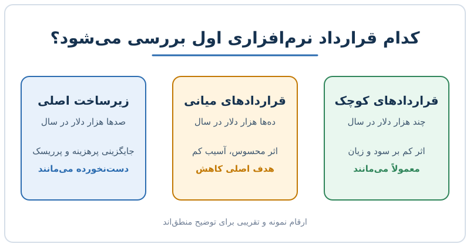

وقتی مدیر مالی مأمور کاهش هزینه می‌شود، فهرست اشتراک‌های نرم‌افزاری یکی از اولین جاهایی است که باز می‌کند. اما او همه‌چیز را یکسان نمی‌بیند. کاهش هزینه نرم‌افزار معمولاً روی گروهی از قراردادها متمرکز می‌شود که نه آن‌قدر کوچک‌اند که نادیده بمانند و نه آن‌قدر حیاتی که لمسشان خطرناک باشد. این نوشته منطق پشت این انتخاب را توضیح می‌دهد.

## فهرست هزینه‌ها را چگونه می‌خوانند

فرض کنید تحلیلگر مالی خروجی همه‌ی پرداخت‌های نرم‌افزاری را از بزرگ به کوچک مرتب کرده است. مدیر مالی از بالا به پایین نگاه می‌کند و برای هر ردیف دو سؤال دارد:

- اگر این قرارداد حذف یا کوچک شود، چقدر در سود و زیان تغییر ایجاد می‌کند؟
- اگر حذف شود، کسب‌وکار چقدر آسیب می‌بیند؟

جواب این دو سؤال سه گروه طبیعی می‌سازد که در ادامه یکی‌یکی بررسی می‌شوند.

## گروه اول: زیرساخت اصلی که دست‌نخورده می‌ماند

سامانه‌ی ERP، انبار داده یا سرویس ابری اصلی ممکن است سالانه صدها هزار دلار هزینه داشته باشند. حذف آن‌ها قطعاً در سود و زیان اثر بزرگی دارد، اما شرکت بدون آن‌ها عملاً نمی‌تواند کار کند. جایگزینی این سامانه‌ها ماه‌ها زمان، پول و ریسک می‌خواهد.

یک نکته‌ی روان‌شناختی هم هست: شرکت‌ها وقتی برای پیاده‌سازی چیزی هزینه و وقت زیادی گذاشته‌اند، دوست ندارند آن را کنار بگذارند. به این گرایش «اینرسی» می‌گویند و در قراردادهای بزرگ بسیار قوی است. همچنین خرید بزرگ معمولاً با تأیید چند نفر انجام شده و فرایند پیچیده‌ای دارد؛ برای همین چسبندگی بیشتری دارد. برای ریشه‌ی این مسئله می‌توانید به [زمان گذار از نرم‌افزار حسابداری به ERP](/posts/2026/10/22/accounting-software-to-erp-timing/) هم نگاهی بیندازید.

## گروه دوم: ابزارهای کوچک که به چشم نمی‌آیند

در انتهای فهرست، اشتراک‌هایی را می‌بینید که سالی چند هزار دلار هزینه دارند. بعضی ارزان و حیاتی‌اند، مثل ابزار مدیریت جدول سهامداران که جایگزین کردنش با یک صفحه‌گسترده منطقی نیست. بعضی هم فقط راحتی کاربران را تأمین می‌کنند.

مثال عددی ساده: اگر یک ابزار یادداشت‌برداری برای ۲۰ نفر سالی ۱۲ هزار دلار هزینه داشته باشد، یعنی نفری ۶۰۰ دلار. حتی اگر شرکت دنبال صرفه‌جویی چند میلیون دلاری باشد، این ردیف تقریباً هیچ تغییری در نتیجه نمی‌دهد. هزینه‌ی وقت برای مذاکره و حذفش از صرفه‌جویی‌اش بیشتر می‌شود. پس طبیعی است که این گروه اغلب بماند.

## گروه سوم: ردیف‌های میانی که قیچی را جذب می‌کنند

حالا فرض کنید در وسط فهرست ردیف‌هایی با رقم ۴۵ هزار، ۹۷ هزار و ۱۲۵ هزار دلار در سال می‌بینید؛ مثلاً ابزار ضبط ویدیو، طراحی رابط کاربری یا مدیریت قابلیت‌های محصول. این‌ها سه ویژگی مشترک دارند:

1. رقمشان آن‌قدر بزرگ است که در سود و زیان دیده شود.
2. معمولاً زیرساخت اصلی نیستند و شرکت بدون آن‌ها هم کار می‌کند.
3. خریدشان اغلب توسط مدیر یک بخش یا حتی یک تیم انجام شده، نه با تصمیم متمرکز مالی.

جمع این سه ویژگی یعنی بیشترین صرفه‌جویی با کمترین اختلال. به همین دلیل، قراردادهای بین ۵۰ تا ۱۰۰ هزار دلار در دوره‌های فشار بودجه از همه آسیب‌پذیرترند. اگر فروشنده‌ای در این بازه کار می‌کند، باید ارزش خود را با عدد ثابت کند، نه با علاقه‌ی کاربران. درباره‌ی نگاه خریدار به ارزش واقعی هر اشتراک، [لایسنس بلااستفاده و سخت‌گیری مدیر مالی](/posts/2027/09/25/shelfware-software-buying-cfo/) را هم ببینید.

| گروه | رقم نمونه در سال | اثر بر سود و زیان | ریسک حذف | رفتار معمول |
|---|---|---|---|---|
| ابزار کوچک | چند هزار دلار | کم | کم تا متوسط | ماندن |
| قرارداد میانی | ۴۵ تا ۱۲۵ هزار دلار | محسوس | کم | کاهش یا ادغام |
| زیرساخت اصلی | بیش از ۲۵۰ هزار دلار | زیاد | زیاد | ماندن |

## ادغام فروشنده؛ بزرگ‌ترین ابزار صرفه‌جویی

در سال‌های پول ارزان، هر تیم ابزار دلخواه خودش را خرید. نتیجه این شد که یک شرکت چند ابزار مشابه داشت: یک تیم از یک نرم‌افزار مدیریت پروژه استفاده می‌کرد و تیم دیگر از نرم‌افزار رقیب. همین اتفاق در پشته‌ی فروش و بازاریابی هم افتاد و گاهی ده لایه‌ی نرم‌افزاری روی هم نشست.

وقتی بودجه تنگ می‌شود، مدیر مالی از فروشنده‌ی بزرگ‌تر می‌پرسد: آیا بسته‌ی شما همین کار را هم انجام می‌دهد؟ اگر پاسخ مثبت باشد، دو تا سه ابزار از یک تأمین‌کننده خریداری و بقیه حذف می‌شوند. این منطق در همه‌ی واحدها تکرار می‌شود:

- مالی: آیا ERP ما ماژول بودجه‌بندی دارد؟
- منابع انسانی: آیا سامانه‌ی استخدام و پرونده‌ی کارکنان را می‌شود از یک فروشنده گرفت؟
- فناوری اطلاعات: آیا برای درخواست‌های ساده واقعاً به یک ابزار مستقل نیاز داریم؟

باید صادق بود: ادغام همیشه کیفیت را حفظ نمی‌کند، اما در محاسبه‌ی هزینه، یک قرارداد کمتر یعنی مذاکره‌ی کمتر، مدیریت ساده‌تر و معمولاً تخفیف بیشتر. برای نگاه ساختاری‌تر به صرفه‌جویی، [راهبردهای ساختاری کاهش هزینه](/posts/2025/08/12/cost-saving-structural-strategies/) را بخوانید.

## یک چارچوب عملی برای مدیر مالی

اگر شما مسئول بازبینی هزینه‌ی نرم‌افزار هستید، این مراحل را امتحان کنید:

1. فهرست کامل قراردادها را با مبلغ سالانه، تاریخ تمدید و مالک بخش تهیه کنید.
2. ردیف‌های میانی را جدا کنید، یعنی رقم‌هایی که برای سود و زیان معنادارند اما زیرساخت نیستند.
3. برای هر کدام بپرسید: چند نفر واقعاً استفاده می‌کنند و چه تصمیمی بر اساس آن گرفته می‌شود؟
4. هم‌پوشانی بین ابزارها را پیدا کنید و ببینید کدام بسته می‌تواند دو کار را با هم پوشش دهد.
5. پیش از تمدید، برای کاهش تعداد کاربر یا مدت قرارداد مذاکره کنید.

یک مثال عددی: فرض کنید سه ابزار با هزینه‌ی ۴۵، ۶۰ و ۹۰ هزار دلار دارید. اگر یکی را حذف و دیگری را با ۳۰ درصد کاهش کاربر تمدید کنید، صرفه‌جویی حدود ۴۵ + ۱۸ = ۶۳ هزار دلار در سال می‌شود، بدون اینکه زیرساخت اصلی لمس شود. این عدد فقط برای نشان‌دادن محاسبه است. اگر کار خرید و استفاده‌ی هوش مصنوعی هم در فهرست شماست، [چارچوب سنجش هزینه‌ی فناوری و هوش مصنوعی](/posts/2026/07/10/ai-tech-spend-metering-framework/) مکمل خوبی است.

## پرسش‌های متداول

### چرا قراردادهای کوچک کمتر هدف کاهش هزینه می‌شوند؟

چون صرفه‌جویی هر کدام ناچیز است و زمان مذاکره یا جایگزینی ممکن است از سودش بیشتر شود. معمولاً فقط وقتی هدف می‌شوند که تعدادشان زیاد و هم‌پوشان باشد.

### آیا حذف قرارداد میانی همیشه درست است؟

نه. اگر ابزار مستقیماً درآمد می‌سازد یا فرایند حیاتی را پشتیبانی می‌کند، باید با ارزش آن سنجیده شود. معیار، ارزش واقعی نسبت به هزینه است، نه فقط اندازه‌ی رقم.

### فروشنده‌ی قرارداد میانی چگونه از حذف جلوگیری کند؟

با نشان‌دادن ارزش قابل‌اندازه‌گیری، مثل صرفه‌جویی زمان یا افزایش درآمد، و با انعطاف در تعداد کاربر و مدت قرارداد. علاقه‌ی کاربران به‌تنهایی در جلسه‌ی بودجه کافی نیست.

### ادغام فروشنده چه خطری دارد؟

وابستگی به یک تأمین‌کننده و احتمال افت کیفیت در بعضی قابلیت‌ها. پیش از ادغام، مقایسه‌ی کارکرد و هزینه‌ی مهاجرت را هم در محاسبه بیاورید.

## جمع‌بندی

در دوره‌ی فشار بودجه، مدیر مالی ابزارهای کوچک را نادیده می‌گیرد، زیرساخت اصلی را حفظ می‌کند و روی قراردادهای میانی تمرکز می‌کند، چون بیشترین صرفه‌جویی را با کمترین اختلال می‌دهند. ادغام فروشنده‌ها و بازبینی هم‌پوشانی ابزارها ساده‌ترین مسیر است. برای کاهش هزینه نرم‌افزار، فهرست قراردادها را بسازید، ردیف‌های میانی را جدا کنید و هر کدام را با ارزش قابل‌اندازه‌گیری بسنجید.
