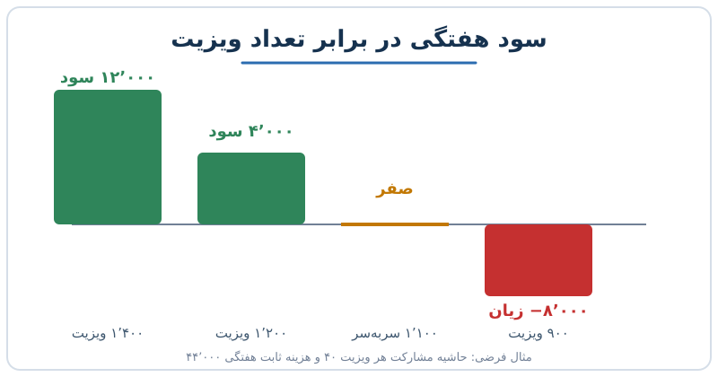

هر کسب‌وکاری، از غرفه‌ی کوچک نمایشگاه تا شرکت بزرگ، اول هر دوره با مجموعه‌ای از هزینه‌های ثابت شروع می‌کند: اجاره، حقوق ثابت، قرارداد نرم‌افزار. تا وقتی این بار جبران نشده، هیچ سودی در کار نیست. اما پس از عبور از آن نقطه، هر فروش اضافی بخش بزرگی از مبلغش را به سود می‌رساند. این نوشته نشان می‌دهد سربه‌سر ماهانه را چطور به یک شاخص عملیاتی ساده تبدیل کنیم که وسط ماه، پیش از بستن دفاتر، بگوید ماه خوبی در راه است یا بد.

## هزینه سربار و لحظه‌ای که «جلو می‌افتید»

هزینه‌ی سربار همان هزینه‌ای است که با حجم فروش تغییر نمی‌کند. دو دسته‌ی ساده داریم:

- **هزینه ثابت:** اجاره، حقوق ثابت، بیمه، هزینه‌ی اشتراک‌ها.
- **هزینه متغیر:** مواد اولیه، کارمزد پرداخت، هزینه‌ی مصرفی هر خدمت.

اگر مبلغ فروش هر واحد را از هزینه‌ی متغیر آن کم کنیم، به «حاشیه مشارکت» هر واحد می‌رسیم. نقطه‌ی سربه‌سر یعنی هزینه ثابت تقسیم بر حاشیه مشارکت هر واحد. پیش از آن نقطه هر فروش فقط بخشی از بار ثابت را جبران می‌کند؛ بعد از آن، حاشیه‌ی هر فروش مستقیم به سود می‌رسد. اگر با فرمول پایه آشنا نیستید، [راهنمای نقطه سربه‌سر](/posts/2024/02/11/break-even-point-analysis-guide/) را اول بخوانید.

## مثال عددی: کلینیک فیزیوتراپی

فرض کنید کلینیکی برای هر ویزیت به‌طور میانگین ۵۰ واحد پول دریافت می‌کند و هزینه‌ی متغیر هر ویزیت ۱۰ واحد است. پس حاشیه مشارکت هر ویزیت ۴۰ واحد است. هزینه‌های ثابت هفتگی (حقوق ثابت درمانگران، منشی، مدیر و اجاره) را ۴۴٬۰۰۰ واحد بگیرید.

نقطه‌ی سربه‌سر هفتگی:

۴۴٬۰۰۰ ÷ ۴۰ = **۱٬۱۰۰ ویزیت در هفته**

| ویزیت هفتگی | محاسبه | نتیجه‌ی هفتگی |
|---|---|---|
| ۹۰۰ | (۹۰۰ − ۱۱۰۰) × ۴۰ | ۸٬۰۰۰ زیان |
| ۱٬۱۰۰ | سربه‌سر | صفر |
| ۱٬۲۰۰ | (۱۲۰۰ − ۱۱۰۰) × ۴۰ | ۴٬۰۰۰ سود |
| ۱٬۴۰۰ | (۱۴۰۰ − ۱۱۰۰) × ۴۰ | ۱۲٬۰۰۰ سود |

نکته‌ی مهم اهرم عملیاتی است: ۱۰۰ ویزیت بیشتر یا کمتر از نقطه‌ی سربه‌سر، چهار هزار واحد سود یا زیان می‌سازد. بنابراین تغییرات کوچک در حجم، روی نتیجه‌ی نهایی اثر بزرگ دارد.

## ظرفیت درآمد: خدمتِ از دست رفته برنمی‌گردد

در کسب‌وکار خدماتی، ظرفیت شبیه صندلی‌های خالی یک پرواز است. اگر امروز بیماری درمان نشود، آن ساعت کاری دیگر قابل فروش نیست. هزینه‌ی ثابت اما ادامه دارد.

بر این اساس ظرفیت ماهانه را با شمردن روزهای کاری واقعی حساب کنید. در یک ماه معمولی حدود ۲۲ روز کاری مؤثر داریم، پس از کم کردن تعطیلات و جمعه‌ها. حالا فرض کنید کلینیک در حالت خوب به ۱٬۴۰۰ ویزیت در هفته می‌رسد و چند روز برفی یا بحرانی باعث می‌شود چهار روز از ۲۲ روز کاری ماه از دست برود. این حدود ۱۸ درصد ظرفیت است:

- ویزیت از دست رفته: حدود ۲۵۰ ویزیت (در مقیاس هفتگی)
- ویزیت باقی‌مانده: حدود ۱٬۱۵۰
- سود هفتگی: (۱۱۵۰ − ۱۱۰۰) × ۴۰ = حدود ۲٬۰۰۰ واحد

یعنی ۱۸ درصد کاهش ظرفیت، سودی را که ۱۲٬۰۰۰ واحد بود به حدود ۲٬۰۰۰ رسانده؛ نزدیک به ۸۳ درصد افت سود. این است معنای اینکه برای کسب‌وکاری با حاشیه‌ی سود کم، چند روز تعطیلی غیرمنتظره تقریباً تمام سود را می‌برد. برای ارتباط این موضوع با برنامه‌ریزی ظرفیت، [برنامه‌ریزی ظرفیت و اهرم هزینه ثابت](/posts/2025/02/13/capacity-planning-fixed-cost-leverage/) را ببینید.

## شاخص میان‌ماه: روز بشمارید یا واحد؟

بسیاری از مدیران می‌پرسند «در چندمین روز ماه از سربار جلو می‌افتیم؟» اما روز همیشه شاخص خوبی نیست، چون تقاضا یکنواخت نیست. تعمیرگاه خودرو را در نظر بگیرید: ماه‌هایی که مردم هزینه‌ی تعطیلات را پرداخته‌اند پرکارند و ماه‌های دیگر خلوت. بنابراین شاخص بهتر معمولاً **واحد فروش**، **ساعت کاری فروخته‌شده** یا **ظرفیت هر ایستگاه کاری** است.

چند قاعده‌ی عملی برای ساختن شاخص:

1. هزینه‌ی ثابت ماهانه‌ی هر واحد ظرفیت (مثلاً یک ایستگاه کاری) را حساب کنید.
2. حاشیه مشارکت هر کار را بسنجید.
3. تعداد کار لازم برای سربه‌سر آن ایستگاه را به دست آورید، مثلاً «۷۰ سرویس در ماه».
4. هر روز تعداد کارهای انجام‌شده را با این عدد مقایسه کنید.
5. فصلی‌بودن را در نظر بگیرید و عدد را برای ماه‌های پرکار و کم‌کار جدا بگذارید.

این‌ها تقریبی است و جای صورت‌های مالی بسته‌شده را نمی‌گیرد، اما به مدیر کمک می‌کند ضربان کسب‌وکار را وسط دوره بشنود. ارتباطش با ریسک ماه‌های بد را در [آزمون‌های هزینه ثابت و بهترین ماه](/posts/2024/09/24/fixed-costs-best-month-downside-tests/) هم می‌توانید دنبال کنید.

## متغیرهای پنهانی که شاخص را به هم می‌زنند

هر کسب‌وکار چند ریسک دارد که در فرمول ساده دیده نمی‌شود:

- **خرابی تجهیزات:** اگر از سه جایگاه کار یکی خراب شود، ظرفیت یک‌سوم کم می‌شود.
- **غیبت نیرو:** نبودن یک کارمند کلیدی در یک شیفت، فروش آن شیفت را از بین می‌برد.
- **فساد مواد اولیه:** در نانوایی یا شیرینی‌پزی، مواد خراب هزینه‌ی متغیر را بالا می‌برد.
- **حقوق پرداختی سه‌باره:** اگر حقوق را هر دو هفته می‌پردازید، سالی ۲۶ بار پرداخت دارید؛ یعنی دو ماه از سال سه پرداخت دارند، نه دو. جریان نقدی آن ماه‌ها فشرده‌تر است.

این‌ها در سربه‌سر دیده نمی‌شوند، ولی باید در حاشیه‌ی ایمنی لحاظ شوند. برای هر کدام یک سناریوی بدبینانه بنویسید.

## مثال اشتراک ماهانه: چه کسی ضرر می‌سازد؟

مثالی از مدل اشتراک: یک کارواش قیمت هر شست‌وشوی تکی را ۱۰ و اشتراک ماهانه را ۲۵ تعیین می‌کند. برای مشتری، اشتراک از ۲٫۵ بار شست‌وشو در ماه به بعد به‌صرفه است. کارواش بر این حساب می‌کند که بیشتر مشترکان به این سقف نمی‌رسند و درآمد ثابت اشتراک‌ها بخش بزرگی از سربار را پوشش می‌دهد.

ولی اگر هزینه‌ی متغیر هر شست‌وشو (آب، مواد شوینده) ۳ واحد باشد، مشترکی که ماهی ۲۰ بار می‌آید ۶۰ واحد هزینه می‌سازد و فقط ۲۵ واحد درآمد دارد. زیان او ۳۵ واحد در ماه است. پس مشترکان پرمصرف روی ارزان‌ترین طرح، حاشیه را می‌خورند. راه‌حل: سقف استفاده، لایه‌بندی قیمت یا طرح گران‌تر برای مصرف زیاد.

## پرسش‌های متداول

### سربه‌سر ماهانه با سربه‌سر سالانه چه فرقی دارد؟

سربه‌سر سالانه میانگین را نشان می‌دهد، اما اگر تقاضا فصلی باشد ممکن است چند ماه زیان‌ده باشید. سربه‌سر ماهانه برای مدیریت نقدینگی و برنامه‌ریزی روزانه دقیق‌تر است.

### آیا همیشه باید هزینه‌ها را به ثابت و متغیر تقسیم کرد؟

برای تحلیل سربه‌سر بله. برخی هزینه‌ها نیمه‌متغیرند (مثل حقوق با پاداش). آن‌ها را به دو بخش ثابت و متغیر بشکنید تا تخمین معقول بماند.

### اگر نقطه‌ی سربه‌سر خیلی نزدیک ظرفیت کامل باشد چه کنم؟

یعنی حاشیه‌ی ایمنی ندارید. گزینه‌ها: کاهش هزینه ثابت، افزایش قیمت یا حاشیه مشارکت، یا افزایش ظرفیت قابل‌فروش.

### شاخص میان‌ماه چقدر دقیق است؟

دقیق نیست و جایگزین بستن دفاتر نمی‌شود، اما برای هشدار زودهنگام مفید است.

## جمع‌بندی

سربار بخشی از هر کسب‌وکار است و هر دوره از نو شروع می‌شود. اگر نقطه‌ی سربه‌سر را به زبان واحد فروش (ویزیت، سرویس، شست‌وشو) بنویسید، مدیر می‌داند وسط ماه کجاست. به ظرفیت از دست رفته، فصلی‌بودن و ریسک‌های پنهان توجه کنید و برای مشترکان پرمصرف سقف بگذارید. حساب و کتاب ساده، همان چیزی است که تصمیم‌های بهتر را ممکن می‌کند.
