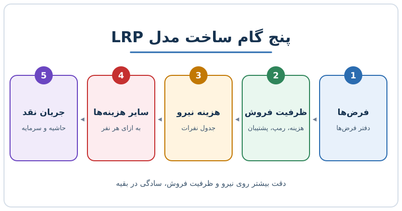

برنامه بلندمدت (LRP) مدلی چندساله است که نشان می‌دهد امسال چه کنیم تا چند سال بعد به یک چهره‌ی مالی مشخص برسیم. اگر قرار است مدل LRP بسازید، وسوسه‌ی مدل کردن تک‌تک ردیف‌های دفتر کل را کنار بگذارید. در این نوشته می‌بینید چرا بهتر است از ظرفیت فروش شروع کنید، چه فرض‌هایی لازم است و بقیه‌ی هزینه‌ها را چگونه با کمترین پیچیدگی روی همین ستون سوار کنید.

## LRP چه فرقی با بودجه سالانه دارد؟

بودجه‌ی سالانه دقیق و جزئی است: ردیف‌های حسابداری، نام تأمین‌کننده‌ها و هدف‌های دوازده‌ماهه. LRP جهت‌دار است. می‌خواهد بگوید با توجه به منابعی که امروز تخصیص می‌دهیم، شرکت در پایان افق برنامه چه شکلی خواهد داشت.

دو پرسش اصلی را باید پاسخ دهد:

- **دوام درآمد:** آیا می‌توانیم مشتری را با هزینه‌ای قابل پیش‌بینی جذب کنیم، نگه داریم و در طول زمان فروش بیشتری به او داشته باشیم؟
- **پایداری جریان نقد آزاد:** آیا شرکت به نقطه‌ای می‌رسد که به سرمایه‌ی بیرونی وابسته نباشد؟ و سود را کجا مصرف می‌کنیم: سرمایه‌گذاری دوباره یا تقسیم؟

برای نگاه راهبردی به مالکیت و نقش LRP در اجرای استراتژی، [برنامه بلندمدت مالی: تبدیل استراتژی به عدد](/posts/2025/10/27/long-range-plan-forcing-strategic-clarity/) را ببینید. این نوشته بیشتر روی خود ساختن مدل تمرکز دارد.

## سرعت یا دقت؟ قبل از ساخت تصمیم بگیرید

عمق مدل را سه چیز تعیین می‌کند: بلوغ مالی شرکت، پرسشی که قرار است مدل پاسخ دهد و زمانی که حاضرید خرج کنید. همیشه می‌شود جزئیات بیشتری اضافه کرد؛ اما مدل برای تصمیم‌گیری است، نه برای نمایش.

یک روش رایج این است که یک LRP اصلی برای هیئت‌مدیره نگه دارید و برای آزمون سناریوهای خاص، از روی آن نسخه‌های موقتی بسازید. مدل اصلی ثابت می‌ماند و تجربه‌ها روی نسخه‌های کپی انجام می‌شود.

## فرض‌ها را بنویسید و تعریفشان کنید

LRP از فرض‌ها شروع می‌شود. نمونه‌هایی از فرض‌های قابل‌قبول:

1. هر سال یک محصول جدید عرضه می‌کنیم.
2. در یک مقطع، دست‌کم ۲۵ درصد درآمد از بازارهای خارج از کشور اصلی می‌آید.
3. ۱۰ درصد از کل بازار هدف (TAM) را می‌گیریم؛ به شرط آنکه TAM را دقیق تعریف کرده باشیم.
4. ظرف ۲۴ ماه به جریان نقد مثبت می‌رسیم.
5. «شاخص پایداری رشد» حداقل ۷۰ درصد بماند؛ یعنی نرخ رشد سال بعد تقسیم بر نرخ رشد امسال.
6. درآمد به ازای هر نفر باید در چارک بالای مقایسه‌ی صنعت باشد؛ با ذکر منبع مقایسه.

نکته‌ی مهم همان «تعریف» است. فرضِ «۱۰ درصد بازار» بدون تعریف بازار، عدد بی‌معناست. یک **دفتر فرض‌ها** بسازید و مالکی برایش تعیین کنید تا با تغییر کسب‌وکار، فرض‌ها هم به‌روز شوند. برای ساختن فرض‌هایی که از آن‌ها دفاع کنید، [فرض‌های قابل دفاع در مدل مالی](/posts/2023/03/06/defensible-financial-model-assumptions/) کمک می‌کند.

## چرا ظرفیت فروش ستون فقرات مدل است؟

رشد درآمد مهم‌ترین محرک LRP است، پس بیشترین جزئیات را باید به سمت بازار و فروش بدهید. منابع فروش هم سقف درآمد سال‌های آینده را تعیین می‌کنند و هم بخش بزرگی (بیش از نیمی در یک شرکت نرم‌افزاری نمونه) از هزینه‌ی نیرو را می‌سازند.

سه چیز را برای هر نیروی فروش مدل کنید:

- **هزینه در برابر دستیابی به هدف:** هزینه‌ی کل یک فروشنده و درصدی از سهمیه که واقعاً محقق می‌شود.
- **زمان رسیدن به بهره‌وری کامل:** فروشنده‌ی تازه چند ماه طول می‌کشد تا کامل کار کند.
- **منابع پشتیبان:** مثلاً کارشناس پیش‌فروش یا پشتیبان فنی که هم درآمد را ممکن می‌کنند و هم هزینه دارند.

### مثال عددی ساده

فرض کنید ۱۰ فروشنده داریم، هدف سالانه‌ی هر نفر ۸۰۰ واحد پولی است و به‌طور میانگین ۷۵ درصد آن محقق می‌شود:

- درآمد جدید هر فروشنده در سال کامل: ۸۰۰ × ۷۵٪ = ۶۰۰
- ظرفیت کل ده نفر: ۶٬۰۰۰

حالا اگر دو نفر از این ده نفر در ابتدای سال استخدام شده باشند و نیمی از سال را صرف آموزش کنند (فرض: در این مدت تقریباً چیزی نمی‌فروشند)، ظرفیت واقعی سال اول کمتر است: هشت فروشنده‌ی کامل ۴٬۸۰۰ و دو نفر تازه‌وارد ۲ × ۳۰۰ = ۶۰۰، جمعاً ۵٬۴۰۰. اگر مدل ظرفیت را ۶٬۰۰۰ نشان دهد، رشد را بیش از حد خوش‌بینانه پیش‌بینی کرده‌اید. اثر استخدام روی ظرفیت را در [مدل ظرفیت و استخدام در رشد سریع](/posts/2027/04/26/hypergrowth-hiring-capacity-model/) دقیق‌تر ببینید.

## هزینه‌ها: نیرو اصل است، بقیه را «بالا ببرید»

در بودجه‌ی سالانه هر هزینه را در سطح حساب و تأمین‌کننده پیش‌بینی می‌کنید. در LRP لازم نیست. چرا؟ در شرکت‌های نرم‌افزاری معمولاً حدود ۷۰ تا ۸۰ درصد هزینه‌ها مربوط به نیروی انسانی است، حدود ۱۰ تا ۲۰ درصد زیرساخت و میزبانی، و باقی اجاره، سفر و مانند آن. (این نسبت‌ها تقریبی و وابسته به نوع کسب‌وکار است.)

| گروه هزینه | سهم تقریبی | روش مدل‌سازی در LRP |
|---|---|---|
| نیروی انسانی | ۷۰ تا ۸۰٪ | جدول تعداد نفرات و حقوق هر نقش |
| زیرساخت و میزبانی | ۱۰ تا ۲۰٪ | درصد از درآمد یا به ازای هر مشتری |
| اجاره، سفر و سایر | باقی‌مانده | مبلغ به ازای هر نفر |

مثلاً اگر هزینه‌ی کل ۱٬۰۰۰ است، حدود ۷۵۰ را نیرو، ۱۵۰ را زیرساخت و ۱۰۰ را بقیه می‌سازد. وقتی هزینه‌های غیرنیرو را به تعداد نفرات گره بزنید، با رشد تیم خودبه‌خود بالا می‌روند و مدل منسجم می‌ماند. برای ساخت خود جدول نفرات، [جدول نیروی انسانی در مدل مالی](/posts/2023/02/20/headcount-schedule-financial-model/) راهنمای خوبی است.

## از سود عملیاتی تا جریان نقد

پس از درآمد و هزینه، مدل را به سود عملیاتی و جریان نقد برسانید. اینجاست که می‌بینید آیا به همان «چهره‌ی مالی هدف» می‌رسید: حاشیه‌ی عملیاتی، زمان مثبت شدن جریان نقد و میزان سرمایه‌ی لازم. مقایسه با شاخص‌های صنعت هم مفید است، به شرط آنکه منبع و تعریف شاخص را بدانید؛ وگرنه عدد مقایسه‌ای گمراه‌کننده می‌شود.

## پرسش‌های متداول

### LRP را چند سال جلو ببریم؟

بستگی به صنعت و هدف دارد؛ معمولاً سه تا پنج سال. مهم این است که افق، با پرسشی که قرار است پاسخ دهد هم‌خوان باشد.

### آیا باید همه‌ی هزینه‌ها را ریزبه‌ریز مدل کنیم؟

خیر. چون سهم نیروی انسانی بالاست، دقت را روی همان و روی ظرفیت فروش بگذارید و بقیه را با فرض‌های ساده به نفرات یا درآمد گره بزنید.

### چرا باید دفتر فرض‌ها داشته باشیم؟

چون فرض‌ها در طول زمان تغییر می‌کنند. دفتر فرض‌ها نشان می‌دهد چرا یک عدد انتخاب شده و چه زمانی باید بازبینی شود.

### یک LRP یا چند نسخه؟

یک نسخه‌ی اصلی برای تصمیم‌های رسمی و نسخه‌های جانبی برای سناریوهای موردی، تا مدل اصلی پایدار بماند.

## جمع‌بندی

مدل LRP خوب ساده است و روی چند محرک اصلی بنا شده: فرض‌های تعریف‌شده، ظرفیت فروش، هزینه‌ی نیرو و هزینه‌های وابسته به نفرات. ابتدا تصمیم بگیرید مدل برای چه کاری است، سپس بیشترین جزئیات را به محرک‌هایی بدهید که درآمد و هزینه را می‌سازند. بقیه را ساده نگه دارید و دفتر فرض‌ها را زنده.
