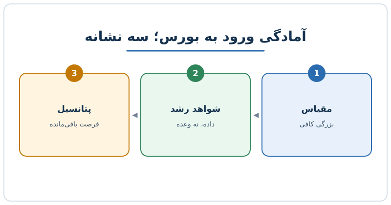

بسیاری از مدیران فکر می‌کنند شرکت وقتی آمادهٔ عرضه اولیه است که درآمدش به عدد مشخصی برسد. اما آمادگی ورود به بورس چند لایه دارد: اندازه، قابل‌اعتماد بودن رشد و جایی که هنوز برای رشد باقی مانده است. در این نوشته سه نشانه‌ای را مرور می‌کنیم که سرمایه‌گذاران معمولاً دنبالشان هستند و با یک مثال عددی ساده نشان می‌دهیم چطور می‌شود آن‌ها را سنجید.

## چرا فقط اندازه کافی نیست؟

شرکتی که درآمد بزرگی دارد ولی رشدش متوقف شده، برای بازار جذابیت چندانی ندارد. سرمایه‌گذار سهام را بر پایهٔ آنچه در آینده اتفاق می‌افتد قیمت می‌گذارد، نه فقط آنچه در گذشته رخ داده است. به همین دلیل چارچوب ساده‌ای که می‌شود به کار برد این است: شرکت باید سه چیز را نشان دهد.

1. **مقیاس:** آن‌قدر بزرگ باشد که معلوم شود به‌سادگی از بین نمی‌رود.
2. **شواهد رشد:** ابتکارهای جدیدش واقعاً نتیجه می‌دهند.
3. **پتانسیل باقی‌مانده:** هنوز بخش مهمی از رشد برای خریداران سهام مانده است.

مقیاس و قابل‌پیش‌بینی بودن معمولاً بیشتر مورد بحث‌اند. نشانهٔ سوم کمتر دیده می‌شود، در حالی که ممکن است تعیین‌کننده‌ترین بخش روایت باشد.

## نشانهٔ اول؛ مقیاس

مقیاس یعنی بزرگی کافی برای اینکه بازار شرکت را جدی بگیرد. هیچ عدد جهانی و قطعی وجود ندارد؛ آستانه به بازار، صنعت و هزینه‌های ثابت حضور در بورس بستگی دارد. در چارچوبی که یک مدیر مالی از یک عرضهٔ اولیهٔ موفق نرم‌افزاری روایت کرده، شرکت با درآمد نزدیک به ۷۰۰ میلیون دلار وارد بورس شده و رقمی بالای ۵۰۰ میلیون دلار به‌عنوان نشانهٔ «مقیاس معنادار» مطرح شده است. این را بیشتر یک مثال بدانید تا قانون.

چرا مقیاس مهم است؟

- هزینهٔ ثابت گزارشگری، حسابرسی و رعایت مقررات بورس باید روی درآمد کافی پخش شود.
- نقدشوندگی سهام برای سرمایه‌گذاران نهادی به اندازهٔ شرکت وابسته است. دربارهٔ این مشکل در [ورود به بورس با ارزش بازار متوسط](/posts/2027/11/22/midcap-ipo-liquidity-coverage-trap/) بیشتر توضیح داده‌ایم.
- شرکت بزرگ‌تر معمولاً مشتریان و منابع درآمدی متنوع‌تری دارد.

## نشانهٔ دوم؛ شواهد اینکه رشد کار می‌کند

سابقهٔ رشد در بازار اصلی کافی نیست. سرمایه‌گذار می‌پرسد: جاهایی که قرار است رشد آینده را بسازند، همین حالا نتیجه می‌دهند؟ مثلاً اگر شرکتی تا امروز فقط به کسب‌وکارهای کوچک خدمات داده و حالا می‌خواهد به مشتریان بزرگ‌تر و بازارهای خارجی برود، باید ببیند این دو حوزه چه سهمی از درآمد جدید دارند.

چند شاخص ساده برای نشان دادن این «اثبات»:

- سهم بازار یا بخش جدید از رشد درآمد در چهار فصل اخیر
- نرخ نگهداشت مشتریان در بخش جدید در مقایسه با بخش قدیمی
- اندازهٔ میانگین قرارداد در بخش جدید
- دورهٔ بازگشت هزینهٔ جذب مشتری در بخش جدید؛ اگر با مفهومش آشنا نیستید، [محاسبهٔ دورهٔ بازگشت هزینهٔ جذب مشتری](/posts/2027/09/21/cac-payback-period-calculation/) را ببینید.

ایدهٔ اصلی این است که قول دادن کافی نیست؛ باید داده‌ای باشد که نشان دهد رشد در حال اتفاق افتادن است.

## نشانهٔ سوم؛ هنوز چیزی برای رشد باقی مانده است

این نشانه را با یک تشبیه ورزشی بهتر می‌شود فهمید. قرارداد یک بازیکن بر پایهٔ عملکرد گذشته‌اش بسته می‌شود، اما ارزش واقعی‌اش به مسافتی بستگی دارد که هنوز انتظار می‌رود بدود. سرمایه‌گذارِ سهام هم همین‌طور است: اگر بفهمد شرکت همهٔ فرصت‌ها را مصرف کرده، حاضر نیست قیمت بالایی بپردازد، چون سودی که قرار است با او تقسیم شود وجود ندارد.

پس در روایت شرکت باید روشن باشد:

- محصولات جدیدی که در مرحلهٔ اولیه‌اند
- صنایع یا بازارهایی که هنوز وارد نشده‌ایم
- ظرفیت افزایش قیمت یا فروش بیشتر به مشتریان فعلی

در نوشتهٔ [فرایند عرضه اولیه و نقش رودشو](/posts/2024/12/03/ipo-process-roadshow-explained/) می‌بینید که این روایت در عمل چطور به سرمایه‌گذاران ارائه می‌شود.

## مثال عددی ساده

فرض کنید شرکت فرضی «الف» سه سال اخیر را این‌طور گزارش می‌کند:

| سال | درآمد (میلیون دلار) | رشد | سهم بخش جدید از درآمد |
|---|---|---|---|
| اول | ۳۰۰ | - | ۵٪ |
| دوم | ۴۲۰ | ۴۰٪ | ۱۲٪ |
| سوم | ۵۸۸ | ۴۰٪ | ۲۲٪ |

اعداد فرضی‌اند. در سال سوم، درآمد حدود ۵۸۸ میلیون دلار است و سهم بخش جدید از ۵ به ۲۲ درصد رسیده؛ یعنی هم مقیاس ساخته شده، هم نشان می‌دهیم ابتکار جدید جواب می‌دهد. اگر همین بخش جدید هنوز در ابتدای بازارش باشد، نشانهٔ سوم هم دیده می‌شود. اگر رشد کل اما ناشی از همان بخش قدیمی باشد، روایت ضعیف‌تر است.

## چک‌لیست کوتاه پیش از تصمیم

- آیا درآمد و سودآوری برای پوشش هزینه‌های بورسی کافی است؟
- آیا رشد در حداقل چهار فصل اخیر قابل‌پیش‌بینی بوده است؟
- آیا یک یا دو حوزهٔ رشد جدید با داده ثابت شده‌اند؟
- آیا روایت شما می‌گوید از این به بعد چه بخشی از رشد هنوز نصیب سهام‌داران جدید می‌شود؟

## پرسش‌های متداول

### آیا عدد مشخصی برای درآمد لازم برای عرضه اولیه وجود دارد؟

خیر. بازارها و صنایع فرق می‌کنند. عددهایی مثل چند صد میلیون دلار فقط مثال‌اند و آستانهٔ قطعی نیستند.

### مقیاس مهم‌تر است یا رشد؟

هر دو لازم‌اند. مقیاس بدون رشد جذابیت کم دارد و رشد بدون مقیاس ریسک بالا دارد.

### «پتانسیل باقی‌مانده» را چطور اثبات کنیم؟

با داده‌هایی مثل سهم کوچک شرکت از بازار هدف، محصولات تازه‌ی در حال رشد و فرصت فروش بیشتر به مشتریان فعلی.

### آیا آمادگی ورود به بورس یعنی سودآوری؟

الزاماً نه. بسیاری از شرکت‌های در حال رشد با زیان وارد بورس شده‌اند، اما باید مسیر روشنی به سودآوری یا کنترل هزینه نشان دهند.

## جمع‌بندی

آمادگی برای بورس سه‌گانه‌ای است: مقیاس که اعتماد می‌سازد، شواهد رشد که قول‌ها را به داده تبدیل می‌کند، و پتانسیل باقی‌مانده که دلیل خرید سهام را می‌دهد. پیش از هر عرضه، هر سه را با عدد و جدول بررسی کنید و روایتی بسازید که نشان دهد «هنوز مسیر باقی است».
