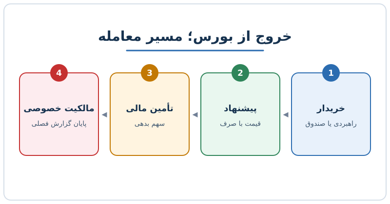

گاهی خبر می‌رسد که یک شرکت بورسی خریداری شده و دیگر سهامش در بازار معامله نمی‌شود. به این رویداد خروج از بورس یا Take Private می‌گویند. چنین معامله‌هایی وقتی بیشتر می‌شوند که قیمت سهام جذاب باشد و تأمین مالی ارزان به دست بیاید. در این نوشته می‌بینیم این معامله دقیقاً چیست، چرا انجام می‌شود و خریدار چه چیزهایی را می‌سنجد.

## خروج از بورس دقیقاً چیست؟

در این معامله، شرکتی که سهامش در بورس معامله می‌شود به یک یا چند خریدار فروخته می‌شود و پس از آن به وضعیت شرکت خصوصی برمی‌گردد. خریدار می‌تواند سه نوع باشد:

- **خریدار راهبردی:** شرکتی دیگر در همان صنعت یا صنعت مرتبط.
- **صندوق سرمایه‌گذاری خصوصی:** که معمولاً بخشی از قیمت را با بدهی تأمین می‌کند. برای آشنایی با منطق این صندوق‌ها، [سرمایه‌گذاری خصوصی چیست](/posts/2024/02/27/private-equity-funding-explained/) را ببینید.
- **سرمایه‌گذار منفرد یا گروهی از سرمایه‌داران بزرگ.**

خریدار معمولاً قیمتی بالاتر از قیمت روز بازار پیشنهاد می‌دهد تا سهام‌داران راضی شوند. این مبلغ اضافه را «صرف» می‌نامند.

## چرا شرکت‌ها از بورس خارج می‌شوند؟

دلایل متعددی وجود دارد و در هر معامله ترکیب متفاوتی دارد:

1. **فشار گزارش‌دهی کمتر.** شرکت بورسی باید هر فصل نتایج را منتشر کند و انتظارات تحلیلگران را مدیریت کند. شرکت خصوصی می‌تواند با شفافیت بیرونی کمتر و سرعت بیشتر تصمیم بگیرد.
2. **امکان اجرای راهبردی بلندمدت.** تغییر ساختار سازمانی یا سرمایه‌گذاری‌هایی که چند سال بعد نتیجه می‌دهند، ممکن است در بازار مورد استقبال نباشند.
3. **ظرفیت بدهی بیشتر.** مالک خصوصی ممکن است ساختار سرمایهٔ پربدهی را آسان‌تر بپذیرد.
4. **کاهش هزینهٔ حضور در بورس.** حسابرسی، امور حقوقی، ارتباط با سرمایه‌گذاران و گزارش‌دهی منظم هزینهٔ زیادی دارند.
5. **قیمت‌گذاری ارزان در بازار.** اگر بازار شرکت را کمتر از ارزش ذاتی‌اش قیمت بزند، خریدار می‌تواند فرصت ببیند.

خروج شرکت دل (Dell) از بورس در سال ۲۰۱۳ نمونه‌ای شناخته‌شده از این مسیر است و این نوع معامله‌ها در بازار جهانی سابقه‌ای طولانی دارند.

## نقش بدهی و نرخ بهره

بخش بزرگی از این معامله‌ها با بدهی تأمین می‌شود. هرچه نرخ بهره پایین‌تر باشد، هزینهٔ بدهی کمتر است و معامله برای خریدار جذاب‌تر می‌شود. مثال: اگر خریدار ۱٬۰۰۰ واحد بدهی با نرخ ۱۰ درصد بگیرد، سالانه ۱۰۰ واحد بهره می‌دهد. با کاهش نرخ به ۹ درصد، همین بهره به ۹۰ واحد می‌رسد و ۱۰ واحد بیشتر برای شرکت می‌ماند.

اما اثر نرخ بهره یک‌طرفه نیست. کاهش نرخ‌ها معمولاً قیمت سهام را هم بالا می‌برد و در نتیجه هدف‌های ارزان کمتر می‌شوند. خریدار باید هر دو اثر را با هم بسنجد. توضیح بیشتر دربارهٔ استفاده از بدهی در این‌گونه معامله‌ها را در [بازسرمایه‌بندی سود تقسیمی](/posts/2025/10/25/dividend-recap-private-equity-debt/) بخوانید.

## ارزش شرکت چگونه سنجیده می‌شود؟

در این معامله‌ها اغلب از ارزش بنگاه (Enterprise Value) استفاده می‌شود:

**ارزش بنگاه = ارزش بازار سهام + کل بدهی − وجه نقد**

ارزش بازار با قیمت روزانهٔ سهام تغییر می‌کند، ولی بدهی و نقد از آخرین صورت‌های مالی فصلی می‌آیند. سپس ارزش بنگاه را بر درآمد دوازده ماه آینده تقسیم می‌کنند تا ضریب درآمدی به دست آید. اگر با این تفاوت‌ها آشنا نیستید، مطلب [از ارزش بنگاه تا ارزش حقوق صاحبان سهام](/posts/2025/07/21/enterprise-to-equity-value-working-capital-peg/) مفید است.

## مثال عددی ساده

شرکت فرضی «ب» را در نظر بگیرید:

| مورد | مقدار (میلیون) |
|---|---|
| ارزش بازار سهام | ۸٬۰۰۰ |
| کل بدهی | ۲٬۰۰۰ |
| وجه نقد | ۱٬۰۰۰ |
| ارزش بنگاه | ۹٬۰۰۰ |
| درآمد پیش‌بینی‌شدهٔ دوازده ماه آینده | ۳٬۰۰۰ |

ضریب ارزش بنگاه به درآمد برابر ۹٬۰۰۰ تقسیم بر ۳٬۰۰۰ یعنی ۳ برابر است. اگر خریدار ۳۰ درصد صرف بپردازد، قیمت سهام ۱۰٬۴۰۰ می‌شود و ارزش بنگاه به ۱۱٬۴۰۰ می‌رسد. حالا خریدار باید بپرسد: جریان نقدی شرکت می‌تواند هزینهٔ بدهی را بدهد و بازده کافی بسازد؟ شرکتی با رشد کم اما جریان نقدی آزاد بالا معمولاً کاندید بهتری است.

## چه شرکت‌هایی کاندیدای بهتری هستند؟

- رشد نسبتاً کند ولی جریان نقدی آزاد پایدار و بالا
- قیمت بازار پایین‌تر از ارزش برآوردی خریدار
- درآمد قابل‌پیش‌بینی که از پس پرداخت بهره برمی‌آید
- مجال بهبود هزینه‌ها یا بازبینی راهبرد

## پرسش‌های متداول

### آیا خروج از بورس برای سهام‌داران همیشه سودآور است؟

معمولاً قیمت پیشنهادی بالاتر از قیمت روز است، اما سهام‌دار بلندمدتی که به رشد آینده امید داشت ممکن است آن را عادلانه نداند.

### فرق خریدار راهبردی و صندوق خصوصی چیست؟

خریدار راهبردی به هم‌افزایی عملیاتی فکر می‌کند، در حالی که صندوق خصوصی بیشتر بر بازده مالی و ساختار بدهی تکیه دارد.

### چرا بدهی این‌قدر در این معامله‌ها مهم است؟

چون بخشی از قیمت خرید با بدهی تأمین می‌شود و بازده سرمایهٔ خریدار را بالا می‌برد، به شرط آنکه شرکت بتواند بهره را بپردازد.

### آیا کاهش نرخ بهره همیشه معامله را آسان می‌کند؟

نه. هزینهٔ بدهی کم می‌شود، ولی قیمت سهام هم ممکن است بالا برود و فرصت‌های ارزان کم شوند.

## جمع‌بندی

خروج از بورس یعنی بازگشت شرکت به مالکیت خصوصی، معمولاً با صرف روی قیمت بازار و کمک بدهی. انگیزه‌ها از کاهش فشار گزارش‌دهی تا اجرای راهبردی بلندمدت متفاوت‌اند. برای سنجیدن چنین معامله‌ای، ارزش بنگاه، جریان نقدی، هزینهٔ بدهی و صرف پرداختی را کنار هم ببینید و فقط به یک عدد تکیه نکنید.
