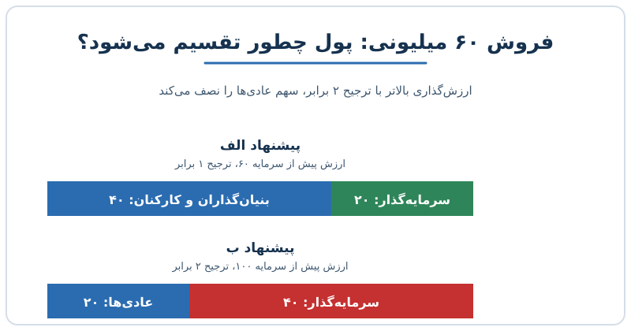

بیشتر بنیان‌گذاران هنگام جذب سرمایه اول به یک چیز نگاه می‌کنند: ارزش‌گذاری. اما ارزش‌گذاری بالا فقط تیتر قرارداد است و سهم واقعی شما از پول خروج را شرایط قرارداد تعیین می‌کند. در این نوشته با چند مثال ساده می‌بینیم چرا یک پیشنهاد با ارزش‌گذاری کمتر و شرایط سبک‌تر می‌تواند برای بنیان‌گذار و کارکنان بهتر از پیشنهاد پرزرق‌وبرق باشد.

## چرا همه به دنبال عدد بزرگ هستند؟

ارزش‌گذاری بالا چند جاذبه دارد. اولاً حس موفقیت می‌دهد و در محیط استارتاپی اعتبار می‌آورد. ثانیاً منطق ساده‌ای پشت آن است: اگر برای مبلغ ثابتی سهم کمتری بدهم، رقیق‌شدن کمتری دارم. مثلاً جذب ۲۰ میلیون با ارزش پیش از سرمایه‌ی ۶۰ میلیون یعنی سرمایه‌گذار ۲۵ درصد می‌گیرد، و با ارزش پیش از سرمایه‌ی ۱۰۰ میلیون فقط حدود ۱۶٫۷ درصد.

مشکل این است که این حساب فقط تا لحظه‌ی امضا درست است. سرمایه‌گذار هم می‌داند ارزش بالا ریسک را بیشتر می‌کند و معمولاً آن را با شرایط سخت‌تر جبران می‌کند. نتیجه این می‌شود که بنیان‌گذار درصد کمتری را از دست می‌دهد، ولی در زمان فروش یا تصفیه، دلار کمتری به دست می‌آورد.

## ترجیح تصفیه؛ اولین قلم پنهان

ترجیح تصفیه (Liquidation Preference) یعنی در زمان فروش شرکت، سرمایه‌گذار پیش از سهام‌داران عادی مبلغی را برمی‌دارد، مثلاً یک، دو یا سه برابر پولی که آورده است. اگر مفهوم آن برایتان تازه است، نوشته‌ی [ترجیح تصفیه و طبقات سهام](/posts/2026/02/18/equity-classes-liquidation-preference-cap-table/) را ببینید.

دو پیشنهاد فرضی را مقایسه کنیم. در هر دو ۲۰ میلیون دلار جذب می‌شود و ترجیح غیرمشارکتی است، یعنی سرمایه‌گذار یا ترجیحش را می‌گیرد یا سهامش را تبدیل می‌کند، هرکدام بیشتر باشد.

| | پیشنهاد الف | پیشنهاد ب |
|---|---|---|
| ارزش پیش از سرمایه | ۶۰ میلیون | ۱۰۰ میلیون |
| سهم سرمایه‌گذار | ۲۵٪ | حدود ۱۶٫۷٪ |
| ترجیح تصفیه | ۱ برابر (۲۰ میلیون) | ۲ برابر (۴۰ میلیون) |

اگر شرکت به قیمت ۶۰ میلیون فروخته شود:

- **پیشنهاد الف:** تبدیل سهام ۱۵ میلیون می‌ارزد، پس سرمایه‌گذار ترجیح ۲۰ میلیون را می‌گیرد و ۴۰ میلیون برای بقیه می‌ماند.
- **پیشنهاد ب:** تبدیل سهام ۱۰ میلیون می‌ارزد، پس ترجیح ۴۰ میلیون انتخاب می‌شود و فقط ۲۰ میلیون به بنیان‌گذاران و کارکنان می‌رسد.

یعنی پیشنهادی که ارزش‌گذاری بالاتری داشت، نصف پول را نصیب سهام‌داران عادی کرد. اگر فروش ۳۰۰ میلیون باشد، هر دو سرمایه‌گذار سهامشان را تبدیل می‌کنند و پیشنهاد ب بهتر است (۲۵۰ در برابر ۲۲۵ میلیون). پس شرایط قرارداد در سناریوهای ضعیف‌تر خودش را نشان می‌دهد، و واقع‌بینانه باید این سناریوها را هم حساب کرد.

## سهام مشارکتی؛ برداشت دوباره

در سهام ممتاز مشارکتی، سرمایه‌گذار اول ترجیحش را برمی‌دارد و بعد با درصد مالکیتش در باقی‌مانده هم شریک می‌شود. مثل کسی که هم سهم ثابت می‌گیرد و هم دوباره در تقسیم باقی‌مانده حاضر است.

در پیشنهاد الف با فروش ۶۰ میلیون: ۲۰ میلیون ترجیح، سپس ۲۵٪ از ۴۰ میلیون باقی‌مانده یعنی ۱۰ میلیون. جمعاً ۳۰ میلیون برای سرمایه‌گذار و ۳۰ میلیون برای بقیه؛ به‌جای ۲۰ و ۴۰ در حالت غیرمشارکتی. بنابراین کلمه‌ی «مشارکتی» در برگه‌ی شرایط را باید جدی گرفت.

## ضد رقیق‌شدن و دور پایین‌تر

اگر بعداً شرکت با قیمت پایین‌تر سرمایه جذب کند (دور نزولی)، بندهای ضد رقیق‌شدن تعداد سهام سرمایه‌گذار قبلی را تعدیل می‌کنند. دو نوع رایج هست: میانگین وزنی که ملایم‌تر است و ضد رقیق‌شدن کامل (Full Ratchet) که شدیدترین حالت است.

مثال ساده: سرمایه‌گذار ۲ میلیون سهم را هر سهم ۱۰ دلار خریده و بنیان‌گذاران ۸ میلیون سهم دارند. دور بعد، ۱۰ میلیون دلار با قیمت ۵ دلار جذب می‌شود و ۲ میلیون سهم جدید صادر می‌شود.

| حالت | سهم بنیان‌گذاران | سهم سرمایه‌گذار قبلی |
|---|---|---|
| بدون ضد رقیق‌شدن | ۸ از ۱۲ میلیون، حدود ۶۶٫۷٪ | حدود ۱۶٫۷٪ |
| ضد رقیق‌شدن کامل | ۸ از ۱۴ میلیون، حدود ۵۷٫۱٪ | ۴ از ۱۴ میلیون، حدود ۲۸٫۶٪ |

در حالت کامل، قیمت خرید سرمایه‌گذار قبلی به ۵ دلار بازتنظیم می‌شود و سهامش دو برابر می‌شود. بار این تعدیل روی بنیان‌گذاران و کارکنان می‌افتد. (برای اثر صدور سهام بر مالکیت، [رقیق‌شدن و پاداش سهام](/posts/2027/04/20/sbc-dilution-talent-war/) را هم ببینید.)

## حق وتو و کنترل

شرط‌های کنترلی هم بخشی از قیمت واقعی هستند: حق وتو بر جذب سرمایه‌ی بعدی، استخدام مدیران ارشد یا فروش شرکت. هرچه این فهرست بلندتر باشد، آزادی عمل مدیرعامل کمتر و خطر بن‌بست در تصمیم‌های سریع بیشتر است. این شرط‌ها روی کاغذ عدد ندارند، اما در بحران بسیار گران تمام می‌شوند.

## چطور پیشنهادها را درست مقایسه کنیم؟

یک روش عملی این است که برای هر پیشنهاد جدول تقسیم پول در چند قیمت خروج بسازید:

1. قیمت‌های خروج مختلف مثل نصف، برابر و دو برابر ارزش‌گذاری را در نظر بگیرید.
2. برای هر قیمت، ترجیح، مشارکت و تبدیل سهام را حساب کنید.
3. سهم نهایی سهام‌داران عادی را به دلار و درصد مقایسه کنید.
4. سناریوی دور نزولی را با بندهای ضد رقیق‌شدن اجرا کنید.
5. شرط‌های کنترلی را فهرست و میزان محدودیت آن‌ها را ارزیابی کنید.

همچنین ببینید ارزش‌گذاری را چطور باید در کل سنجید؛ [ارزش‌گذاری یک کارنامه نیست](/posts/2027/05/06/valuation-not-a-scorecard/) در این باره مفید است.

## پرسش‌های متداول

### آیا باید همیشه ارزش‌گذاری پایین‌تر را قبول کرد؟

نه. هدف، بالاترین نتیجه‌ی واقعی برای سهام‌داران عادی است. گاهی ارزش بالا با شرایط سبک بهترین گزینه است. مقایسه‌ی سناریو به شما نشان می‌دهد کدام پیشنهاد واقعاً بهتر است.

### ترجیح تصفیه‌ی یک برابر غیرمشارکتی چه وضعی دارد؟

این شکل رایج‌ترین و نسبتاً متعادل‌ترین حالت است، اما استاندارد بودن آن به بازار و مرحله‌ی شرکت بستگی دارد. پیش از قبول، همیشه جدول تقسیم را اجرا کنید.

### چرا گاهی بنیان‌گذاران دور نزولی را نمی‌پذیرند؟

دلایل شخصیتی و بازاری دارد: نگرانی از دل‌سردی کارکنان، فشار بر سرمایه‌گذاران قبلی و پیام منفی به مشتریان. اما حفظ عدد قبلی با شرایط سنگین می‌تواند هزینه‌ای بیش از پذیرش دور نزولی ساده داشته باشد.

### پیش از امضا چه کسی باید قرارداد را ببیند؟

علاوه بر مشاور حقوقی باتجربه در این حوزه، بهتر است یک نفر مالی مدل تقسیم پول را بسازد تا اثر اعداد روشن شود.

## جمع‌بندی

ارزش‌گذاری فقط یک عدد در برگه‌ی شرایط است و سهم واقعی شما از خروج به ترجیح تصفیه، مشارکت، ضد رقیق‌شدن و حقوق کنترلی بستگی دارد. جذب سرمایه باید گزینه‌های شما را بیشتر کند، نه کمتر. پیش از امضا جدول تقسیم پول را در چند سناریوی خروج بسازید و بر پایه‌ی آن تصمیم بگیرید، نه بر پایه‌ی تیتر ارزش‌گذاری. توجه کنید که این نوشته آموزشی است و جایگزین مشاوره‌ی حقوقی نیست.
