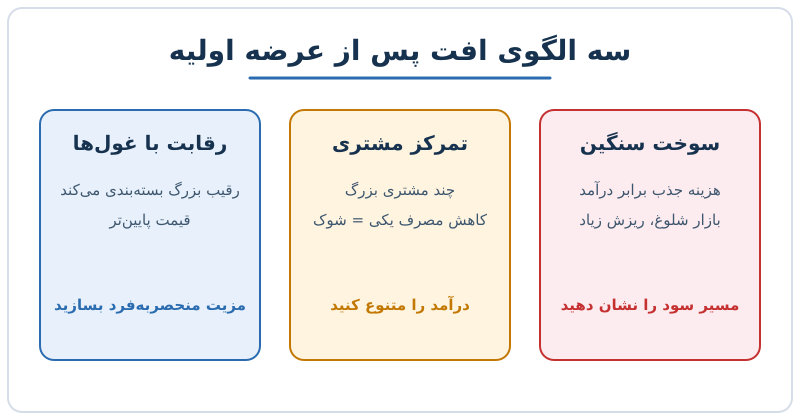

عرضه اولیه مثل آب‌انداختن یک قایق است: گاهی روی آب می‌ماند، گاهی غرق می‌شود و گاهی به یخ‌کوه می‌خورد. در این نوشته به افت قیمت سهام پس از عرضه اولیه نگاه می‌کنیم و سه الگوی رایج را بررسی می‌کنیم: سوخت زیاد نقدینگی در بازار شلوغ، تمرکز درآمد روی چند مشتری و رقابت با بازیگران بسیار بزرگ‌تر.

## الگوی اول: رشد سریع، سوخت سنگین، بازار شلوغ

شرکت نرم‌افزاری را فرض کنید که درآمدش سریع رشد می‌کند ولی تقریباً به اندازه‌ی درآمد، هزینه‌ی جذب مشتری خرج می‌کند. سرمایه‌گذار در ابتدا رشد را دوست دارد، اما خیلی زود می‌پرسد: «کی سودآور می‌شود؟»

مسئله وقتی جدی‌تر است که بازار پر از رقیب باشد. تفاوت بزرگی است بین خرج‌کردن برای تصاحب قطعی یک دسته‌ی محصول (با ماندگاری بالای مشتری) و ورود به دعوایی شلوغ با ریزش زیاد. در حالت دوم، هزینه‌ی جذب بیشتر لزوماً به درآمد پایدار تبدیل نمی‌شود.

**درس:** در بازار پررقیب، رشد به‌تنهایی کافی نیست. باید تمایز روشن و مسیر سودآوری قابل‌اثبات داشت.

## الگوی دوم: تمرکز مشتری

شرکتی را در نظر بگیرید که بخش بزرگی از درآمدش از چند مشتری کلیدی می‌آید. تا وقتی آن‌ها مصرف خود را حفظ کنند همه‌چیز خوب است. اما اگر یکی از آن‌ها مصرفش را کم کند، درآمد ناگهان پایین می‌آید و سرمایه‌گذاران می‌روند.

مثال عددی: درآمد سالانه ۱۰۰ میلیارد تومان است و ۳۰ میلیارد آن از یک مشتری می‌آید. اگر مصرف او نصف شود، ۱۵ درصد کل درآمد از بین می‌رود، حتی اگر بقیه‌ی مشتریان کاملاً ثابت باشند. در بازاری که جابه‌جایی مشتری آسان است، چنین رخدادی بسیار محتمل‌تر است.

از سوی دیگر، شرکت‌هایی که پیش از عرضه وابستگی خود به یک پلتفرم یا کانال را کم کرده‌اند (مثلاً از بیش از ۷۰ درصد درآمد وابسته به یک بستر به سطح کمتر رسیده‌اند)، اعتماد بازار را راحت‌تر جلب می‌کنند.

**درس:** پیش از ورود به بورس، تنوع درآمد را بسازید و آن را مستند کنید.

## الگوی سوم: رقابت با غول‌ها

گاهی شرکت پیشگام یک فناوری است، اما بازیگران بسیار بزرگ‌تر خدمتی مشابه را عرضه یا در بسته‌ی خدمات خود بسته‌بندی می‌کنند. شرکت مستقل باید توضیح دهد چرا محصول جداگانه‌اش ارزش دارد، در حالی که رقیب بزرگ ممکن است همان کار را با قیمت کمتر انجام دهد.

**درس:** بدون مزیت منحصربه‌فرد یا یکپارچگی عمیق با اکوسیستم مشتری، حفظ شتاب در بازار سهام سخت است؛ مقیاس اغلب برنده است.

## چهار معیار برای سنجش کارایی

سرمایه‌گذاران چند معیار عمومی را کنار هم می‌گذارند تا ببینند شرکت چقدر «با کمتر، بیشتر» می‌سازد:

- **ارزش شرکت به درآمد ۱۲ ماه آینده:** ارزش شرکت = ارزش بازار + کل بدهی منهای وجه نقد. تقسیم آن بر درآمد پیش‌بینی‌شده‌ی ۱۲ ماه آینده، ضریبی برای مقایسه‌ی شرکت‌های زیان‌ده می‌دهد. ضریب ۱۰ برابر معمولاً برای بهترین‌ها «حق‌بیمه» محسوب می‌شود.
- **دوره‌ی بازگشت هزینه‌ی جذب مشتری:** هزینه‌ی فروش و بازاریابی تقسیم بر افزایش درآمد، با تعدیل حاشیه سود ناخالص. جزئیات را در [محاسبه‌ی دوره‌ی بازگشت هزینه‌ی جذب مشتری](/posts/2027/09/21/cac-payback-period-calculation/) ببینید.
- **درآمد سرانه‌ی هر کارمند:** درآمد ۱۲ ماه اخیر تقسیم بر تعداد کارکنان. قاعده‌ی سرانگشتی: شرکت‌های بورسی در مقیاس بالا باید از ۴۵۰ هزار دلار به ازای هر نفر فراتر بروند.
- **قاعده‌ی ۴۰:** رشد درآمد به‌علاوه‌ی حاشیه‌ی سود؛ مجموع باید بالای ۴۰ باشد. مثلاً رشد ۳۰٪ و حاشیه‌ی ۱۵٪ یعنی ۴۵ و قبول.

## مثال عددی کوتاه

شرکتی با ارزش بازار ۹۰۰ میلیارد، بدهی ۱۰۰ و وجه نقد ۲۰۰ میلیارد تومان را در نظر بگیرید: ارزش شرکت = ۹۰۰ + ۱۰۰ − ۲۰۰ = ۸۰۰ میلیارد. اگر درآمد ۱۲ ماه آینده ۸۰ میلیارد پیش‌بینی شود، ضریب ۱۰ برابر است؛ یعنی در محدوده‌ی «حق‌بیمه». حالا اگر ۳۰٪ درآمد وابسته به یک مشتری باشد و او نصف شود، درآمد به ۶۸ میلیارد می‌رسد و با همان ارزش، ضریب به حدود ۱۱٫۸ برابر می‌رود؛ یعنی بازار یا قیمت را پایین می‌آورد یا شرکت باید رشد بالاتری نشان دهد. این‌گونه یک رخداد تمرکز مستقیم به ارزش‌گذاری منتقل می‌شود.

## پرسش‌های متداول

**آیا افت پس از عرضه اولیه نشانه‌ی شکست شرکت است؟**
نه الزاماً. نشان می‌دهد بازار به قیمت‌گذاری اولیه و چشم‌انداز سودآوری خوش‌بین نبوده است.

**تمرکز مشتری چه سطحی خطرناک است؟**
عدد قطعی نیست، اما وقتی از دست رفتن یک مشتری چند درصد کل درآمد را از بین ببرد، ریسک جدی است. پیش‌تر بررسی کنید.

**رشد یا سودآوری؟**
هر دو؛ قاعده‌ی ۴۰ همین توازن را می‌سنجد.

**چه زمانی شرکت آماده‌ی عرضه است؟** نشانه‌ها را در [سه نشانه‌ی آمادگی ورود به بورس](/posts/2027/12/10/ipo-readiness-three-signals/) بخوانید. رفتار روز اول بازار هم در [نوشته‌ی جهش روز اول عرضه اولیه](/posts/2027/11/26/ipo-day-one-pop-who-benefits/) بررسی شده است.

## جمع‌بندی

سه الگو تکرار می‌شود: سوخت زیاد بدون مسیر سودآوری، تمرکز درآمد و رقابت با غول‌ها. مدیر مالی که به فکر عرضه اولیه است باید پیش از ورود، شواهد کارایی (بازگشت هزینه‌ی جذب، درآمد سرانه، قاعده‌ی ۴۰)، تنوع درآمد و مزیت رقابتی را نشان دهد. قیمت سهام بر پایه‌ی وعده‌ی فردا تعیین می‌شود، نه نتایج دیروز.
