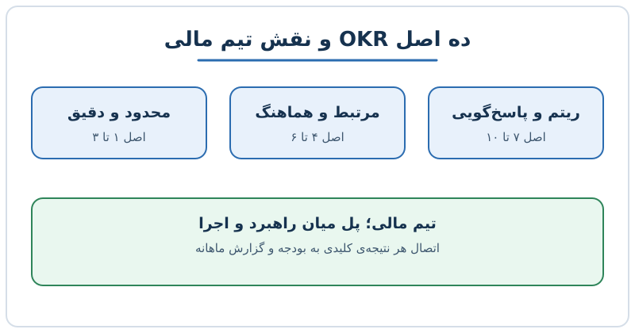

بسیاری از شرکت‌ها در ابتدای سال اهداف و نتایج کلیدی یا همان OKR می‌نویسند، اما تا میانه‌ی سال کسی دیگر سراغشان نمی‌رود. مشکل معمولاً در خود روش نیست؛ در نحوه‌ی تعریف و پیگیری آن است. در این نوشته ده اصل عملی برای نوشتن OKR قابل‌اجرا را مرور می‌کنیم و می‌بینیم تیم مالی چطور می‌تواند آن را به بودجه و گزارش ماهانه وصل کند.

## OKR چیست و چه تفاوتی با KPI دارد؟

هر OKR از دو بخش ساخته می‌شود. **هدف (Objective)** جمله‌ای کیفی و الهام‌بخش است که می‌گوید به کجا می‌خواهیم برسیم. **نتیجه‌ی کلیدی (Key Result)** عددی قابل‌اندازه‌گیری است که نشان می‌دهد به آن هدف رسیده‌ایم یا نه.

KPI معمولاً سلامت جاری کسب‌وکار را پایش می‌کند، مثل حاشیه‌ی سود ناخالص یا نرخ ریزش مشتری. OKR برای تغییر است: می‌خواهیم وضعیت را از نقطه‌ی الف به نقطه‌ی ب ببریم. اگر هنوز شاخص‌هایتان را انتخاب نکرده‌اید، [انتخاب شاخص‌های کلیدی عملکرد؛ هفت گام عملی](/posts/2024/04/17/choose-right-kpis-seven-steps/) نقطه‌ی شروع خوبی است.

## اصل اول: تعداد را به موارد ضروری محدود کنید

وقتی همه‌چیز هدف باشد، هیچ‌چیز هدف نیست. برای کل شرکت سه تا پنج هدف کافی است و در شرکت‌های کوچک دو یا سه هدف هم زیاد است. فهرست بلند نتایج کلیدی هم فقط پراکندگی می‌آورد.

یک قاعده‌ی ساده: برای هر هدف حداکثر سه نتیجه‌ی کلیدی بنویسید. اگر برای جمع‌کردن نتایج به پانزده سطر نیاز دارید، احتمالاً هنوز نمی‌دانید مهم‌ترین کار کدام است.

## اصل دوم و سوم: موفقیت را دقیق تعریف کنید و روی اثر تدریجی تمرکز کنید

عبارت «تجربه‌ی مشتری را بهتر کنیم» جهت نمی‌دهد. جمله‌ی «امتیاز رضایت مشتری را تا پایان فصل سوم به ۹۰ برسانیم» هم عدد دارد، هم زمان. آزمون ساده این است: آیا هر عضو تیم در پایان فصل می‌تواند بدون بحث بگوید که این هدف محقق شد یا نه؟

از سوی دیگر، به جای جهش‌های رویایی، بهبودهای قابل‌دستیابی و پشت‌سرهم تعریف کنید. مثلاً کاهش زمان بستن حساب‌های ماهانه از ده روز به هشت روز، سپس به شش روز، پیشرفتی ملموس است که انگیزه هم می‌دهد.

## اصل چهارم و پنجم: از شاخص‌های ظاهری دوری کنید و هماهنگ کنید، نه آبشاری

شاخص ظاهری (Vanity Metric) عددی است که خوب به نظر می‌رسد اما تصمیمی را تغییر نمی‌دهد؛ مثل تعداد بازدید بدون توجه به تبدیل آن به فروش. نتیجه‌ی کلیدی باید به پول، مشتری یا کارایی گره بخورد.

در روش آبشاری، هدف مدیرعامل عیناً به معاونان و بعد به کارشناسان می‌رسد و هر سطح فقط عدد را کوچک‌تر می‌کند. نتیجه، اهداف کسل‌کننده و بدون مالکیت است. در روش هماهنگ‌سازی، هر تیم می‌فهمد هدف شرکت چیست و خودش مشخص می‌کند چه سهمی می‌تواند داشته باشد. این رویکرد به شفافیت بیشتر و تعهد واقعی منجر می‌شود. برای دیدن مسیر کامل از هدف تا شاخص، [برنامه سالانه: از هدف راهبردی تا KPI و نقشه‌ی اجرا](/posts/2024/05/05/strategic-objectives-goals-kpi-annual-plan/) را بخوانید.

## اصل ششم: اهداف جاه‌طلبانه و تعهدی را از هم جدا کنید

همه‌ی OKRها یک جنس نیستند.

| نوع | انتظار | معنای ۷۰ درصد تحقق |
|---|---|---|
| تعهدی | تقریباً صددرصد باید محقق شود | شکست یا نیاز به توضیح |
| جاه‌طلبانه | سقف بلند، تحقق کامل نادر است | نتیجه‌ی خوب |

اگر این دو را قاطی کنید، تیم‌ها یا اهداف را بسیار محافظه‌کارانه می‌نویسند یا از عدم تحقق می‌ترسند. بهتر است کنار هر هدف نوشته شود که تعهدی است یا جاه‌طلبانه. در بودجه هم فقط اهداف تعهدی را وارد پیش‌بینی پایه کنید و اهداف جاه‌طلبانه را به‌عنوان سناریوی خوش‌بینانه نگه دارید.

## اصل هفتم و هشتم: ریتم پیگیری بسازید و مالی را پل راهبرد و اجرا کنید

کاهش توجه در میانه‌ی سال شایع‌ترین دلیل شکست OKR است. راه‌حل، ریتم ثابت است:

- **هفتگی:** به‌روزرسانی کوتاه وضعیت هر نتیجه‌ی کلیدی (سبز، زرد، قرمز)
- **ماهانه:** مرور در جلسه‌ی عملکرد، کنار گزارش مالی
- **فصلی:** نمره‌دهی، یادگیری و تعریف دوره‌ی بعد

تیم مالی طبیعی‌ترین گزینه برای نگه‌داشتن این ریتم است، چون ماهانه با همه‌ی واحدها تماس دارد و عددها را می‌شناسد. اگر هر نتیجه‌ی کلیدی به یک ردیف بودجه یا یک شاخص گزارش مدیریتی وصل شود، OKR دیگر کاغذ نیست. [بودجه‌بندی مبتنی بر استراتژی](/posts/2026/04/01/strategy-first-budgeting-reallocation/) نشان می‌دهد این پیوند در عمل چگونه ساخته می‌شود.

## اصل نهم و دهم: تاریخ پاسخ‌گویی و اصلاح مسیر

برای هر نتیجه‌ی کلیدی یک مالک مشخص و تاریخ بررسی تعیین کنید. هدفِ بی‌صاحب، هدفِ فراموش‌شده است.

اصلاح مسیر هم نشانه‌ی ضعف نیست. فرض کنید نتیجه‌ی کلیدی شما «کاهش هزینه‌ی جذب مشتری از ۲۰۰ به ۱۶۰ دلار تا پایان سال» است و تا پایان فصل دوم فقط به ۱۹۰ رسیده‌اید. دو راه دارید: دلیل را بررسی کنید و اگر بازار تغییر کرده، عدد را با توضیح بازنگری کنید؛ یا اگر مشکل اجرایی است، منابع را جابه‌جا کنید. مهم این است که تصمیم آگاهانه و مستند باشد، نه سکوت.

## پرسش‌های متداول

**OKR را سالانه بنویسم یا فصلی؟**
معمولاً هدف سالانه جهت می‌دهد و نتایج کلیدی فصلی اجرا و نمره‌دهی می‌شوند. بدین ترتیب انعطاف کافی برای اصلاح دارید.

**اگر تیم مالی هستم، OKR چه کمکی به من می‌کند؟**
هم برای خود تیم مالی (مثل کوتاه‌کردن زمان بستن حساب‌ها) و هم برای ربط‌دادن اهداف سایر واحدها به بودجه و گزارش عملکرد.

**چند درصد تحقق OKR خوب است؟**
برای اهداف جاه‌طلبانه حدود ۶۰ تا ۷۰ درصد معمولاً قابل‌قبول است، اما برای اهداف تعهدی انتظار نزدیک به کامل است.

**آیا OKR جای KPI را می‌گیرد؟**
خیر. KPI سلامت فعلی را رصد می‌کند و OKR تغییر مطلوب را هدایت می‌کند؛ هر دو کنار هم مفیدند.

## جمع‌بندی

OKR وقتی کار می‌کند که کم، دقیق و قابل‌اندازه‌گیری باشد، با شاخص ظاهری پر نشود، میان اهداف تعهدی و جاه‌طلبانه فرق بگذارد و ریتم پیگیری ثابتی داشته باشد. تیم مالی با اتصال این اهداف به بودجه و گزارش ماهانه، آن‌ها را از اسلاید به تصمیم تبدیل می‌کند. برای شروع، سه هدف انتخاب کنید و برای هرکدام یک مالک و یک تاریخ بررسی بنویسید.
