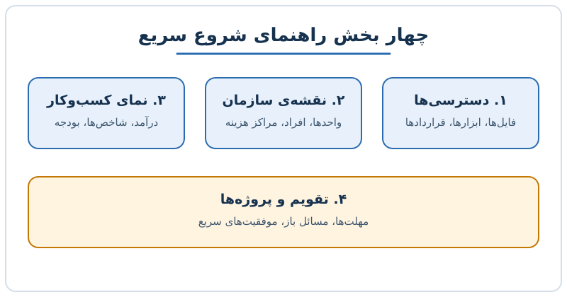

آمدن رئیس جدید برای هر کارشناس مالی لحظه‌ای دوگانه است: هم نگرانی از تغییر، هم فرصتی برای دیده‌شدن. رئیس تازه باید سریع شرکت را بشناسد و تصمیم بگیرد، و کسی که از قبل در تیم بوده بهترین منبع اطلاعات اوست. در این نوشته می‌بینید یک راهنمای شروع سریع برای رئیس جدید مالی چه بخش‌هایی دارد و چگونه آن را بسازید.

## چرا باید پیش از درخواست، راهنما بسازید؟

ذهنیت «نکند جایم را بگیرند» طبیعی است، اما بازتعریف آن مفیدتر است: رئیس جدید باید در چند هفته‌ی اول اطلاعات پراکنده را جمع کند، روابط را بشناسد و نتیجه نشان دهد. اگر یک سند منسجم در اختیارش بگذارید، زمان یادگیری او کوتاه می‌شود و شما شریک مورد اعتمادش می‌شوید.

نکته‌ی مهم این است که این کار را کسی از شما نخواسته است. همین پیش‌قدمی اثر آن را چند برابر می‌کند. برای گام‌های بعدی مسیر، [تأثیرگذاری بر استراتژی شرکت؛ راهنمای ۵ مرحله‌ای تیم مالی](/posts/2023/07/22/influence-company-strategy-fpa-five-steps/) را هم بخوانید.

## بخش اول: دسترسی فوری به موارد ضروری

ساده‌ترین بخش، اما حیاتی‌ترین. رئیس جدید باید بدون پرسیدن از ده نفر بتواند فایل‌ها را پیدا کند.

- **سازمان‌دهی فایل‌ها:** پوشه‌های مشترک تیم کجاست و چگونه نام‌گذاری شده؟ فایل‌های بودجه، پیش‌بینی و گزارش‌های ماهانه را کجا بجوید؟
- **دسترسی‌ها:** فهرست همه‌ی سیستم‌ها و ابزارها (نرم‌افزار حسابداری، ابزار برنامه‌ریزی، داشبوردها) و اینکه دسترسی هر کدام را چه کسی می‌دهد.
- **قرارداد ابزارها:** اگر بدانید قرارداد ابزار برنامه‌ریزی چه زمانی تمام می‌شود، مثلاً دو سال است استفاده می‌کنید و شش ماه مانده، رئیس جدید می‌تواند درباره‌ی تمدید یا تعویض زودتر تصمیم بگیرد.

## بخش دوم: نقشه‌ی سازمان

بدون شناخت ساختار، هر جلسه مثل ورود به اتاقی تاریک است.

- **ساختار واحدها:** نمودار سازمانی شامل مالی، محصول، بازاریابی و تیم‌های ادغام‌شده یا ارثی را رسم کنید. ویژگی‌های خاص را بنویسید؛ مثلاً «تحلیل داده زیرمجموعه‌ی فنی است» یا «تیم جذب مشتری در بازاریابی قرار دارد».
- **ساختار تیم مالی:** نقش هر نفر و حوزه‌ای که پوشش می‌دهد.
- **افراد اثرگذار:** کسانی که رسماً مدیر نیستند اما روی روحیه و تصمیم‌ها اثر دارند. جمله‌ای مثل «همکار منابع انسانی برای تغییرات بزرگ بهترین نقطه‌ی شروع است» ارزش زیادی دارد.
- **مراکز هزینه:** نقشه‌ای تصویری از مراکز هزینه بکشید، چون گاهی با سلسله‌مراتب گزارش‌دهی فرق دارد. کنارش بنویسید کدام شریک تجاری مالی مسئول هر مرکز است تا رئیس جدید بتواند منابع تیم را با بودجه‌ی واحدها پیوند بزند. اگر با این نقش آشنا نیستید، [شریک تجاری مالی (FBP) چیست؟](/posts/2022/04/12/finance-business-partner-guide/) را ببینید.

## بخش سوم: نمای کلی کسب‌وکار

در این بخش با اعداد و عبارت ساده توضیح بدهید شرکت چطور پول درمی‌آورد.

1. **مدل درآمدی و محصولات:** سهم هر خط درآمد و روند اخیر آن.
2. **شاخص‌های اصلی:** پنج یا شش معیاری که مدیران به آن‌ها نگاه می‌کنند، با تعریف دقیق محاسبه.
3. **ساختار هزینه:** بزرگ‌ترین اقلام و کدام ثابت و کدام متغیر است.
4. **وضعیت فعلی نسبت به بودجه:** مثلاً «درآمد تجمعی ۴ درصد بالاتر از بودجه است، اما هزینه‌ی بازاریابی ۱۰ درصد بیشتر». چنین جمله‌ای در دو خط تصویر شفافی می‌دهد. برای ساختن این تحلیل، [تحلیل بودجه در برابر عملکرد](/posts/2022/04/14/budget-vs-actual-variance-analysis/) کمک‌کننده است.

## بخش چهارم: تقویم، پروژه‌ها و ریسک‌ها

رئیس جدید باید بداند در ماه‌های پیش رو چه چیزی در جریان است.

- **تقویم مالی:** زمان بستن حساب‌ها، مهلت ارائه‌ی بودجه، جلسات هیئت‌مدیره و مهلت‌های قانونی.
- **پروژه‌های در جریان:** وضعیت، مالک و موعد هر پروژه (مثلاً تعویض ابزار گزارشگری).
- **مسائل باز و ریسک‌ها:** موضوعاتی که منتظر تصمیم‌اند، با صداقت و بدون تزئین.
- **موفقیت‌های سریع:** دو یا سه کاری که با کمترین تلاش اثر بالایی دارد و رئیس جدید می‌تواند زود نتیجه‌اش را نشان دهد.

## نکاتی برای نوشتن راهنمایی که واقعاً خوانده شود

- طول را به چند صفحه‌ی خلاصه محدود کنید و جزئیات را در پیوست بگذارید.
- از عکس و نمودار استفاده کنید؛ نقشه‌ی سازمان بهتر از ده پاراگراف است.
- بی‌طرف باشید. درباره‌ی افراد نظر شخصی منفی ننویسید؛ واقعیت‌های کاری را بنویسید.
- در جلسه‌ی اول، راهنما را با رئیس مرور کنید و بپرسید چه چیزی را اضافه کنم.
- بعد از چند هفته به‌روزرسانی‌اش کنید.

## پرسش‌های متداول

**آیا لازم است راهنما را رسمی و طولانی بنویسم؟**
خیر. سندی ۳ تا ۵ صفحه‌ای که سریع خوانده شود از گزارشی ۵۰ صفحه‌ای مؤثرتر است.

**اگر رئیس جدید از بیرون شرکت آمده باشد چه؟**
دقیقاً در این حالت راهنما بیشترین ارزش را دارد، چون هیچ زمینه‌ی قبلی ندارد.

**آیا این کار ممکن است ریاکارانه به نظر برسد؟**
اگر بر پایه‌ی اطلاعات واقعی و بدون خودنمایی باشد، همکاری حرفه‌ای تلقی می‌شود. هدف کمک به موفقیت مشترک است.

**اطلاعات حساس را هم باید در راهنما بگذارم؟**
فقط آنچه در حیطه‌ی اختیار شماست و طبق سیاست‌های شرکت قابل‌اشتراک است؛ موارد محرمانه را از مجرای رسمی منتقل کنید.

## جمع‌بندی

یک راهنمای شروع سریع شامل دسترسی‌ها، نقشه‌ی سازمان، نمای کلی کسب‌وکار و تقویم پروژه‌هاست. این سند زمان یادگیری رئیس جدید را کم می‌کند و به شما جایگاه شریک قابل‌اتکا می‌دهد. این هفته نقشه‌ی مراکز هزینه را بکشید؛ ساده‌ترین بخش و اثرگذارترین آن است.
