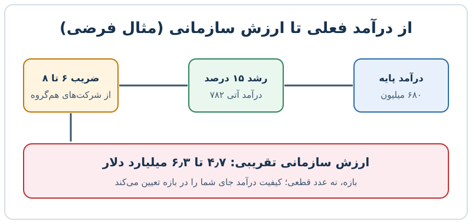

وقتی یک شرکت نرم‌افزاری زیان‌ده به بورس می‌آید، سود خالص نمی‌تواند معیار قیمت باشد. در این حالت **ارزش‌گذاری شرکت SaaS** معمولاً با ضریب درآمد آتی انجام می‌شود: درآمد دوازده ماه آینده را در یک عدد ضرب می‌کنند و ارزش سازمانی به دست می‌آید. در این مطلب مرحله‌به‌مرحله می‌بینید این عدد چگونه ساخته می‌شود و چه چیزهایی آن را بالا یا پایین می‌برد.

## چرا برای شرکت‌های زیان‌ده سراغ ضریب درآمد می‌رویم؟

نسبت قیمت به سود برای شرکتی که هنوز سود نمی‌کند بی‌معناست. در عوض از ضریب «ارزش سازمانی به درآمد» استفاده می‌شود. مبنای رایج برای مقایسه، **درآمد دوازده ماه آینده** (NTM) است، چون سال مالی و فصلی‌بودن شرکت‌ها را یکسان می‌کند و به هر شرکت اعتبار یک سال کامل آینده را می‌دهد.

ارزش سازمانی از این فرمول به دست می‌آید:

**ارزش سازمانی = ارزش بازار سهام + کل بدهی − وجه نقد**

ارزش بازار با قیمت سهام هر روز تغییر می‌کند، اما بدهی و نقد از آخرین صورت مالی فصلی گرفته می‌شود. به همین دلیل مقایسه‌ها باید مرتب به‌روز شوند.

## چهار گام ساخت یک بازه ارزش‌گذاری

یک مثال فرضی را دنبال کنید: شرکتی با درآمد تکرارشونده سالانه ۶۸۰ میلیون دلار.

1. **درآمد پایه را مشخص کنید:** ۶۸۰ میلیون دلار.
2. **رشد محافظه‌کارانه فرض کنید:** با رشد ۱۵ درصد، درآمد آتی حدود ۷۸۲ میلیون دلار می‌شود.
3. **بازه ضریب را از مقایسه با شرکت‌های هم‌گروه بگیرید:** مثلاً ۶ تا ۸ برابر.
4. **ضرب کنید:** ۷۸۲ × ۶ برابر ۴٫۷ میلیارد و ۷۸۲ × ۸ برابر ۶٫۳ میلیارد دلار.

نتیجه یک بازه است، نه یک عدد قطعی. هر چه رشد بیشتر، حاشیه سود ناخالص بالاتر و ماندگاری مشتری بهتر باشد، شرکت به سقف بازه نزدیک‌تر می‌شود. در ادبیات بازار، ضریب ۱۰ برابر درآمد آتی را معمولاً «ضریب ممتاز» می‌دانند که برای بهترین شرکت‌ها کنار گذاشته می‌شود. نرخ بهره هم اثر مستقیم دارد: در محیط نرخ پایین ضرایب بالا می‌روند و برعکس.

## چه عواملی ضریب را بالا یا پایین می‌برند؟

مقایسه‌گر حرفه‌ای فقط به عدد ضریب نگاه نمی‌کند. فهرست زیر دلایل رایج تفاوت ضریب‌هاست:

- سهم درآمد تکرارشونده از کل درآمد
- چسبندگی محصول و نرخ ماندگاری مشتریان
- اندازه متوسط قرارداد
- هزینه ارائه خدمت (حاشیه ناخالص)
- حیاتی‌بودن محصول برای مشتری
- اندازه بازار قابل دسترس

درآمد خدمات حرفه‌ای (پیاده‌سازی و آموزش) معمولاً حاشیه کم یا منفی دارد، اما می‌تواند ماندگاری را بالا ببرد. سرمایه‌گذار باید تصمیم بگیرد این بخش را در ضریب چگونه وزن بدهد. همین‌طور درآمد مبتنی بر پرداخت و تراکنش، چسبندگی را زیاد می‌کند ولی کارمزد پردازش حاشیه را کم می‌کند.

## سه معیار کارایی که باید کنار ضریب ببینید

شرکتی که با منابع کمتر رشد می‌کند ارزش بیشتری می‌گیرد. سه معیار در گزارش‌های عمومی همیشه قابل محاسبه‌اند:

| معیار | فرمول | نکته |
|---|---|---|
| دوره بازگشت هزینه جذب | هزینه فروش و بازاریابی ۱۲ ماه ÷ درآمد افزوده‌شده، تعدیل با حاشیه ناخالص | هرچه کوتاه‌تر بهتر |
| درآمد به‌ازای هر کارمند | درآمد ۱۲ ماه ÷ تعداد کارکنان فعلی | برای شرکت عمومی بالغ بیش از ۴۵۰ هزار دلار مطلوب است |
| قانون ۴۰ | درصد رشد درآمد + حاشیه EBITDA تعدیل‌شده | باید دست‌کم ۴۰ شود |

مثال قانون ۴۰: رشد ۲۵ درصد و حاشیه EBITDA منفی ۱۰ درصد مجموع ۱۵ می‌دهد؛ یعنی شرکت در این آزمون نمی‌گذرد، حتی اگر رشد چشمگیری داشته باشد.

## هزینه فروش و بازاریابی؛ نشانه کارایی یا ولخرجی؟

اگر هزینه فروش و بازاریابی حدود ۵۰ درصد درآمد باشد، یعنی شرکت از هر دو دلار درآمد، یک دلار را صرف جذب مشتری می‌کند. این الگو در فروش میدانی سنگین رایج است، اما قاعده سرانگشتی این است که این نسبت در بلندمدت باید زیر ۳۵ درصد بیاید. سرمایه‌گذار می‌پرسد: آیا این هزینه‌ها سرمایه‌گذاری برای رشد است یا نشانه تلاش ناکارآمد؟

نکته دیگر: صورت‌های مالی استاندارد (GAAP) هزینه جبران خدمات سهامی را شامل می‌شوند. هنگام مقایسه، هم‌پایه‌بودن مبنا را بررسی کنید، وگرنه سود و حاشیه‌ها گمراه‌کننده می‌شوند.

## چه چیزهایی بعد از عرضه اولیه پایش می‌شود؟

- مسیر رسیدن به سودآوری و کاهش زیان خالص در عین حفظ رشد
- ادامه رشد بالای ۲۰ درصد برای چند سال
- توسعه محصولات جانبی و فروش بیشتر به مشتریان فعلی
- گسترش بازار با خرید شرکت‌های کوچک‌تر یا ورود به بازارهای جدید

یک دیدگاه متعادل این است: شرکت رهبر بازار با مشتری چسبنده جذاب است، اما اگر رشد کند شود یا درآمد تراکنشی حاشیه را بخورد، ضریب باید پایین بیاید. ارزش‌گذاری را مثل یک بازه و یک فرضیه ببینید، نه مثل حکم نهایی. برای تکمیل بحث می‌توانید [تحلیل S-1 و قانون ۴۰](/posts/2027/04/06/figma-s1-saas-rule-of-40-valuation/) و [انتخاب شرکت‌های قابل مقایسه](/posts/2027/11/18/choose-comparable-companies-valuation/) را هم بخوانید، و برای یک معیار کارایی دقیق‌تر سراغ [محاسبه دوره بازگشت هزینه جذب](/posts/2027/09/21/cac-payback-period-calculation/) بروید.

## پرسش‌های متداول

**ضریب درآمد آتی چیست؟**
نسبت ارزش سازمانی به درآمد پیش‌بینی‌شده دوازده ماه آینده است.

**چرا از ارزش سازمانی استفاده می‌کنیم و نه ارزش بازار؟**
چون بدهی و نقد را هم در نظر می‌گیرد و شرکت‌هایی با ساختار سرمایه متفاوت را قابل مقایسه می‌کند.

**ضریب ۶ تا ۸ برابر برای همه شرکت‌ها درست است؟**
نه. این بازه فقط مثال بود؛ ضریب واقعی به رشد، حاشیه، ماندگاری و شرایط بازار بستگی دارد.

**آیا قانون ۴۰ شرط قطعی ارزش‌گذاری است؟**
نه، یک آزمون سریع تعادل رشد و سودآوری است و باید کنار معیارهای دیگر دیده شود.

## جمع‌بندی

ارزش‌گذاری شرکت زیان‌ده نرم‌افزاری با سه ورودی ساخته می‌شود: درآمد آتی، ضریب مقایسه‌ای و کیفیت درآمد. بازه به‌دست‌آمده را با دوره بازگشت هزینه جذب، درآمد هر کارمند و قانون ۴۰ محک بزنید و فرض‌ها را شفاف بنویسید. اگر هر فرض ضعیف بود، قیمت پیشنهادی هم باید محتاط‌تر شود.
