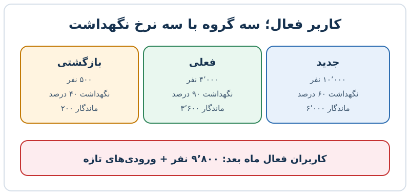

شمارش «کاربر فعال» ساده به نظر می‌رسد، اما همین عدد ساده اگر بد تعریف شود، تصمیم محصول و پیش‌بینی درآمد را هر دو منحرف می‌کند. در این مطلب می‌بینید **کاربر فعال** چگونه باید تعریف شود، چرا بازه زمانی اندازه‌گیری مهم است و چگونه تفکیک کاربران به سه گروه، پیش‌بینی درآمد را واقعی‌تر می‌کند.

## چرا ورود به برنامه برای فعال‌بودن کافی نیست؟

رایج‌ترین تعریف، کاربری است که فقط وارد برنامه شده است. مشکل این است که کاربری که ماهی یک بار وارد می‌شود و هیچ کاری نمی‌کند، «فعال» حساب می‌شود، در حالی که ارزش محصول را تجربه نکرده است. DAU (کاربر فعال روزانه) و MAU (کاربر فعال ماهانه) بدون قواعد دقیق تقریباً بی‌فایده‌اند.

تعریف بهتر دو جزء دارد:

- **عمل اصلی ارزش‌آفرین:** مثلاً در یک برنامه ورزشی، دیدن یک فعالیت، مرور خوراک یا ثبت تمرین؛ نه صرفاً ورود.
- **بازه زمانی مشخص:** مثلاً ورود و انجام یکی از آن اعمال در ۲۸ روز گذشته.

بازه ۲۸ روزه مزیت دارد: همیشه تعداد کامل هفته را پوشش می‌دهد و اثر روزهای هفته را حذف می‌کند.

## کدام بازه زمانی: روزانه، هفتگی یا ماهانه؟

بازه را الگوی طبیعی استفاده از محصول تعیین می‌کند. پیام‌رسان یا شبکه اجتماعی را هر روز باز می‌کنند، پس DAU معنا دارد. اما برنامه ثبت دویدن یا دوچرخه‌سواری را کسی هر روز استفاده نمی‌کند؛ اینجا شاخص هفتگی ناظر اصلی است و شاخص روزانه و ماهانه نقش کنترل‌کننده دارند. سرمایه‌گذاران برای قابل‌مقایسه‌بودن اغلب شاخص روزانه یا ماهانه را می‌خواهند، پس بهتر است هر سه را پایش کنید اما بدانید کدام یک با رفتار واقعی مشتری هم‌خوان است.

قاعده عملی: بازه اندازه‌گیری را با فاصله‌ای انتخاب کنید که انتظار دارید کاربر در آن ارزش دریافت کند.

## تفکیک کاربران فعال به سه گروه

همه کاربران فعال یکسان نیستند. تفکیک زیر به **حسابداری رشد** معروف است:

| گروه | تعریف | سؤال کلیدی |
|---|---|---|
| جدید | کاربری که تازه ثبت‌نام کرده است | آیا در هفته اول ماندگار می‌شود؟ |
| فعلی | کاربر جدیدی که ماندگاری اولیه را نشان داده یا از قبل فعال بوده | چقدر طول می‌کشد تا ترک کند؟ |
| بازگشتی | کاربر غیرفعالی که دوباره برگشته | چقدر خاموش بوده و چه چیزی او را برگردانده؟ |

برای هر گروه یک نرخ نگهداشت جدا محاسبه می‌شود: نرخ نگهداشت کاربر جدید، کاربر فعلی و کاربر بازگشتی. حتی بازگشتی‌ها را هم می‌توان بر اساس مدت خاموشی تقسیم کرد: کسی که ظرف ۲۸ روز برمی‌گردد با کسی که چند ماه غایب بوده انگیزه و پروفایل متفاوتی دارد.

مزیت عملی این تفکیک آن است که برای هر گروه اقدام متفاوتی طراحی می‌کنید؛ مثلاً آموزش برای جدیدها و پیام یادآوری یا تماس برای خاموش‌ها.

## فعال‌سازی؛ لحظه‌ای که کاربر «گرفتار» می‌شود

کلید نگهداشت، **فعال‌سازی** است: کاری که اگر کاربر در زمان کوتاهی انجام دهد، احتمال ماندنش به‌شدت بالا می‌رود. نمونه‌های مشهور:

- یک سرویس ذخیره‌سازی فایل دریافت که کاربری که در بازه اولیه یک فایل بگذارد، تقریباً ماندگار است.
- یک شبکه اجتماعی که هفت دوست در ده روز را نشانه ماندگاری می‌دانست.
- یک بازار آنلاین قطعات خودرو که اگر تعمیرگاه در هفت روز اول پنج سفارش ثبت کند، نگهداشتش از ۹۸ درصد بالاتر می‌رود.

برای یافتن آستانه خودتان، رفتار کاربران ماندگار و رفته را مقایسه کنید و رفتاری را بیابید که این دو را بهتر جدا می‌کند. بعد همه تلاش را روی رساندن کاربران به همان نقطه بگذارید.

## کاربر فعال؛ واحد اتمی درآمد

شاخص کاربر فعال فقط متریک محصول نیست؛ **واحد پایه درآمد** است، به‌ویژه وقتی اندازه قراردادها کوچک است، مدل رشد مصرفی است یا فروش از طریق خود محصول انجام می‌شود. یک مثال عددی ساده:

- ماه اول: ۱۰٬۰۰۰ کاربر فعال جدید با نگهداشت ماهانه ۶۰ درصد
- کاربران فعلی: ۴٬۰۰۰ نفر با نگهداشت ۹۰ درصد
- بازگشتی‌ها: ۵۰۰ نفر با نگهداشت ۴۰ درصد

کاربران فعال ماه بعد از این سه بخش می‌آیند: ۶٬۰۰۰ + ۳٬۶۰۰ + ۲۰۰ = ۹٬۸۰۰ نفر، به‌علاوه ورودی‌های تازه. اگر همه را یک گروه با نرخ میانگین می‌دیدید، خطای پیش‌بینی می‌خوردید، چون ترکیب گروه‌ها در طول زمان عوض می‌شود. وقتی درآمد هر کاربر فعال را در این تعداد ضرب کنید، پیش‌بینی درآمد بر پایه رفتار واقعی بنا شده است. برای تکمیل بحث، [سنجش درست نگهداشت خالص](/posts/2027/10/01/calculate-net-dollar-retention-correctly/)، [انواع ریزش مشتری](/posts/2027/07/31/saas-churn-types-measurement-mistakes/) و [معیارهای مبتنی بر مصرف](/posts/2027/06/29/usage-based-saas-metrics/) را ببینید.

## پرسش‌های متداول

**آیا MAU از DAU بهتر است؟**
هیچ‌کدام ذاتاً بهتر نیست؛ باید با رفتار طبیعی مصرف محصول هماهنگ باشد.

**چرا بازه ۲۸ روزه به ۳۰ روزه ترجیح داده می‌شود؟**
چون دقیقاً چهار هفته است و نوسان روزهای هفته را از بین می‌برد.

**تفکیک کاربران چه فایده‌ای برای مالی دارد؟**
نرخ نگهداشت هر گروه متفاوت است و پیش‌بینی درآمد با نرخ جدا دقیق‌تر می‌شود.

**فعال‌سازی را چطور پیدا کنیم؟**
رفتار اولیه کاربران ماندگار را با کاربران ریزشی مقایسه کنید و عملی را که بیشترین تمایز را دارد انتخاب کنید.

## جمع‌بندی

تعریف کاربر فعال باید به عمل ارزش‌آفرین و بازه زمانی متناسب با محصول گره بخورد. با تفکیک کاربران به جدید، فعلی و بازگشتی، هر گروه را جداگانه رصد کنید، آستانه فعال‌سازی را پیدا کنید و پیش‌بینی درآمد را بر شمار کاربران هر گروه و نرخ نگهداشت همان گروه بسازید.
