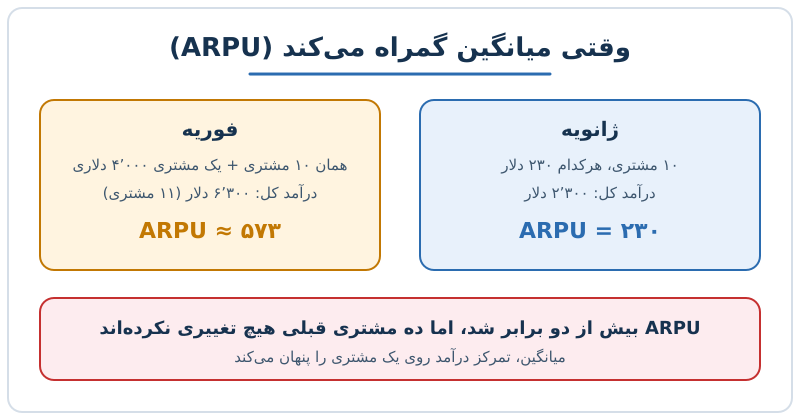

ARPU (میانگین درآمد به ازای هر مشتری یا کاربر) ساده‌ترین شاخصی است که تقریباً هر کسب‌وکار اشتراکی هر ماه گزارش می‌کند: درآمد کل تقسیم بر تعداد مشتریان. سادگی‌اش جذاب است، اما همین سادگی خطرناک می‌شود. در این نوشته می‌بینیم ARPU از کجا آمده، پنج دلیل که تنها نگاه‌کردن به آن گمراه‌کننده است و چطور باید کنار شاخص‌های دیگر خواندش.

## ARPU چیست و از کجا آمد؟

فرمول آن ساده است:

**ARPU = درآمد دوره ÷ تعداد مشتریان فعال همان دوره**

این شاخص ابتدا در صنعت مخابرات و در دوران گسترش خطوط موبایل رواج یافت. شرکت‌های اپراتور می‌خواستند بدانند هر مشترک به‌طور میانگین چقدر برایشان درآمد می‌سازد و گروه‌های مشترکان یا بازارهای مختلف را با هم مقایسه کنند. در آن صنعت، مشترکان نسبتاً شبیه هم بودند و میانگین معنا داشت.

بعدها با اشتراکی‌شدن بیشتر کسب‌وکارها، ARPU به بازی‌های آنلاین، پخش آنلاین و نرم‌افزار به‌عنوان خدمت (SaaS) هم رسید. مشکل اینجاست که مشتریان یک شرکت نرم‌افزاری اغلب بسیار متفاوت‌اند و میانگین، این تفاوت را پنهان می‌کند.

## محدودیت اول: معیار «خوب» وجود ندارد

بسیاری از شاخص‌های SaaS نرخ هستند و می‌توان آن‌ها را با یک مرجع سنجید. ARPU یک عدد مطلق است. ۱۰۰ دلار در یک صنعت می‌تواند عالی باشد و در صنعتی دیگر ضعیف. این عدد به نوع محصول، مدل قیمت‌گذاری، بخش بازار و حتی موقعیت جغرافیایی بستگی دارد.

پس مقایسه ARPU فقط میان شرکت‌هایی معنا دارد که مدل کسب‌وکار و مشتریان مشابهی دارند. برای بقیه، تنها مقایسه‌ی معنادار روند خود شرکت در طول زمان است.

## محدودیت دوم: ARPU می‌تواند بالا برود، در حالی که سلامت کسب‌وکار بدتر می‌شود

فرض کنید ده مشتری دارید که هرکدام ماهانه ۲۳۰ دلار می‌پردازند. ARPU برابر ۲۳۰ دلار است. ماه بعد یک مشتری بزرگ با پرداخت ۴٬۰۰۰ دلار اضافه می‌شود:

| ماه | تعداد مشتری | درآمد کل | ARPU |
|---|---|---|---|
| ژانویه | ۱۰ | ۲٬۳۰۰ | ۲۳۰ |
| فوریه | ۱۱ | ۶٬۳۰۰ | ≈ ۵۷۳ |

ARPU بیش از دو برابر شده، اما نه قیمت‌گذاری بهتر شده، نه ویژگی جدیدی فروخته شده، نه مشتریان قبلی بیشتر پرداخته‌اند. فقط یک مشتری وزنه‌ی میانگین را جابه‌جا کرده است.

در بسیاری از کسب‌وکارها درآمد هر مشتری از الگوی «توان‌قانونی» پیروی می‌کند: تعداد کمی مشتری بزرگ بخش عمده‌ی درآمد را می‌سازند و بقیه سهم کوچکی دارند، مثل درآمد فیلم‌ها در گیشه یا جمعیت شهرها. در چنین توزیعی میانگین عدد تقریباً بی‌معنایی است. بهتر است همراه آن میانه (median) یا درآمد هر گروه از مشتریان را هم ببینید.

## محدودیت سوم: ARPU سودآوری را نشان نمی‌دهد

ARPU فقط درآمد را می‌شمارد، نه هزینه‌ی جذب یا خدمت‌دهی را. اگر هر مشتری سالانه بیشتر از آنچه می‌پردازد برایتان هزینه داشته باشد، ARPU بالا هیچ کمکی نمی‌کند.

مسئله‌ی دیگر این است که ARPU نمی‌گوید آیا از هر مشتری حداکثر ارزش ممکن را می‌گیرید یا نه. فرض کنید هزار مشتری هرکدام ماهانه ۱۵ دلار می‌دهند. بعید است همه‌ی آن‌ها ارزش یکسانی برای محصول قائل باشند؛ بعضی حاضرند بسیار بیشتر بپردازند. اگر مدل قیمت‌گذاری شما سطح‌بندی (tier) بر اساس ارزش ندارد، بخشی از درآمد بالقوه از دست می‌رود و ARPU هیچ هشداری درباره‌اش نمی‌دهد.

## محدودیت چهارم: مشتری با ARPU بالا هم ریزش می‌کند

این تصور که «هرکس بیشتر می‌پردازد، راضی‌تر است» همیشه درست نیست. مشتری پرمصرف ممکن است فقط به‌خاطر قرارداد قفل شده باشد و در اولین فرصت برود. گاهی هم ARPU به‌خاطر کارمزد مصرف اضافه یا افزایش تهاجمی قیمت بالا رفته و مشتری ناراضی است.

ARPU درباره‌ی رضایت، وابستگی به محصول و ریسک ترک چیزی نمی‌گوید. برای بررسی این بخش به شاخص‌های ریزش و نگهداشت نیاز دارید؛ مطلب [ریزش مشتری، انواع و اشتباهات محاسبه](/posts/2027/07/31/saas-churn-types-measurement-mistakes/) این موضوع را بازتر کرده است.

## محدودیت پنجم: ARPU همان LTV نیست

گاهی ARPU با ارزش طول عمر مشتری (LTV) اشتباه گرفته می‌شود. LTV به ریزش وابسته است و در کنار هزینه‌ی جذب مشتری (CAC) تصویر اقتصاد واحد را می‌دهد؛ ARPU فقط یک بعد دارد. ممکن است تعداد مشتریان کم شود و ریزش بالا برود، اما چون مشتریان باقی‌مانده بزرگ‌ترند، ARPU بهتر به نظر برسد و درآمد کل و مسیر رشد در حال بدتر شدن باشد.

برای تصمیم‌های اقتصاد واحد، [محدودیت‌های LTV/CAC و بدیل دوره‌ی بازگشت هزینه](/posts/2027/08/04/ltv-cac-limits-payback-alternative/) و [محاسبه‌ی دوره‌ی بازگشت CAC](/posts/2027/09/21/cac-payback-period-calculation/) مکمل مناسبی هستند.

## چطور ARPU را درست بخوانیم؟

- آن را فقط نقطه‌ی شروع بدانید، نه شاخص نهایی.
- همراه تعداد مشتریان، نرخ ریزش، CAC و LTV گزارش کنید.
- ARPU را به‌تفکیک بخش مشتری (کوچک، متوسط، بزرگ) بسنجید، نه یک عدد کل.
- میانه و توزیع درآمد مشتریان را کنار میانگین ببینید.
- وقتی ARPU ناگهان جهش کرد، اول بپرسید: افزایش قیمت بوده، فروش بیشتر به مشتریان فعلی، یا ورود یک مشتری استثنایی؟

برای شاخص‌های مرتبط در مدل‌های مصرفی هم می‌توانید [شاخص‌های SaaS مبتنی بر مصرف](/posts/2027/06/29/usage-based-saas-metrics/) را ببینید.

## پرسش‌های متداول

### ARPU و ARPA چه فرقی دارند؟

ARPU درآمد را بر کاربر تقسیم می‌کند و ARPA بر حساب (account). اگر هر مشتری شرکتی با چند کاربر باشد، ARPA معمولاً مفیدتر است.

### ARPU را ماهانه حساب کنیم یا سالانه؟

هر دو رایج است؛ مهم این است که دوره ثابت بماند تا روند قابل مقایسه باشد. در مدل‌های اشتراک ماهانه، ARPU ماهانه رایج‌تر است.

### آیا ARPU بالا همیشه خوب است؟

نه. اگر به‌خاطر یک مشتری بزرگ، افزایش قیمت تهاجمی یا کاهش تعداد مشتریان کوچک بالا رفته باشد، می‌تواند نشانه‌ی ریسک باشد.

### جایگزین بهتر برای ARPU چیست؟

جایگزین واحدی وجود ندارد؛ ترکیب میانه‌ی درآمد مشتری، ARPU به‌تفکیک بخش، ریزش، CAC و LTV تصویر کامل‌تری می‌دهد.

## جمع‌بندی

ARPU شاخص مفیدی برای شروع گفتگو درباره‌ی درآمد هر مشتری است، اما به‌تنهایی معیار سلامت کسب‌وکار نیست. عدد مطلق است، با یک مشتری بزرگ جابه‌جا می‌شود، سودآوری و رضایت را نشان نمی‌دهد و جای LTV را نمی‌گیرد. آن را به‌تفکیک بخش‌ها و کنار ریزش و هزینه‌ی جذب بخوانید تا میانگین، واقعیت را پنهان نکند.
