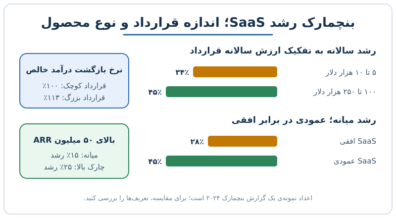

بنچمارک رشد SaaS به شما می‌گوید رشد ۲۰ یا ۳۰ درصدی در شرکت شما چه جایگاهی دارد. یک گزارش بنچمارک سال ۲۰۲۴ نشان می‌دهد معیار «رشد عالی» در شرکت‌های بزرگ بسیار پایین‌تر از تصور سال‌های ۲۰۲۱ و ۲۰۲۲ است. در این نوشته اعداد را کنار هم می‌گذاریم و می‌گوییم مدیر مالی با آن‌ها چه کند.

## چرا بنچمارک رشد بدون زمینه گمراه می‌کند

عدد رشد وقتی معنا دارد که با گروه درست مقایسه شود. رشد ۴۰ درصدی برای شرکتی با ۲ میلیون دلار درآمد تکرارشونده سالانه (ARR) معمولی است، ولی برای شرکتی با ۱۰۰ میلیون دلار ARR استثنایی. به همین دلیل بنچمارک‌ها معمولاً دو سطح می‌دهند:

- **میانه (حد «خوب»)**: نیمی از شرکت‌ها از این عدد بالاترند.
- **چارک بالا (حد «عالی»)**: فقط یک‌چهارم شرکت‌ها از آن عبور می‌کنند.

اگر رشد شما به چارک بالا برسد، یعنی از حدود ۷۵ درصد همتاها جلوترید. این تعبیر ساده، مبنای سه یافته‌ی بعدی است. برای ارزیابی اعتبار خود گزارش‌ها هم می‌توانید از [چک‌لیست سنجش کیفیت بنچمارک](/posts/2027/08/18/evaluate-benchmark-quality-checklist/) کمک بگیرید.

## رشد خوب و عالی در شرکت‌های بالای ۵۰ میلیون دلار ARR

در گروه شرکت‌های با ARR بیش از ۵۰ میلیون دلار، اعداد این‌طور بودند:

| سطح | رشد سالانه |
|---|---|
| خوب (میانه) | ۱۵٪ |
| عالی (چارک بالا) | ۲۵٪ |

یعنی شرکتی که در این اندازه ۲۵ درصد رشد می‌کند، در گروه برتر است. مثال عددی: شرکتی با ۶۰ میلیون دلار ARR و رشد ۲۵ درصدی، سال بعد حدود ۷۵ میلیون دلار می‌شود و ۱۵ میلیون دلار ARR جدید اضافه کرده است. همان شرکت با رشد ۱۵ درصدی فقط ۹ میلیون دلار اضافه می‌کند.

نکته‌ی عملی این است که فشار برای «رسیدن به ۵۰ درصد رشد» در این مقیاس معمولاً واقع‌بینانه نیست. اگر برای رسیدن به آن هزینه‌ی فروش و بازاریابی را بی‌حساب بالا ببرید، ممکن است رشد را با کارایی معامله کنید. برای سنجش اینکه رشد شما چقدر دوام دارد، [امتیاز دوام رشد](/posts/2027/10/27/growth-endurance-score-saas/) ابزار مناسبی است.

## SaaS عمودی در برابر SaaS افقی

SaaS عمودی نرم‌افزاری است که برای یک صنعت مشخص ساخته می‌شود، مثل نرم‌افزار کلینیک یا پیمانکاری. SaaS افقی برای بخش‌های مختلف مشتری کاربرد دارد، مثل نرم‌افزار مدیریت ارتباط با مشتری.

در همان گزارش، رشد شرکت‌های عمودی بالاتر بود:

| گروه | رشد میانه | رشد چارک بالا |
|---|---|---|
| SaaS عمودی | ۴۵٪ | ۱۰۰٪ |
| SaaS افقی | ۲۸٪ | ۵۶٪ |

دلیل‌های محتمل این فاصله منطقی است. محصول عمیقاً مخصوص یک صنعت، چسبندگی بیشتری دارد، امکان قیمت بالاتر می‌دهد و در برابر محصولات «یک‌اندازه برای همه» مقاوم‌تر است. توجه کنید این میانگین‌ها به معنای تضمین نیستند؛ نمونه‌ها محدود و ترکیب شرکت‌ها متفاوت است.

## اندازه قرارداد، رشد و نرخ بازگشت درآمد خالص

ارزش سالانه‌ی قرارداد (ACV) یعنی مبلغی که یک مشتری در سال می‌پردازد. گزارش دو گروه را مقایسه کرد:

| ACV | رشد | NRR |
|---|---|---|
| ۱۰۰ تا ۲۵۰ هزار دلار | ۴۵٪ | ۱۱۳٪ |
| ۵ تا ۱۰ هزار دلار | ۳۴٪ | ۱۰۰٪ |

NRR یا نرخ بازگشت درآمد خالص نشان می‌دهد درآمد مشتریان فعلی بعد از احتساب ریزش و ارتقا، یک سال بعد چند درصد مبلغ اولیه است. NRR برابر ۱۰۰ درصد یعنی ریزش و ارتقا یکدیگر را خنثی می‌کنند؛ ۱۱۳ درصد یعنی حتی بدون مشتری تازه، درآمد پایه ۱۳ درصد رشد می‌کند.

مثال: اگر ۱۰ میلیون دلار درآمد از مشتریان فعلی داشته باشید، با NRR برابر ۱۱۳ درصد سال بعد ۱۱.۳ میلیون و با ۱۰۰ درصد همان ۱۰ میلیون دلار خواهید داشت. تفاوت ۱.۳ میلیون دلار بدون هیچ هزینه‌ی جذب مشتری تازه است.

قراردادهای بزرگ‌تر دشوارتر و پرهزینه‌ترند: چرخه‌ی فروش طولانی‌تر است و ریسک از دست رفتن یک معامله بیشتر. اما نتیجه معمولاً رشد و ماندگاری بهتر است. برای مرور شاخص‌های پایه‌ی مقایسه، [راهنمای بنچمارک شاخص‌های SaaS](/posts/2027/04/14/saas-benchmark-metrics-operators/) را ببینید.

## بازگشت هزینه‌کرد نرم‌افزار؛ نشانه‌ای برای طرف خریدار

همین گزارش از بازگشت هزینه‌کرد نرم‌افزاری هم خبر می‌داد: هزینه‌ی خرید SaaS در سال ۲۰۲۴ حدود ۹ درصد در کل شرکت‌ها رشد کرده و در شرکت‌های کمتر از ۵۰۰ نفر رشد بسیار بیشتری ثبت شده بود. برداشت محتاطانه این است که شرکت‌های کوچک‌تر به‌جای استخدام بیشتر، به ابزار سرمایه می‌گذارند. برای فروشنده‌ی SaaS، این یعنی تقاضا در حال بازگشت است، ولی هر رقم کلی را باید با بازار خودتان تطبیق دهید.

## چه کنیم؟ چهار توصیه‌ی عملی

1. **خودتان را با گروه درست مقایسه کنید**: اندازه‌ی ARR، نوع محصول و ACV را مشخص کنید.
2. **به‌جای عدد رشد، کیفیت رشد را ببینید**: رشد همراه با NRR بالا ارزشمندتر از رشد با ریزش زیاد است.
3. **مسیر حرکت به قراردادهای بزرگ‌تر را برنامه‌ریزی کنید**: اگر فقط قراردادهای کوچک می‌بندید، هزینه‌ی کمیسیون و جذب نسبت به درآمد سنگین می‌ماند.
4. **هدف‌گذاری را واقع‌بینانه کنید**: در مقیاس بالا، ۲۵ درصد رشد می‌تواند موفقیت باشد.

## پرسش‌های متداول

**رشد خوب برای یک شرکت SaaS چند درصد است؟**
بستگی به اندازه دارد. در بالای ۵۰ میلیون دلار ARR میانه‌ی ۱۵ درصد و حد عالی ۲۵ درصد بود؛ در شرکت‌های کوچک‌تر اعداد بالاتر است.

**چارک بالا یعنی چه؟**
یعنی عملکرد شما از حدود ۷۵ درصد شرکت‌های گروه مقایسه بهتر است.

**چرا SaaS عمودی سریع‌تر رشد می‌کند؟**
چون محصول عمیق‌تر برای یک صنعت، چسبندگی و قدرت قیمت‌گذاری بیشتری دارد؛ البته نتیجه‌ی کلی همه‌ی شرکت‌ها یکسان نیست.

**آیا NRR بالای ۱۰۰ درصد همیشه خوب است؟**
معمولاً بله، چون یعنی مشتریان فعلی بیشتر خرج می‌کنند. فقط باید تعریف محاسبه را بررسی کنید.

## جمع‌بندی

بنچمارک رشد SaaS وقتی مفید است که اندازه، نوع محصول و ACV را کنار هم ببینید. در مقیاس بالا ۲۵ درصد رشد عالی است، SaaS عمودی سریع‌تر رشد می‌کند و قراردادهای بزرگ‌تر معمولاً رشد و NRR بهتری دارند. این اعداد را مبنای هدف‌گذاری واقع‌بینانه کنید و هر گزارش را با پرسش درباره‌ی نمونه و تعریف‌ها بخوانید.
