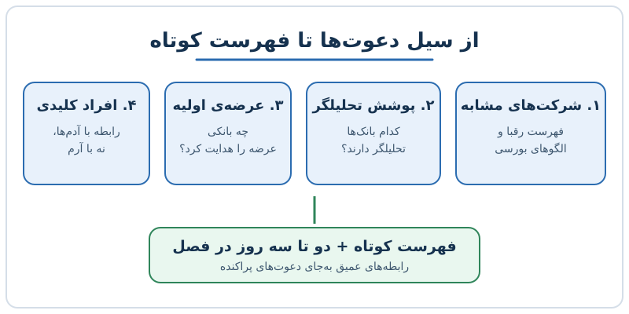

بودجه‌بندی زمان بیرونی مدیر مالی یعنی تصمیم بگیرید کدام درخواست‌های سرمایه‌گذاران، بانک‌های سرمایه‌گذاری و برگزارکنندگان همایش را بپذیرید و کدام را مؤدبانه رد کنید. وقتی شرکت رشد می‌کند، صندوق ایمیل پر از دعوت می‌شود و زمان، کمیاب‌ترین دارایی مدیر مالی است. این نوشته چارچوبی عملی برای گزینش و زمان‌بندی این رابطه‌ها می‌دهد.

## چرا با رشد شرکت دعوت‌ها سرازیر می‌شوند؟

تا وقتی شرکت کوچک است، کمتر کسی سراغ مدیر مالی می‌آید. اما با عبور درآمد از چند ده میلیون دلار، تصویر عوض می‌شود. تحلیلگران بانک‌ها، صندوق‌های سرمایه‌گذاری، مشاوران ادغام و تملک و برگزارکنندگان پنل و کنفرانس، همه می‌خواهند وقت شما را بگیرند. هر کدام دلیلی موجه دارند و هر کدام نام‌آشنا هستند.

مشکل اینجاست که بیشتر مدیران مالی به‌طور طبیعی دوست دارند همه را راضی کنند. ذهن برای «بله» گفتن دلیل می‌تراشد: «شاید روزی به کارمان بیاید»، «برند خوبی دارد»، «نمی‌خواهم بی‌ادب به نظر برسم». نتیجه تقویمی است که با جلسه‌های کم‌بازده پر شده و برای کار اصلی، یعنی بستن حساب‌ها، بودجه و همراهی با مدیرعامل، جا نمانده است.

## گام اول تا چهارم: ساختن فهرست هدفمند

راه‌حل، تبدیل یک تصمیم احساسی به یک جدول ساده است. چهار گام دارد:

1. **فهرست شرکت‌های مشابه عمومی.** در یک صفحه‌گسترده شرکت‌های بورسی هم‌حوزه‌ی خود را بنویسید؛ شرکت‌هایی که شبیه‌شان هستید و حتی آن‌هایی که دوست دارید روزی به آن‌ها برسید.
2. **پوشش پژوهشی.** مشخص کنید کدام بانک‌ها برای هر یک از این شرکت‌ها تحلیلگر سهام دارند و گزارش منتشر می‌کنند.
3. **سابقه‌ی عرضه‌ی اولیه.** در پیش‌نویس عرضه‌ی اولیه‌ی هر شرکت ببینید چه بانک‌هایی عرضه را هدایت کرده‌اند. بانکی که چند عرضه‌ی موفق در حوزه‌ی شما داشته، تجربه‌ی مرتبط دارد.
4. **افراد کلیدی.** از هر بانک یا صندوق، نام آدم‌هایی را بنویسید که واقعاً کار را پیش برده‌اند. رابطه را با فرد می‌سازید، نه با آرم یک سازمان.

خروجی کار فهرستی کوتاه است. به‌جای بیست بانک که هرکدام باید کمی توجه بگیرند، شاید پنج یا شش رابطه‌ی ارزشمند دارید که می‌توانید عمیق‌شان کنید.

### نمونه‌ی ساده‌ی امتیازدهی

برای اینکه جدول فقط توصیفی نماند، به هر بانک یا صندوق از صفر تا سه امتیاز بدهید:

| معیار | امتیاز ممکن |
|---|---|
| تحلیلگر فعال در حوزه‌ی شما | ۰ تا ۳ |
| سابقه‌ی عرضه‌ی اولیه در همین حوزه | ۰ تا ۳ |
| شناخت شخصی و سابقه‌ی گفت‌وگو | ۰ تا ۳ |

فرض کنید بانک الف نمره‌های ۳، ۲ و ۱ و بانک ب نمره‌های ۱، ۰ و ۰ گرفته‌اند. جمع بانک الف ۶ و بانک ب ۱ است؛ پس پاسخ دعوت بانک ب به‌طور پیش‌فرض «نه، با تشکر» خواهد بود، مگر دلیل تازه‌ای پیدا شود. معیار را روشن بنویسید تا بعدها بتوانید آن را بدون احساس گناه به کار ببرید.

## قاعده‌ی دو تا سه روز در فصل

گزینش فقط نیمی از کار است؛ نیمه‌ی دیگر چگونگی صرف زمان است. رویکردی که در عمل جواب می‌دهد، اختصاص دو تا سه روز کامل در هر فصل به کارهای بیرونی است. در این روزها جلسه‌های یک‌به‌یک، همایش‌ها و گفت‌وگوهای بازار را پشت سر هم برنامه‌ریزی کنید و تقویم را از پیش اعلام کنید.

چند دلیل برای تمرکز زمان وجود دارد:

- جلسه‌های پراکنده در میان کار روزانه معمولاً با حواس‌پرتی برگزار می‌شوند و طرف مقابل زود می‌فهمد که ذهن شما جای دیگری است.
- پاسخ‌دادن به پیام‌های داخلی میان گفت‌وگو، یا بیرون رفتن برای تماس با حسابدار ارشد، اعتبار را کم می‌کند.
- وقتی بازه‌ی بیرونی از پیش مشخص باشد، تیم داخلی هم می‌داند چه زمانی در دسترس نیست و کارها را همان‌طور تنظیم می‌کند.

اگر تقویم فصل بعد را همین حالا پر کنید، درخواست‌های ناخواسته را می‌توان به آن روزها حواله داد یا رد کرد. «بودجه» در اینجا همان معنای مالی را دارد: سقف مشخصی از زمان تخصیص می‌دهید و هر درخواست باید برای سهم خود رقابت کند.

## خط بکشید، نقطه نگذارید

یک اصل دیگر این است که رابطه را به‌شکل خط بسازید، نه نقطه. یک آشنایی در یک همایش یک نقطه است. چند گفت‌وگوی پیاپی طی ماه‌ها، با به‌روزرسانی‌های کوتاه و پاسخ‌های صادقانه، یک خط می‌سازد. این خط وقتی ارزش پیدا می‌کند که شرکت به سرمایه یا مشاوره نیاز دارد.

در عمل، برای جذب سرمایه معمولاً به همه‌ی سرمایه‌گذاران نیاز ندارید؛ به یک نفر مناسب نیاز دارید. و آن فرد معمولاً کسی است که شش ماه تا یک سال و نیم پیش با او آشنا شده‌اید و در این مدت اعتماد ساخته‌اید. برای آشنایی بیشتر با این مسیر، نوشته‌ی [گفت‌وگو با سرمایه‌گذاران پیش از جذب سرمایه](/posts/2027/09/15/talk-to-investors-before-fundraising/) را ببینید و برای دانستن انتظار انواع سهامدار، [انواع سهامداران و انتظارهای آن‌ها](/posts/2025/11/02/shareholder-types-investor-expectations-cfo/) را مرور کنید.

## چگونه «نه» بگوییم؟

پس از ساختن فهرست، رد درخواست‌ها ساده‌تر می‌شود چون معیار دارید. یک پاسخ کوتاه و محترمانه کافی است: از دعوت تشکر کنید، بگویید این فصل برنامه‌ی بیرونی‌تان پر شده و برای فصل بعد هم می‌توانند دوباره پیگیری کنند. برای تکنیک‌های بیشتر، [نه گفتن مدیر مالی](/posts/2024/11/15/cfo-saying-no-gracefully/) را بخوانید.

## پرسش‌های متداول

**آیا همه‌ی دعوت‌های بانک‌ها را باید رد کرد؟**
خیر. هدف رد همه نیست؛ هدف این است که فقط به رابطه‌هایی وقت بدهید که با فهرست و معیار شما می‌خوانند.

**این چارچوب برای شرکت کوچک هم لازم است؟**
وقتی دعوت‌ها کم‌اند، نیازی به فهرست رسمی نیست. اما خوب است ذهنیت آن را از همان ابتدا داشته باشید تا در زمان رشد غافلگیر نشوید.

**دو تا سه روز در فصل برای همه کافی است؟**
عدد ثابت نیست. بسته به مرحله‌ی شرکت، فصل عرضه‌ی عمومی یا جذب سرمایه ممکن است بیشتر لازم باشد، ولی اصل تمرکز و اعلام زودهنگام باقی می‌ماند.

**رابطه را چگونه زنده نگه داریم؟**
با به‌روزرسانی کوتاه و منظم، صداقت درباره‌ی نتایج و پاسخ‌گویی سریع. نقطه‌ی شروع می‌تواند یک [الگوی نامه‌ی به‌روزرسانی برای سرمایه‌گذاران](/posts/2027/07/17/investor-update-email-template/) باشد.

## جمع‌بندی

بودجه‌بندی زمان بیرونی یعنی نگاه به تقویم مثل یک بودجه: سقف مشخص، معیار انتخاب و بازده قابل انتظار. با چهار گام ساخت فهرست، امتیازدهی ساده، تخصیص دو تا سه روز در فصل و ساختن رابطه‌های عمیق، می‌توانید از سیل دعوت‌ها بدون از دست دادن فرصت‌های واقعی عبور کنید. تقویم فصل آینده‌تان را امروز با این معیار مرور کنید.
