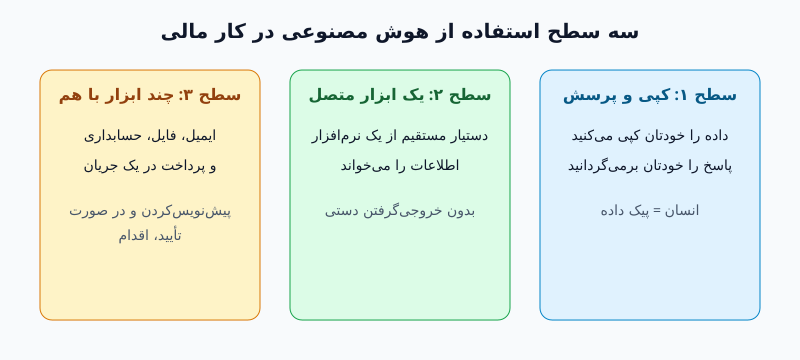

اتصال هوش مصنوعی به نرم‌افزارهای مالی یعنی دستیار هوشمند به‌جای اینکه منتظر بماند شما داده را کپی و در چت بچسبانید، مستقیم به ابزارهایی که هر روز استفاده می‌کنید وصل شود و اطلاعات را خودش بخواند. برای مدیر مالی، این تفاوت شبیه فرق «پیک داده بودن» با «تصمیم‌گرفتن» است. در این یادداشت سه سطح استفاده، نقش پروتکلی به نام MCP و چند احتیاط ضروری را مرور می‌کنیم.

## چرا کار مالی هر روز به چند ابزار پراکنده بند است؟

صبح یک مدیر مالی معمولاً همین مسیر را می‌رود: صندوق ایمیل، پیام‌رسان تیم، حساب بانکی و نرم‌افزار حسابداری. هر کدام بخشی از تصویر را دارند. بانک می‌گوید پول کجا رفته، حسابداری می‌گوید چه چیزی ثبت شده، و سامانه‌ی پرداخت می‌گوید چه صورتحساب‌هایی در انتظار پرداخت‌اند و هر پرداخت الان در چه مرحله‌ای است.

اگر برای پاسخ به یک پرسش ساده، مثل «چه صورتحساب‌هایی تا دو هفته‌ی دیگر سررسید می‌شوند؟»، باید وارد چند نرم‌افزار شوید و منوها را بگردید، بخش بزرگی از زمان صرف جابه‌جایی می‌شود، نه تحلیل.

## سطح اول: کپی‌کردن داده و پرسیدن

بیشتر افراد از همین‌جا شروع کرده‌اند. گزارشی را از نرم‌افزار خروجی می‌گیرید، در چت هوش مصنوعی می‌چسبانید، سؤال می‌پرسید و پاسخ را دوباره به فایل یا ایمیل خودتان منتقل می‌کنید.

این روش کار می‌کند، اما مشکل دارد: شما حامل همه‌چیز هستید. داده ممکن است کهنه شود، قالب‌بندی خراب شود یا بخشی جا بماند. در این سطح هوش مصنوعی فقط روی تکه‌ای از واقعیت قضاوت می‌کند که شما به او داده‌اید.

## سطح دوم: اتصال مستقیم به یک ابزار

در سطح دوم جهت کار برعکس می‌شود. به‌جای اینکه داده را نزد هوش مصنوعی ببرید، هوش مصنوعی را به نرم‌افزاری که قبلاً دارید وصل می‌کنید. حالا می‌پرسید «کدام صورتحساب‌ها این هفته سررسید دارند؟» و دستیار پاسخ را مستقیم از همان سامانه می‌خواند. لازم نیست ابتدا گزارشی بسازید و خروجی بگیرید.

برای پاسخ‌هایی مثل این هم کاربرد دارد:

- کدام تأمین‌کنندگان در ماه گذشته بیشترین پرداخت را گرفته‌اند؟
- کدام مشتریان بیش از ۳۰ روز تأخیر دارند؟
- پرداخت‌های ارسال‌شده‌ی این هفته به تفکیک تأمین‌کننده چقدر است؟

نکته‌ی مهم این است که اتصال، نرم‌افزار را کنار نمی‌گذارد. همه‌چیز هنوز روی همان نرم‌افزار اجرا می‌شود؛ شما فقط دیگر مجبور نیستید برای رسیدن به پاسخ در منوها قدم بزنید.

## سطح سوم: چند ابزار در یک جریان کاری

قدرت اصلی وقتی پیدا می‌شود که چند ابزار را کنار هم بگذارید. فرض کنید مشتری ایمیل می‌زند و پیش‌بینی مالی‌اش را می‌خواهد. پیش از این باید ایمیل را پیدا می‌کردید، فایل درست را از پوشه‌ها بیرون می‌کشیدید، ضمیمه می‌کردید و پاسخ می‌نوشتید. در سطح سوم از دستیار می‌خواهید ایمیل را پیدا کند، آخرین نسخه‌ی مدل را از فایل‌ها بردارد و یک پیش‌نویس پاسخ با اعداد کلیدی آماده کند.

مثال دیگر: متن جلسه‌های ضبط‌شده را با پیام‌های تیم مقایسه کنید تا فهرست تعهدهایی که مطرح شده ولی هنوز انجام نشده به‌دست آید. یا یک بررسی دوره‌ای انجام دهید که مشتریانی را نشان دهد که ۶۰ روز است از محصول استفاده نکرده‌اند و پیشنهاد اقدام بعدی بدهد.

حتی می‌توانید این گردش‌کارها را زمان‌بندی کنید تا بدون اینکه خودتان یادتان بیاید و درخواست بدهید، هر صبح یا هر هفته اجرا شوند. بزرگ‌ترین بهره اغلب همین‌جاست: کار تکراری جایی که فراموش می‌شد، دیگر فراموش نمی‌شود.

## MCP چیست و چرا مهم است؟

پشت این اتصال‌ها پروتکلی استاندارد به نام MCP (پروتکل زمینه‌ی مدل) قرار دارد. تا پیش از آن، وصل‌کردن دو برنامه معمولاً یک پروژه‌ی توسعه بود: برنامه‌نویس کد می‌نوشت، داده را وصل می‌کرد و یک صفحه برای استفاده می‌ساخت.

با MCP، اگر نرم‌افزاری «کانکتور» داشته باشد، این مرحله‌ها حذف می‌شود. شما فقط می‌نویسید چه می‌خواهید و دستیار از طریق کانکتور با نرم‌افزار حرف می‌زند. بنابراین ابزارهای بیشتری برای تیم‌های مالی کوچک هم در دسترس می‌شود، حتی بدون برنامه‌نویس.

## چهار احتیاط پیش از وصل‌کردن همه‌چیز

همه‌ی کانکتورها یک‌جور کار نمی‌کنند. بعضی فقط می‌خوانند و بعضی می‌توانند رکورد بسازند، داده را تغییر دهند یا ایمیل بفرستند. پیش از اتصال، این چهار اصل را رعایت کنید:

1. **از دسترسی فقط‌خواندنی شروع کنید.** تا جایی که ممکن است، ابتدا کانکتوری را فعال کنید که نمی‌تواند چیزی تغییر دهد. هوش مصنوعی فقط همان چیزی را می‌بیند که نقش کاربری شما در آن نرم‌افزار اجازه می‌دهد.
2. **برای کارهای حساس تأیید انسانی بخواهید.** ارسال پول، تأیید پرداخت یا ایمیل به مشتری بدون بازبینی شما نباید انجام شود. الگوی مطمئن این است: هوش مصنوعی پیش‌نویس می‌کند، شما تأیید می‌کنید.
3. **عددهای مهم را با منبع مقایسه کنید.** پیش از اینکه عددی از دستیار به مشتری، مدیرعامل یا گزارش رسمی برسد، آن را با نرم‌افزار مبدأ تطبیق بدهید.
4. **سیاست شرکت را بررسی کنید.** مطمئن شوید سازمان با اتصال داده‌های مالی به ابزار هوش مصنوعی موافق است و تعهدهای محرمانگی را نقض نمی‌کند.

درباره‌ی چارچوب کنترل، یادداشت [حاکمیت هوش مصنوعی در مالی](/posts/2024/08/27/ai-finance-governance-controls/) را ببینید. اگر می‌خواهید آهسته و مرحله‌به‌مرحله پیش بروید، [خزیدن، راه‌رفتن، دویدن در هوش مصنوعی مالی](/posts/2025/01/04/ai-for-finance-crawl-walk-run/) نقشه‌ی خوبی می‌دهد. برای انتخاب کاربردها هم [کجا هوش مصنوعی در مالی کار می‌کند](/posts/2024/12/01/ai-agents-finance-use-cases/) مفید است.

## پرسش‌های متداول

**آیا اتصال هوش مصنوعی به نرم‌افزار مالی امن است؟**
بستگی به نوع دسترسی دارد. کانکتور فقط‌خواندنی که از سطح دسترسی خود کاربر فراتر نمی‌رود، ریسک کمتری دارد. اتصال‌هایی که می‌توانند داده را تغییر دهند یا پیام بفرستند باید با تأیید انسانی همراه شوند.

**برای شروع به برنامه‌نویس نیاز دارم؟**
اگر نرم‌افزار شما کانکتور آماده داشته باشد، معمولاً نه. نیاز اصلی، تصمیم درباره‌ی دسترسی‌ها و تعریف روشن از کاری است که می‌خواهید خودکار شود.

**از کدام گردش‌کار شروع کنم؟**
از پرسش‌های خواندنی و تکراری شروع کنید، مثل سررسیدها، مانده‌ی مشتریان یا خلاصه‌ی جلسه‌ها. خطای این‌ها کم‌هزینه است و ارزش آن سریع دیده می‌شود.

**آیا می‌توانم به عدد خروجی هوش مصنوعی اعتماد کنم؟**
نه بدون بررسی. حتی وقتی دستیار مستقیم از منبع می‌خواند، عددهای مهم را پیش از ارائه با خود نرم‌افزار تطبیق بدهید.

## جمع‌بندی

سه سطح را به یاد بسپارید: کپی‌کردن داده، اتصال یک ابزار، و ترکیب چند ابزار در یک جریان. با پروتکل MCP، رسیدن به سطح دوم و سوم بسیار ساده‌تر شده، اما مسئولیت تصمیم همچنان با شماست. از دسترسی فقط‌خواندنی شروع کنید، کارهای حساس را به تأیید انسانی بسپارید و هر عدد مهم را با منبع تطبیق دهید. نتیجه کمتر شدن کار دستی و بیشتر شدن وقت برای تحلیل است.
