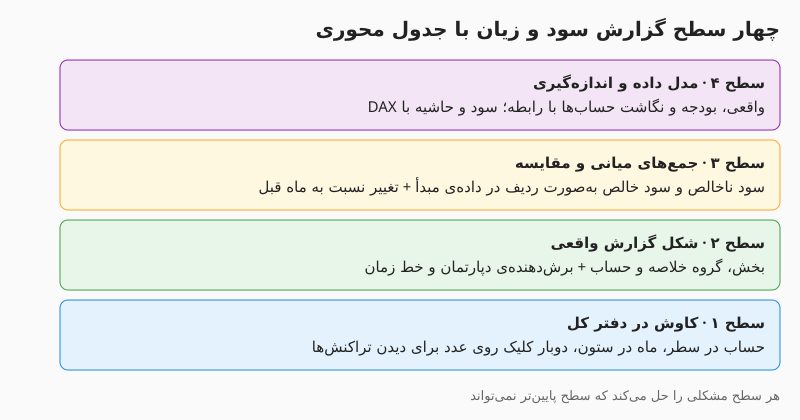

گزارش سود و زیان با جدول محوری یکی از سریع‌ترین راه‌ها برای رساندن داده‌ی دفتر کل به گزارش مدیریتی است؛ به شرط این‌که بدانید جدول محوری کجا همکاری می‌کند و کجا لج‌بازی. در این نوشته چهار سطح را مرور می‌کنیم، از کاوش ساده در تراکنش‌ها تا گزارشی که بودجه در برابر عملکرد و مقایسه ماه به ماه را کنار هم نشان می‌دهد.

## سطح اول: کاوش در دفتر کل

نقطه‌ی شروع همه، خروجی دفتر کل از نرم‌افزار حسابداری است؛ مثلاً همه‌ی تراکنش‌های چند سال اخیر. حساب را در سطرها، مبلغ را در مقادیر و تاریخ را در ستون‌ها بگذارید. اکسل تاریخ‌ها را خودش به سال، فصل و ماه گروه می‌کند و می‌توانید هر سال را باز کنید.

بعد زیر هر حساب، تأمین‌کنندگان را تو در تو بیاورید و «کلاس» یا مرکز هزینه را به فیلتر بالای جدول ببرید. حالا می‌دانید هر حساب دقیقاً چقدر و نزد چه کسانی خرج شده است.

مهم‌ترین ترفند این سطح «کاوش تا ریشه» است: روی هر عدد دوبار کلیک کنید تا اکسل برگه‌ای تازه با همه‌ی تراکنش‌های پشت آن عدد باز کند. هر وقت به کاوش در عددها فکر کردید، ذهنتان باید سراغ جدول محوری برود. پیش از درخواست بودجه از مدیر یک واحد هم همین نما را نشانش بدهید تا ببیند پولش تا امروز کجا رفته است.

یک نکته‌ی فنی: چیدمان را روی حالت جدولی بگذارید و گزینه‌ی تکرار برچسب همه‌ی آیتم‌ها را روشن کنید. آن‌وقت هر سطر حساب و تأمین‌کننده‌ی خودش را دارد و بارگذاری خروجی در سیستم یا پایگاه داده آسان‌تر می‌شود. اما این سطح هنوز شبیه گزارشی نیست که به مدیرعامل بدهید.

## سطح دوم: شکل یک گزارش سود و زیان واقعی

برای این‌که خروجی شبیه صورت سود و زیان شود، هر سطر داده باید برچسب‌هایی داشته باشد: بخش (درآمد، بهای تمام‌شده، هزینه‌های عملیاتی)، گروه خلاصه و دپارتمان. سلسله‌مراتب را به همین ترتیب بچینید: بخش، سپس گروه خلاصه، سپس حساب. درآمد و هزینه‌ها اول به گروه‌ها و بعد به حساب‌ها باز می‌شوند.

بالای صفحه یک خط زمان برای انتخاب ماه‌ها و یک برش‌دهنده (Slicer) برای دپارتمان اضافه کنید. حالا می‌توانید جدول را کپی کنید، روی هزینه‌های عملیاتی فیلتر کنید و آن را به نمودار دایره‌ای تبدیل کنید. دو جدول کاملاً جدا هستند، ولی با «اتصال گزارش‌ها» (Report Connections) هر دو از یک برش‌دهنده و یک خط زمان فرمان می‌گیرند. کافی است روی برش‌دهنده راست‌کلیک کنید و همه‌ی جدول‌هایی را که باید کنترل کند تیک بزنید.

## سطح سوم: جمع‌های میانی و مقایسه

اینجا جدول محوری شروع به مقاومت می‌کند. گزارش سطح دوم سود ناخالص، سود عملیاتی و سود خالص ندارد. راه داخلی اکسل «آیتم محاسباتی» (Calculated Item) است: وارد فیلد بخش می‌شوید و فرمول «درآمد منهای بهای تمام‌شده» را می‌نویسید.

مشکل این است که آیتم محاسباتی نازک‌خاطر است:

- وقتی حساب‌ها را هم به جدول برمی‌گردانید، سطرهای محاسباتی پر از صفر می‌شوند و باید فیلتر مقدار «برابر صفر نباشد» بزنید.
- اگر بخواهید یک عدد را دو بار برای مقایسه‌ی دوره‌ها نشان بدهید، خطا می‌گیرید.
- درصد از درآمد فقط در سطح بخش درست کار می‌کند، نه در گروه خلاصه و حساب.

راه عملی‌تر این است که سود ناخالص، سود عملیاتی و سود غیرعملیاتی را مستقیم در داده‌ی مبدأ، به‌صورت سطرهای مستقل، بسازید. جدول محوری آن‌ها را مثل هر خط دیگر می‌خواند و از آیتم محاسباتی بی‌نیاز می‌شوید. بعد از آن مقایسه ماه به ماه ساده است: در تنظیم «نمایش مقادیر به‌صورت»، گزینه‌ی تفاوت با ماه قبل را انتخاب کنید.

برای دیدن چارچوب کلی تحلیل انحراف می‌توانید [تحلیل انحراف بودجه و عملکرد](/posts/2022/04/14/budget-vs-actual-variance-analysis/) را هم بخوانید.

## سطح چهارم: مدل داده و اندازه‌گیری

اگر گزارش قرار است در جدول محوری بماند، هدف باید سطح چهارم باشد. به‌جای یک جدول تخت، عملکرد واقعی، بودجه، تراکنش‌ها و نگاشت حساب‌ها را با رابطه به هم وصل می‌کنید. سود ناخالص، سود عملیاتی، سود خالص و حاشیه‌ها دیگر سطر یا آیتم نیستند؛ «اندازه‌گیری» (Measure) با فرمول DAX‌اند که داخل مدل زندگی می‌کنند.

نتیجه یک جدول محوری است که بودجه در برابر عملکرد، تغییر ماه به ماه، برش‌دهنده‌ی دپارتمان، خط زمان و کاوش تا تراکنش را یک‌جا پوشش می‌دهد. بسیاری از دردسرهای سطح سوم اینجا از بین می‌رود. جزئیات ساخت مدل را در [داشبورد سود و زیان با پاور پیوت](/posts/2026/11/07/one-click-pnl-dashboard-power-pivot/) آورده‌ایم و برای نمایش بخش‌ها و دپارتمان‌ها [داشبورد سود و زیان بر اساس دپارتمان](/posts/2026/09/12/class-department-pnl-dashboards/) مکمل خوبی است.

## پیش‌نیاز همه‌ی سطح‌ها: برچسب‌گذاری حساب‌ها

هر چهار سطح یک شرط مشترک دارند: هر حساب دفتر کل باید به خط درست گزارش، مثلاً درآمد، بهای تمام‌شده یا هزینه‌ی عملیاتی، نگاشت شده باشد. هر ماه که داده‌ی تازه می‌رسد، همین نگاشت باید برای حساب‌های جدید هم انجام شود. اگر این جدول نگاشت نگه‌داری نشود، زیباترین مدل هم گزارش غلط می‌دهد. پس نگاشت را یک جدول مستقل و نگه‌داری‌شده بدانید، نه کاری که هر ماه دستی انجام می‌شود.

## پرسش‌های متداول

### کدام سطح برای شروع مناسب است؟
با سطح اول و دوم شروع کنید. اگر فقط یک گزارش ماهانه لازم دارید، همین دو سطح و چند سطر جمع میانی در داده‌ی مبدأ کافی است.

### چرا آیتم محاسباتی این‌قدر خطا می‌دهد؟
چون روی یک فیلد با سلسله‌مراتب کار می‌کند و با افزودن سطح‌های دیگر، یا نمایش یک مقدار دو بار، به هم می‌ریزد. ساختن جمع‌های میانی در داده‌ی مبدأ پایدارتر است.

### پاور پیوت حتماً لازم است؟
نه. اگر ساختار داده مرتب باشد و نگاشت حساب‌ها داشته باشید، سطح سوم برای بسیاری از گزارش‌ها کافی است. پاور پیوت وقتی ارزش دارد که بودجه، عملکرد و تراکنش را از چند منبع می‌آورید.

### برای مقایسه با دوره‌ی قبل چه کنیم؟
در سطح سوم از «تفاوت با ماه قبل» و در سطح چهارم از اندازه‌گیری‌های مخصوص دوره استفاده کنید. روش‌های مقایسه را در [مقایسه سود و زیان با دوره‌ی قبل و سال قبل](/posts/2026/09/28/pnl-comparison-prior-period-year/) مرور کرده‌ایم.

## جمع‌بندی

برای گزارش سود و زیان با جدول محوری، سطح مناسب را با نیاز گزارش انتخاب کنید: سطح یک برای کاوش، سطح دو برای شکل گزارش، سطح سه برای جمع‌های میانی و مقایسه، و سطح چهار وقتی بودجه و چند منبع داده در کار است. مهم‌تر از ابزار، ساختار داده و نگاشت درست حساب‌هاست؛ با این پایه، گزارش ماه بعد هم بدون ساختن دوباره‌ی جدول از صفر آماده می‌شود.
